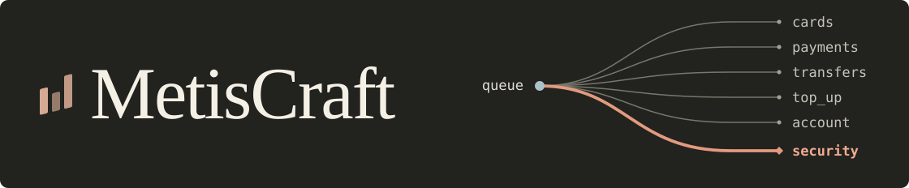
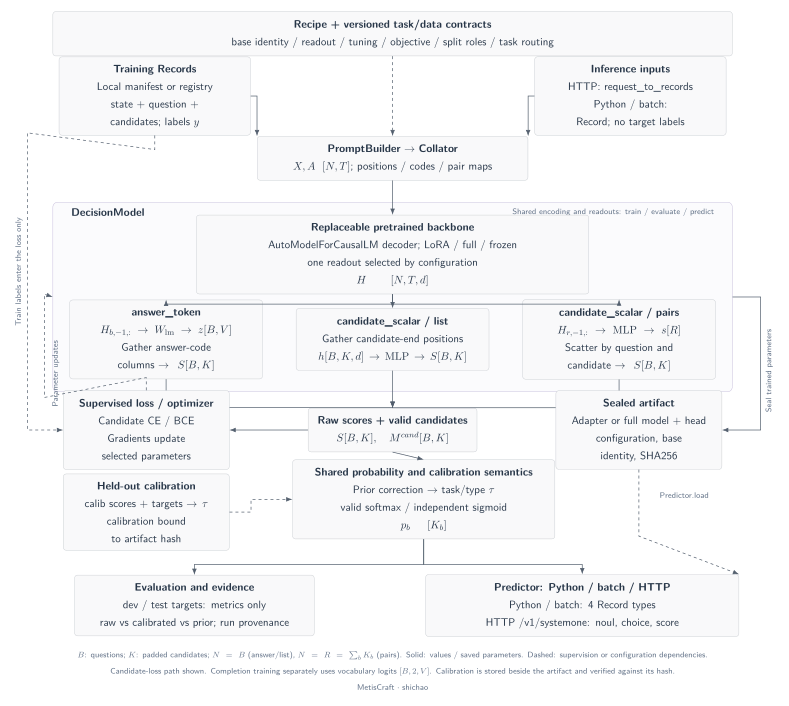
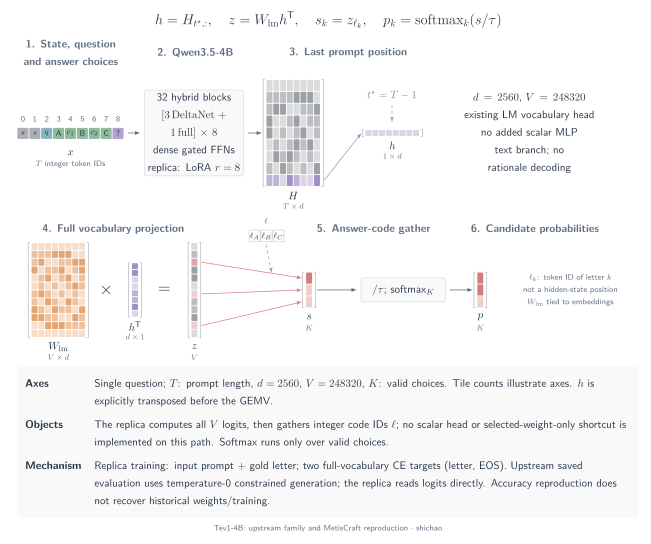

<h1></h1>

**English** · [简体中文](README_zh.md)　 |　 [PyPI](https://pypi.org/project/metiscraft/) · [Release 0.1.0](https://github.com/Shichaoxx/MetisCraft/releases/tag/v0.1.0) · [CI](https://github.com/Shichaoxx/MetisCraft/actions/workflows/ci.yml)

MetisCraft is a Python toolkit for training models that answer a question from a set of allowed answers. Given a report of a stolen card, one model can choose a support queue and separately estimate whether the case is urgent. A YAML recipe describes how to train, calibrate and evaluate that model. You can load the resulting artifact for batch prediction or serve it over HTTP.

| Read | What you’ll find |
| --- | --- |
| [**JevLike research**](https://shichaoxx.github.io/MetisCraft/en/tensor-analysis/introduction/) | How a model scores candidate answers, and what we know about the open implementations. |
| [**MetisCraft manual**](https://shichaoxx.github.io/MetisCraft/en/) | Installation, data formats, training recipes and serving interfaces. |
| [**Cookbook**](https://shichaoxx.github.io/MetisCraft/en/cookbook/) | Follow a real prediction, train a first model on CPU or adapt the example to your own task. |

## Train a first model on CPU

Start in a fresh Python 3.10 or 3.11 environment with a suitable PyTorch build. The example creates a tiny random model and synthetic data locally. Run these commands in a POSIX shell.

```bash
python -m pip install 'metiscraft[serve]==0.1.0'
metiscraft init my-first-judge
cd my-first-judge
python prepare.py
metiscraft data import dataset.yaml --data-root ./data
CUDA_VISIBLE_DEVICES='' OMP_NUM_THREADS=1 metiscraft train recipe.yaml
```

Open `report.md` in the run directory printed by training. The tutorial continues with evaluation, batch prediction and an HTTP request. [First model](https://shichaoxx.github.io/MetisCraft/en/cookbook/first-model/) · [Bring your own task](https://shichaoxx.github.io/MetisCraft/en/cookbook/own-task/) · [Installation and release wheels](https://shichaoxx.github.io/MetisCraft/en/installation/) · [Tested environments](https://shichaoxx.github.io/MetisCraft/en/compatibility/)

## How the routing example answers

> My card was stolen this morning and there are two payments on it that I did not make.

The cover illustrates a recorded response to this example message. Out of six queues the trained model picked `security`. A separate question, `urgent`, returned the probability of a yes answer. Here is the excerpt from run `20261105-101057-30757bf7`.

```json
{
  "queue": {"choice": "security", "confidence": 0.9999995054983101},
  "urgent": {"noul": 0.9999314182034214}
}
```

On 3,080 held-out messages, the model chose the correct queue **97.8%** of the time. A baseline using training-set label frequencies scored **24.7%**. The queue and urgency labels in this teaching task come from a fixed mapping of Banking77 intents. [Full request and response](https://shichaoxx.github.io/MetisCraft/en/cookbook/decision/) · [Recipe and results](https://shichaoxx.github.io/MetisCraft/en/recipes/banking77_support/)

### Which questions can I ask?

| Answer type | Example question | Python / batch | HTTP |
| --- | --- | :---: | :---: |
| Yes/no · `noul` | Is this message urgent? | ✓ | ✓ |
| Choice · `choice` | Which team should handle it? | ✓ | ✓ |
| Ordered score · `score` | How severe is the issue? | ✓ | ✓ |
| Multiple labels · `multi_label` | Which topics appear in this message? | ✓ | — |

A recipe can read logits for answer tokens or use a shared scalar head to score each candidate. Training supports LoRA, full fine-tuning and frozen backbones. Each run records the base model identity, data version, configuration and evaluation results. Temperature calibration uses a held-out split. [Data format](https://shichaoxx.github.io/MetisCraft/en/data/) · [Training and calibration](https://shichaoxx.github.io/MetisCraft/en/training/) · [Prediction and serving](https://shichaoxx.github.io/MetisCraft/en/serving/)

<details>
<summary>Inside the routing model · Qwen3-0.6B-Base and the scalar head</summary>

The recorded configuration pairs LoRA with a shared **1024 → 256 → 1** head. In the `list` layout, candidates share one causal sequence. The head reads the hidden state at the end of each candidate, assigns a score and normalizes the scores over the allowed answers.

<a href="https://shichaoxx.github.io/MetisCraft/en/tensor-analysis/architectures/">
  <picture>
    <source media="(prefers-color-scheme: dark)" srcset="docs/tensor-analysis/figures/metiscraft-architecture.en.dark.svg">
    
  </picture>
</a>

[Architecture atlas](https://shichaoxx.github.io/MetisCraft/en/tensor-analysis/architectures/) · [Five-minute tensor walkthrough](https://shichaoxx.github.io/MetisCraft/en/tensor-analysis/walkthrough/)

</details>

## Reproducing Tev1 4B

| Public development set | MetisCraft 4B | Original Tev1 4B | Difference |
| --- | ---: | ---: | ---: |
| Main decisions · 1,000 questions | **87.3%** (873/1,000) | 88.0% | −0.70 pp |
| Policy transfer · 300 questions | **99.33%** (298/300) | 100% | −0.67 pp |

The reproduction met both predeclared accuracy targets with one random seed on the same public questions. The original training history is unavailable. Calibration can worsen negative log-likelihood even when accuracy holds. [Reproduction record](https://shichaoxx.github.io/MetisCraft/en/reproductions/tev1/) · [Training recipe](https://shichaoxx.github.io/MetisCraft/en/recipes/tev1/)

<details>
<summary>Inside Tev1 4B · Qwen3.5-4B and answer tokens</summary>

The reproduction trains LoRA on letter and end-of-sequence targets using the full vocabulary head. At inference it selects the logits for the allowed answer codes. The reproduction record explains how this evaluation differs from the upstream constrained-generation protocol.

<a href="https://shichaoxx.github.io/MetisCraft/en/reproductions/tev1/">
  <picture>
    <source media="(prefers-color-scheme: dark)" srcset="docs/tensor-analysis/figures/tev1-architecture.en.dark.svg">
    
  </picture>
</a>

</details>

### Other recipes

| Dataset | What the run covers |
| --- | --- |
| [Banking77](https://shichaoxx.github.io/MetisCraft/en/recipes/banking77/) | Two readouts compared under the same protocol. A matched encoder baseline is still open. |
| [CLINC150](https://shichaoxx.github.io/MetisCraft/en/recipes/clinc150/) | **92.3%** accuracy on 5,500 test examples across 150 intents and one out-of-scope answer. The prior baseline scored 18.2%. |
| [BoolQ](https://shichaoxx.github.io/MetisCraft/en/recipes/boolq/) · [SST-5](https://shichaoxx.github.io/MetisCraft/en/recipes/sst5/) · [GoEmotions](https://shichaoxx.github.io/MetisCraft/en/recipes/go_emotions/) | Yes/no, ordered scores and multiple labels. The published GoEmotions results predate the prior-shift fix. |

[Ecosystem support matrix](https://shichaoxx.github.io/MetisCraft/en/support-matrix/) · [Known limitations](https://shichaoxx.github.io/MetisCraft/en/limitations/)

## Contributing

[Contributor guide](https://shichaoxx.github.io/MetisCraft/en/contributing/) · [Report a bug](https://github.com/Shichaoxx/MetisCraft/issues/new?template=bug_report.yml) · [Request a feature](https://github.com/Shichaoxx/MetisCraft/issues/new?template=feature_request.yml) · [Changelog](CHANGELOG.md)

The code is licensed under Apache 2.0. Datasets and base models have their own terms. Check the metadata and artifact `NOTICE` before distributing trained weights. [License](LICENSE)
