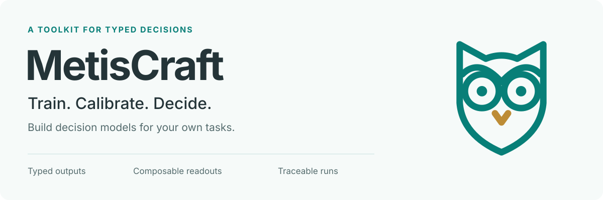
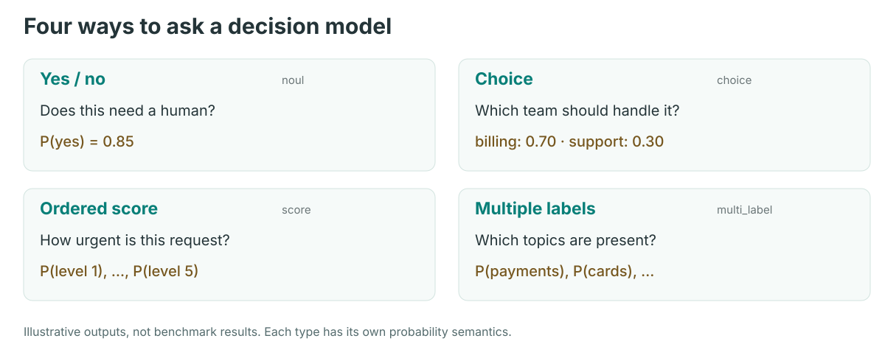
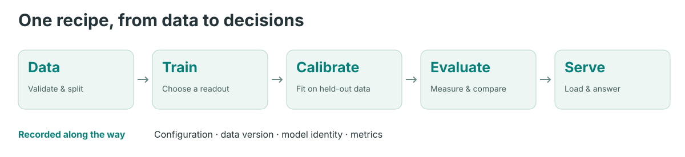

<p align="center">
  <picture>
    <source media="(prefers-color-scheme: dark)" srcset="docs/visuals/figures/hero-dark.svg">
    
  </picture>
</p>

<p align="center">
  <a href="https://github.com/Shichaoxx/MetisCraft/actions/workflows/ci.yml"></a>
  <a href="LICENSE"></a>
  <a href="docs/en/installation.md"></a>
  <a href="CHANGELOG.md"></a>
</p>

<p align="center">
  <b>English</b> · <a href="README_zh.md">简体中文</a><br>
  <a href="docs/en/quickstart.md">Quickstart</a> ·
  <a href="docs/en/index.md">Documentation</a> ·
  <a href="docs/support-matrix.md">Ecosystem</a> ·
  <a href="CONTRIBUTING.md">Contribute</a>
</p>

**Build decision models for your own tasks.** MetisCraft trains Jev-style System One models that answer typed questions in a forward pass. A recipe connects your data, model, readout, training, calibration, evaluation and deployment.

> **Public preview in preparation.** `0.1.0rc1` is a release candidate, not yet available on PyPI. APIs may change. See the [validation boundaries](docs/en/limitations.md) and [project status](docs/status.md).

## What does a decision look like?

Give the model a situation and a question with a defined answer space. Get a structured decision and probabilities you can evaluate and calibrate.

```json
{
  "state": "My card was stolen and I see two payments I did not make.",
  "questions": {
    "queue": {
      "type": "choice",
      "instructions": "Which team should handle this message?",
      "criteria": {"security": "Lost cards and unrecognised payments", "support": "General account help"}
    }
  }
}
```

The response contains `answers.queue.choice`, `confidence` and a probability for each option. The question defines the decision; your data teaches the model how to answer it. See a [recorded customer-routing example](recipes/banking77_support/README.md).

<picture>
  <source media="(max-width: 600px)" srcset="docs/visuals/figures/judgments-mobile.svg">
  
</picture>

## What you can build

| Capability | Available in the preview |
|---|---|
| Typed judgments | Yes/no, choice, ordered score and multiple labels through the Record API |
| Composable readouts | Answer-token logits or a candidate scalar head; LoRA, full or frozen backbones |
| Your own data | Import local Record JSONL with explicit train/calibration/evaluation splits |
| Calibration and evaluation | Task/type temperatures; NLL, Brier, ECE and task metrics; visible fallback selection |
| Recorded runs | Configuration, data version, source revision when available, environment and verified base identity |
| Serving | Python/batch prediction for all four types; `/v1/systemone` for yes/no, choice and score |

<picture>
  <source media="(max-width: 600px)" srcset="docs/visuals/figures/pipeline-mobile.svg">
  
</picture>

Calibration is fitted on held-out data. Its benefit must be measured on your evaluation distribution; it does not guarantee reliable confidence under distribution shift.

## Install

Use Python 3.10 or 3.11. Install a suitable PyTorch build for your hardware, then install from source:

```bash
git clone --branch toolkit-rewrite https://github.com/Shichaoxx/MetisCraft.git
cd MetisCraft
python -m pip install '.[serve]'
```

For development, use `python -m pip install -e '.[dev,serve,reproduce]'`. A locally built release wheel can also be installed with `python -m pip install './dist/metiscraft-0.1.0rc1-py3-none-any.whl[serve]'`. Full prerequisites and model preparation are in the [installation guide](docs/en/installation.md).

## Run your first workflow

This example uses a **tiny random model and synthetic data**. It checks the software workflow on CPU without downloading models; its scores are not model-quality results. Run it in a new workspace, outside the source repository:

```bash
metiscraft init my-first-judge
cd my-first-judge
python prepare.py
metiscraft data import dataset.yaml --data-root ./data
CUDA_VISIBLE_DEVICES='' OMP_NUM_THREADS=1 metiscraft train recipe.yaml
```

Training prints the run directory. Use its artifact to start a service:

```bash
CUDA_VISIBLE_DEVICES='' metiscraft serve <run-directory>/artifact
# In a second terminal in the same workspace:
curl -sS http://127.0.0.1:8000/v1/systemone \
  -H 'Content-Type: application/json' --data-binary @request.json
```

The [complete quickstart](docs/en/quickstart.md) also covers integrity checks, evaluation, batch prediction and stopping the server. Then [import your own data](docs/en/data.md) and replace the random model with a versioned pretrained base.

## Recipes and evidence

| Recipe | What it demonstrates | Evidence boundary |
|---|---|---|
| [Banking77](recipes/banking77/README.md) | Compare two readouts under one task | Qwen3-0.6B recipe results; no matched encoder comparison yet |
| [Customer routing](recipes/banking77_support/README.md) | Multiple business questions with one model | Derived from Banking77; a public example, not a production deployment claim |
| [BoolQ](recipes/boolq/README.md) · [SST-5](recipes/sst5/README.md) | Yes/no and ordered judgments | Dataset terms apply individually |
| [GoEmotions](recipes/go_emotions/README.md) | Independent probabilities for multiple labels | Reported training predates the prior-shift fix; corrected-code retraining is pending |
| [Tev1](docs/reproductions/tev1.md) | Rebuild published data and reproduce a recipe | **Partially met**: 2B test 86.4% vs published 4B 88.0%; transfer 92.0% vs 100%. Model size and readout comparison remain limitations |

MetisCraft is one part of a growing decision-model ecosystem. The [support matrix](docs/support-matrix.md) separates compatibility, implementation and reproduction evidence, including JevAny, ms-swift and Unsloth. It does not claim the first or only unified toolkit.

## Learn and contribute

- **Use it:** [Installation](docs/en/installation.md) · [Your own data](docs/en/data.md) · [Training](docs/en/training.md) · [Serving](docs/en/serving.md).
- **Understand it:** [Cookbook (中文)](docs/cookbook/README.md) · [Readouts and tensor diagrams (中文)](docs/readouts/README.md).
- **Help improve it:** [Contribution guide](CONTRIBUTING.md) · [Report a bug](https://github.com/Shichaoxx/MetisCraft/issues/new?template=bug_report.yml) · [Suggest a feature](https://github.com/Shichaoxx/MetisCraft/issues/new?template=feature_request.yml).
- **Follow development:** [Changes](CHANGELOG.md) · [Status and next steps](docs/status.md) · [Known limitations](docs/en/limitations.md).

## License

The code is [Apache-2.0](LICENSE). Datasets and base models retain their own terms; inspect the dataset metadata and artifact `NOTICE` before using or distributing trained weights.

MetisCraft takes its name from *mētis*, practical intelligence, and *craft*, the act of making. The owl mark draws on Athena's association with wisdom. Maintained by [shichao](https://github.com/Shichaoxx). The earlier Metis 0.1.0 is preserved at [`metis-v0.1.0`](https://github.com/Shichaoxx/MetisCraft/tree/metis-v0.1.0).
