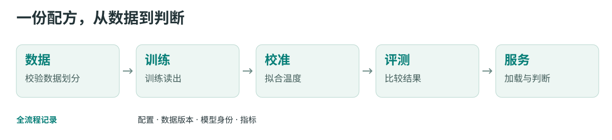

<p align="center">
  <picture>
    <source media="(prefers-color-scheme: dark)" srcset="docs/visuals/figures/wordmark-dark.svg">
    
  </picture>
  <br><b>JevLike 判断模型工具包</b>
</p>

<p align="center">
  <a href="https://github.com/Shichaoxx/MetisCraft/actions/workflows/ci.yml"></a>
  <a href="LICENSE"></a>
  <a href="docs/zh/installation.md"></a>
  <a href="CHANGELOG_zh.md"></a>
</p>

<p align="center">
  <a href="README.md">English</a> · <b>简体中文</b><br>
  <a href="docs/zh/cookbook/first-model.md">开始使用</a> ·
  <a href="docs/zh/cookbook/index.md">Cookbook</a> ·
  <a href="docs/zh/tensor-analysis/index.md">原理与张量解析</a> ·
  <a href="https://shichaoxx.github.io/MetisCraft/zh/">文档</a> ·
  <a href="CONTRIBUTING_zh.md">参与贡献</a>
</p>

**训练、复现与部署 JevLike 模型。** 同一工具包连接训练、校准、评测和服务；既能复现公开配方，也能接入自己的标注任务。

## 用 MetisCraft 复现 Tev1 4B

| 评测集 | MetisCraft 4B | 原版 Tev1 4B | 差距 |
|---|---:|---:|---:|
| 主决策集 · 1,000 题 | **87.3% · 873/1,000** | 88.0% | −0.70 个百分点 |
| 政策迁移 · 300 题 | **99.33% · 298/300** | 100% | −0.67 个百分点 |

**两项预定准确率验收均达标。** 单种子、同一批公开开发题；原始训练历史未恢复，校准可能恶化 NLL。[复现记录与限制](docs/reproductions/tev1.md) · [训练配方](recipes/tev1/README.md)。

[模型架构图谱](docs/zh/tensor-analysis/architectures.md)：对照 MetisCraft、Tev1 与开源实现的 token、主干、读出和训练依据。

## 一条消息，两个判断

> “My card was stolen this morning and there are two payments on it that I did not make.”

已有客服分流模型把这条消息分给 **security**，并回答“是否紧急”。下面是运行 `20261105-101057-30757bf7` 的真实响应摘录；消息为人工构造，概率不是准确率。

```json
{
  "queue": {"choice": "security", "confidence": 0.9999995054983101},
  "urgent": {"noul": 0.9999314182034214}
}
```

[完整请求与响应](docs/zh/cookbook/decision.md) · [配方与测试集结果](recipes/banking77_support/README.md)。同一运行的选择题准确率为 **97.8%**，先验基线为 **24.7%**（n=3,080）；这是一份教学场景配方。

## 四种判断，一条工作流

| 判断 | 可以问什么 | Python／批量 | HTTP |
|---|---|:---:|:---:|
| 是非 `noul` | 这条消息紧急吗？ | ✓ | ✓ |
| 选择 `choice` | 应该交给哪个团队？ | ✓ | ✓ |
| 等级 `score` | 严重程度是哪个等级？ | ✓ | ✓ |
| 多标签 `multi_label` | 包含哪些主题？ | ✓ | — |

答案 token 或逐候选标量头，两种读出按配方选择。支持 LoRA、全参和冻结基座；产物记录配置、数据版本、基座身份与评测结果。校准使用独立划分，收益需要在目标分布上验证。

<picture>
  <source media="(max-width: 600px)" srcset="docs/visuals/figures/pipeline-mobile-zh.svg">
  
</picture>

## 开始使用

使用 Python 3.10 或 3.11，并先为硬件安装合适的 PyTorch。当前可从源码安装：

```bash
git clone --branch release/0.1.0rc1 https://github.com/Shichaoxx/MetisCraft.git
cd MetisCraft
python -m pip install '.[serve]'
```

在源码目录之外运行：

```bash
metiscraft init my-first-judge
cd my-first-judge
python prepare.py
metiscraft data import dataset.yaml --data-root ./data
CUDA_VISIBLE_DEVICES='' OMP_NUM_THREADS=1 metiscraft train recipe.yaml
```

[跑通第一个模型](docs/zh/cookbook/first-model.md)包含安装、预期输出、评测和 HTTP 调用。它使用随机微型模型与构造数据，**无需 GPU 或下载权重**；完成后进入[自己的任务](docs/zh/cookbook/own-task.md)。

## 配方与结果

| 配方 | 已有证据 | 边界 |
|---|---|---|
| [客服分流](recipes/banking77_support/README.md) | 同一模型回答选择和是非题 | Banking77 衍生的教学场景 |
| [Banking77](recipes/banking77/README.md) | 同协议比较两种读出 | 尚无同协议 encoder 对照 |
| [Tev1 4B](docs/reproductions/tev1.md) | 87.3% vs 原版 88.0%；迁移 99.33% vs 100% | 准确率门槛已达标；历史训练与校准限制见记录 |
| [BoolQ](recipes/boolq/README.md) · [SST-5](recipes/sst5/README.md) · [GoEmotions](recipes/go_emotions/README.md) | 不同判断类型的配方与结果 | GoEmotions 数字来自修复前训练，详见配方 |

所有数字链接到配方或复现记录。[支持矩阵](docs/support-matrix.md)核对 JevAny、ms-swift 等生态项目；[能力边界](docs/zh/limitations.md)区分软件验证与模型效果。

## 文档与社区

[Cookbook](docs/zh/cookbook/index.md) · [原理与张量解析](docs/zh/tensor-analysis/index.md) · [五分钟技术导览](docs/zh/tensor-analysis/walkthrough.md) · [数据格式](docs/zh/data.md) · [训练与校准](docs/zh/training.md) · [预测与服务](docs/zh/serving.md) · [版本说明](CHANGELOG_zh.md)

欢迎[贡献](CONTRIBUTING_zh.md)、[报告问题](https://github.com/Shichaoxx/MetisCraft/issues/new?template=bug_report.yml)与[提出建议](https://github.com/Shichaoxx/MetisCraft/issues/new?template=feature_request.yml)。

[JevLike 引言：任务、数据与张量架构](docs/zh/tensor-analysis/introduction.md)

## 许可证

代码采用 [Apache-2.0](LICENSE)。数据集和基座模型保留各自条款；分发训练产物前请检查元数据和 `NOTICE`。
