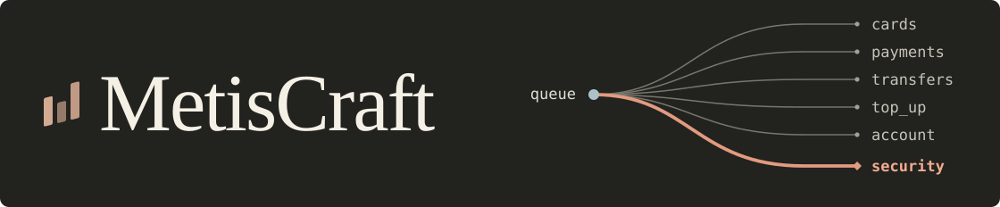
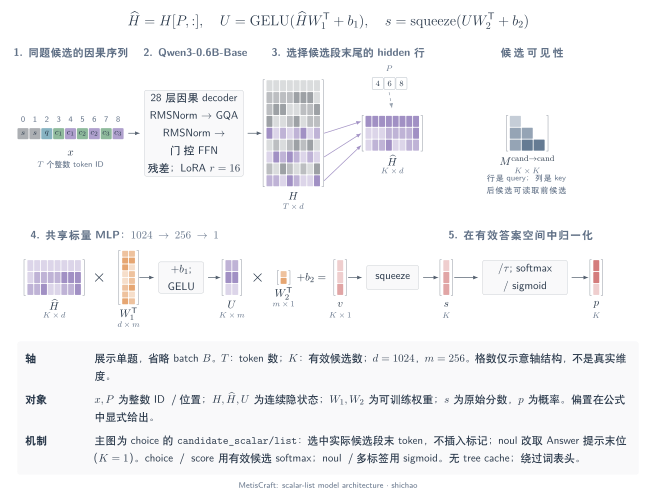
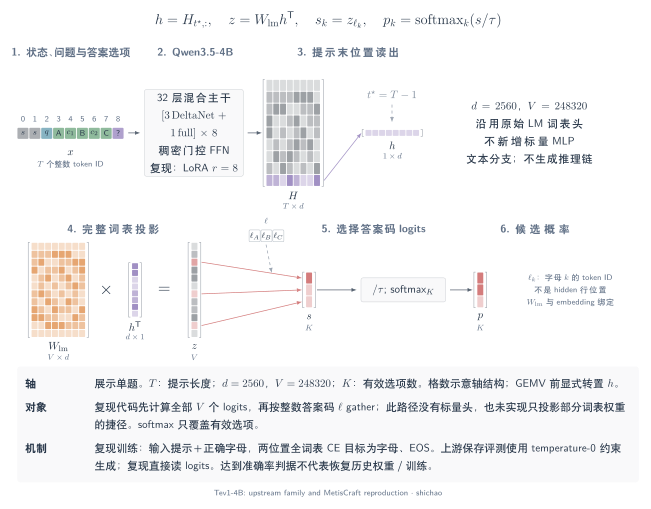

<h1></h1>

[English](README.md) · **简体中文**　 |　 [PyPI](https://pypi.org/project/metiscraft/) · [0.1.0 正式版](https://github.com/Shichaoxx/MetisCraft/releases/tag/v0.1.0) · [持续集成](https://github.com/Shichaoxx/MetisCraft/actions/workflows/ci.yml)

MetisCraft 是一个训练判断模型的 Python 工具包。比如，收到一条银行卡被盗的消息，模型可以从六个客服队列中选出接手的团队，也可以单独判断这件事是否紧急。用一份 YAML 配方就能训练、校准和评测这样的模型。训练产物既能用于批量预测，也能通过 HTTP 提供服务。

| 入口 | 可以读到什么 |
| --- | --- |
| [**JevLike 研究**](https://shichaoxx.github.io/MetisCraft/zh/tensor-analysis/introduction/) | 模型如何给候选答案打分，以及现有开源实现采用了哪些做法。 |
| [**MetisCraft 开发手册**](https://shichaoxx.github.io/MetisCraft/zh/) | 安装、数据格式、训练配方和服务接口。 |
| [**Cookbook 实践**](https://shichaoxx.github.io/MetisCraft/zh/cookbook/) | 读懂一次真实预测，在 CPU 上训练第一个模型，再换成自己的任务。 |

## 在 CPU 上训练第一个模型

准备一个新的 Python 3.10 或 3.11 环境，并安装适合本机的 PyTorch。示例会在本地生成一个随机初始化的微型模型和一份合成数据。在 POSIX shell 中依次运行下面的命令。

```bash
python -m pip install 'metiscraft[serve]==0.1.0'
metiscraft init my-first-judge
cd my-first-judge
python prepare.py
metiscraft data import dataset.yaml --data-root ./data
CUDA_VISIBLE_DEVICES='' OMP_NUM_THREADS=1 metiscraft train recipe.yaml
```

训练结束后，打开终端给出的运行目录，查看 `report.md`。接下来可以在同一目录评测模型、做批量预测，再发出第一条 HTTP 请求。[完整教程](https://shichaoxx.github.io/MetisCraft/zh/cookbook/first-model/) · [接入自己的任务](https://shichaoxx.github.io/MetisCraft/zh/cookbook/own-task/) · [安装与 wheel 下载](https://shichaoxx.github.io/MetisCraft/zh/installation/) · [已测试的环境](https://shichaoxx.github.io/MetisCraft/zh/compatibility/)

## 模型如何分派一条客服消息

> My card was stolen this morning and there are two payments on it that I did not make.

封面上的六条分支来自这条演示消息的实测响应。模型把它分给安全团队（`security`），同时回答了另一个问题（`urgent`），给出“紧急”的概率。下面摘自运行 `20261105-101057-30757bf7`。

```json
{
  "queue": {"choice": "security", "confidence": 0.9999995054983101},
  "urgent": {"noul": 0.9999314182034214}
}
```

在 3,080 条留出的测试消息上，该模型选对队列的比例为 **97.8%**。仅按训练集标签频率预测，准确率为 **24.7%**。这份教学配方按固定规则，将 Banking77 原有的意图标签映射为客服队列和紧急程度。[完整请求与响应](https://shichaoxx.github.io/MetisCraft/zh/cookbook/decision/) · [配方与测试结果](https://shichaoxx.github.io/MetisCraft/zh/recipes/banking77_support/)

### 可以问模型哪些问题？

| 判断类型 | 问题示例 | Python／批量 | HTTP |
| --- | --- | :---: | :---: |
| 是非 · `noul` | 这条消息紧急吗？ | ✓ | ✓ |
| 选择 · `choice` | 应该交给哪个团队？ | ✓ | ✓ |
| 等级 · `score` | 这个问题有多严重？ | ✓ | ✓ |
| 多标签 · `multi_label` | 这条消息涉及哪些主题？ | ✓ | — |

配方可以读取答案 token 的 logits，也可以用共享标量头为各候选答案打分。训练支持 LoRA、全参数微调和冻结基座三种方式。每次运行都记录基座模型标识、数据版本、配置和评测结果。温度校准使用单独留出的数据。[数据格式](https://shichaoxx.github.io/MetisCraft/zh/data/) · [训练与校准](https://shichaoxx.github.io/MetisCraft/zh/training/) · [预测与服务](https://shichaoxx.github.io/MetisCraft/zh/serving/)

<details>
<summary>客服模型的内部结构 · Qwen3-0.6B-Base 与标量头</summary>

这次实验使用 LoRA 和共享的 **1024 → 256 → 1** 标量头。在 `list` 布局中，多个候选答案位于同一条因果序列里。标量头读取每个候选段末尾的隐藏状态并打分，再将这些分数归一化为各答案的概率。

<a href="https://shichaoxx.github.io/MetisCraft/zh/tensor-analysis/architectures/">
  <picture>
    <source media="(prefers-color-scheme: dark)" srcset="docs/tensor-analysis/figures/metiscraft-architecture.zh.dark.svg">
    
  </picture>
</a>

[模型架构图谱](https://shichaoxx.github.io/MetisCraft/zh/tensor-analysis/architectures/) · [五分钟张量导览](https://shichaoxx.github.io/MetisCraft/zh/tensor-analysis/walkthrough/)

</details>

## Tev1 4B 复现结果

| 公开开发集 | MetisCraft 4B | 原版 Tev1 4B | 差距 |
| --- | ---: | ---: | ---: |
| 主决策集 · 1,000 题 | **87.3%**（873/1,000） | 88.0% | −0.70 个百分点 |
| 政策迁移 · 300 题 | **99.33%**（298/300） | 100% | −0.67 个百分点 |

复现使用一个随机种子，在同一批公开题目上达到了两项预先设定的准确率目标。我们未取得原版的训练记录。即便准确率持平，校准也可能使负对数似然变差。[复现记录](https://shichaoxx.github.io/MetisCraft/zh/reproductions/tev1/) · [训练配方](https://shichaoxx.github.io/MetisCraft/zh/recipes/tev1/)

<details>
<summary>Tev1 4B 的内部结构 · Qwen3.5-4B 与答案 token</summary>

复现沿用基座的完整词表头，用答案字母和序列结束符作为 LoRA 的训练目标。推理时只取允许的答案码所对应的 logits。复现记录说明了这套评测与上游约束生成协议的差别。

<a href="https://shichaoxx.github.io/MetisCraft/zh/reproductions/tev1/">
  <picture>
    <source media="(prefers-color-scheme: dark)" srcset="docs/tensor-analysis/figures/tev1-architecture.zh.dark.svg">
    
  </picture>
</a>

</details>

### 其他实验配方

| 数据集 | 实验内容 |
| --- | --- |
| [Banking77](https://shichaoxx.github.io/MetisCraft/zh/recipes/banking77/) | 在同一评测协议下比较两种读出方式。目前尚缺同协议的编码器基线。 |
| [CLINC150](https://shichaoxx.github.io/MetisCraft/zh/recipes/clinc150/) | 150 类意图加一个范围外选项。在 5,500 条测试样本上的准确率为 **92.3%**，按训练集标签频率预测的基线为 18.2%。 |
| [BoolQ](https://shichaoxx.github.io/MetisCraft/zh/recipes/boolq/) · [SST-5](https://shichaoxx.github.io/MetisCraft/zh/recipes/sst5/) · [GoEmotions](https://shichaoxx.github.io/MetisCraft/zh/recipes/go_emotions/) | 分别包含是非、等级和多标签判断。已公布的 GoEmotions 结果来自先验偏移修复前的训练。 |

[开源项目支持矩阵](https://shichaoxx.github.io/MetisCraft/zh/support-matrix/) · [能力边界](https://shichaoxx.github.io/MetisCraft/zh/limitations/)

## 参与项目

[贡献指南](https://shichaoxx.github.io/MetisCraft/zh/contributing/) · [报告问题](https://github.com/Shichaoxx/MetisCraft/issues/new?template=bug_report.yml) · [提出功能建议](https://github.com/Shichaoxx/MetisCraft/issues/new?template=feature_request.yml) · [版本记录](CHANGELOG_zh.md)

代码采用 Apache 2.0 许可证。数据集和基座模型各有使用条款，分发训练权重前请检查元数据及产物中的 `NOTICE`。[许可证](LICENSE)
