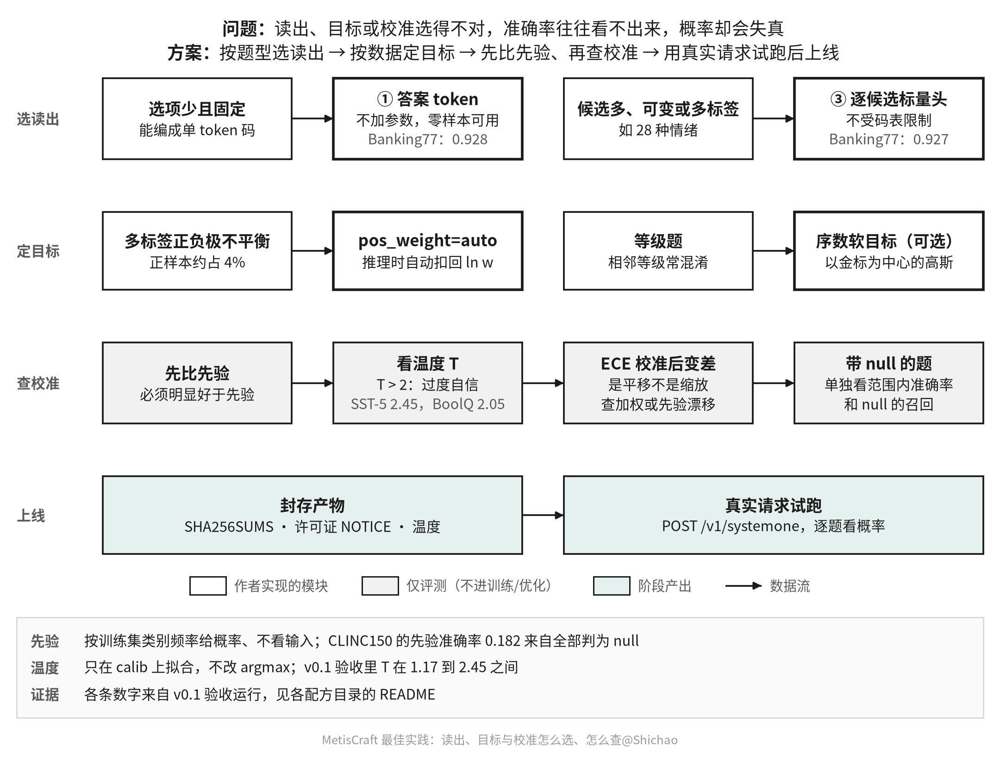

# 最佳实践

这些做法来自 v0.1 的验收运行（Qwen3-0.6B，单卡），每条都附真实数字，详见各配方目录的 README。原理见[原理篇](principles.md)。

## 读出

1. **选项少且固定时，① 答案 token 就够用**。① 不加新参数，还保留零样本能力。Banking77 的 77 个选项都能编成单 token 码，同协议下 ① 的 test 准确率 0.928，③ 是 0.927。
2. **候选多、选项集合会变、或者要多标签时，用 ③ 逐候选标量头**。③ 不受码表限制；训练时保持 `shuffle_train: true`，避免模型记住候选的位置。
3. **想对照两种读出，只改 `readout.kind` 一行**，其余设置不动，比较才有意义。

## 训练目标

4. **多标签的正负样本极不平衡时，可以用 `objective.pos_weight: auto`，但推理必须把 $\ln w$ 扣回来**。MetisCraft 会把训练时实际用的 $w$ 写进产物，推理和校准前自动扣除。不扣的症状很明显：平均预测概率远高于真实频率，温度校准后 ECE 不降反升。GoEmotions 就是例子：平均预测概率 0.151，真实频率 0.042，ECE 从 0.109 升到 0.118；按修复后的规则离线扣除后，ECE 降到 0.002，NLL 从 0.221 降到 0.076（先验 0.148）。
5. **等级题可以考虑序数软目标**（`objective.kind: ordinal_soft`）：以金标等级为中心给相邻等级一些概率。v0.1 的 SST-5 配方没有用它，效果还没有在验收中对照过。
6. **改微批大小、梯度累积或卡数，不会改变训练目标**。损失按全局题数归一，所以显存不够时可以减小 `batch_size`、增大 `grad_accum`，有效批量不变。候选多的任务（CLINC150 每题 151 个候选）就是用微批 4、累积 4 跑的。

## 校准与诊断

7. **每份报告先和先验比**。先验按训练集的类别频率给概率、不看输入。不同任务的先验差别很大：CLINC150 的先验准确率 0.182（全部判为 null）；客服分流"是否紧急"的先验准确率 0.870（大多数消息不紧急），所以 0.986 要和 0.870 比，而不是和 0.5 比。
8. **温度校准一定要做，而且只在 calib 上拟合**。v0.1 验收里温度在 1.17 到 2.45 之间，说明微调后的模型普遍过度自信；校准后 ECE 都明显下降，例如 BoolQ 从 0.094 降到 0.024，CLINC150 从 0.045 降到 0.019，SST-5 从 0.270 降到 0.040。
9. **$T>2$ 是过度自信的信号，训练轮数多时常见**（SST-5 训 3 轮，$T=2.45$；BoolQ 训 2 轮，$T=2.05$）。部署须沿用离线验证过的校准规则，并保留校准前后指标；分布变化时温度校准也可能恶化指标，见 [Tev1 的校准限制](../reproductions/tev1.md)。
10. **校准后 ECE 变差，问题通常是平移而不是缩放**。温度只能缩放 logit，修不了整体偏移；先查训练是否加了权重（第 4 条），或者训练与评测的先验是否差得很远。
11. **等级题同时看期望分的 MAE**。温度会让分布变软、期望分向中间靠，所以 SST-5 校准后 NLL 从 1.380 降到 1.014，MAE 却从 0.506 升到 0.559。按用途选择报准确率、期望分还是完整分布。
12. **带 null 选项的选择题，要单独看范围内准确率和 null 的召回、精确率**。CLINC150 的 test 准确率 0.923 是混合结果：范围内 0.959，范围外（null）召回只有 0.765，判为 null 的精确率是 0.971。训练集里 null 只占约 1.6%，模型就倾向于少判 null；需要拒答的场景应补充 null 样本。

## 数据与划分

13. **固定来源版本，写明许可证和条款**。内置数据在注册表声明，自有数据使用[导入清单](../zh/data.md)。`NOTICE` 保留限制标记，未解释条款标为未验证；使用许可须核对原声明。不要用 Jev 或 TypeSafe 接口的输出做训练数据，其条款禁止这样做。
14. **同一份材料派生的题共用 `group`**，切分时整组落在同一边。内置数据准备按评测集优先去重；自有数据导入保留显式划分，遇到拟合与评测用途重叠会报错。
15. **calib 只拟合温度，dev 用来选择，test 在封存产物之后只评一次**。

## 可追溯

16. **正式结果在干净的提交上跑**。工作区有未提交的改动时，运行会记成 dirty 并保存 `git.diff`；只有未跟踪文件时同样记成 dirty，但没有 `git.diff`，配方说明和交付报告会把它注明为"已跟踪的代码与提交一致"。
17. **报告里的每个数字都带运行 id**，回到运行目录就能看到配置、提交、环境、数据版本和逐题预测。
