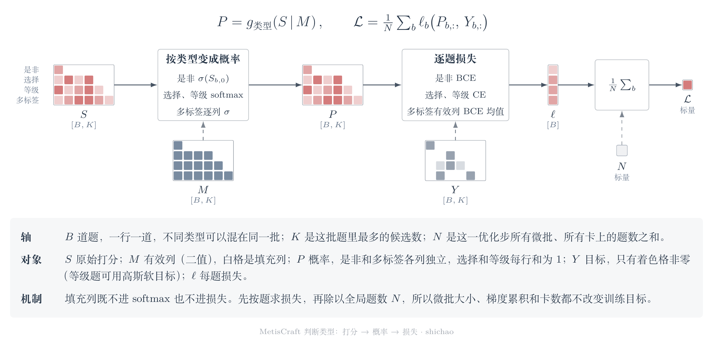
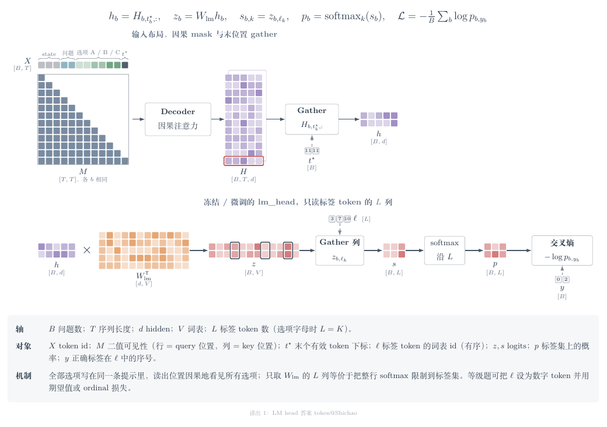
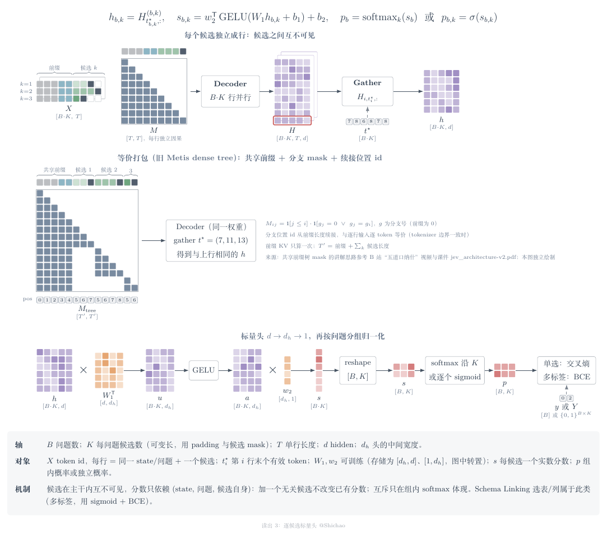
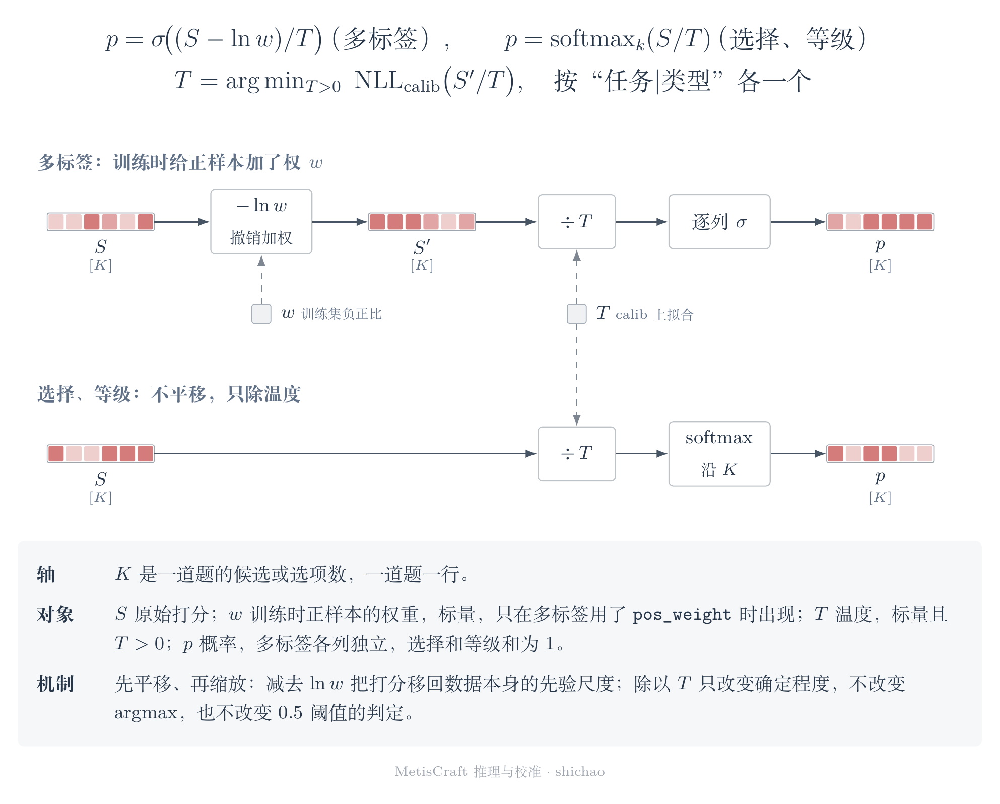

# 原理

MetisCraft 训练的是 Jev 类（System One）决策模型：读一次输入，一次前向就给出带类型的判断和校准过的概率，不生成推理链。本篇按数据流讲每一步在算什么，公式都对应到代码；规范性的细节见 [`design.md`](../design.md)。

## 1. 一条记录

数据契约沿用 Jev 的请求格式：`state` 是要判断的材料，`questions` 里每道题有类型、说明和选项。MetisCraft 把每道题拆成一条记录。下面是银行客服分流场景里的一条真实记录（选项只留两个）：

```json
{
  "id": "banking77_support:train:0:queue",
  "task_id": "banking77_support",
  "group": {"id": "banking77_support:train:0"},
  "input": {
    "context": {"state": "I am still waiting on my card?"},
    "query": "Which support queue should handle this customer message?"
  },
  "question": {
    "type": "choice",
    "allow_null": false,
    "options": [
      {"id": "cards", "text": "Ordering, delivering, activating, linking or replacing cards; ..."},
      {"id": "payments", "text": "Card payments, cash withdrawals, refunds, fees, ..."}
    ]
  },
  "supervision": {"kind": "choice", "labels": "cards"},
  "provenance": {"source": "PolyAI/banking77@1846984189f2bc0ac51c6fc3a600fa9e1714e0c6", "split": "train", "index": 0}
}
```

- `group`：同一份材料派生的所有题共用一组，切分时整组落在同一边，避免同一句话一半在训练、一半在评测。
- `provenance`：记录上游仓库、revision、原始划分和行号，任何一条都能追回源头。
- 代码：`data/contract.py`（记录结构）、`data/jev.py`（与官方请求格式互转）。

## 2. 四种判断类型：同一个打分矩阵，不同的概率和损失

不论用哪种读出，模型对一批 $B$ 道题都先给出打分矩阵 $S\in\mathbb{R}^{B\times K}$，$K$ 是这批题里最多的候选数；掩码 $M\in\{0,1\}^{B\times K}$ 标出每道题真正有效的列。判断类型只决定"打分怎样变成概率、损失和决策"。



| 类型 | 用到的列 | 概率 | 训练损失 | 决策 |
|---|---|---|---|---|
| 是非 noul | 第 0 列 $z$ | $p=\sigma(z)$ | 二元交叉熵 | $p\ge 0.5$ |
| 选择 choice | 有效列（可含 null 选项） | $p=\mathrm{softmax}(S_{b,:}\mid M)$ | 交叉熵（目标可以是软标签） | argmax，选中 null 即弃答 |
| 等级 score | $L$ 个有序等级 | 同 choice | 交叉熵；可换成以金标等级为中心的高斯软目标 | argmax，另给期望分 $\sum_i i\,p_i$ |
| 多标签 multi_label | 每个候选一列 | $p_k=\sigma(S_{b,k})$，各列独立 | 逐候选二元交叉熵，在有效列上取平均 | 每列 $p_k\ge 0.5$ |

代码：`judgments/__init__.py` 的 `target_vector`、`batch_loss`、`probabilities`、`decide`。

## 3. 两种读出：打分从哪来

### ① 答案 token

把选项写进提示，每个选项配一个码（A、B、C……，超过 26 个时接 AA、AB 等），只保留在分词器里是单个 token 的码。模型读完提示后，取最后一个位置的隐藏状态 $h_T\in\mathbb{R}^{d}$，经语言模型输出层得到全词表 logits，再按每道题的选项码取出 $K$ 列：

$$z_k = W_{\mathrm{lm}}[c_k]\cdot h_T,\qquad S_{b,:}=(z_1,\dots,z_K).$$

是非题用"是""否"两个码，打分取 $z_{\text{是}}-z_{\text{否}}$。



- 不加新参数，直接复用预训练的输出层，所以没训练时也能零样本作答。
- 受码表限制：所有选项都要能编成单 token 的码。
- 代码：`modeling/model.py` 的 `DecisionModel.forward`（`answer_token` 分支）、`modeling/prompts.py` 的 `build_codebook`。

### ③ 逐候选标量头

候选依次写在提示末尾（list 布局）。取每个候选最后一个 token 的隐藏状态，过一个小 MLP 得到一个标量：

$$S_{b,k}=\mathrm{MLP}\big(h_{t_k}\big),\qquad t_k=\text{第 }k\text{ 个候选的末位位置}.$$

pairs 布局则是每个候选单独拼成一条序列，用作对照。



- 候选数不受码表限制，天然支持多标签和数量可变的选项。
- 多了一个要训练的头；训练时打乱候选顺序（`shuffle_train`），避免模型记住位置。
- 代码：`modeling/model.py` 的 `ScalarHead` 与 `DecisionModel.forward`（`candidate_scalar` 分支）。

两种读出只差配方里的 `readout.kind` 一行。在 Banking77（77 个选项）上同协议对照，① 与 ③ 的 test 准确率分别是 0.928 和 0.927，见 [Banking77 的配方说明](../../recipes/banking77/README.md)。

## 4. 损失按全局问题数归一

一个优化步里有多个微批，多卡时还有多份。每个微批的题数可能不同：同一条客服消息派生两道题，混合任务的批次里题型也不一样。如果先在微批内取平均再平均，题多的微批就被低估了。MetisCraft 先把这一步里所有微批、所有卡上的题数加起来得到 $N$，每个微批回传

$$\frac{\text{world}}{N}\sum_{q\in\text{微批}}\ell_q ,$$

DDP 在卡间对梯度取平均（除以 world），合起来正好是 $\nabla\frac{1}{N}\sum_{q}\ell_q$，即全局按题平均。所以"微批 $b$、累积 $k$ 步"和"一次 $k\cdot b$"得到的梯度在数值上一致，换卡数也不改训练语义。

代码：`train/loop.py` 的 `accumulate`；等价性测试是 `tests/modeling/test_train_calibrate.py::test_gradient_accumulation_matches_one_big_batch`。

## 5. 校准：先回到数据本身的先验尺度，再按类型除温度



1. **撤销正样本加权**。多标签可以用 `objective.pos_weight` 给稀有的正样本加权 $w$。加权后的交叉熵最优点会把每个正样本的赔率乘上 $w$，学到的 logit 整体高出 $\ln w$。产物会记下训练时实际用的 $w$，推理时先减去它：$S' = S-\ln w$。不扣的话，概率会系统性偏高，而且温度只能缩放、修不了平移。GoEmotions 验收就是这样暴露出问题的。代码：`judgments.prior_shift`、`evaluate/infer.py` 的 `predict`。
2. **按类型除温度**。$p=\mathrm{softmax}(S'/T)$ 或 $\sigma(S'/T)$。每个"任务|类型"一个温度 $T$，在独立的 calib 划分上用 LBFGS 最小化 NLL 拟合，范围限制在 $[0.05, 20]$；某个任务样本不足时，退回同类型的共用温度 `*|类型`。代码：`calibrate.py` 的 `fit_calibration`、`temperature_for`。
3. **决策不变**。$T>0$ 时，softmax 的 argmax 不变，$\sigma(s/T)\ge 0.5$ 当且仅当 $s\ge 0$，所以温度只改"有多确定"，不改"选哪个"。第 1 步的偏移会改变多标签的决策，这是有意为之：它让 0.5 的阈值重新对应真实频率。

v0.1 验收里拟合出的温度在 1.17 到 2.45 之间，说明微调后的模型普遍过度自信；温度把 ECE 降了一半以上，例如 BoolQ 从 0.094 降到 0.024，SST-5 从 0.270 降到 0.040。

## 6. 评测口径

- **ECE**：15 个等宽分箱。选择和等级取 top-1 概率作置信度，是非和多标签的每个候选取正类概率。口径写在报告开头，所有任务共用。
- **NLL、Brier**：与 ECE 一起报，避免只看一个校准指标。
- **先验基线**：每个（任务，类型，选项集合）在训练集上的平均目标，不看输入。每份报告都和它并列，先确认模型确实学到了东西。
- **划分**：calib 只用来拟合温度，dev 用来选择，test 只在封存产物之后评一次。

代码：`evaluate/metrics.py`。

## 7. 可追溯

每次运行一个目录：完整配置及其哈希、git 提交（有未提交改动时连同 diff）、环境、数据版本、基座身份、训练日志、产物、校准和评测。产物里有 LoRA adapter、读出头、`SHA256SUMS` 和许可证 `NOTICE`；校准是绑定在产物哈希上的派生产物，可以单独重做。报告里的每个数字都能追到运行 id。

代码：`trace.py`、`pipeline.py`。
