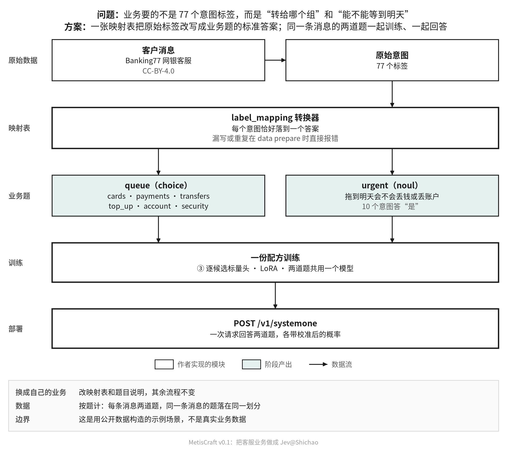

# 把自己的业务做成 Jev

本篇用"银行客服分流"走一遍完整流程：从业务问题到可调用的 `/v1/systemone` 服务。所有片段都取自仓库与验收运行的真实文件。



## 1. 先把业务问题写成题

业务方要的通常不是"这条消息属于 77 个意图里的哪个"，而是能直接驱动动作的问题。为每个问题选一个判断类型：

| 业务问题 | 类型 | 写法要点 |
|---|---|---|
| 这条消息该转给哪个客服组？ | 选择 choice | 每个选项写一句边界清楚的说明（`criteria`），模型和人都按它判断 |
| 拖到明天处理，客户会不会损失钱或丢失账户访问？ | 是非 noul | 问题本身要可判定，避免"是否重要"这类含糊说法 |
| 情绪强度 1–5 | 等级 score | 等级按顺序排列，可用序数软目标 |
| 消息里涉及哪些产品 | 多标签 multi_label | 每个候选独立判断，注意正负样本极不平衡时的处理（见[最佳实践](best-practices.md)） |

"都不对"也是一种回答：选择题可以打开 `allow_null`，让模型在没有合适选项时弃答。

## 2. 准备数据：两条路

自有数据先整理为标准 Record JSONL，用清单声明来源、条款与各划分，再运行
`metiscraft data import dataset.yaml --data-root ./data`。完整格式与步骤见
[自有数据指南](../zh/data.md)。这条路径可直接使用安装后的 wheel，无需编辑注册表。
下面的注册表片段用于解释已内置的 Banking77 场景；运行本篇示例时使用该内置条目。

**已有带标签的数据**：用映射表把原始标签改写成业务题的标准答案。客服分流就是这样从 Banking77 的 77 个意图得到的。下面是注册表条目（`src/metiscraft/data/registry.yaml`，节选）：

```yaml
banking77_support:
  hf: PolyAI/banking77@1846984189f2bc0ac51c6fc3a600fa9e1714e0c6
  judgment: [choice, noul]
  converter: label_mapping
  license: cc-by-4.0
  terms: [attribution]
  params:
    text_field: text
    label_field: label
    questions:
      queue:
        type: choice
        instructions: Which support queue should handle this customer message?
        criteria:
          cards: Ordering, delivering, activating, linking or replacing cards; PINs, card limits and card support.
          security: Lost, stolen or compromised cards or phones, and transactions the customer does not recognise.
          # ……另外 4 个客服组
        map:
          cards: [activate_my_card, card_arrival, change_pin, ...]   # 每个原始意图恰好落到一个答案
          security: [compromised_card, lost_or_stolen_card, ...]
      urgent:
        type: noul
        instructions: Could the customer lose money or access to their account if this message waits until tomorrow?
        true_for: [compromised_card, lost_or_stolen_card, card_swallowed, ...]
```

映射表写错会直接报错：漏掉某个原始标签、或一个标签映到两个答案，`metiscraft data prepare` 都会拒绝生成。

**直接写 Jev 格式的数据**：每行一条官方请求格式的记录（`state` + `questions`），加上每道题的标准答案。注册表里的 Jev 类数据集（如 `open_jev`、`typed_decisions`）就是这样读入的，转换器是 `jev_requests` 一族。

内置数据条目在注册表里固定上游 revision；自有数据在导入清单里固定版本与来源。
两种路径均保留许可证和条款。产物 `NOTICE` 记录可识别的限制；自定义或未解释条款
标为未验证，不能据此推断使用许可。

## 3. 准备并检查数据

```bash
metiscraft data prepare banking77_support   # 下载、转换、评测集优先去重、写版本目录
metiscraft data verify banking77_support    # 按 SHA256SUMS 校验
metiscraft data show banking77_support --split train   # 看几条记录
```

同一条消息派生的两道题共用一个 `group`，切分时整组落在同一边。test 放在 `derived/eval_only/` 里，只在评测时读取。

## 4. 写配方

配方是 YAML，决定数据、基座、读出、目标、训练、校准和评测。客服分流的配方（`recipes/banking77_support/qwen3-0.6b-base_candidate-scalar.yaml`）：

```yaml
task: banking77_support
data: {dataset: banking77_support}
model:
  base: qwen3/0.6b-base-da87bfb6
  dtype: bf16
  max_length: 384
  finetune: {kind: lora, r: 16, alpha: 32, dropout: 0.05, targets: all-linear}
readout: {kind: candidate_scalar, layout: list, head: {hidden: 256}, shuffle_train: true}
objective: {kind: auto}
train: {epochs: 2, batch_size: 16, grad_accum: 1, lr: 2.0e-4, head_lr: 1.0e-3, warmup_ratio: 0.03, seed: 42, bf16: true, logging_steps: 20}
calibrate: {method: temperature, split: calib}
eval: {splits: [dev, test], baselines: [prior]}
```

两道题类型不同，但共用一个模型和一份配方。字段的完整说明见[配方字段参考](recipe-reference.md)。命令行可以覆盖任何字段，例如 `readout.kind=answer_token train.lr=1e-4`。

## 5. 训练、校准、评测

```bash
metiscraft train recipes/banking77_support/qwen3-0.6b-base_candidate-scalar.yaml
```

一条命令依次完成训练、封存产物、在 calib 上拟合温度、在 dev/test 上评测并写报告。报告的 test 部分（验收运行 `20261105-101057-30757bf7`）：

| 题 | 方法 | 准确率 | NLL | ECE |
|---|---|---|---|---|
| queue（选择） | 模型 | 0.978 | 0.102 | 0.010 |
| | 模型 + 温度 | 0.978 | 0.087 | 0.006 |
| | 先验 | 0.247 | 1.704 | 0.047 |
| urgent（是非） | 模型 | 0.986 | 0.065 | 0.012 |
| | 模型 + 温度 | 0.986 | 0.049 | 0.008 |
| | 先验 | 0.870 | 0.386 | 0.002 |

读报告时先看先验这一行：urgent 的先验准确率已经是 0.870（大多数消息不紧急），所以 0.986 的意义要和它比；再看温度前后的 NLL 和 ECE，确认概率可信。

## 6. 部署与调用

```bash
metiscraft serve <运行目录>/artifact
```

请求沿用官方 `/v1/systemone` 格式，一次请求回答两道题。下面是验收产物对一条构造消息的实际响应：

```json
{
  "model": "metiscraft/banking77_support",
  "answers": {
    "queue": {
      "type": "choice",
      "choice": "security",
      "confidence": 0.9999995054983101,
      "probabilities": {"cards": 2.0e-07, "payments": 2.9e-07, "transfers": 1.4e-09,
                        "top_up": 1.1e-09, "account": 1.8e-09, "security": 0.9999995054983101}
    },
    "urgent": {"type": "noul", "noul": 0.9999314182034214}
  },
  "usage": {"input_tokens": 199, "output_tokens": 0}
}
```

对应的请求是："My card was stolen this morning and there are two payments on it that I did not make."，题目定义与注册表中的 `queue`、`urgent` 相同。完整请求见[配方说明](../../recipes/banking77_support/README.md)。

## 检查清单

- [ ] 每道题的类型、说明和选项边界写清楚了，需要时打开了 `allow_null`。
- [ ] 数据固定了上游 revision，许可证和条款写进了注册表。
- [ ] 同一份材料派生的题共用 `group`。
- [ ] 报告里模型明显好于先验，温度后的 NLL、ECE 没有变差。
- [ ] 部署前用几条真实请求试过响应。
