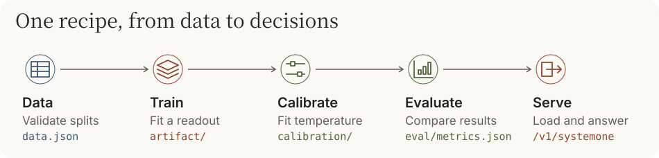

---
hide:
  - toc
---

# *Metis*

A customer reports a stolen card. Which team should take the case, and does it need urgent attention? Follow the model’s decision, look up the tools or run the experiment yourself.

<nav class="home-actions" aria-label="Main sections">
  <a href="jevlike/index.md"><strong lang="en">JevLike</strong>Model research</a>
  <a href="metiscraft/index.md"><strong lang="en">MetisCraft</strong>Developer manual</a>
  <a href="cookbook/index.md"><strong lang="en">Cookbook</strong>Experiments</a>
</nav>

[0.1.0 release](https://github.com/Shichaoxx/MetisCraft/releases/tag/v0.1.0) · [Installation](installation.md)

## Start with a recorded decision

<blockquote lang="en">My card was stolen this morning and there are two payments on it that I did not make.</blockquote>

<svg class="choice-readout" viewBox="0 0 335 156" role="img" aria-label="Of six support queues, the model chose security."><use href="../visuals/figures/choice-readout.svg#readout"></use></svg>

<dl class="specimen-decisions">
  <dt>Who should handle it?</dt><dd>The security team</dd>
  <dt>Is it urgent?</dt><dd>The model says yes</dd>
</dl>

The message was written for this example. Both answers come from the routing model’s recorded response. [Inspect the request and response](cookbook/decision.md)

Recorded probabilities

<dl><dt>queue.confidence</dt><dd>0.9999995054983101</dd><dt>urgent.noul</dt><dd>0.9999314182034214</dd></dl>

## Tev1 4B reproduction

[On the same 1,000 questions, how did 54 different choices add up to just seven fewer correct answers?](jevlike/tev1.md#seven-fewer-correct-answers-54-different-selections)

### Main decisions

**87.3%**

873 of 1,000 correct · Original Tev1 **88.0%**

### Policy transfer

**99.33%**

298 of 300 correct · Original Tev1 **100%**

Both predeclared accuracy checks passed on the same public development questions with a single seed. The original training history is unavailable, and calibration can worsen negative log-likelihood.

[Reproduction record and limits](reproductions/tev1.md) · [Training recipe](../../recipes/tev1/README_en.md)

## Cookbook tutorials { #choose-your-next-step }

- [Understand a decision](cookbook/decision.md) — Inspect all six queue probabilities and the separate urgency prediction.
- [Run your first model](cookbook/first-model.md) — Complete a CPU example without downloading weights.
- [Bring your own task](cookbook/own-task.md) — Replace the data and base model, keeping the same training and serving path.

## Tasks supported by MetisCraft { #typed-judgments-recorded-evidence }

Use yes/no, choice, ordered score and multiple labels through Python or batch prediction. HTTP `/v1/systemone` supports the first three.

[Recipes and results](limitations.md) · [Data format](data.md) · [Train and calibrate](training.md) · [Predict and serve](serving.md)

<picture>
  <source media="(max-width: 600px)" srcset="../visuals/figures/pipeline-mobile.svg">
  
</picture>

## JevLike model research { #understand-the-computation }

How does the routing model pick one of six queues? [Tasks and answer spaces](tensor-analysis/introduction.md) traces a training example and a recorded prediction. [Candidate scores and probabilities](jevlike/candidate-scores.md) works through two questions by hand. The [architecture atlas](tensor-analysis/architectures.md) shows where different implementations read their scores.
