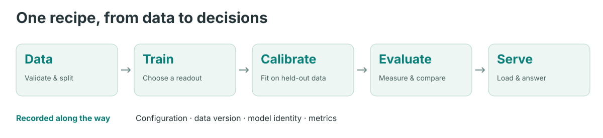

# MetisCraft

Train decision models that return typed judgments and probabilities in one forward
pass. MetisCraft brings data preparation, training, calibration, evaluation and
serving into one recipe for general judges and domain-specific tasks.

<picture>
  <source media="(max-width: 600px)" srcset="../visuals/figures/pipeline-mobile.svg">
  
</picture>

The current release candidate is **0.1.0rc1**. It has not been published to PyPI.
Start with [installation](installation.md), then run the [CPU quickstart](quickstart.md).
The quickstart uses a random tiny model and synthetic data to check the software
workflow. It does not establish useful model quality.

## What can it judge?

| Type | Output | Record API | HTTP `/v1/systemone` |
|---|---|---|---|
| `noul` | Probability of yes / true | Yes | Yes |
| `choice` | One option and a distribution over options | Yes | Yes |
| `score` | Distribution over ordered levels | Yes | Yes |
| `multi_label` | Independent probabilities for candidates | Yes | No |

Two readouts are available: answer-token logits for `noul`, `choice` and `score`,
and a candidate scalar head for all four types. LoRA, full fine-tuning and frozen
backbones are configurable. Temperature calibration uses a separate split; its
effect is reported alongside uncalibrated results.

## Choose a starting point

- [Quickstart](quickstart.md): import, train, evaluate and serve a complete CPU example.
- [Your data](data.md): import supervised JSONL without editing the dataset registry.
- [Training](training.md): prepare a verified local base and configure a recipe.
- [Serving](serving.md): load an artifact and keep task-specific calibration consistent.
- [Limitations](limitations.md): current scope and what the evidence does not establish.

The existing [cookbook](../cookbook/README.md), [readout notes](../readouts/README.md)
and [research support matrix](../support-matrix.md) provide more detail in Chinese.
Project progress is recorded in [status](../status.md).

[中文](../zh/index.md)
