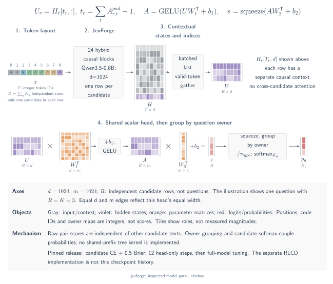

# How JevForge scores a candidate

Suppose a support team adds a third queue to a routing question. What happens to the two scores the model already assigned? JevForge encodes the message with each candidate separately, scores each row, then converts the scores for a question into probabilities that sum to one. This chapter traces inference at source revision `039badb` and uses revision `5ca7c08` for the JevForge-0.8B checkpoint settings. [Inference entry point](https://github.com/zwliJay/jev-forge/blob/039badbafc242b4f8105a59e27f789320efe6e9c/jevforge/predict.py#L111-L129) · [Release configuration](https://huggingface.co/AndeyTait/JevForge-0.8B/blob/5ca7c0861a0d9b72629a7bc40130a8f154c4840f/config.json)

## One input row per candidate

The encoder tokenizes the common state and question prefix once per question and copies those token IDs into every candidate row. Each complete row contains the state, question type, instruction, one candidate and the final `<|oj:answer|>` marker. The question type determines how a candidate is written. [Prompt construction](https://github.com/zwliJay/jev-forge/blob/039badbafc242b4f8105a59e27f789320efe6e9c/jevforge/encode.py#L24-L66) · [Candidate IDs](https://github.com/zwliJay/jev-forge/blob/039badbafc242b4f8105a59e27f789320efe6e9c/jevforge/schema.py#L51-L58)

| Type | What distinguishes the rows within a question |
| --- | --- |
| `choice` | Each row contains one option key and description, such as `[cards] Card services`. |
| `score` | Each row names one level by index and description, such as `level 0: low`. Reordering levels changes the indices. |
| `noul` | One row contains `no`, the other `yes`. If the caller supplies criteria for true or false, both rows include those definitions in their question prefix. |

Two questions with two and three candidates yield a batch of five rows. The predictor pads the rows on the right and records the question index for each row in `owner`. For the readout it counts valid tokens and selects the final valid hidden state, at the end of the answer marker. The backbone has already seen the candidate description by that position. [Batching and grouping](https://github.com/zwliJay/jev-forge/blob/039badbafc242b4f8105a59e27f789320efe6e9c/jevforge/predict.py#L83-L104) · [Final position and scalar head](https://github.com/zwliJay/jev-forge/blob/039badbafc242b4f8105a59e27f789320efe6e9c/jevforge/model.py#L28-L40)

[Light SVG](../../tensor-analysis/figures/architecture-jevforge.en.svg) · [Dark SVG](../../tensor-analysis/figures/architecture-jevforge.en.dark.svg) · [PDF](../../tensor-analysis/figures/architecture-jevforge.en.pdf) · [Editable TikZ](../../tensor-analysis/figures/architecture-jevforge.en.tex)

The 0.8B release uses a Qwen3.5 backbone with 18 linear-attention layers and six full-attention layers. Each final hidden state passes through the same `1024 → 1024` linear layer, GELU and `1024 → 1` linear layer. Each row in the diagram yields one scalar. Following `decide → _forward → model` in this version shows that the backbone receives complete rows with repeated prefix tokens. This call path passes no shared prefix KV cache to the candidates. [Backbone configuration](https://huggingface.co/AndeyTait/JevForge-0.8B/blob/5ca7c0861a0d9b72629a7bc40130a8f154c4840f/backbone/config.json#L7-L44) · [Forward call](https://github.com/zwliJay/jev-forge/blob/039badbafc242b4f8105a59e27f789320efe6e9c/jevforge/predict.py#L83-L104)

## Adding a third queue

Keep the model, state, instructions and the keys and descriptions of A and B fixed. Adding C to this `choice` question leaves the token content of the original two rows intact. Each raw score still depends on its own row. The change happens one step later, when the predictor groups scores by question and applies softmax over all candidates in that question. [Probability conversion and response fields](https://github.com/zwliJay/jev-forge/blob/039badbafc242b4f8105a59e27f789320efe6e9c/jevforge/predict.py#L121-L147)

For a worked example, set the temperature to one and assign A and B the raw scores \(\ln 4\) and 0. Give the new candidate C a score of \(\ln 3\).

| Candidates in this question | Exponentiated scores | P(A) | P(B) | P(C) |
| --- | --- | ---: | ---: | ---: |
| A, B | 4, 1 | 80% | 20% | — |
| A, B, C | 4, 1, 3 | 50% | 12.5% | 37.5% |
| C removed | 4, 1 | 80% | 20% | — |

The ratio P(A)/P(B) stays at four. Adding C to a **different question** only changes that question’s denominator, leaving the original 80% and 20% intact. The example also illustrates how to interpret `choice.confidence`. With three options and a top probability of 50%, JevForge reports a confidence of 0.25. This field uses the number of candidates and the largest probability. It is zero for a uniform distribution and one when all probability falls on a single candidate. [Confidence calculation](https://github.com/zwliJay/jev-forge/blob/039badbafc242b4f8105a59e27f789320efe6e9c/jevforge/predict.py#L17-L22)

## Training and temperature

The release training script computes cross-entropy against each question’s target distribution and adds half the sum of squared differences between predicted and target probabilities. The head trains alone for the first 12 updates, after which the backbone also receives updates. The script loads the selected checkpoint and fits one temperature per question type on the calibration data. This release records `choice 1.085`, `noul 1.2835` and `score 1.0785`. At inference the predictor divides a question’s raw scores by its temperature before applying softmax. A caller can also supply an override. [Training and loss](https://huggingface.co/AndeyTait/JevForge-0.8B/blob/5ca7c0861a0d9b72629a7bc40130a8f154c4840f/training-code/train_curated_v3.py#L68-L81) · [Fitting and saving temperatures](https://huggingface.co/AndeyTait/JevForge-0.8B/blob/5ca7c0861a0d9b72629a7bc40130a8f154c4840f/training-code/train_curated_v3.py#L104-L107) · [Released temperatures](https://huggingface.co/AndeyTait/JevForge-0.8B/blob/5ca7c0861a0d9b72629a7bc40130a8f154c4840f/config.json#L4-L10) · [Inference override](https://github.com/zwliJay/jev-forge/blob/039badbafc242b4f8105a59e27f789320efe6e9c/jevforge/predict.py#L106-L125)

We checked the pinned source and release files, then exercised the upstream encoding, readout, grouping and normalization code with a byte-based test tokenizer and a miniature backbone. The numerical table was calculated separately from the supplied example scores. We did not load JevForge’s released weights or rerun a benchmark. For experiments with per-candidate inputs in MetisCraft, see the [scalar-pairs layout](../tensor-analysis/scalar-heads.md). The two projects use their own artifact formats.
