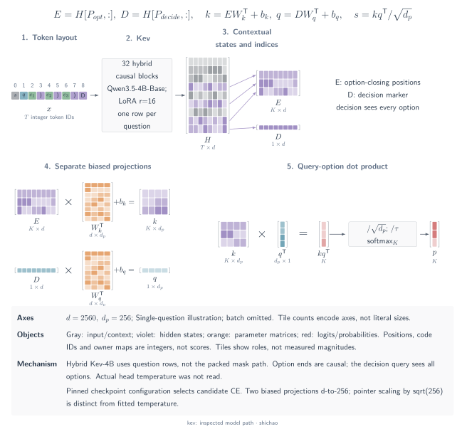

# The Kev-4B pointer readout

This page examines the PyTorch path in Kev source `2074cc4`. The author describes Kev-4B as a rank-16 LoRA adapter and pointer head on Qwen3.5-4B-Base. The base configuration gives a hidden width of 2,560 across 32 layers, with 24 linear-attention and eight full-attention layers. [Author’s model card](https://github.com/jaredpalmer/kev/blob/2074cc44256200bb37540103fa4572901faa10f3/docs/model-cards/kev-4b.md#L69-L75) · [Author’s experiment configuration](https://github.com/jaredpalmer/kev/blob/2074cc44256200bb37540103fa4572901faa10f3/experiments/q35-4b.json#L2-L12) · [Pinned base configuration](https://huggingface.co/Qwen/Qwen3.5-4B-Base/blob/1001bb4d826a52d1f399e183466143f4da7b741b/config.json)

## Input positions and readout

The logical input is a state followed by question branches: `<q> instruction <opt> option </opt> … <decide>`. This hybrid backbone runs one causal row per question, containing the state and that question's complete branch. The pointer gathers the final `<decide>` representation and each candidate's closing `</opt>` representation. Two separate biased linear projections map their width from 2,560 to \(d_p=256\).

[SVG](../../tensor-analysis/figures/architecture-kev.en.svg) · [Dark SVG](../../tensor-analysis/figures/architecture-kev.en.dark.svg) · [PDF](../../tensor-analysis/figures/architecture-kev.en.pdf) · [TikZ](../../tensor-analysis/figures/architecture-kev.en.tex)

\[
\begin{aligned}
H&:[B,T,2560]
 \xrightarrow{\mathrm{gather}}
 D:[B,2560],\ E:[R,2560],\\
Q&=DW_q^{\mathsf T}+b_q:[B,256],\qquad
K=EW_k^{\mathsf T}+b_k:[R,256],\\
z_r&=\frac{\langle K_r,Q_{g(r)}\rangle}{\sqrt{256}},
\qquad p_b=\operatorname{softmax}(z_b/\tau).
\end{aligned}
\]

Here \(B\) counts question rows, \(T\) is the padded sequence length, \(R\) counts valid options and \(g(r)\) identifies the question that owns option \(r\). The dot product sums over the projection dimension. The final softmax runs over each question’s options. The projections enter the dot product without L2 normalization. The projection width determines the scale \(1/\sqrt{256}\). Inference uses a separate temperature \(\tau\). [Option and decision indices](https://github.com/jaredpalmer/kev/blob/2074cc44256200bb37540103fa4572901faa10f3/kev/model.py#L107-L126) · [Projections and scale](https://github.com/jaredpalmer/kev/blob/2074cc44256200bb37540103fa4572901faa10f3/kev/model.py#L205-L223) · [Per-question normalization](https://github.com/jaredpalmer/kev/blob/2074cc44256200bb37540103fa4572901faa10f3/kev/model.py#L494-L505)

## Question rows and prefix reuse

Within a Kev-4B row, later options can read earlier ones and the decision marker can read every option in its question. The code detects `linear_attention` layers in the base configuration, uses question rows for that hybrid backbone and rejects option isolation on this path. For compatible attention-only backbones, a packed block-causal mask can also restrict visibility between options in a question. [Hybrid detection](https://github.com/jaredpalmer/kev/blob/2074cc44256200bb37540103fa4572901faa10f3/kev/model.py#L69-L72) · [Layout and isolation constraint](https://github.com/jaredpalmer/kev/blob/2074cc44256200bb37540103fa4572901faa10f3/kev/model.py#L257-L264) · [Packed mask](https://github.com/jaredpalmer/kev/blob/2074cc44256200bb37540103fa4572901faa10f3/kev/model.py#L154-L183)

A question row describes which input the question can read. The PyTorch `probs` entry point can encode a shared state prefix once and continue each question from its cached state. Counting question rows alone therefore gives no count of prefix evaluations. [Probability entry point and prefix reuse](https://github.com/jaredpalmer/kev/blob/2074cc44256200bb37540103fa4572901faa10f3/kev/model.py#L396-L410)

## Training objective and evidence

The training stage recorded at revision `6cfce5c` started from an earlier checkpoint. Its configuration sets `head_dim=256`, `option_isolation=0` and zero weights for `brier_w`, `ord_w` and `perm_kl`. These settings describe this stage. The fitted inference temperature is stored separately with the model. [Released training configuration](https://huggingface.co/jaredpalmer/kev-4b/blob/6cfce5c2fa4b4bd64026336ab649c5ca78857d52/training_config.json)

Training supports hard-label or soft-target cross-entropy per question. The pointer head applies the stored temperature in evaluation mode. The author’s calibration script writes the temperature and its provenance into checkpoint metadata. A numeric temperature is specific to a checkpoint revision. [Candidate loss](https://github.com/jaredpalmer/kev/blob/2074cc44256200bb37540103fa4572901faa10f3/kev/train.py#L41-L61) · [Writing the temperature](https://github.com/jaredpalmer/kev/blob/2074cc44256200bb37540103fa4572901faa10f3/scripts/calibrate_checkpoint.py#L135-L151)

This account is based on pinned source and author documentation. We did not load the Kev weights or run performance tests. For the readouts and artifact formats that MetisCraft supports, see [implementation limits](../limitations.md). For a worked numerical example, see [candidate scores and probabilities](candidate-scores.md).
