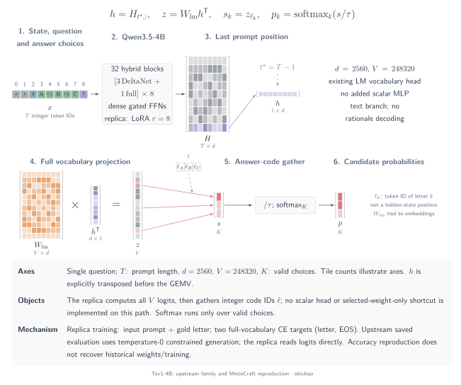

# How Tev1-4B reads answer letters

In the authors’ billing example, `A` stands for a duplicate charge and `B` for cancelling a subscription. The model sees the customer’s message, the question and the options. It returns a letter. The client looks that letter up in the current question’s option list, for example `A → duplicate_charge`. In the next question the same letter can mean something entirely different. [Original example](https://github.com/togethercomputer/tev1/blob/1dde7782382c9f49d627153759b8d1deab426ce0/examples/charge-dispute.json) · [Client-side mapping](https://github.com/togethercomputer/tev1/blob/1dde7782382c9f49d627153759b8d1deab426ce0/examples/decide.py#L44-L51)

## Two prediction positions during training

Tev1 uses the existing language-model output head of Qwen3.5-4B. Consider a question whose correct answer is `A` and follow the MetisCraft 4B reproduction recipe. During training the correct letter is appended to the prompt. Two positions contribute to the loss. [Authors’ model description](https://github.com/togethercomputer/tev1/blob/1dde7782382c9f49d627153759b8d1deab426ce0/README.md#L20-L31) · [Reproduction recipe](../../../recipes/tev1/qwen3.5-4b_chat-completion.yaml)

| Input seen so far | Target next token | Cross-entropy denominator |
| --- | --- | --- |
| The prompt, including every option | Correct letter `A` | Full vocabulary |
| The prompt followed by the correct letter `A` | End-of-sequence token (EOS) | Full vocabulary |

The first target teaches the model to answer. The second teaches it to stop. The reproduction reads both positions in one pass and averages their full-vocabulary cross-entropies. Even if `A` outscores every other candidate letter, a high score for some unrelated token can still increase the first loss. [Batch construction and targets](https://github.com/Shichaoxx/MetisCraft/blob/e9a100bc6cb781270c9935a225e087f1f9167d7a/src/metiscraft/train/collate.py#L104-L117) · [The two readout positions](https://github.com/Shichaoxx/MetisCraft/blob/e9a100bc6cb781270c9935a225e087f1f9167d7a/src/metiscraft/modeling/model.py#L55-L67) · [Loss calculation](https://github.com/Shichaoxx/MetisCraft/blob/e9a100bc6cb781270c9935a225e087f1f9167d7a/src/metiscraft/judgments/__init__.py#L63-L71)



[Vector figure](../../tensor-analysis/figures/tev1-architecture.en.svg) · [PDF](../../tensor-analysis/figures/tev1-architecture.en.pdf) · [Editable TikZ](../../tensor-analysis/figures/tev1-architecture.en.tex)

## Selecting a letter at inference

The authors evaluated their endpoint using constrained generation at temperature zero. The client builds a regular expression from the question’s letters, such as `(A|B|C|D)`, and checks that the returned text matches exactly one option. [Request construction](https://github.com/togethercomputer/tev1/blob/1dde7782382c9f49d627153759b8d1deab426ce0/examples/decide.py#L34-L51) · [Upstream evaluation protocol](https://github.com/togethercomputer/tev1/blob/1dde7782382c9f49d627153759b8d1deab426ce0/runs/new-v1/evaluation.json#L1-L13)

The reproduction sends only the prompt. At the last prompt position it selects the vocabulary score for each option letter by token ID, then normalizes over the valid options. That gives the selected letter and candidate probabilities directly, with no EOS prediction. To compare two sets of answers, first match each question’s option order and letter mapping. Attributing disagreements to decoding alone would require testing both protocols on **the same weights and prompts**. The recorded comparison uses two sets of weights. [Answer-token calculation](../tensor-analysis/answer-token.md) · [Reproduction record](../reproductions/tev1.md)

## Seven fewer correct answers, 54 different selections

| Historical evaluation | Authors’ endpoint | MetisCraft retraining | Same letter selected |
| --- | ---: | ---: | ---: |
| Main decisions | 880 / 1,000 correct | 873 / 1,000 correct | 946 / 1,000 |
| Policy transfer | 300 / 300 correct | 298 / 300 correct | 298 / 300 |

<figure class="tev1-agreement">
<figcaption>Letter-by-letter agreement on the main set</figcaption>
<div class="tev1-group">
<p>All 1,000 questions</p>
<div class="tev1-strip" aria-hidden="true" style="grid-template-columns: 946fr 54fr">
<span data-outcome="same"></span>
<span data-outcome="different"></span>
</div>
<ul role="list">
<li data-outcome="same"><strong>946</strong> Same letter</li>
<li data-outcome="different"><strong>54</strong> Different letters</li>
</ul>
</div>
<div class="tev1-group">
<p>The 54 questions with different selections</p>
<div class="tev1-strip" aria-hidden="true" style="grid-template-columns: 28fr 21fr 5fr">
<span data-outcome="upstream"></span>
<span data-outcome="retrained"></span>
<span data-outcome="wrong"></span>
</div>
<ul role="list">
<li data-outcome="upstream"><strong>28</strong> Only the authors’ endpoint correct</li>
<li data-outcome="retrained"><strong>21</strong> Only the retrained model correct</li>
<li data-outcome="wrong"><strong>5</strong> Both wrong</li>
</ul>
</div>
</figure>

Of the 946 matching selections, 852 were correct and 94 shared the same wrong letter. Subtract the two groups where only one model was correct: 28 − 21 = 7. That accounts for the seven-answer gap in the accuracy table. The paired counts come from the same public development questions. The retraining used one seed, and the authors published recommended settings. The complete settings from their historical training job remain unavailable. [Paired reproduction results](../reproductions/tev1.md#per-question-agreement) · [Authors’ training notes](https://github.com/togethercomputer/tev1/blob/1dde7782382c9f49d627153759b8d1deab426ce0/docs/TRAINING.md#L1-L18)

**Recount the authors’ answers.** Save the [per-question output at the pinned commit](https://raw.githubusercontent.com/togethercomputer/tev1/1dde7782382c9f49d627153759b8d1deab426ce0/evaluation/new-v1-4b/results.jsonl) as `results.jsonl` and run the following in that directory. Comparing predicted letters with gold letters reproduced `test 880/1000` and `policy_transfer 300/300` in this documentation check. It used saved outputs, without training a model or calling the endpoint.

```python
import json
from pathlib import Path

with Path("results.jsonl").open(encoding="utf-8") as file:
    rows = [json.loads(line) for line in file]

for split in ("test", "policy_transfer"):
    cases = [row for row in rows if row["split"] == split]
    hits = sum(row["predicted"] == row["gold"] for row in cases)
    print(split, f"{hits}/{len(cases)}")
```
