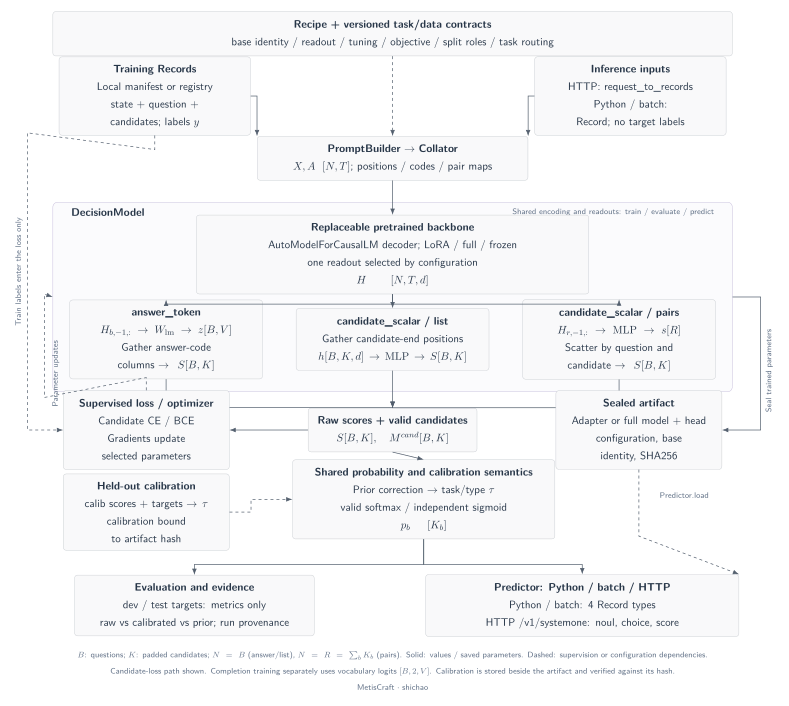

# Model architecture and training artifacts

A MetisCraft recipe specifies how to turn a Record into candidate scores. The support model below shows where those scores come from. The same task and data contracts carry through to the artifact used for calibration and prediction. The dimensions in the diagram are specific to the support recipe.

[Light SVG](../../tensor-analysis/figures/metiscraft-architecture.en.svg) · [Dark SVG](../../tensor-analysis/figures/metiscraft-architecture.en.dark.svg) · [PDF](../../tensor-analysis/figures/metiscraft-architecture.en.pdf) · [Editable TikZ](../../tensor-analysis/figures/metiscraft-architecture.en.tex)

## Shared model core

1. **Record and recipe contracts.** A `Record` separates input, answer definitions, supervision, task ID and provenance. The recipe selects the base, tuning method, readout, objective and split roles. HTTP requests are adapted to the same Record contract.
2. **Prompt construction and collation.** `PromptBuilder` defines which input tokens represent each candidate. `Collator` pads sequences and constructs token IDs, padding masks, answer codes or candidate-position indices. Answer-token and scalar-list paths use one sequence per question; scalar-pairs uses one per candidate.
3. **DecisionModel.** A replaceable pretrained decoder returns hidden states. The selected readout is **one of three paths**, not an ensemble: answer-token vocabulary projection and code gather; scalar-list candidate gather and a shared MLP; or scalar-pairs scoring and scatter back to question/candidate columns.
4. **Typed scores and probabilities.** Candidate masks distinguish valid columns. Judgment semantics determine categorical softmax or event-wise sigmoid. Prior correction and task/type temperature selection are shared by evaluation and prediction.

Let \(N\) count encoded sequences, \(B\) count questions and \(R=\sum_bK_b\). The common interface is

\[
X,A\in\mathbb{Z}^{N\times T}\;\longrightarrow\;
H\in\mathbb{R}^{N\times T\times d}\;\longrightarrow\;
S\in\mathbb{R}^{B\times K_{\max}}.
\]

Here \(N=B\) for answer-token/list and \(N=R\) for pairs. Padding-mask values are binary; IDs and positions are integers, while hidden states and scores are floating point. Invalid score columns carry no answer meaning and are excluded before normalization. For `noul`, the answer-token path reduces yes/no vocabulary scores to their logit difference.

## Training and deployment meet at the artifact

Supervision enters CE/BCE losses for the configured judgment type. Gradients update the selected LoRA, full-model and/or readout parameters. Answer-token `completion` is a distinct training path: it produces full-vocabulary logits \([B,2,V]\) to predict answer code and EOS; it does not train CE on the candidate-score tensor shown in the main path.

Training seals model/adapter parameters, an optional scalar head, configuration, verified base identity and checksums. Calibration is stored separately and bound to that artifact's hash; a mismatched calibration is rejected. `Predictor.load` reconstructs the selected model and uses the same collation, correction and temperature semantics for Python, batch and HTTP. Evaluation compares predictions with dev/test targets and records raw, calibrated and prior results.

For the supported task types, third-party mechanisms and current limits, see [implementation boundaries](../limitations.md).

The [engineering workflow diagram](../../tensor-analysis/figures/metiscraft-workflow.en.svg) follows a Record through collation, loss computation, artifact storage and serving.

| Architectural boundary | Source |
|---|---|
| Data and configuration | [`Record`](../../../src/metiscraft/data/contract.py), [`Recipe`](../../../src/metiscraft/config.py) |
| Tensor construction and model paths | [`PromptBuilder`](../../../src/metiscraft/modeling/prompts.py), [`Collator`](../../../src/metiscraft/train/collate.py), [`DecisionModel`](../../../src/metiscraft/modeling/model.py) |
| Training, evaluation and sealing | [`pipeline`](../../../src/metiscraft/pipeline.py), [`trace`](../../../src/metiscraft/trace.py) |
| Loading, calibration routing and output | [`Predictor`](../../../src/metiscraft/serve/predictor.py), [`judgments`](../../../src/metiscraft/judgments/__init__.py) |
