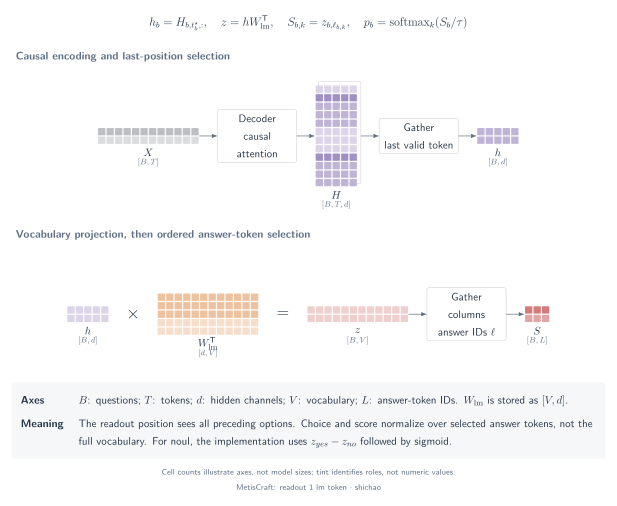

# Answer-token readout

An answer-token readout reuses a language model's output projection and reads scores for a finite set of answer codes. MetisCraft uses this path for `noul`, `choice` and `score`, including the Tev1 recipe.

## Question

Which part of a vocabulary distribution corresponds to an application's answer space? The critical distinction is between a **candidate index** \(k\), a **candidate ID** such as `security`, and a **vocabulary index** \(\ell_{b,k}\) for its answer code. They are connected by an explicit codebook.



[SVG](../../tensor-analysis/figures/readout-1-lm-token.en.svg) · [PDF](../../tensor-analysis/figures/readout-1-lm-token.en.pdf) · [TikZ](../../tensor-analysis/figures/readout-1-lm-token.en.tex)

## Tensors and semantics

| Tensor | Shape | Meaning |
|---|---|---|
| \(H\) | \([B,T,d]\) | Contextualized input tokens |
| \(h\) | \([B,d]\) | Hidden state at the final prompt position |
| \(W_{\mathrm{lm}}\) | \([V,d]\) | Vocabulary projection, stored in PyTorch orientation |
| \(Z\) | \([B,V]\) | Full-vocabulary next-token logits |
| \(\ell\) | \([B,K_{\mathrm{code},\max}]\) | Vocabulary indices for each question's answer codes |
| \(S\) | \([B,K_{\max}]\) | Task scores after code selection and binary conversion |

The plain prompt uses single-token letter codes for choices and zero-based numeric codes for score levels. `chat_json` uses letters for both and preserves the supplied JSON payload in the tokenizer's non-thinking chat template. `noul` uses `yes` and `no` codes with a plain prompt. A tokenizer must provide the required codes as distinct single tokens.

## Operator chain

1. Render state, question and candidate definitions, then left-pad the batch.
2. Read `H[:, -1]`. Left padding makes the last column a valid prompt position for every row.
3. Apply the LM output projection, then `gather` the code columns independently for each question.
4. For choice and score, normalize only valid candidate scores. For noul, subtract the no logit from the yes logit and apply sigmoid to that single difference.

```python
h = H[:, -1]                              # [B, d]
Z = lm_head(h)                            # [B, V]
S_codes = Z.gather(1, codes)               # [B, K_code_max]
S_noul = S_codes[noul_rows, 0] - S_codes[noul_rows, 1]
```

The last operation is categorical code selection, not generated text parsing. MetisCraft's inference path does not need to sample an answer string.

## Equations

For a bias-free LM head, the projected matrix product contracts the hidden axis:

\[
H_{\mathrm{last}}W_{\mathrm{lm}}^{\mathsf T}:
(B\times d)(d\times V)\longrightarrow B\times V,
\qquad s_{b,k}=Z_{b,\ell_{b,k}}.
\]

For choice or score:

\[
p_{b,k}=\operatorname{softmax}_{k\in\mathcal K_b}(s_{b,k}/\tau_b).
\]

For noul, two vocabulary scores become one binary logit:

\[
\Delta_b=Z_{b,\ell_{\mathrm{yes}}}-Z_{b,\ell_{\mathrm{no}}},
\qquad p_b=\sigma(\Delta_b/\tau_b).
\]

At unit temperature, this equals a two-code softmax's yes probability. In general it differs from the yes token's probability normalized over the entire vocabulary.

## Small example

Suppose the selected code logits are \([0,1,2]\). Their candidate-normalized probabilities are \([0.090031,0.244728,0.665241]\), regardless of logits in unselected vocabulary columns. If the yes/no logits are \([2,0]\), the binary logit is \(2\) and the yes probability is \(0.880797\).

These are constructed values. The [CPU verification script](../../../scripts/verify_tensor_examples.py) checks the gather and logit-difference identities against a randomly initialized transformer; it does not measure model quality.

## Source map

- [`build_codebook`, `level_codes`, `yes_no_codes`](../../../src/metiscraft/modeling/prompts.py#L87): valid single-token codes.
- [`answer_token` and `chat_json`](../../../src/metiscraft/modeling/prompts.py#L164): codebook-to-prompt alignment.
- [`Collator`](../../../src/metiscraft/train/collate.py#L112): per-row code-index tensor.
- [`DecisionModel.forward`](../../../src/metiscraft/modeling/model.py#L62): LM projection, gather and noul conversion.
- [Tev1 4B recipe](../../../recipes/tev1/qwen3.5-4b_chat-completion.yaml): `chat_json` with full-vocabulary completion training.

## Scope

An autoregressive prompt exposes preceding options to later positions; this is directional causal visibility, not bidirectional interaction. Code choice, option order and truncation can affect results. The plain prompt truncates only state; `chat_json` rejects an overlong complete prompt.

Completion training adds a separate \([B,2,V]\) training path for predicting the answer code and EOS. It should not be confused with candidate-only CE or reasoning-token generation; see [training and calibration](training-calibration.md). This readout does not support `multi_label`, and the package does not claim external inference-engine or prefix-cache integration.
