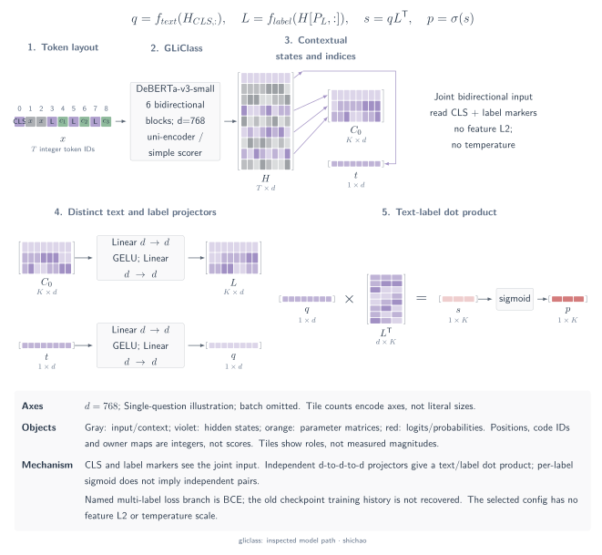
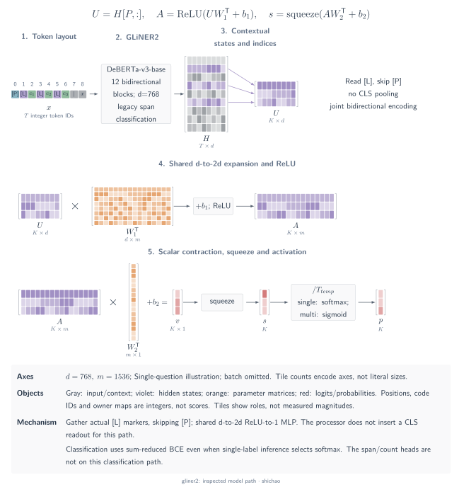
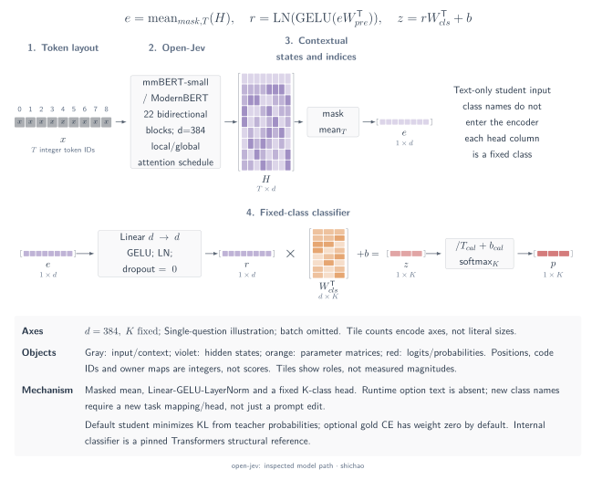
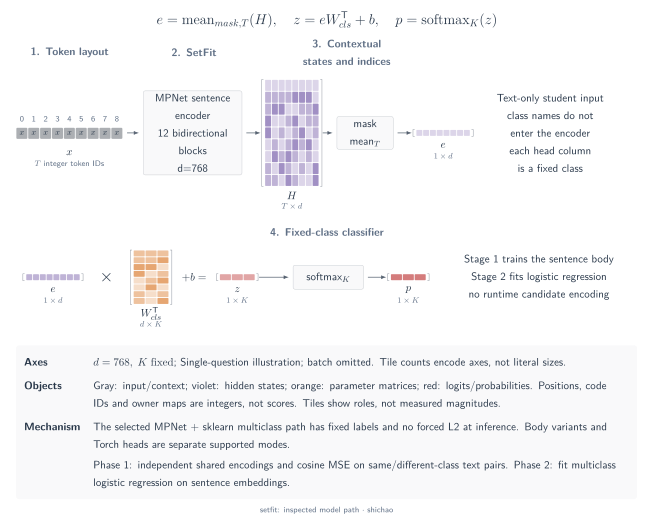
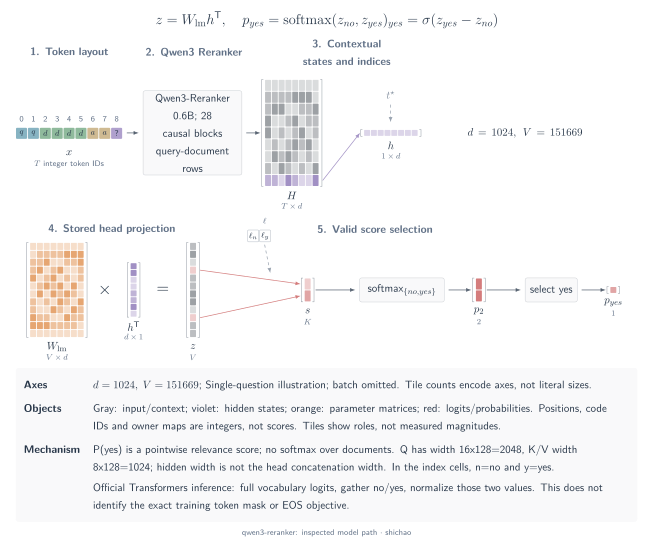

# Encoder classifiers and pointwise rerankers

These five examples distinguish **dynamic candidate text** from a **fixed task classifier**, and joint encoding from independent pair scoring. Each section selects a named mode and pins its evidence. The diagrams describe inspected source paths; they do not report local model execution, training or performance reproduction. Here, \(B\) is batch size, \(T\) encoded length, \(C\) the runtime candidate count, \(K\) a fixed task's class count, and \(N\) the number of independent query–document pairs. Padding entries are excluded from the relevant readouts and normalizers.

## GLiClass

The selected example is `knowledgator/gliclass-small-v1.0` at `66a80146`, interpreted with official library code at `af82d425`: **uni-encoder, first-token pooling, simple dot-product scorer**, with multi-label inference. This selection does not describe every GLiClass variant. With `prompt_first=false` and no optional examples or task prompt, the input is `[CLS] text <<LABEL>> label_1 … <<LABEL>> label_C <<SEP>> [SEP]`. The tokenizer supplies the outer control tokens. The actual return statement places text before labels, despite a different order in the input helper's docstring.

[SVG](../../tensor-analysis/figures/architecture-gliclass.en.svg) · [Dark SVG](../../tensor-analysis/figures/architecture-gliclass.en.dark.svg) · [PDF](../../tensor-analysis/figures/architecture-gliclass.en.pdf) · [TikZ](../../tensor-analysis/figures/architecture-gliclass.en.tex)

DeBERTa-v3-small has six layers, width 768, 12 attention heads and FFN width 3,072. Its bidirectional encoder returns \(H:[B,T,768]\). The first-token state \([B,768]\) and the `<<LABEL>>` states \([B,C,768]\) pass through separate `768 → 768 → 768` GELU projectors. Contracting their feature axis gives \(S:[B,C]\); multi-label inference applies sigmoid to each entry. Text, labels and other labels share the encoder context, so adding a candidate can change existing raw scores. A sigmoid output does not make the candidate representations independent.

The inspected multi-label training branch uses BCE with optional focal weighting; the selected checkpoint's disabled focal coefficients reduce that branch to ordinary BCE. Its configuration does not recover the historical `problem_type` or training recipe, and the paper's optional PPO pipeline should not be attributed to these weights. For MetisCraft, this is a reference for dynamic labels and joint candidate context. MetisCraft's scalar-list path uses causal candidate-end representations and an MLP, so it is a different computation; checkpoint import and reproduction are not established by this comparison.

Primary sources:

- [Pinned checkpoint configuration and tokenizer metadata](https://huggingface.co/knowledgator/gliclass-small-v1.0/commit/66a80146c51756e463e93b142919d5862fd0038d).
- [Pinned input construction](https://github.com/Knowledgator/GLiClass/blob/af82d425c0259a6f46f240bb0633fcdab821eaea/gliclass/pipeline.py#L598-L659).
- [Pinned encoder, readouts and loss dispatch](https://github.com/Knowledgator/GLiClass/blob/af82d425c0259a6f46f240bb0633fcdab821eaea/gliclass/model.py).
- [GLiClass paper, v1](https://arxiv.org/html/2508.07662v1), architecture variants and training pipelines.

## GLiNER2

This example selects **the span architecture's ordinary classification branch** for `fastino/gliner2-base-v1`, using checkpoint configuration at `784e0b98` and library code at `ca4f6823`. It does not combine span classification with the newer boundary architecture or constrained joint decoding. A basic schema becomes `( [P] task ( [L] label_1 … [L] label_C ) ) [SEP_TEXT] text`; multiple schemas use `[SEP_STRUCT]` separators. The processor converts tokenized fragments directly to IDs. This path does not add a CLS readout.

[SVG](../../tensor-analysis/figures/architecture-gliner2.en.svg) · [Dark SVG](../../tensor-analysis/figures/architecture-gliner2.en.dark.svg) · [PDF](../../tensor-analysis/figures/architecture-gliner2.en.pdf) · [TikZ](../../tensor-analysis/figures/architecture-gliner2.en.tex)

DeBERTa-v3-base produces \(H:[B,T,768]\) with 12 bidirectional layers, 12 heads and FFN width 3,072. Recorded structural positions select the \(C\) `[L]` states, skipping `[P]`, to form \(U:[B,C,768]\). One shared `768 → 1536 → 1` ReLU MLP scores each label, yielding \(S:[B,C]\). The classification branch does not pool a separate text vector or score text–label dot products. All schema labels can exchange information with one another and with the text through the encoder.

Training sums per-label BCE on these logits. Inference first divides logits by a configurable positive temperature; `class_act=auto` uses candidate-axis softmax for single-label classification and sigmoid for multi-label classification. The training loss and inference normalizer are therefore separate choices. Span and count losses belong to the other task branches. For MetisCraft, schema-conditioned classification is a mechanism reference; its typed decision interface does not provide GLiNER2's span, boundary or extraction heads. The selected span path also should not be presented as the entire 2025 paper or every later family member.

Primary sources:

- [Pinned span checkpoint configuration](https://huggingface.co/fastino/gliner2-base-v1/blob/784e0b98a34f167e3fe20a4d217e039aa29c408e/config.json).
- [Pinned schema construction and marker routing](https://github.com/fastino-ai/GLiNER2/blob/ca4f68235b50fe4c3ecf3876851d748fe4b15c6c/gliner2/processor.py).
- [Pinned span classifier and BCE loss](https://github.com/fastino-ai/GLiNER2/blob/ca4f68235b50fe4c3ecf3876851d748fe4b15c6c/gliner2/models/span/model.py).
- [Pinned classification inference and activation](https://github.com/fastino-ai/GLiNER2/blob/ca4f68235b50fe4c3ecf3876851d748fe4b15c6c/gliner2/inference/runtime.py#L880-L915).

## Open-Jev

This section covers **Shalimov04/open-jev's fixed-task student** at `6126df4b`, with the default `jhu-clsp/mmBERT-small` backbone referenced at `ffaae3d4`. It is distinct from the similarly named ZefanCai/Open-Jev dataset. The student receives task-formatted text; fixed labels configure `num_labels` and the label mapping. They are not a runtime candidate menu. The teacher separately receives the task and letter-coded options to produce soft targets.

[SVG](../../tensor-analysis/figures/architecture-open-jev.en.svg) · [Dark SVG](../../tensor-analysis/figures/architecture-open-jev.en.dark.svg) · [PDF](../../tensor-analysis/figures/architecture-open-jev.en.pdf) · [TikZ](../../tensor-analysis/figures/architecture-open-jev.en.tex)

The mmBERT-small configuration specifies a ModernBERT-family encoder with 22 layers, width 384, six attention heads and FFN width 1,152. From \(H:[B,T,384]\), attention-mask mean pooling gives \([B,384]\). The reference sequence-classification head applies `384 → 384`, GELU and LayerNorm, then a `384 → K` classifier produces \(Z:[B,K]\). Every output column denotes a trained class. Open-Jev does not pin its Transformers dependency: the head expansion in the figure uses **Transformers v4.51.3 as a fixed structural reference**, rather than a reconstruction of the author's runtime environment.

Default training minimizes \(\mathrm{KL}(p_{\mathrm{teacher}}\parallel\operatorname{softmax}(Z))\); optional `gold_weight` adds gold-label CE. The `calib` split selects the student and subsequently fits post-hoc `logits / T + bias`, so these uses do not have independent datasets. Class bias is selected against temperature-only scaling using held-out NLL; the no-gold path can instead use teacher-soft targets and a declared prior. For MetisCraft, the useful comparison is the fixed-task distillation and calibration workflow. The repository's separate `open-jev-base` pair-scorer experiment does not make this main student a general runtime-menu classifier, and neither path has been reproduced here.

Primary sources:

- [Pinned student training and text-only inputs](https://github.com/Shalimov04/open-jev/blob/6126df4b8d9163af835048476a7eee0858b81dbb/openjev/train.py).
- [Pinned mmBERT-small configuration](https://huggingface.co/jhu-clsp/mmBERT-small/blob/ffaae3d46e9b171c3a001dfd4252b71d62a18c78/config.json).
- [Fixed Transformers reference for the classification head](https://github.com/huggingface/transformers/blob/5f4ecf2d9f867a1255131d2461d75793c0cf1db2/src/transformers/models/modernbert/modeling_modernbert.py#L1178-L1253).
- [Pinned calibration implementation](https://github.com/Shalimov04/open-jev/blob/6126df4b8d9163af835048476a7eee0858b81dbb/openjev/calibrate.py).

## SetFit

The selected configuration is **two-stage SetFit with a Sentence Transformer body and a scikit-learn logistic-regression head** for single-label multiclass classification. The method follows paper v1; library code is pinned at `d70dad84`. The concrete reference body is `sentence-transformers/paraphrase-mpnet-base-v2` at `b2b82f2e`. Other Sentence Transformer bodies and differentiable heads are separate configurations.

[SVG](../../tensor-analysis/figures/architecture-setfit.en.svg) · [Dark SVG](../../tensor-analysis/figures/architecture-setfit.en.dark.svg) · [PDF](../../tensor-analysis/figures/architecture-setfit.en.pdf) · [TikZ](../../tensor-analysis/figures/architecture-setfit.en.tex)

The reference MPNet has 12 layers, width 768, 12 attention heads and FFN width 3,072. Each text independently produces \(H:[B,T,768]\), followed by attention-mask mean pooling to \(E:[B,768]\). In the first training stage, two texts pass separately through the same parameter-shared body. Same-class and different-class pairs supply targets 1 and 0 to MSE on their cosine similarity. The pair members do not attend to each other's tokens. In the second stage, the adapted body encodes the original labeled examples, and logistic regression fits fixed class weights. At inference, a text embedding maps through `768 → K` to \([B,K]\) logits and multiclass probabilities. Label names are not encoded as candidates.

The default body-training objective is `CosineSimilarityLoss`; the loss's cosine calculation does not mean exported embeddings are always unit-normalized. The library's `normalize_embeddings` option defaults to false. For MetisCraft, SetFit provides a supervised few-shot baseline with a fixed label set. Comparisons should disclose labels per class and pair sampling, since that supervision budget differs from evaluating a model without current-task training data. The selected body, library code and paper are separate evidence pins, not a recovered experimental environment or an imported checkpoint.

Primary sources:

- [SetFit paper, v1](https://arxiv.org/html/2209.11055v1), §3.1 and Figure 2.
- [Pinned SetFit body/head fitting and loading](https://github.com/huggingface/setfit/blob/d70dad84de757d30f03465d120e0d3fad2c725b0/src/setfit/modeling.py).
- [Pinned default training objective](https://github.com/huggingface/setfit/blob/d70dad84de757d30f03465d120e0d3fad2c725b0/src/setfit/training_args.py#L178-L193) and [its fixed cosine-MSE implementation](https://github.com/huggingface/sentence-transformers/blob/ba908be1e939b61e961eedeb78ba3a0e409b7af8/sentence_transformers/losses/CosineSimilarityLoss.py).
- [Pinned MPNet configuration](https://huggingface.co/sentence-transformers/paraphrase-mpnet-base-v2/blob/b2b82f2ed502d476516d22add63f309e8e9ff6bd/config.json) and [mean-pooling architecture](https://huggingface.co/sentence-transformers/paraphrase-mpnet-base-v2/blob/b2b82f2ed502d476516d22add63f309e8e9ff6bd/README.md).

## Qwen3-Reranker

This example selects **Qwen3-Reranker-0.6B's official Transformers probability path** at model revision `e61197ed`. Each query–document pair is an independent causal input row: a system judgment instruction, `<Instruct>`, `<Query>` and `<Document>` fields, then the assistant suffix ending with an empty `<think>…</think>` block. The readout is the final **input** position's next-token distribution; an answer need not first be generated.

[SVG](../../tensor-analysis/figures/architecture-qwen3-reranker.en.svg) · [Dark SVG](../../tensor-analysis/figures/architecture-qwen3-reranker.en.dark.svg) · [PDF](../../tensor-analysis/figures/architecture-qwen3-reranker.en.pdf) · [TikZ](../../tensor-analysis/figures/architecture-qwen3-reranker.en.tex)

The backbone has 28 layers, hidden width 1,024 and SwiGLU width 3,072. Its 16 query heads and eight key/value heads each have width 128: Q projects to **2,048**, K and V each to **1,024**, and concatenated attention outputs project from 2,048 back to 1,024. These are GQA dimensions, not a division of the hidden width into 16 equal parts. Final states \(H:[N,T,1024]\) provide \(h_{\mathrm{end}}:[N,1024]\); the existing LM head yields vocabulary logits \([N,151669]\). Selecting the `no` and `yes` columns gives \([N,2]\), and softmax over those **two columns** yields the yes score. Documents do not share an attention context or a softmax denominator.

Paper v1 reports SFT on the correct `yes`/`no` label-token likelihood, followed by checkpoint merging. The two-column inference formula does not establish that training used only a binary BCE head. The newer Sentence Transformers wrapper returns the raw `yes − no` logit difference by default; applying sigmoid recovers the corresponding 0–1 score. For MetisCraft, the selected mode belongs to the answer-token binary-readout family, with independent pair inputs. That mechanism relationship establishes neither checkpoint conversion nor reproduced ranking performance, and it should not be presented as a categorical distribution over the documents.

Primary sources:

- [Pinned 0.6B model configuration](https://huggingface.co/Qwen/Qwen3-Reranker-0.6B/blob/e61197ed45024b0ed8a2d74b80b4d909f1255473/config.json).
- [Pinned official inference examples and wrapper score semantics](https://huggingface.co/Qwen/Qwen3-Reranker-0.6B/blob/e61197ed45024b0ed8a2d74b80b4d909f1255473/README.md).
- [Fixed Qwen3 attention and LM-head implementation](https://github.com/huggingface/transformers/blob/5f4ecf2d9f867a1255131d2461d75793c0cf1db2/src/transformers/models/qwen3/modeling_qwen3.py).
- [Qwen3 Embedding report, v1](https://arxiv.org/html/2506.05176v1), reranking architecture and Equation 2.

## Backbone indices

**DeBERTaV3** and **ModernBERT** are backbone references here, not additional JevLike products. The [pinned DeBERTa-v3-base configuration](https://huggingface.co/microsoft/deberta-v3-base/blob/5f32929a4206c500f4044bf7778298aedc77531a/config.json) specifies 12 layers of width 768, content/relative-position attention and a 3,072-wide GELU FFN; GLiClass's selected small variant uses six layers. The [pinned ModernBERT-base configuration](https://huggingface.co/answerdotai/ModernBERT-base/blob/5756c58a31a2478f9e62146021f48295a92c3da5/config.json) specifies 22 layers of width 768, alternating global/local bidirectional attention, RoPE and a 1,152-wide gated FFN. Open-Jev's selected mmBERT-small uses the same architecture family with width 384. A backbone's availability does not supply a task-specific candidate layout, trained decision head or checkpoint adapter.

[Model architecture atlas](architectures.md)

[中文](../../zh/tensor-analysis/architectures-encoders.md)
