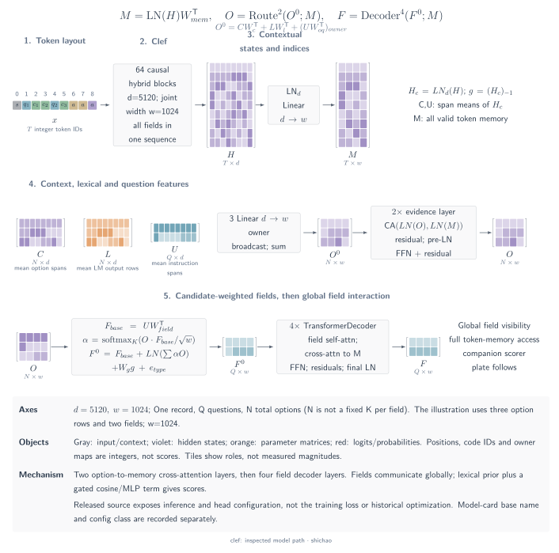
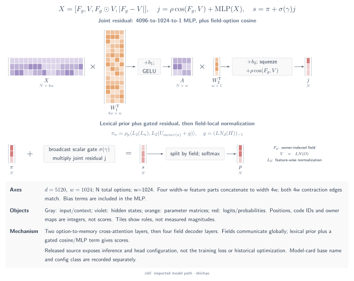
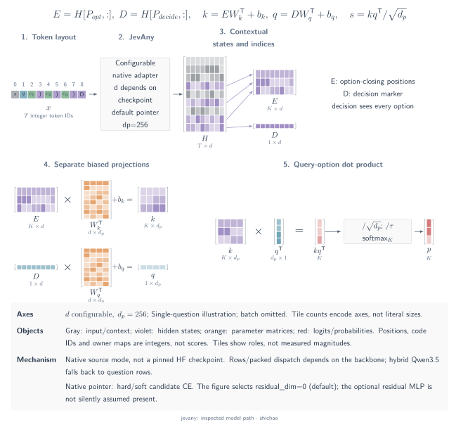
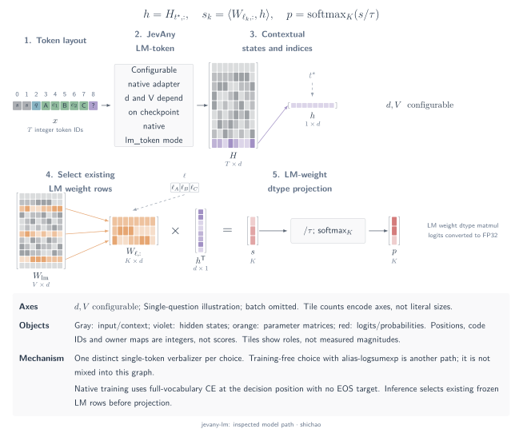

# Scalar, pointer and joint-schema architectures

These four projects place the decision head at different points in the token computation. The sections below describe pinned source and release metadata inspected on 2026-11-10. They provide architecture evidence for comparison with MetisCraft; no training run, checkpoint import or accuracy reproduction is reported here.

Let \(B\) be the number of questions, \(K_b\) the candidate count for question \(b\), and \(R=\sum_b K_b\). A question row and a candidate row represent different computational objects. All final softmax operations below normalize over the valid candidates of one question.

## JevForge: an independent scalar for each candidate path

Each candidate has its own input row. The model reads one scalar from its final hidden state, then normalizes the scores within a question. [How JevForge scores a candidate](../jevlike/jevforge.md) traces the architecture, works through adding an option and documents the released temperatures.

## Kev: a decision query points to option-end representations

Kev pairs one decision vector at the end of each question with its option-end representations. The [Kev-4B pointer readout](../jevlike/kev.md) covers the question rows, projections and architecture diagram with links to pinned source lines.

## Clef: evidence routing, field interaction and a gated joint score

The reference is `Cloudflare/clef` at `cfddda0`. The model card names Qwen3.8-27B as its base; the released configuration uses the `Qwen3_5ForConditionalGeneration` class. That configuration declares hidden width \(d=5120\) and 64 layers, comprising 48 linear-attention and 16 full-attention layers. The joint head has width \(w=1024\), two evidence-routing layers, four field-decoder layers, 16 attention heads and feedforward width 4,096.

Clef encodes the state and the entire schema in one sequence, followed by an assistant decision suffix. It records half-open instruction and option spans, then obtains the backbone's final hidden states. The encoder preserves the schema and suffix while truncating the state to the remaining length budget. The head slices away padding and processes each record separately.

[SVG](../../tensor-analysis/figures/architecture-clef-scorer.en.svg) · [PDF](../../tensor-analysis/figures/architecture-clef-scorer.en.pdf) · [TikZ](../../tensor-analysis/figures/architecture-clef-scorer.en.tex)

[SVG](../../tensor-analysis/figures/architecture-clef.en.svg) · [Dark SVG](../../tensor-analysis/figures/architecture-clef.en.dark.svg) · [PDF](../../tensor-analysis/figures/architecture-clef.en.pdf) · [TikZ](../../tensor-analysis/figures/architecture-clef.en.tex)

For one record, let \(T\) be its valid token count, \(Q\) its field count and \(N=\sum_{q=1}^{Q}K_q\) its total candidate count. The head applies LayerNorm over the backbone width and constructs:

- token memory \(M:[1,T,1024]\), projected from normalized hidden states \([T,5120]\);
- instruction-span means \(U:[Q,5120]\), option-context means \(C:[N,5120]\), and a global vector \(g:[5120]\) from the final sequence position;
- lexical option means \(L:[N,5120]\), gathered from the original LM **output embedding rows** at the option-span token IDs.

Three bias-free projections form each candidate query:
\[
O_n=W_cC_n+W_\ell L_n+W_{oq}U_{\operatorname{owner}(n)}
\in\mathbb R^{1024}.
\]
The two evidence-routing layers cross-attend from \(O:[1,N,1024]\) to the complete token memory. Each layer uses pre-normalization, an attention residual and a `1024 → 4096 → 1024` feedforward residual. These layers contain no candidate self-attention.

The routed candidates are split by field. Within each field, a softmax of the candidate–field dot products produces an option summary. The initial field representation adds the projected instruction, normalized option summary, projected global vector and learned question-type embedding. Four pre-norm Transformer decoder layers then apply field self-attention, token-memory cross-attention and feedforward updates. No field or memory attention mask is supplied to these head layers. A final LayerNorm yields \(F:[Q,1024]\).

The scalar score retains two branches. A lexical prior compares L2-normalized \(L_n\) with L2-normalized \(U_q+g\). The joint branch combines field–candidate cosine similarity with an MLP on four width-\(w\) feature groups:
\[
\begin{aligned}
X_{q,k}&=[F_q;\widehat O_{q,k};
 F_q\odot\widehat O_{q,k};|F_q-\widehat O_{q,k}|]\in\mathbb R^{4096},\\
z_{q,k}&=\rho_p\langle\operatorname{norm}(L_{q,k}),
                   \operatorname{norm}(U_q+g)\rangle\\
&\quad+\sigma(a)\left[
 \rho_j\operatorname{cos}(F_q,\widehat O_{q,k})
 +\operatorname{MLP}_{4096\to1024\to1}(X_{q,k})\right].
\end{aligned}
\]
Here \(\widehat O\) is the LayerNorm-normalized routed option vector; \(\rho_p\) and \(\rho_j\) are learned positive scales capped at 100, and \(a\) is a learned scalar gate. Their trained numeric values are checkpoint parameters. The final output is \(\operatorname{softmax}_k(z_{q,k})\).

Although the backbone is causal, the head reads the complete token memory and mixes field representations. Later options and other fields can therefore influence a final candidate score. The published code and model card provide no training-loss implementation or complete training recipe. MetisCraft's current candidate scalar head does not include this schema encoder, evidence routing, field decoder or gated scorer; Clef compatibility would require those components and its checkpoint loader.

Pinned sources: [encoding and complete joint head](https://huggingface.co/Cloudflare/clef/blob/cfddda043dd190ef3b01cff449d5ee8cff1e8ec6/joint_schema_model.py), [head configuration](https://huggingface.co/Cloudflare/clef/blob/cfddda043dd190ef3b01cff449d5ee8cff1e8ec6/joint_head_config.json), [backbone configuration](https://huggingface.co/Cloudflare/clef/blob/cfddda043dd190ef3b01cff449d5ee8cff1e8ec6/config.json), [model card](https://huggingface.co/Cloudflare/clef/blob/cfddda043dd190ef3b01cff449d5ee8cff1e8ec6/README.md).

## JevAny: two native readouts over an adapted backbone

The reference is JevAny toolkit source `7832fd7`. This source pin covers the implementation, while the comparison does not select a particular JevAny Hub checkpoint. The backbone width \(d\), layer count and tuning configuration therefore remain checkpoint-specific.

Native inputs use the state, question instructions, option spans and a final decision marker. The adapter chooses either isolated causal question rows or a supported packed branch layout. In the inspected text adapter, packed execution is admitted for recognized full-attention Llama/Mistral configurations without a sliding window; other configurations use rows. Option isolation requires packed-mask support.

[SVG](../../tensor-analysis/figures/architecture-jevany.en.svg) · [Dark SVG](../../tensor-analysis/figures/architecture-jevany.en.dark.svg) · [PDF](../../tensor-analysis/figures/architecture-jevany.en.pdf) · [TikZ](../../tensor-analysis/figures/architecture-jevany.en.tex)

The native **pointer** path gathers \(D:[B,d]\) at decision markers and \(E:[R,d]\) at option ends. Biased projections produce queries \([B,d_p]\) and keys \([R,d_p]\), followed by an owner-selected dot product divided by \(\sqrt{d_p}\), inference temperature and per-question softmax. The source defaults are \(d_p=256\) and `residual_dim=0`. When configured, the optional residual scores the elementwise query–key product through `d_p → residual_dim → 1` with GELU. It is absent under the default setting.

The native **LM-token** path prefixes each option with a frozen, distinct, single-token verbalizer. It reads the decision state \(D_b:[d]\) through the original frozen LM projection \(W_{\mathrm{lm}}:[V,d]\). Training and inference use different output supports:
\[
\begin{array}{ll}
\text{training:}&D_b\to W_{\mathrm{lm}}D_b:[V]
 \to\operatorname{logsoftmax}_V\to\text{target verbalizer CE},\\
\text{inference:}&W_b=W_{\mathrm{lm}}[\ell_{b,1:K_b},:]:[K_b,d],
 \quad D_b\to W_bD_b:[K_b]\to\operatorname{softmax}_{K_b}.
\end{array}
\]
Inference selects the weight rows before projection and applies the configured temperature. The training loss retains the full-vocabulary denominator, with either a hard target or a soft distribution on the verbalizer IDs. It supervises the decision position; the inspected loss does not add an EOS target.

Pointer training implements candidate cross-entropy and an optional experimental RLCR objective. RLCR is restricted to pointer mode in this source. These implemented options do not identify the training history of an unpinned checkpoint. MetisCraft's answer-token path shares the idea of reading candidate-code logits, but prompt construction, loss support and artifact loading must be checked separately; JevAny's pointer checkpoint format is also distinct from MetisCraft's current artifacts.

JevAny also provides a **training-free choice-token readout**, described separately from the two native paths above. It uses its own option-ID prompt for up to 52 `A–Z, a–z` symbols. Every token ID decoding to the exact symbol contributes to that symbol's log mass \(m_k\) through log-sum-exp; the output is \(p_k=\operatorname{softmax}_k(m/\tau)\). This alias aggregation differs from the native LM-token mode's frozen single-ID verbalizer table and should not be merged into its architecture diagram.

Pinned sources: [native model and readouts](https://github.com/SimpleJev/JevAny/blob/7832fd7ba3b0ba4205bf9f6d3457a7256e11e24e/jevany/model.py), [adapter and packed-mask selection](https://github.com/SimpleJev/JevAny/blob/7832fd7ba3b0ba4205bf9f6d3457a7256e11e24e/jevany/backbones.py#L228-L234), [native training losses](https://github.com/SimpleJev/JevAny/blob/7832fd7ba3b0ba4205bf9f6d3457a7256e11e24e/jevany/train.py#L28-L85), [training-free prompt and alias aggregation](https://github.com/SimpleJev/JevAny/blob/7832fd7ba3b0ba4205bf9f6d3457a7256e11e24e/jevany/letter_readout.py).

### Native LM-token path

[SVG](../../tensor-analysis/figures/architecture-jevany-lm.en.svg) · [PDF](../../tensor-analysis/figures/architecture-jevany-lm.en.pdf) · [TikZ](../../tensor-analysis/figures/architecture-jevany-lm.en.tex)

[Model architecture atlas](architectures.md)

[中文](../../zh/tensor-analysis/architectures-structured.md)
