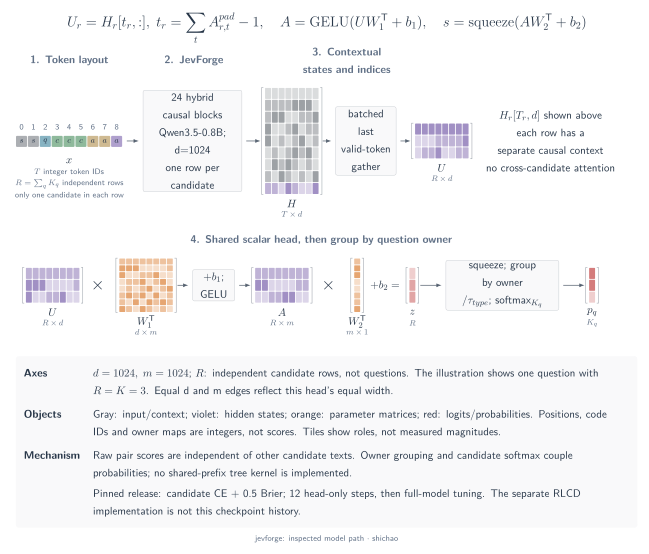
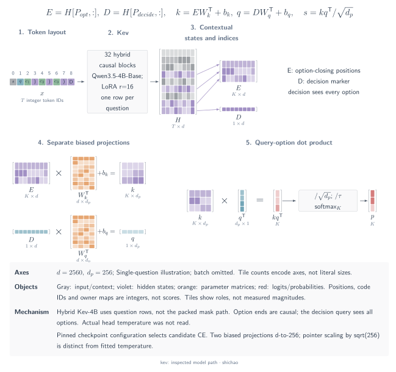
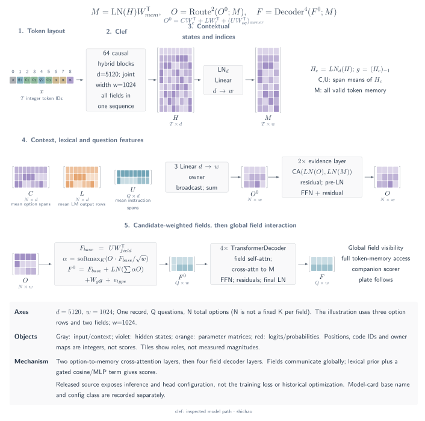
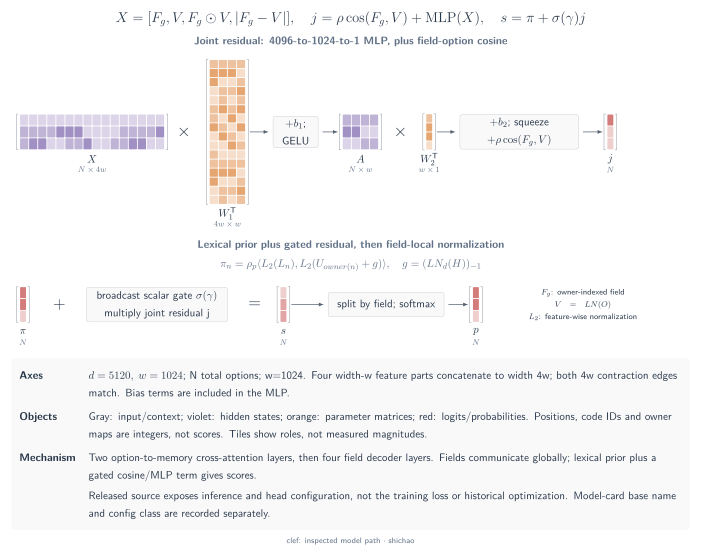
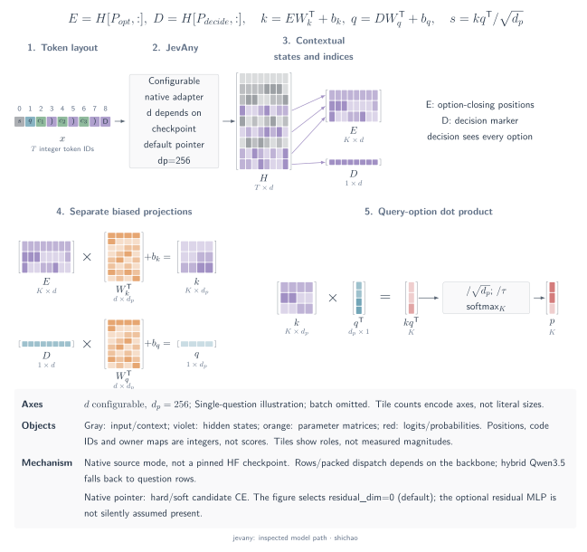
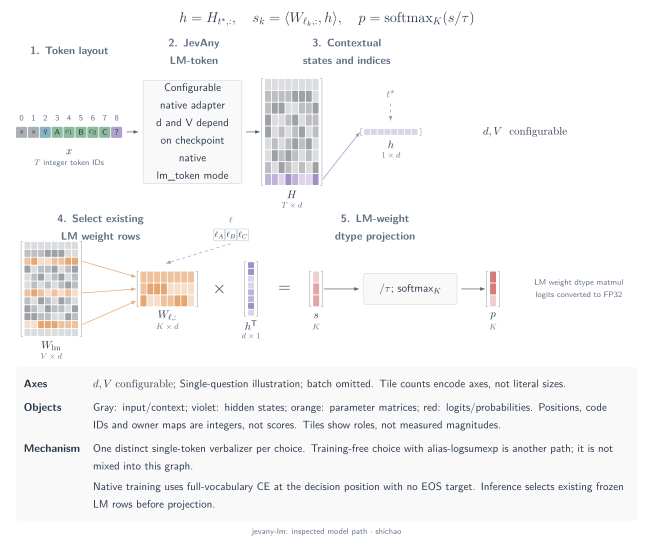

# Scalar, pointer and joint-schema architectures

These four projects place the decision head at different points in the token computation. The sections below describe pinned source and release metadata inspected on 2026-11-10. They provide architecture evidence for comparison with MetisCraft; no training run, checkpoint import or accuracy reproduction is reported here.

Let \(B\) be the number of questions, \(K_b\) the candidate count for question \(b\), and \(R=\sum_b K_b\). A question row and a candidate row represent different computational objects. All final softmax operations below normalize over the valid candidates of one question.

## JevForge: an independent scalar for each candidate path

The reference is JevForge source `039badb` and the `AndeyTait/JevForge-0.8B` release at `5ca7c08`. The release contains a Qwen3.5-0.8B configuration with hidden width 1,024 and 24 layers: 18 linear-attention layers and six full-attention layers.

Each input row contains the state, one question and one candidate. The native renderer produces `<|oj:state|> … <|oj:question|> … candidate … <|oj:answer|>`. It copies the question prefix into each candidate path, then right-pads the \(R\) paths. The model gathers the last real token of each path, at the end of the answer marker. The head is a shared `Linear(1024,1024) → GELU → Linear(1024,1)`, with biases in both linear layers.

[SVG](../../tensor-analysis/figures/architecture-jevforge.en.svg) · [Dark SVG](../../tensor-analysis/figures/architecture-jevforge.en.dark.svg) · [PDF](../../tensor-analysis/figures/architecture-jevforge.en.pdf) · [TikZ](../../tensor-analysis/figures/architecture-jevforge.en.tex)

\[
I:[R,T]\ \longrightarrow\ H:[R,T,1024]
\ \xrightarrow{\mathrm{gather}}\ U:[R,1024]
\ \xrightarrow{\mathrm{MLP}}\ z:[R]
\ \xrightarrow{\mathrm{group\ by\ owner}}\ (z_b:[K_b])_b.
\]

For the real-token mask \(A:[R,T]\), the readout position is \(t_r=\sum_t A_{r,t}-1\), so \(U_r=H_{r,t_r,:}\). An integer owner index assigns each scalar to its question. Inference applies \(p_b=\operatorname{softmax}(z_b/\tau_{\mathrm{type}})\). A candidate's raw score depends on its own row; the categorical denominator couples its probability to the other candidates. The implementation batches independent rows and does not establish a shared-prefix tree-attention kernel.

The pinned release training script uses target-distribution cross-entropy plus \(0.5\sum_k(p_{b,k}-y_{b,k})^2\). It enables backbone updates after 12 head-only steps. MetisCraft's [scalar-pairs layout](scalar-heads.md) expresses the corresponding independent-row mechanism. Its default scalar-list layout instead places all candidates in one causal sequence, and the recorded 0.6B recipe uses a `1024 → 256 → 1` head. These correspondences do not supply a JevForge checkpoint loader.

Pinned sources: [prompt encoding](https://github.com/zwliJay/jev-forge/blob/039badbafc242b4f8105a59e27f789320efe6e9c/jevforge/encode.py#L24-L66), [scalar head and token gather](https://github.com/zwliJay/jev-forge/blob/039badbafc242b4f8105a59e27f789320efe6e9c/jevforge/model.py#L20-L49), [release backbone configuration](https://huggingface.co/AndeyTait/JevForge-0.8B/blob/5ca7c0861a0d9b72629a7bc40130a8f154c4840f/backbone/config.json), [release training objective](https://huggingface.co/AndeyTait/JevForge-0.8B/blob/5ca7c0861a0d9b72629a7bc40130a8f154c4840f/training-code/train_curated_v3.py#L70-L80).

## Kev: a decision query points to option-end representations

The reference is Kev source `2074cc4` and `jaredpalmer/kev-4b` at `6cfce5c`. Its release configuration selects Qwen3.5-4B-Base at `1001bb4`, with hidden width 2,560, 32 layers and rank-16 LoRA. The backbone has 24 linear-attention layers and eight full-attention layers.

The logical input is a state followed by question branches: `<q> instruction <opt> option </opt> … <decide>`. This hybrid backbone runs one causal row per question, containing the state and that question's complete branch. The pointer gathers the final `<decide>` representation and each candidate's closing `</opt>` representation. Two separate biased linear projections map their width from 2,560 to \(d_p=256\).

[SVG](../../tensor-analysis/figures/architecture-kev.en.svg) · [Dark SVG](../../tensor-analysis/figures/architecture-kev.en.dark.svg) · [PDF](../../tensor-analysis/figures/architecture-kev.en.pdf) · [TikZ](../../tensor-analysis/figures/architecture-kev.en.tex)

\[
\begin{aligned}
H&:[B,T,2560]
 \xrightarrow{\mathrm{gather}}
 D:[B,2560],\ E:[R,2560],\\
Q&=DW_q^{\mathsf T}+b_q:[B,256],\qquad
K=EW_k^{\mathsf T}+b_k:[R,256],\\
z_r&=\frac{\langle K_r,Q_{g(r)}\rangle}{\sqrt{256}},
\qquad p_b=\operatorname{softmax}(z_b/\tau).
\end{aligned}
\]

Here \(g(r)\) is the integer question owner of candidate \(r\). The width axis is contracted by the dot product; the candidate axis is normalized by the final softmax. The head does not L2-normalize its projected vectors. The factor \(1/\sqrt{256}\) belongs to pointer scoring, while \(\tau\) is a separate inference temperature.

Within a row, a later option can read earlier options and the decision marker can read every option. Questions remain isolated. The same source supports a packed block-causal mask for suitable attention-only backbones: a query at \(i\) can read key \(j\) when \(j\leq i\) and the key belongs to the state or the same question. Optional option isolation further restricts option-span visibility and resets their position IDs; the pinned hybrid Kev-4B path rejects that setting. Its primary architecture should therefore show question rows.

The training code implements hard-label or soft-target cross-entropy over a question's candidates. The release configuration records zero weights for the auxiliary loss switches in the inspected stage. A stored temperature is applied only in evaluation mode; its numeric weight value was not inspected here. MetisCraft's current readouts do not implement this pointer head or its checkpoint format. Supporting Kev would require the two-position gather, pointer parameters and checkpoint loading path.

Pinned sources: [encoding, pointer head and row dispatch](https://github.com/jaredpalmer/kev/blob/2074cc44256200bb37540103fa4572901faa10f3/kev/model.py), [base configuration](https://huggingface.co/Qwen/Qwen3.5-4B-Base/blob/1001bb4d826a52d1f399e183466143f4da7b741b/config.json), [release training configuration](https://huggingface.co/jaredpalmer/kev-4b/blob/6cfce5c2fa4b4bd64026336ab649c5ca78857d52/training_config.json), [candidate loss](https://github.com/jaredpalmer/kev/blob/2074cc44256200bb37540103fa4572901faa10f3/kev/train.py#L41-L61).

## Clef: evidence routing, field interaction and a gated joint score

The reference is `Cloudflare/clef` at `cfddda0`. The model card names Qwen3.8-27B as its base; the released configuration uses the `Qwen3_5ForConditionalGeneration` class. That configuration declares hidden width \(d=5120\) and 64 layers, comprising 48 linear-attention and 16 full-attention layers. The joint head has width \(w=1024\), two evidence-routing layers, four field-decoder layers, 16 attention heads and feedforward width 4,096.

Clef encodes the state and the entire schema in one sequence, followed by an assistant decision suffix. It records half-open instruction and option spans, then obtains the backbone's final hidden states. The encoder preserves the schema and suffix while truncating the state to the remaining length budget. The head slices away padding and processes each record separately.

[SVG](../../tensor-analysis/figures/architecture-clef-scorer.en.svg) · [PDF](../../tensor-analysis/figures/architecture-clef-scorer.en.pdf) · [TikZ](../../tensor-analysis/figures/architecture-clef-scorer.en.tex)

[SVG](../../tensor-analysis/figures/architecture-clef.en.svg) · [Dark SVG](../../tensor-analysis/figures/architecture-clef.en.dark.svg) · [PDF](../../tensor-analysis/figures/architecture-clef.en.pdf) · [TikZ](../../tensor-analysis/figures/architecture-clef.en.tex)

For one record, let \(T\) be its valid token count, \(Q\) its field count and \(N=\sum_{q=1}^{Q}K_q\) its total candidate count. The head applies LayerNorm over the backbone width and constructs:

- token memory \(M:[1,T,1024]\), projected from normalized hidden states \([T,5120]\);
- instruction-span means \(U:[Q,5120]\), option-context means \(C:[N,5120]\), and a global vector \(g:[5120]\) from the final sequence position;
- lexical option means \(L:[N,5120]\), gathered from the original LM **output embedding rows** at the option-span token IDs.

Three bias-free projections form each candidate query:
\[
O_n=W_cC_n+W_\ell L_n+W_{oq}U_{\operatorname{owner}(n)}
\in\mathbb R^{1024}.
\]
The two evidence-routing layers cross-attend from \(O:[1,N,1024]\) to the complete token memory. Each layer uses pre-normalization, an attention residual and a `1024 → 4096 → 1024` feedforward residual. These layers contain no candidate self-attention.

The routed candidates are split by field. Within each field, a softmax of the candidate–field dot products produces an option summary. The initial field representation adds the projected instruction, normalized option summary, projected global vector and learned question-type embedding. Four pre-norm Transformer decoder layers then apply field self-attention, token-memory cross-attention and feedforward updates. No field or memory attention mask is supplied to these head layers. A final LayerNorm yields \(F:[Q,1024]\).

The scalar score retains two branches. A lexical prior compares L2-normalized \(L_n\) with L2-normalized \(U_q+g\). The joint branch combines field–candidate cosine similarity with an MLP on four width-\(w\) feature groups:
\[
\begin{aligned}
X_{q,k}&=[F_q;\widehat O_{q,k};
 F_q\odot\widehat O_{q,k};|F_q-\widehat O_{q,k}|]\in\mathbb R^{4096},\\
z_{q,k}&=\rho_p\langle\operatorname{norm}(L_{q,k}),
                   \operatorname{norm}(U_q+g)\rangle\\
&\quad+\sigma(a)\left[
 \rho_j\operatorname{cos}(F_q,\widehat O_{q,k})
 +\operatorname{MLP}_{4096\to1024\to1}(X_{q,k})\right].
\end{aligned}
\]
Here \(\widehat O\) is the LayerNorm-normalized routed option vector; \(\rho_p\) and \(\rho_j\) are learned positive scales capped at 100, and \(a\) is a learned scalar gate. Their trained numeric values are checkpoint parameters. The final output is \(\operatorname{softmax}_k(z_{q,k})\).

Although the backbone is causal, the head reads the complete token memory and mixes field representations. Later options and other fields can therefore influence a final candidate score. The published code and model card provide no training-loss implementation or complete training recipe. MetisCraft's current candidate scalar head does not include this schema encoder, evidence routing, field decoder or gated scorer; Clef compatibility would require those components and its checkpoint loader.

Pinned sources: [encoding and complete joint head](https://huggingface.co/Cloudflare/clef/blob/cfddda043dd190ef3b01cff449d5ee8cff1e8ec6/joint_schema_model.py), [head configuration](https://huggingface.co/Cloudflare/clef/blob/cfddda043dd190ef3b01cff449d5ee8cff1e8ec6/joint_head_config.json), [backbone configuration](https://huggingface.co/Cloudflare/clef/blob/cfddda043dd190ef3b01cff449d5ee8cff1e8ec6/config.json), [model card](https://huggingface.co/Cloudflare/clef/blob/cfddda043dd190ef3b01cff449d5ee8cff1e8ec6/README.md).

## JevAny: two native readouts over an adapted backbone

The reference is JevAny toolkit source `7832fd7`. This source pin covers the implementation, while the comparison does not select a particular JevAny Hub checkpoint. The backbone width \(d\), layer count and tuning configuration therefore remain checkpoint-specific.

Native inputs use the state, question instructions, option spans and a final decision marker. The adapter chooses either isolated causal question rows or a supported packed branch layout. In the inspected text adapter, packed execution is admitted for recognized full-attention Llama/Mistral configurations without a sliding window; other configurations use rows. Option isolation requires packed-mask support.

[SVG](../../tensor-analysis/figures/architecture-jevany.en.svg) · [Dark SVG](../../tensor-analysis/figures/architecture-jevany.en.dark.svg) · [PDF](../../tensor-analysis/figures/architecture-jevany.en.pdf) · [TikZ](../../tensor-analysis/figures/architecture-jevany.en.tex)

The native **pointer** path gathers \(D:[B,d]\) at decision markers and \(E:[R,d]\) at option ends. Biased projections produce queries \([B,d_p]\) and keys \([R,d_p]\), followed by an owner-selected dot product divided by \(\sqrt{d_p}\), inference temperature and per-question softmax. The source defaults are \(d_p=256\) and `residual_dim=0`. When configured, the optional residual scores the elementwise query–key product through `d_p → residual_dim → 1` with GELU. It is absent under the default setting.

The native **LM-token** path prefixes each option with a frozen, distinct, single-token verbalizer. It reads the decision state \(D_b:[d]\) through the original frozen LM projection \(W_{\mathrm{lm}}:[V,d]\). Training and inference use different output supports:
\[
\begin{array}{ll}
\text{training:}&D_b\to W_{\mathrm{lm}}D_b:[V]
 \to\operatorname{logsoftmax}_V\to\text{target verbalizer CE},\\
\text{inference:}&W_b=W_{\mathrm{lm}}[\ell_{b,1:K_b},:]:[K_b,d],
 \quad D_b\to W_bD_b:[K_b]\to\operatorname{softmax}_{K_b}.
\end{array}
\]
Inference selects the weight rows before projection and applies the configured temperature. The training loss retains the full-vocabulary denominator, with either a hard target or a soft distribution on the verbalizer IDs. It supervises the decision position; the inspected loss does not add an EOS target.

Pointer training implements candidate cross-entropy and an optional experimental RLCR objective. RLCR is restricted to pointer mode in this source. These implemented options do not identify the training history of an unpinned checkpoint. MetisCraft's answer-token path shares the idea of reading candidate-code logits, but prompt construction, loss support and artifact loading must be checked separately; JevAny's pointer checkpoint format is also distinct from MetisCraft's current artifacts.

JevAny also provides a **training-free choice-token readout**, described separately from the two native paths above. It uses its own option-ID prompt for up to 52 `A–Z, a–z` symbols. Every token ID decoding to the exact symbol contributes to that symbol's log mass \(m_k\) through log-sum-exp; the output is \(p_k=\operatorname{softmax}_k(m/\tau)\). This alias aggregation differs from the native LM-token mode's frozen single-ID verbalizer table and should not be merged into its architecture diagram.

Pinned sources: [native model and readouts](https://github.com/SimpleJev/JevAny/blob/7832fd7ba3b0ba4205bf9f6d3457a7256e11e24e/jevany/model.py), [adapter and packed-mask selection](https://github.com/SimpleJev/JevAny/blob/7832fd7ba3b0ba4205bf9f6d3457a7256e11e24e/jevany/backbones.py#L228-L234), [native training losses](https://github.com/SimpleJev/JevAny/blob/7832fd7ba3b0ba4205bf9f6d3457a7256e11e24e/jevany/train.py#L28-L85), [training-free prompt and alias aggregation](https://github.com/SimpleJev/JevAny/blob/7832fd7ba3b0ba4205bf9f6d3457a7256e11e24e/jevany/letter_readout.py).

### Native LM-token path

[SVG](../../tensor-analysis/figures/architecture-jevany-lm.en.svg) · [PDF](../../tensor-analysis/figures/architecture-jevany-lm.en.pdf) · [TikZ](../../tensor-analysis/figures/architecture-jevany-lm.en.tex)

[Model architecture atlas](architectures.md)

[中文](../../zh/tensor-analysis/architectures-structured.md)
