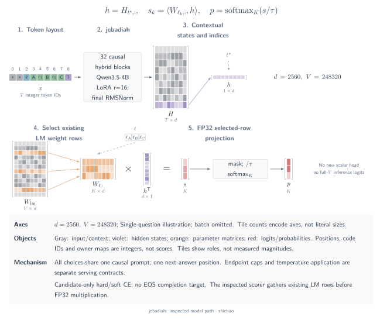
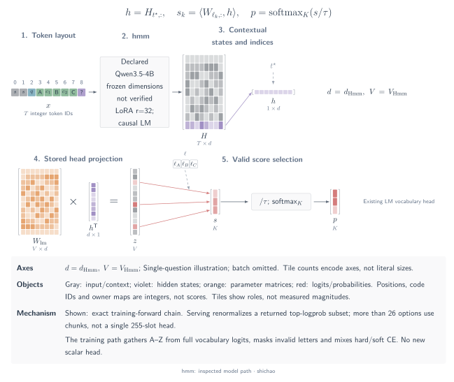
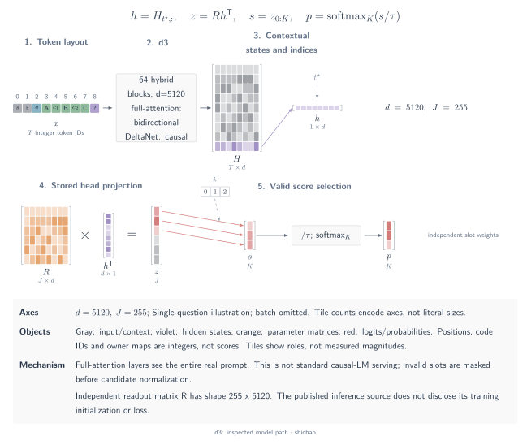
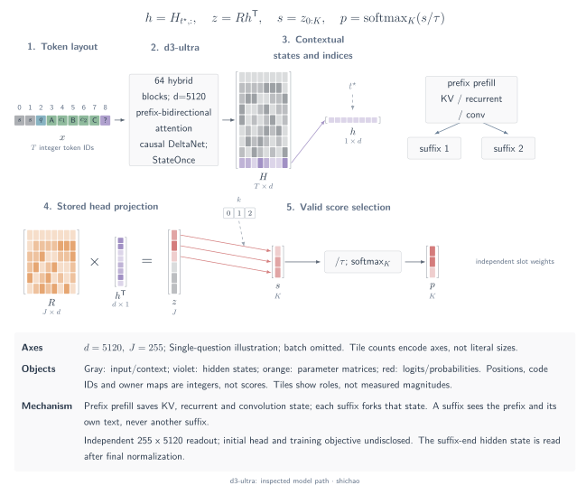
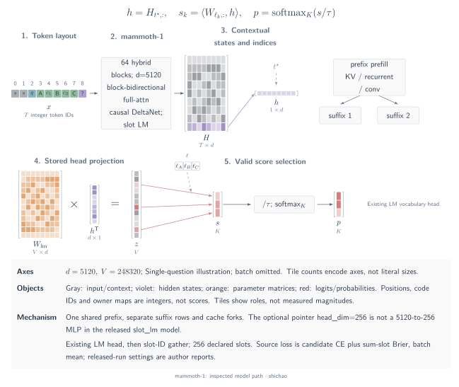

# Answer-token and fixed-slot model architectures

These architectures are described at fixed source and checkpoint revisions. Configuration, executable readout logic and author-reported training history are separate evidence. A matching readout family does not establish checkpoint compatibility or a reproduced training run. Shapes below retain the batch axis where it affects the computation.

## jebadiah

The reference checkpoint is **frontier-infra/jebadiah-4b-v2@872ae9509607761d4484ab49270311d9308bba18**, with source **getainode/jebadiah@a7e8108fbedaa08faa016bf4aeaa7c281b068639**. Its declared base is Qwen3.5-4B at revision `851bf6e806efd8d0a36b00ddf55e13ccb7b8cd0a`.

[SVG](../../tensor-analysis/figures/architecture-jebadiah.en.svg) · [Dark SVG](../../tensor-analysis/figures/architecture-jebadiah.en.dark.svg) · [PDF](../../tensor-analysis/figures/architecture-jebadiah.en.pdf) · [TikZ](../../tensor-analysis/figures/architecture-jebadiah.en.tex)

Each question forms one causal sequence: system instruction, state, question, labeled options and the non-thinking assistant prefix. The provided scorer uses the text CausalLM branch. Its backbone has 32 layers, hidden width 2,560, and eight groups of three Gated DeltaNet layers followed by one full-attention layer. Options share this sequence; later options can depend on earlier ones.

The scorer gathers the last real prompt representation and selects the existing LM-head rows for the candidate letters **before** multiplication. With right padding, the row index is \(t_b=\sum_t M_{b,t}-1\):

\[
h_b=H_{b,t_b,:}\in\mathbb R^{2560},\qquad
W_c=W_{\mathrm{lm}}[\ell]\in\mathbb R^{B\times K_{\max}\times2560},\qquad
s_{b,k}=\sum_j (W_c)_{b,k,j}(h_b)_j .
\]

The dot product uses FP32. Invalid candidate columns become \(-\infty\), and the valid scores pass through temperature scaling and candidate softmax. This is a row subset of the existing \(248320\times2560\) LM matrix; no new scalar head is attached.

The training implementation uses candidate-space cross-entropy against source distributions or hard labels. The released recipe uses an ordinal target for score questions. LoRA merging and the historical training recipe are recorded by the author. MetisCraft's answer-token readout expresses the same decision family, but its current forward projects the full vocabulary before gathering candidate columns; its Tev1 completion objective also differs from jebadiah's candidate CE. The retained vision configuration does not establish trained or calibrated image decisions.

Fixed sources:

- [Checkpoint configuration](https://huggingface.co/frontier-infra/jebadiah-4b-v2/blob/872ae9509607761d4484ab49270311d9308bba18/config.json)
- [Released scorer: position selection, LM-row gather and softmax](https://huggingface.co/frontier-infra/jebadiah-4b-v2/blob/872ae9509607761d4484ab49270311d9308bba18/scripts/jebadiah_model.py)
- [Training targets and candidate-space loss](https://github.com/getainode/jebadiah/blob/a7e8108fbedaa08faa016bf4aeaa7c281b068639/train/train_jebadiah.py)
- [Released base, adapter and temperature metadata](https://huggingface.co/frontier-infra/jebadiah-4b-v2/blob/872ae9509607761d4484ab49270311d9308bba18/jebadiah.json)

## Hmm

The reference release is **n4ze3m/Qwen3.5-4B-Hmm@adcef8b4701704a37c33053a8a262a7bd076a511**, with source **n4ze3m/hmm@78d8d4a62a41857ce67d903aadf504580feea832**. The adapter names Qwen3.5-4B as its base, but leaves the base revision unset. The reviewed release supplies GGUF files and a LoRA adapter without a frozen full backbone configuration; \(D_{\mathrm{Hmm}}\) and \(V_{\mathrm{Hmm}}\) therefore remain symbolic.

[SVG](../../tensor-analysis/figures/architecture-hmm.en.svg) · [Dark SVG](../../tensor-analysis/figures/architecture-hmm.en.dark.svg) · [PDF](../../tensor-analysis/figures/architecture-hmm.en.pdf) · [TikZ](../../tensor-analysis/figures/architecture-hmm.en.tex)

**Training path.** One question becomes a left-padded causal prompt containing the state, question and 2–26 options labeled A–Z. The model computes the last prompt position's vocabulary logits, then gathers the 26 letter columns:

\[
Z\in\mathbb R^{B\times1\times V_{\mathrm{Hmm}}},\qquad
S=Z[:,0,\ell_{A:Z}]\in\mathbb R^{B\times26}.
\]

Columns beyond each question's option count are set to \(-10^4\) before softmax. The existing LM head is reused; the adapter specifies LoRA rank 32, alpha 64 and dropout 0.05, with no added slot head. The loss mixes hard-label CE and soft-target CE. Its default soft-target weight is 0.5 when a teacher distribution exists; otherwise the example uses hard CE. Noul remains a two-letter classification task.

**Serving path.** The TypeScript service asks llama.cpp or Ollama for one token and a limited top-logprob list, collects returned letter probabilities, then renormalizes over the requested options. Missing letters receive zero mass; an all-zero result falls back to a uniform distribution. Above 26 options, it scores chunks of 25 plus a “none of these” exit and renormalizes the combined scores. This service path is not an exact single-pass 255-way candidate softmax.

MetisCraft can express the answer-token family, but preserving Hmm's behavior requires its prompt, letter limits, mixed training target and separate serving probability contract. The published training conditions and scores remain author reports.

Fixed sources:

- [Released LoRA configuration and unset base revision](https://huggingface.co/n4ze3m/Qwen3.5-4B-Hmm/blob/adcef8b4701704a37c33053a8a262a7bd076a511/lora/adapter_config.json)
- [Training prompt, full-vocabulary readout and mixed CE](https://github.com/n4ze3m/hmm/blob/78d8d4a62a41857ce67d903aadf504580feea832/training/train.py)
- [Serving backends and top-logprob collection](https://github.com/n4ze3m/hmm/blob/78d8d4a62a41857ce67d903aadf504580feea832/server/src/backends.ts)
- [Serving chunks, renormalization and fallback](https://github.com/n4ze3m/hmm/blob/78d8d4a62a41857ce67d903aadf504580feea832/server/src/index.ts)

## d3

The reference is **vllm-sr/d3@62f07e54c6c3a5ff5f695107377edc43e1a86ea8**. Its decision metadata names **Qwen/Qwen3.8-27B@1d4bf0f2ff6012fd82039f2fa52739d0dd7c60c0** as the base, while the actual configuration and loader use `qwen3_5` / `Qwen3_5Model`. Both identifiers matter.

[SVG](../../tensor-analysis/figures/architecture-d3.en.svg) · [Dark SVG](../../tensor-analysis/figures/architecture-d3.en.dark.svg) · [PDF](../../tensor-analysis/figures/architecture-d3.en.pdf) · [TikZ](../../tensor-analysis/figures/architecture-d3.en.tex)

Each question supplies a complete prompt with the state, question and coded options. The backbone has 64 layers and hidden width 5,120. In each group of four layers, three DeltaNet layers retain causal scans and one full-attention layer reads every real prompt token bidirectionally. Thus the full-attention layers also connect candidate texts in both directions. The plain path recomputes the full prompt for each question.

After final RMSNorm, the last prompt representation is multiplied by an independent FP32 matrix loaded from `readout.safetensors`:

\[
h\in\mathbb R^{B\times5120},\qquad
R\in\mathbb R^{255\times5120},\qquad
S=hR^{\mathsf T}\in\mathbb R^{B\times255}.
\]

The runtime checks this matrix shape explicitly. Slots beyond \(K_b\) are masked to \(-\infty\); temperature is 1.0, followed by softmax and removal of invalid columns. The answer codes identify slot rows. Their token IDs do not establish that the independent matrix was initialized from LM-head rows.

The reviewed artifact does not disclose the training objective, its reduction, or the readout's training-time initialization. The loader's no-op initialization only means that inference loads checkpoint weights. MetisCraft's current answer-token and scalar-list readouts do not implement d3's independent head and attention requirements.

Fixed sources:

- [Backbone and vision configuration](https://huggingface.co/vllm-sr/d3/blob/62f07e54c6c3a5ff5f695107377edc43e1a86ea8/config.json)
- [Base identity, answer codes and attention mode](https://huggingface.co/vllm-sr/d3/blob/62f07e54c6c3a5ff5f695107377edc43e1a86ea8/decision_config.json)
- [Prompt encoder, matrix-shape check, candidate mask and normalization](https://huggingface.co/vllm-sr/d3/blob/62f07e54c6c3a5ff5f695107377edc43e1a86ea8/d3_runtime.py)
- [Inference wrapper and checkpoint-only initialization](https://huggingface.co/vllm-sr/d3/blob/62f07e54c6c3a5ff5f695107377edc43e1a86ea8/modeling_d3.py)

## d3-ultra

The reference is **vllm-sr/d3-ultra@ccdcfa611649a59e095e0b5e1732a15cedafadd6**. Its configuration specifies the 64-layer `qwen3_5` backbone with hidden width 5,120. The pinned card, decision configuration and manifest do not identify an exact pretrained base revision; d3's base identity must not be transferred to this release.

[SVG](../../tensor-analysis/figures/architecture-d3-ultra.en.svg) · [Dark SVG](../../tensor-analysis/figures/architecture-d3-ultra.en.dark.svg) · [PDF](../../tensor-analysis/figures/architecture-d3-ultra.en.pdf) · [TikZ](../../tensor-analysis/figures/architecture-d3-ultra.en.tex)

The `header-v1` layout places a numbered header of the request's questions, state and shared media in the common prefix. Each question then has its own suffix containing the question, coded options and assistant prefix. The `prefix_bidir` mask lets prefix tokens read the prefix bidirectionally, while each suffix reads the prefix and its own suffix bidirectionally. A prefix cannot read a suffix, and different suffixes do not attend to one another. DeltaNet layers remain causal.

The `StateOnce` implementation computes the prefix once and retains full-attention keys/values plus DeltaNet recurrent and convolution states. Question suffix batches continue from that cache:

\[
\mathrm{cache}=\mathrm{StateOnce}(X_{\mathrm{prefix}}),\qquad
h=\mathrm{Questions}(X_{\mathrm{suffix}},\mathrm{cache})\in\mathbb R^{B\times5120},\qquad
S=hR^{\mathsf T},\quad R\in\mathbb R^{255\times5120}.
\]

Final normalization precedes the last-suffix-position readout. Invalid slots are masked before candidate softmax. The configured temperature is 1.046 for requests with one choice/noul/score question and 1.0 for the remaining request-size bins. Box reads four marker positions through the same matrix and uses the first 128 slots as coordinate bins; this does not establish a separate box MLP.

The training objective and readout initialization are not disclosed in the reviewed release. MetisCraft does not currently provide this head, block mask or shared-state cache adapter. The shared-state implementation distinguishes this release from d3's full-prompt-per-question path.

Fixed sources:

- [Backbone configuration](https://huggingface.co/vllm-sr/d3-ultra/blob/ccdcfa611649a59e095e0b5e1732a15cedafadd6/config.json)
- [Prefix mask, header layout and temperature table](https://huggingface.co/vllm-sr/d3-ultra/blob/ccdcfa611649a59e095e0b5e1732a15cedafadd6/decision_config.json)
- [StateOnce cache, fixed-slot projection and marker-position readouts](https://huggingface.co/vllm-sr/d3-ultra/blob/ccdcfa611649a59e095e0b5e1732a15cedafadd6/d3_runtime.py)
- [Shared header and token-boundary construction](https://huggingface.co/vllm-sr/d3-ultra/blob/ccdcfa611649a59e095e0b5e1732a15cedafadd6/d3_format.py)

## mammoth-1

The reference is **baselabs/mammoth-1@61cec44c281c693992e3d6ebeb44dd3402dfa186**. Its packaged runtime combines **OmniJev/OneJev@81ce62f1597c91e46767d4d02d6ac2e18534fe94** with the checkpoint's `serve.patch`. The card names Qwen3.5-27B as the base; no exact base revision is supplied.

[SVG](../../tensor-analysis/figures/architecture-mammoth-1.en.svg) · [Dark SVG](../../tensor-analysis/figures/architecture-mammoth-1.en.dark.svg) · [PDF](../../tensor-analysis/figures/architecture-mammoth-1.en.pdf) · [TikZ](../../tensor-analysis/figures/architecture-mammoth-1.en.tex)

The language backbone has 64 layers and hidden width 5,120. The shared prefix contains the system instruction and state; each question suffix contains its question, options and assistant prefix. Full-attention layers are bidirectional within the prefix and within each suffix, with suffix-to-prefix visibility. Prefix-to-suffix visibility is blocked, and suffix rows remain separate. DeltaNet layers stay causal. This permits a shared prefix prefill followed by cached question-suffix batches.

The checkpoint declares `slot_lm` and 256 slots. It uses the existing LM vocabulary head, not an added \(5120\rightarrow256\rightarrow256\) MLP:

\[
h\in\mathbb R^{B\times5120},\qquad
Z=hW_{\mathrm{lm}}^{\mathsf T}\in\mathbb R^{B\times248320},\qquad
S_{b,k}=Z_{b,\ell_k},\qquad p_b=\operatorname{softmax}(S_{b,\mathrm{valid}}/\tau).
\]

The runtime requires slot labels to round-trip as single tokens. In this `slot_lm` branch, head attachment returns without creating an additional decision-head module. The metadata's `head_dim=256` configures the optional pointer-head variant; it is not a bottleneck in the released readout. The supplied text runtime computes the LM head in FP32 by default.

The pinned loss implementation uses slot-wise CE plus Brier error, summing over valid slots and averaging over examples:

\[
\mathcal L=\frac1B\sum_b\left[-\sum_i q_{b,i}\log p_{b,i}
+\lambda\sum_i(p_{b,i}-q_{b,i})^2\right].
\]

The card reports \(\lambda=1\), full tuning of the language model and a frozen vision encoder. Those conditions describe the author's training run. The artifact includes vision configuration, while the supplied qev self-hosting entrypoint selects the text CausalLM branch; the two execution scopes should remain distinct. MetisCraft's CE/Brier support does not provide mammoth-1's checkpoint format, block mask or prefix-fork implementation.

Fixed sources:

- [Backbone, attention overrides and slot_lm declaration](https://huggingface.co/baselabs/mammoth-1/blob/61cec44c281c693992e3d6ebeb44dd3402dfa186/config.json)
- [Packaged readout and shared-prefix implementation](https://huggingface.co/baselabs/mammoth-1/blob/61cec44c281c693992e3d6ebeb44dd3402dfa186/serve.patch)
- [Pinned slot CE+Brier implementation](https://github.com/OmniJev/OneJev/blob/81ce62f1597c91e46767d4d02d6ac2e18534fe94/train/sft.py#L368-L379)
- [Model card and author-reported training conditions](https://huggingface.co/baselabs/mammoth-1/blob/61cec44c281c693992e3d6ebeb44dd3402dfa186/README.md)

[Model architecture atlas](architectures.md)

[中文](../../zh/tensor-analysis/architectures-token.md)
