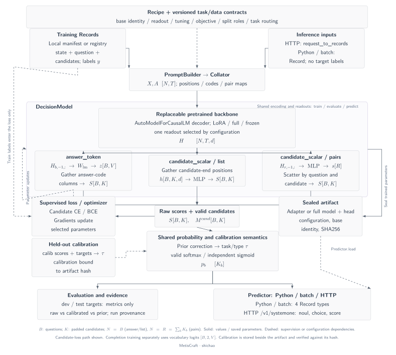
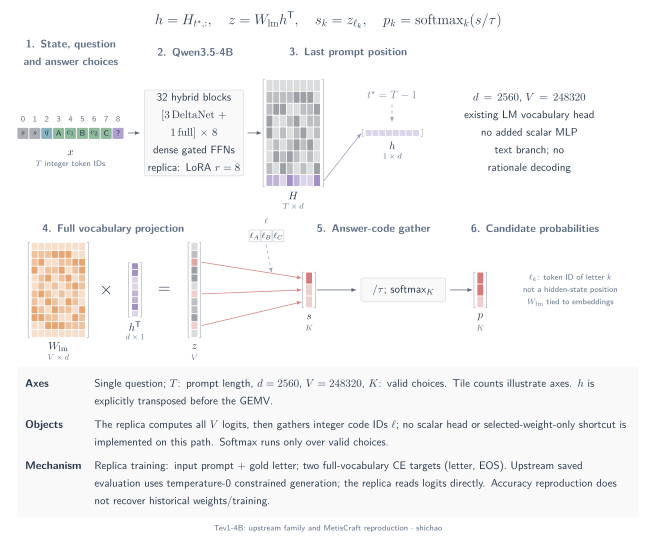

# Model architecture atlas

A shared decision interface can sit above different neural computations. This atlas follows **tokens → contextual states → indexed readouts → parameter projections → scores → normalization** for named implementations. It separates the input sequence count, candidate visibility and normalization axis from the number of batched model calls. Those distinctions explain a model's computation; they do not establish speed or calibration quality.

The diagrams use one geometry for each symbolic axis: selected rows remain rows, transposes swap physical edges, and both sides of a contracted dimension match. Tile counts illustrate axes rather than literal model sizes. Every plate has English/Chinese, light/dark, vector SVG/PDF and standalone editable TikZ exports. Click a diagram to inspect its full size; the viewer follows the page theme.

## MetisCraft: an instantiated model and a toolkit

The recorded customer-routing model uses **Qwen3-0.6B-Base, LoRA r=16 and a shared `1024 → 256 → 1` scalar head**. In default `list` layout, candidate-end hidden rows come from one causal question sequence. Later candidates can read earlier candidates. `noul` instead reads the final answer cue and produces one event logit. Optional `pairs` uses independent candidate rows and scatters their scores back to questions.

[SVG](../../tensor-analysis/figures/metiscraft-architecture.en.svg) · [Dark SVG](../../tensor-analysis/figures/metiscraft-architecture.en.dark.svg) · [PDF](../../tensor-analysis/figures/metiscraft-architecture.en.pdf) · [TikZ](../../tensor-analysis/figures/metiscraft-architecture.en.tex)

This is one concrete model assembled by the toolkit, not a claim that MetisCraft invented the pretrained backbone. [Introduction](introduction.md) connects the task, real train/test examples and saved response. [Scalar layouts](scalar-heads.md) expands `list` and `pairs`; [engineering workflow](../../tensor-analysis/figures/metiscraft-workflow.en.svg) separately connects contracts, artifacts and serving.

## Tev1: reproduced with MetisCraft's answer-token path

Tev1-4B belongs to a different readout family: a **32-layer Qwen3.5-4B hybrid backbone** followed by the existing vocabulary head. The MetisCraft reproduction gathers the last prompt state, projects the full vocabulary and selects answer-code logits. It trains LoRA r=8 with full-vocabulary letter/EOS completion targets. It does not attach the customer-routing scalar MLP.

[SVG](../../tensor-analysis/figures/tev1-architecture.en.svg) · [Dark SVG](../../tensor-analysis/figures/tev1-architecture.en.dark.svg) · [PDF](../../tensor-analysis/figures/tev1-architecture.en.pdf) · [TikZ](../../tensor-analysis/figures/tev1-architecture.en.tex)

The [reproduction record](../reproductions/tev1.md) reports **873/1,000 (87.3%)** on main and **298/300 (99.33%)** on transfer, versus published 88.0% and 100%. It also documents the upstream constrained-generation protocol, direct-logit reproduction, answer agreement, calibration limits and unavailable historical settings. This is accuracy reproduction under disclosed conditions; it does not recover the original training job or weights.

## Open implementations by actual computation

The following entries are **pinned-source architecture inspections**, not additional MetisCraft reproductions. Each chapter specifies its selected checkpoint or source mode, shapes, training evidence and unresolved publication details.

| Implementation | Readout and visibility | Detailed plate |
|---|---|---|
| jebadiah | Gather existing LM weight rows before multiplication; causal prompt | [Answer tokens](architectures-token.md#jebadiah) |
| Hmm | Training: full-vocabulary logits → A–Z; serving has a distinct top-logprob path | [Answer tokens](architectures-token.md#hmm) |
| d3 | Independent 255-slot matrix; full-attention bidirectional, DeltaNet causal | [Fixed slots](architectures-token.md#d3) |
| d3-ultra | Independent slot matrix; prefix-state reuse and question suffixes | [Fixed slots](architectures-token.md#d3-ultra) |
| mammoth-1 | Existing LM head, slot-ID gather and block-bidirectional full-attention | [Slot LM](architectures-token.md#mammoth-1) |
| JevForge | Independent candidate rows; shared `1024 → 1024 → 1` scalar MLP | [Scalar head](architectures-structured.md) |
| Kev-4B | Question rows; decision/option projections and scaled pointer dot product | [Pointer](architectures-structured.md) |
| Clef | Option-memory routing, field interaction, lexical prior and gated joint score | [Joint schema](architectures-structured.md) |
| JevAny | Native pointer and direct-token paths; backbone-dependent row/packed dispatch | [Native readouts](architectures-structured.md) |
| GLiClass | Joint bidirectional text/label context; two projectors and dot product | [Dynamic labels](architectures-encoders.md#gliclass) |
| GLiNER2 | Bidirectional schema `[L]` states; shared `768 → 1536 → 1` classifier | [Schema classification](architectures-encoders.md#gliner2) |
| Open-Jev student | Text-only encoder, mean pooling and fixed task classes | [Fixed-task student](architectures-encoders.md#open-jev) |
| SetFit | Sentence-body adaptation and fixed-class logistic regression | [Two-stage classifier](architectures-encoders.md#setfit) |
| Qwen3 Reranker | Independent query/document prompts; `no`/`yes` vocabulary logits | [Pointwise reranking](architectures-encoders.md) |

## Scope and sources

MetisCraft currently implements answer-token, scalar-list and scalar-pairs paths. A similar mathematical family does not provide direct loading of another project's checkpoint. Pointer, fixed-slot and joint-schema heads remain external comparisons. Shared-prefix tree attention remains a research mechanism rather than an implemented MetisCraft execution path.

Frameworks such as ms-swift and Unsloth configure multiple models; they are not assigned one invented architecture here. ModernBERT and DeBERTa are identified as backbones in the encoder chapter. Datasets and benchmarks are documented as data, not neural models. Jev's public System One contract does not reveal its private network.

The [ecosystem support matrix](../support-matrix.md) records adaptation and reproduction status. Diagram parameters and fixed primary-source references are retained in [the shared model catalogue](../../tensor-analysis/src/model-atlas.json); [the renderer](../../tensor-analysis/src/model_plates.py) derives equal-axis geometry. Full derivations continue in [readout mechanisms](readout-comparison.md).

[中文](../../zh/tensor-analysis/architectures.md)
