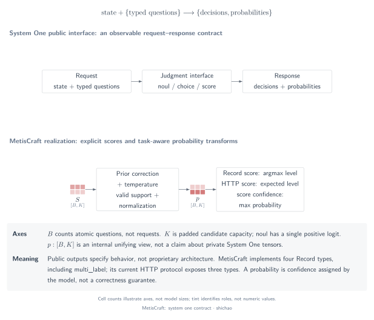
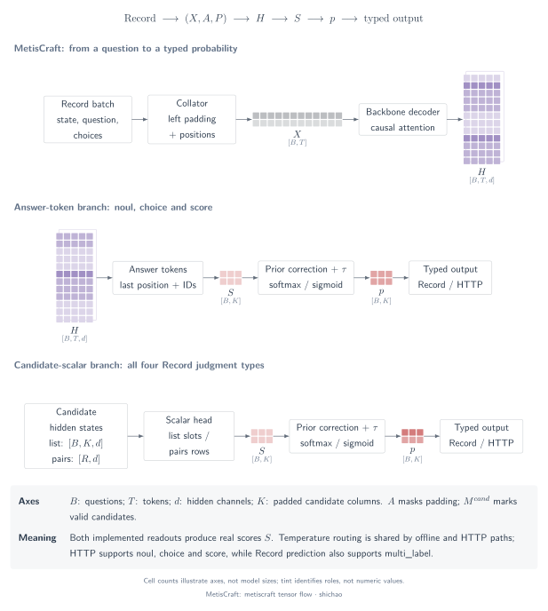

# System One and MetisCraft: from inputs to typed decisions

This chapter follows a decision from a named question to a probability distribution and a program-facing answer. The System One interface supplies the public contract; MetisCraft supplies inspectable implementations of answer-token and candidate-scalar readouts. A matching interface does not establish an identical model architecture.

## Question

How does a model turn `state` and a finite answer space into an answer that software can use? Three distinctions organize the explanation:

1. **Contract:** which questions and result types an interface accepts.
2. **Computation:** which tensors, indices and operators produce the scores.
3. **Evidence:** which implementation and measurements support a claim.

The [System One API reference](https://docs.typesafe.ai/api/system-one) defines named questions over shared state. This chapter uses that contract to explain MetisCraft; it does not infer Jev's private layers, training method or execution kernels. Official documentation was checked on **2026-11-09**.

[SVG](../../tensor-analysis/figures/system-one-contract.en.svg) · [PDF](../../tensor-analysis/figures/system-one-contract.en.pdf) · [TikZ](../../tensor-analysis/figures/system-one-contract.en.tex)

## Tensors and semantics

One HTTP request can contain several questions. MetisCraft converts each question to one `Record`, so the batch axis counts **questions**, not requests. A choice question with three options has three mutually exclusive outcomes; a multi-label question has one Bernoulli outcome per candidate.

| Object | Shape | Meaning of one entry |
|---|---|---|
| Token IDs \(X\) | \([B,T]\) | Vocabulary index at one token position |
| Padding mask \(A\) | \([B,T]\) | Whether a token position contains input rather than padding |
| Hidden states \(H\) | \([B,T,d]\) | A feature coordinate at one contextualized token |
| Candidate mask \(M^{\mathrm{cand}}\) | \([B,K_{\max}]\) | Whether that question has this candidate column |
| Readout scores \(S\) | \([B,K_{\max}]\) | An unnormalized score, not a probability |
| Valid probabilities \(P_b\) | \([K_b]\) | Probability of an option, level or candidate event |

See the [notation and indexing guide](notation.md) for dtypes, ragged batches and the difference between padding, causal visibility and candidate validity.

## Operator chain

MetisCraft follows this path:

`request → Records → tokenization → left padding → backbone → readout → logit correction → temperature → typed probabilities → response`

[SVG](../../tensor-analysis/figures/metiscraft-tensor-flow.en.svg) · [PDF](../../tensor-analysis/figures/metiscraft-tensor-flow.en.pdf) · [TikZ](../../tensor-analysis/figures/metiscraft-tensor-flow.en.tex)

The backbone returns representations. The readout selects representations or vocabulary columns and turns them into scores. The judgment type determines normalization; the response adapter assigns the resulting values to stable answer IDs.

## Equations

For question \(b\), let \(\mathcal K_b\) contain its valid candidate columns and let \(\tau_b>0\) be the selected temperature. Write \(\widetilde s_{b,k}=(s_{b,k}-\delta_b)/\tau_b\), where \(\delta_b\) is zero except for the configured multi-label positive-weight correction.

\[
p_{b,k}=\frac{\exp(\widetilde s_{b,k})}{\sum_{j\in\mathcal K_b}\exp(\widetilde s_{b,j})}
\qquad\text{for choice and score},
\]

\[
p_{b,k}=\sigma(\widetilde s_{b,k})
\qquad\text{for noul and multi-label events}.
\]

Softmax couples candidate probabilities through its denominator. Independent sigmoid outputs have no sum-to-one constraint; this does not imply that their hidden representations are independent.

## Small example

The following values are **constructed arithmetic**, not a model-quality result. For three option scores \([0,1,2]\) and temperature \(1\), softmax gives approximately \([0.090031,0.244728,0.665241]\). A choice selects the third option. For ordered levels numbered \(0,1,2\), the same distribution has modal level \(2\) and expected score \(1.575210\).

| Judgment | Python / Record | `/v1/systemone` |
|---|---|---|
| `noul` | Probability of yes and a thresholded decision | Probability of yes |
| `choice` | Option distribution and selected ID | Option distribution and selected ID |
| `score` | Level distribution and modal level index | Level distribution and expected level index |
| `multi_label` | Independent candidate probabilities and selected IDs | Not supported in this version |

MetisCraft `0.1.0rc1` returns maximum option/level probability as HTTP `confidence`. TypeSafe's documented confidence statistics differ. The [training and calibration page](training-calibration.md#probability-score-and-confidence) gives the explicit comparison; no protocol change is implied by this chapter.

## Source map

These explanations follow the toolkit implementation at commit `6b9701da7814111b13d8882f48288f4df46dc983`.

| Stage | Inspectable implementation |
|---|---|
| Question-to-Record conversion | [`request_to_records`](../../../src/metiscraft/data/jev.py#L146) |
| Token sequences and candidate indices | [`PromptBuilder`](../../../src/metiscraft/modeling/prompts.py#L136) |
| Padding and tensor batching | [`Collator`](../../../src/metiscraft/train/collate.py#L39) |
| Answer-token and scalar readouts | [`DecisionModel.forward`](../../../src/metiscraft/modeling/model.py#L55) |
| Normalization and decisions | [`probabilities` and `decide`](../../../src/metiscraft/judgments/__init__.py#L112) |
| Calibration and response assembly | [`Predictor`](../../../src/metiscraft/serve/predictor.py#L126) |

## Scope and reading routes

MetisCraft implements two readout families and three execution paths: answer-token, scalar `list`, and scalar `pairs`. The [seven-family comparison](readout-comparison.md) also explains mechanisms from the surrounding ecosystem; those diagrams do not add implementations to the package.

- **Five-minute explanation:** follow the [guided walkthrough](walkthrough.md), reusing this chapter's diagrams and evidence.
- **Implementation reading:** [notation](notation.md) → [answer-token](answer-token.md) → [scalar heads](scalar-heads.md) → [training and calibration](training-calibration.md).
- **First runnable application:** use the [CPU Cookbook](../cookbook/first-model.md).
- **Measured model behavior:** consult the [Tev1 reproduction record](../reproductions/tev1.md); tensor arithmetic and random-model checks do not measure task accuracy.
