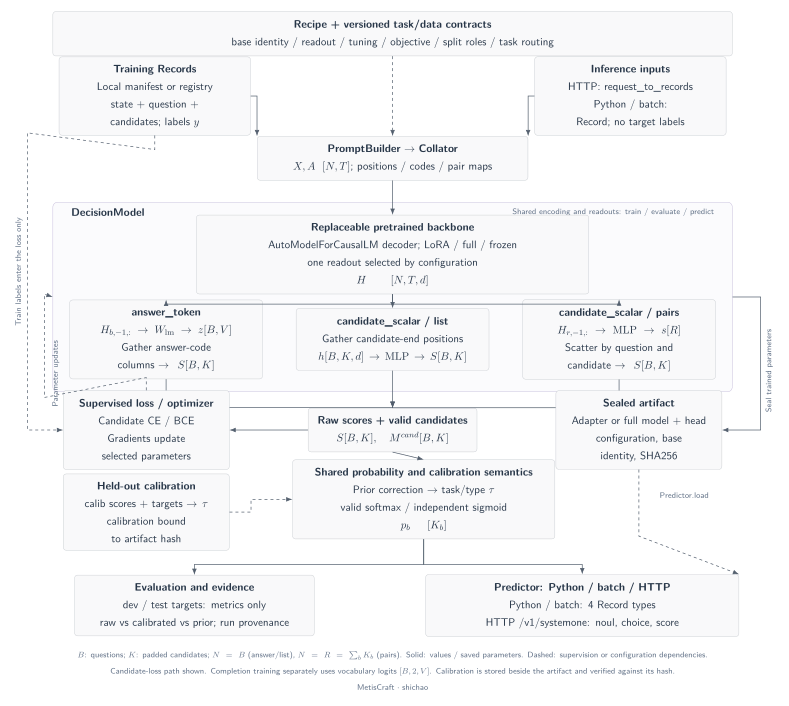
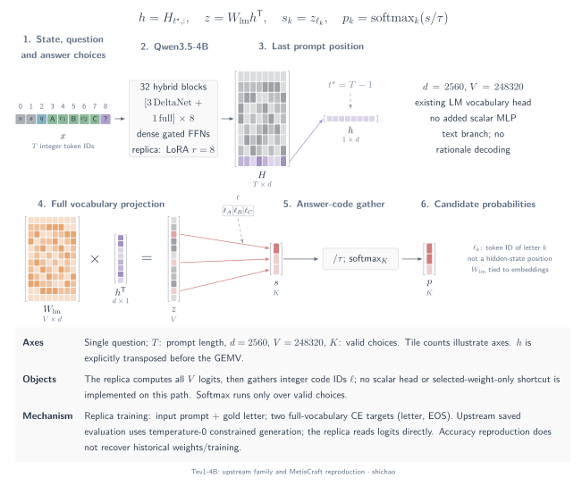

# 0. Introduction: JevLike decision models

A customer message can require several decisions before any reply is written: which team should receive it, whether it is urgent, and which topics it mentions. A decision model makes the answer space explicit and returns values that a program can inspect, evaluate and calibrate. MetisCraft is a toolkit for training and serving these models on labeled tasks.

This introduction defines the task and data, explains **MetisCraft's shared architecture**, and then instantiates its model core with the recorded Banking77-derived customer-routing recipe. Tev1's answer-token reproduction is a separate architecture and evidence record.

## 1. What does JevLike mean?

Here, **JevLike** describes models that take shared state and typed questions and produce decisions over defined answer spaces. It is a working description of a model family, not a claim that every project shares Jev's internal architecture. The [official System One contract](https://docs.typesafe.ai/api/system-one) specifies named questions and corresponding answers; it does not establish the private implementation behind the service.

For a mutually exclusive question, write

\[
p_\theta(y=k\mid x,q,\mathcal C),\qquad k\in\{1,\ldots,K\},
\]

where \(x\) is the state, \(q\) is the instruction, and \(\mathcal C\) supplies the candidate IDs and meanings. Yes/no and multi-label questions instead represent one or more Bernoulli events. MetisCraft implements four Record judgment types: `noul`, `choice`, `score` and `multi_label`; HTTP `/v1/systemone` supports the first three.

The inspected implementations score a finite answer space without generating a rationale token by token at inference. Sequence count, model-call batches and autoregressive decode steps are different quantities: a `pairs` readout needs multiple candidate sequences, even when batched into one call. The interface alone guarantees neither a specific latency nor calibrated confidence. See [contract and output semantics](index.md) and the [official confidence definition](https://docs.typesafe.ai/confidence).

## 2. The task: route a message and identify urgency

The teaching task asks two questions about each message:

| Question | Type | Answer space | Application use |
|---|---|---|---|
| `queue` | `choice` | `cards`, `payments`, `transfers`, `top_up`, `account`, `security` | Select one support queue |
| `urgent` | `noul` | Probability of yes | Support a separately evaluated escalation policy |

For the constructed demonstration message below, the saved model response selects `security` and assigns high probability to urgency:

> My card was stolen this morning and there are two payments on it that I did not make.

| Saved field | Value |
|---|---:|
| `answers.queue.choice` | `security` |
| `answers.queue.confidence` | 0.9999995054983101 |
| `answers.urgent.noul` | 0.9999314182034214 |

These are outputs from run `20261105-101057-30757bf7`, not invented teaching probabilities. The message was written for the demonstration and is **not a held-out dataset example**. One response does not measure task accuracy; the [recorded decision](../cookbook/decision.md) includes the full request, response and comparison with a prior baseline.

## 3. Data: from intent labels to typed supervision

The application uses [`PolyAI/banking77`](https://huggingface.co/datasets/PolyAI/banking77/tree/1846984189f2bc0ac51c6fc3a600fa9e1714e0c6) at revision `1846984189f2bc0ac51c6fc3a600fa9e1714e0c6`, under **CC-BY-4.0**. The `label_mapping@1` converter maps 77 source intents to six queues and a binary urgency label. These business labels are derived teaching labels, not original human annotations of urgency.

Each message becomes two Records with the same group key. Splitting keeps the questions for that message together. The version is `banking77_support/rev-18469841`; test truth is evaluation-only. The [sample provenance](../../examples/support-data-source.json) records the fixed revision, IDs and derived-file hashes.

| Split | Messages | Questions / Records | Purpose |
|---|---:|---:|---|
| train | 8,967 | 17,934 | Fit model parameters |
| calib | 527 | 1,054 | Fit temperature on separate data |
| dev | 501 | 1,002 | Inspect development metrics |
| test | 3,080 | 6,160 | Evaluate on the upstream test split |

Calib and dev are hash-based partitions of upstream train. These counts describe the recorded dataset version; they are not a template for every imported task. The [recipe and mapping](../../../recipes/banking77_support/README_en.md) give the complete criteria and preparation commands.

### A training example

The following is a **metadata excerpt** of a real training Record, preserving its original text and label. Download the [complete training Record](../../examples/support-train-record.json), including the six candidate descriptions, grouping and provenance.

```json
{
  "id": "banking77_support:train:0:queue",
  "input": {
    "context": {"state": "I am still waiting on my card?"},
    "query": "Which support queue should handle this customer message?"
  },
  "supervision": {"kind": "choice", "labels": "cards"}
}
```

Its source intent is `card_arrival`; the companion urgency Record is labeled `false`. The `supervision` field supplies the target for the loss. It is not concatenated to the inference prompt.

### An evaluation example

This is a metadata excerpt of an original test Record. Its message is different, while the task and answer definitions remain the same. Download the [complete evaluation Record](../../examples/support-test-record.json).

```json
{
  "id": "banking77_support:test:0:queue",
  "input": {
    "context": {"state": "How do I locate my card?"},
    "query": "Which support queue should handle this customer message?"
  },
  "supervision": {"kind": "choice", "labels": "cards"}
}
```

The evaluator compares the prediction with the target; the model's prompt receives only the input and question. The frozen test labels do not fit the model or temperature.

## 4. Invocation: the caller supplies no target label

After installing the toolkit and obtaining a trained artifact, start the service in one terminal:

```bash
metiscraft serve <run-directory>/artifact
```

In a second terminal, download the complete demonstration request and send it unchanged:

```bash
curl -fsS -o request.json https://shichaoxx.github.io/MetisCraft/assets/docs/examples/support-request.json
curl -fsS http://127.0.0.1:8000/v1/systemone \
  -H 'Content-Type: application/json' --data-binary @request.json
```

The request contains `model`, `state` and named `questions`; it contains no `supervision`. The saved [response JSON](../../examples/support-response.json) comes from the recorded trained artifact above. A newly trained model may produce different numbers. Model preparation and stopping the server are covered by the [CPU tutorial](../cookbook/first-model.md) and [serving guide](../serving.md); the random CPU model verifies the workflow, not this application's quality.

## 5. MetisCraft's architecture

MetisCraft organizes a typed decision model around **shared contracts and a configurable model core**. The architecture connects data, tensor construction, readouts, objectives and artifact loading, so that training and applications agree on what each score means.



[Light SVG](../../tensor-analysis/figures/metiscraft-architecture.en.svg) · [Dark SVG](../../tensor-analysis/figures/metiscraft-architecture.en.dark.svg) · [PDF](../../tensor-analysis/figures/metiscraft-architecture.en.pdf) · [Editable TikZ](../../tensor-analysis/figures/metiscraft-architecture.en.tex)

### Shared model core

1. **Record and recipe contracts.** A `Record` separates input, answer definitions, supervision, task ID and provenance. The recipe selects the base, tuning method, readout, objective and split roles. HTTP requests are adapted to the same Record contract.
2. **Prompt construction and collation.** `PromptBuilder` defines which input tokens represent each candidate. `Collator` pads sequences and constructs token IDs, padding masks, answer codes or candidate-position indices. Answer-token and scalar-list paths use one sequence per question; scalar-pairs uses one per candidate.
3. **DecisionModel.** A replaceable pretrained decoder returns hidden states. The selected readout is **one of three paths**, not an ensemble: answer-token vocabulary projection and code gather; scalar-list candidate gather and a shared MLP; or scalar-pairs scoring and scatter back to question/candidate columns.
4. **Typed scores and probabilities.** Candidate masks distinguish valid columns. Judgment semantics determine categorical softmax or event-wise sigmoid. Prior correction and task/type temperature selection are shared by evaluation and prediction.

Let \(N\) count encoded sequences, \(B\) count questions and \(R=\sum_bK_b\). The common interface is

\[
X,A\in\mathbb{Z}^{N\times T}\;\longrightarrow\;
H\in\mathbb{R}^{N\times T\times d}\;\longrightarrow\;
S\in\mathbb{R}^{B\times K_{\max}}.
\]

Here \(N=B\) for answer-token/list and \(N=R\) for pairs. Padding-mask values are binary; IDs and positions are integers, while hidden states and scores are floating point. Invalid score columns carry no answer meaning and are excluded before normalization. For `noul`, the answer-token path reduces yes/no vocabulary scores to their logit difference.

### Training and deployment meet at the artifact

Supervision enters CE/BCE losses for the configured judgment type. Gradients update the selected LoRA, full-model and/or readout parameters. Answer-token `completion` is a distinct training path: it produces full-vocabulary logits \([B,2,V]\) to predict answer code and EOS; it does not train CE on the candidate-score tensor shown in the main path.

Training seals model/adapter parameters, an optional scalar head, configuration, verified base identity and checksums. Calibration is stored separately and bound to that artifact's hash; a mismatched calibration is rejected. `Predictor.load` reconstructs the selected model and uses the same collation, correction and temperature semantics for Python, batch and HTTP. Evaluation compares predictions with dev/test targets and records raw, calibrated and prior results.

This is the toolkit's architectural contribution: task contracts and interchangeable readouts stay connected to a traceable train-to-service path. Qwen3 is one concrete backbone choice within that core. The [implementation boundaries](../limitations.md) distinguish these implemented components from researched mechanisms.

The separate [engineering workflow diagram](../../tensor-analysis/figures/metiscraft-workflow.en.svg) connects Records, collation, losses, sealed artifacts and serving. It complements the neural model plate; it does not specify a new backbone.

| Architectural boundary | Source |
|---|---|
| Data and configuration | [`Record`](../../../src/metiscraft/data/contract.py), [`Recipe`](../../../src/metiscraft/config.py) |
| Tensor construction and model paths | [`PromptBuilder`](../../../src/metiscraft/modeling/prompts.py), [`Collator`](../../../src/metiscraft/train/collate.py), [`DecisionModel`](../../../src/metiscraft/modeling/model.py) |
| Training, evaluation and sealing | [`pipeline`](../../../src/metiscraft/pipeline.py), [`trace`](../../../src/metiscraft/trace.py) |
| Loading, calibration routing and output | [`Predictor`](../../../src/metiscraft/serve/predictor.py), [`judgments`](../../../src/metiscraft/judgments/__init__.py) |

## 6. Instantiate the architecture: customer routing

The customer-routing recipe uses **Qwen3-0.6B-Base + LoRA + a scalar readout in `list` layout**. The [pinned base configuration](https://huggingface.co/Qwen/Qwen3-0.6B-Base/blob/da87bfb608c14b7cf20ba1ce41287e8de496c0cd/config.json) specifies 28 causal decoder layers and hidden width \(d=1024\). The [Qwen3 implementation](https://github.com/huggingface/transformers/blob/v4.51.3/src/transformers/models/qwen3/modeling_qwen3.py) exposes RMSNorm, grouped-query attention, a gated MLP and residual connections. The recipe adapts linear modules with LoRA \(r=16\), \(\alpha=32\), and adds one shared `1024 → 256 → 1` head. The vocabulary output head is bypassed on this path.

The model plate above instantiates this recipe. The [model architecture atlas](architectures.md) compares it with Tev1 and the inspected open implementations.


### Objects and axes

| Object | Shape | What one entry represents |
|---|---|---|
| \(X\) | \([B,T]\) | An integer token ID in a question's padded sequence |
| \(H\) | \([B,T,1024]\) | One contextual hidden feature at a token |
| \(P\) | \([B,K_{\max}]\) | The token index at the end of a candidate's segment |
| \(h\) | \([B,K_{\max},1024]\) | A selected candidate representation |
| \(S\) | \([B,K_{\max}]\) | An unnormalized real-valued candidate score |
| \(M\) | \([B,K_{\max}]\) | Whether a candidate column is valid |

For **one request with queue and urgency**, \(B=2\), \(K_{\max}=6\). The queue row has six valid columns; the urgency row has one. \(T\) varies with tokenization and padding; the recipe's maximum input length is 384. A `noul` row selects the final answer-cue position, not six option positions.

### The computation and why it works

The prompt places state and question before the ordered candidates. A causal decoder contextualizes the sequence. The `positions` tensor selects each candidate-end vector, and the **same learned MLP** scores every selected vector:

\[
H=\operatorname{decoder}(X,A),\qquad h_{b,k,:}=H_{b,P_{b,k},:},
\]

\[
u=\operatorname{GELU}(hW_1^{\mathsf T}+b_1),\qquad
S=\operatorname{squeeze}_{-1}(uW_2^{\mathsf T}+b_2).
\]

The first linear layer contracts only the hidden axis: \(([B,K,1024])(1024\times256)\to[B,K,256]\). The second maps \([B,K,256]\) to \([B,K,1]\); squeeze preserves the question and candidate axes.

A queue score becomes a probability through softmax over **its six valid candidates**; urgency uses sigmoid on its one score. The recorded run selected temperatures 1.50 for choice and 1.55 for noul. Labels train categorical CE for queue and binary CE for urgency; temperature fitting uses only calib. See [training and calibration](training-calibration.md).

In `list`, later candidates can attend to earlier candidates. They are not independent pair encodings. Conversely, a single request's two questions become two sequences; the current implementation does not share their encoded state through a tree cache. These distinctions explain information flow, not measured acceleration.

### A numerical illustration

For three constructed scores \([0,1,2]\) and \(\tau=1\), softmax gives \([0.090031,0.244728,0.665241]\). A target at index 2 contributes CE \(-\log(0.665241)\approx0.407606\). For a constructed urgency logit \(2\), sigmoid gives \(0.880797\). These illustrate the operators; they are not predictions from the recorded model.

The [CPU tensor verifier](../../../scripts/verify_tensor_examples.py) checks the implemented gather, MLP, masks, normalization and HTTP conversion against explicit calculations using a tiny random model. It downloads no weights and does not establish task accuracy.

## 7. Architecture, results and reading route

On the recorded 3,080-message test set, queue accuracy is **97.8%** versus a **24.7%** prior baseline, and urgency accuracy is **98.6%** versus **87.0%**. These are public-data teaching results with derived labels, not a production deployment claim. See the [full run conditions](../../../recipes/banking77_support/README_en.md).

**Tev1 is different:** its reproduced 4B model uses Qwen3.5's hybrid backbone and the existing LM vocabulary head to read answer-token logits. It does not use the scalar head shown above. Its [architecture and tensor walkthrough](../reproductions/tev1.md#model-architecture) separates the 87.3% / 99.33% accuracy results from training and calibration limits.

Continue with [System One and MetisCraft](index.md) → [tensors and indexing](notation.md) → [scalar layouts](scalar-heads.md) / [answer-token readout](answer-token.md). For a runnable application, open the [Cookbook](../cookbook/index.md).


### Tev1 reproduction: a different model path



[SVG](../../tensor-analysis/figures/tev1-architecture.en.svg) · [PDF](../../tensor-analysis/figures/tev1-architecture.en.pdf) · [TikZ](../../tensor-analysis/figures/tev1-architecture.en.tex)

The reproduction uses the 32-layer Qwen3.5-4B hybrid backbone and its original LM head, with LoRA r=8 and letter/EOS completion training. It does not use the scalar MLP above. The [Tev1 record](../reproductions/tev1.md) documents the upstream protocol, reproduction differences and 87.3% / 99.33% results. Continue to the [per-project model atlas](architectures.md).

[中文](../../zh/tensor-analysis/introduction.md)
