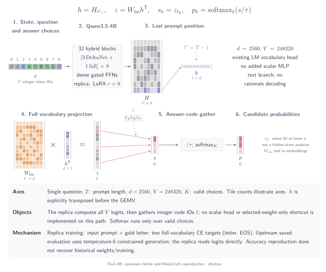

# JevLike tasks and answer spaces { #0-introduction-jevlike-decision-models }

A customer message can require several decisions before any reply is written: which team should receive it, whether it is urgent, and which topics it mentions. A decision model makes the answer space explicit and returns values that a program can inspect, evaluate and calibrate. MetisCraft is a toolkit for training and serving these models on labeled tasks.

This chapter follows a customer-routing task from the source labels to its answers, then compares two ways to read decisions from a model. The support recipe scores candidate representations. The Tev1 reproduction reads scores for answer tokens.

## Definition and scope { #1-what-does-jevlike-mean }

Here, **JevLike** describes models that take shared state and typed questions and produce decisions over defined answer spaces. It is a working description of a model family, not a claim that every project shares Jev's internal architecture. The [official System One contract](https://docs.typesafe.ai/api/system-one) specifies named questions and corresponding answers; it does not establish the private implementation behind the service.

For a mutually exclusive question, write

\[
p_\theta(y=k\mid x,q,\mathcal C),\qquad k\in\{1,\ldots,K\},
\]

where \(x\) is the state, \(q\) is the instruction, and \(\mathcal C\) supplies the candidate IDs and meanings. Yes/no and multi-label questions instead represent one or more Bernoulli events. MetisCraft implements four Record judgment types: `noul`, `choice`, `score` and `multi_label`; HTTP `/v1/systemone` supports the first three.

The support model in this chapter scores its answers in a forward pass. Another possible design generates a rationale before reading an answer distribution. Compare the number of input sequences and the number of sequential decoding steps separately. For example, `pairs` can encode several candidate sequences in one batched call. Latency and probability quality each require measurement. [Readout comparison](readout-comparison.md) · [Output contract](index.md)

## Support queues and urgency { #2-the-task-route-a-message-and-identify-urgency }

The teaching task asks two questions about each message:

| Question | Type | Answer space | Application use |
|---|---|---|---|
| `queue` | `choice` | `cards`, `payments`, `transfers`, `top_up`, `account`, `security` | Select one support queue |
| `urgent` | `noul` | Probability of yes | Support a separately evaluated escalation policy |

For the constructed demonstration message below, the saved model response selects `security` and assigns high probability to urgency:

> My card was stolen this morning and there are two payments on it that I did not make.

| Saved field | Value |
|---|---:|
| `answers.queue.choice` | `security` |
| `answers.queue.confidence` | 0.9999995054983101 |
| `answers.urgent.noul` | 0.9999314182034214 |

These are outputs from run `20261105-101057-30757bf7`, not invented teaching probabilities. The message was written for the demonstration and is **not a held-out dataset example**. One response does not measure task accuracy; the [recorded decision](../cookbook/decision.md) includes the full request, response and comparison with a prior baseline.

## From intent labels to training examples { #3-data-from-intent-labels-to-typed-supervision }

The application uses [`PolyAI/banking77`](https://huggingface.co/datasets/PolyAI/banking77/tree/1846984189f2bc0ac51c6fc3a600fa9e1714e0c6) at revision `1846984189f2bc0ac51c6fc3a600fa9e1714e0c6`, under **CC-BY-4.0**. The `label_mapping@1` converter maps 77 source intents to six queues and a binary urgency label. These business labels are derived teaching labels, not original human annotations of urgency.

Each message becomes two Records with the same group key. Splitting keeps the questions for that message together. The version is `banking77_support/rev-18469841`; test truth is evaluation-only. The [sample provenance](../../examples/support-data-source.json) records the fixed revision, IDs and derived-file hashes.

| Split | Messages | Questions / Records | Purpose |
|---|---:|---:|---|
| train | 8,967 | 17,934 | Fit model parameters |
| calib | 527 | 1,054 | Fit temperature on separate data |
| dev | 501 | 1,002 | Inspect development metrics |
| test | 3,080 | 6,160 | Evaluate on the upstream test split |

Calib and dev are hash-based partitions of upstream train. These counts describe the recorded dataset version; they are not a template for every imported task. The [recipe and mapping](../../../recipes/banking77_support/README_en.md) give the complete criteria and preparation commands.

### A training example

The following is a **metadata excerpt** of a real training Record, preserving its original text and label. Download the [complete training Record](../../examples/support-train-record.json), including the six candidate descriptions, grouping and provenance.

```json
{
  "id": "banking77_support:train:0:queue",
  "input": {
    "context": {"state": "I am still waiting on my card?"},
    "query": "Which support queue should handle this customer message?"
  },
  "supervision": {"kind": "choice", "labels": "cards"}
}
```

Its source intent is `card_arrival`; the companion urgency Record is labeled `false`. The `supervision` field supplies the target for the loss. It is not concatenated to the inference prompt.

### An evaluation example

This is a metadata excerpt of an original test Record. Its message is different, while the task and answer definitions remain the same. Download the [complete evaluation Record](../../examples/support-test-record.json).

```json
{
  "id": "banking77_support:test:0:queue",
  "input": {
    "context": {"state": "How do I locate my card?"},
    "query": "Which support queue should handle this customer message?"
  },
  "supervision": {"kind": "choice", "labels": "cards"}
}
```

The evaluator compares the prediction with the target; the model's prompt receives only the input and question. The frozen test labels do not fit the model or temperature.

## Request and response { #4-invocation-the-caller-supplies-no-target-label }

After installing the toolkit and obtaining a trained artifact, start the service in one terminal:

```bash
metiscraft serve <run-directory>/artifact
```

In a second terminal, download the complete demonstration request and send it unchanged:

```bash
curl -fsS -o request.json https://shichaoxx.github.io/MetisCraft/assets/docs/examples/support-request.json
curl -fsS http://127.0.0.1:8000/v1/systemone \
  -H 'Content-Type: application/json' --data-binary @request.json
```

The request contains `model`, `state` and named `questions`; it contains no `supervision`. The saved [response JSON](../../examples/support-response.json) comes from the recorded trained artifact above. A newly trained model may produce different numbers. Model preparation and stopping the server are covered by the [CPU tutorial](../cookbook/first-model.md) and [serving guide](../serving.md); the random CPU model verifies the workflow, not this application's quality.

## Where candidate scores come from { #5-metiscrafts-architecture }

<a id="shared-model-core"></a>

The support model reads a vector at the end of each candidate and scores it with a shared scalar head. A pointer readout can also take one decision vector for the whole question and pair it with each candidate vector. To compare them, identify the positions that supply the scores and the options that enter each question’s denominator. [Candidate scores and probabilities](../jevlike/candidate-scores.md)

<a id="training-and-deployment-meet-at-the-artifact"></a>

To trace a MetisCraft Record through to a prediction, see the manual’s [model core](../metiscraft/model-and-artifacts.md#shared-model-core) and [training artifacts and deployment](../metiscraft/model-and-artifacts.md#training-and-deployment-meet-at-the-artifact).

## The customer-routing model { #6-instantiate-the-architecture-customer-routing }

The customer-routing recipe uses **Qwen3-0.6B-Base + LoRA + a scalar readout in `list` layout**. The [pinned base configuration](https://huggingface.co/Qwen/Qwen3-0.6B-Base/blob/da87bfb608c14b7cf20ba1ce41287e8de496c0cd/config.json) specifies 28 causal decoder layers and hidden width \(d=1024\). The [Qwen3 implementation](https://github.com/huggingface/transformers/blob/v4.51.3/src/transformers/models/qwen3/modeling_qwen3.py) exposes RMSNorm, grouped-query attention, a gated MLP and residual connections. The recipe adapts linear modules with LoRA \(r=16\), \(\alpha=32\), and adds one shared `1024 → 256 → 1` head. The vocabulary output head is bypassed on this path.

The shapes and equations below describe this support recipe. The [model diagram in the manual](../metiscraft/model-and-artifacts.md) locates the candidate positions and shows the tensor shapes. The [architecture atlas](architectures.md) documents where other implementations read their scores.

### Tensor dimensions { #objects-and-axes }

| Object | Shape | What one entry represents |
|---|---|---|
| \(X\) | \([B,T]\) | An integer token ID in a question's padded sequence |
| \(H\) | \([B,T,1024]\) | One contextual hidden feature at a token |
| \(P\) | \([B,K_{\max}]\) | The token index at the end of a candidate's segment |
| \(h\) | \([B,K_{\max},1024]\) | A selected candidate representation |
| \(S\) | \([B,K_{\max}]\) | An unnormalized real-valued candidate score |
| \(M\) | \([B,K_{\max}]\) | Whether a candidate column is valid |

For **one request with queue and urgency**, \(B=2\), \(K_{\max}=6\). The queue row has six valid columns; the urgency row has one. \(T\) varies with tokenization and padding; the recipe's maximum input length is 384. A `noul` row selects the final answer-cue position, not six option positions.

### Candidate positions and the scalar head { #the-computation-and-why-it-works }

The prompt places state and question before the ordered candidates. A causal decoder contextualizes the sequence. The `positions` tensor selects each candidate-end vector, and the **same learned MLP** scores every selected vector:

\[
H=\operatorname{decoder}(X,A),\qquad h_{b,k,:}=H_{b,P_{b,k},:},
\]

\[
u=\operatorname{GELU}(hW_1^{\mathsf T}+b_1),\qquad
S=\operatorname{squeeze}_{-1}(uW_2^{\mathsf T}+b_2).
\]

The first linear layer contracts only the hidden axis: \(([B,K,1024])(1024\times256)\to[B,K,256]\). The second maps \([B,K,256]\) to \([B,K,1]\); squeeze preserves the question and candidate axes.

A queue score becomes a probability through softmax over **its six valid candidates**; urgency uses sigmoid on its one score. The recorded run selected temperatures 1.50 for choice and 1.55 for noul. Labels train categorical CE for queue and binary CE for urgency; temperature fitting uses only calib. See [training and calibration](training-calibration.md).

In `list`, later candidates can attend to earlier candidates. They are not independent pair encodings. Conversely, a single request's two questions become two sequences; the current implementation does not share their encoded state through a tree cache. These distinctions explain information flow, not measured acceleration.

### Numerical example { #a-numerical-illustration }

For three constructed scores \([0,1,2]\) and \(\tau=1\), softmax gives \([0.090031,0.244728,0.665241]\). A target at index 2 contributes CE \(-\log(0.665241)\approx0.407606\). For a constructed urgency logit \(2\), sigmoid gives \(0.880797\). These illustrate the operators; they are not predictions from the recorded model.

The [CPU tensor verifier](../../../scripts/verify_tensor_examples.py) checks the implemented gather, MLP, masks, normalization and HTTP conversion against explicit calculations using a tiny random model. It downloads no weights and does not establish task accuracy.

## Experimental results { #7-architecture-results-and-reading-route }

Across 3,080 test messages, queue accuracy was **97.8%** against a **24.7%** baseline using training-label frequencies alone. Urgency accuracy was **98.6%** against **87.0%** for the baseline. Both tasks were scored against labels derived from Banking77 intents. [Full run conditions](../../../recipes/banking77_support/README_en.md)

### The answer-token readout in Tev1 { #tev1-reproduction-a-different-model-path }

The Tev1 reproduction uses a 32-layer Qwen3.5-4B hybrid backbone. Its vocabulary head supplies the answer-token scores. Training uses rank-8 LoRA with the answer letter and EOS as completion targets. The reproduction reached 87.3% accuracy on the main decision set and 99.33% on policy transfer. These benchmarks use different data and targets from the support task. [Tev1 architecture, evaluation conditions and limits](../reproductions/tev1.md#model-architecture)



[SVG](../../tensor-analysis/figures/tev1-architecture.en.svg) · [PDF](../../tensor-analysis/figures/tev1-architecture.en.pdf) · [TikZ](../../tensor-analysis/figures/tev1-architecture.en.tex)

For the two computation paths, see [answer tokens](answer-token.md), [scalar layouts](scalar-heads.md) and the [architecture atlas](architectures.md). To run a task, open the [Cookbook](../cookbook/index.md).

[中文](../../zh/tensor-analysis/introduction.md)
