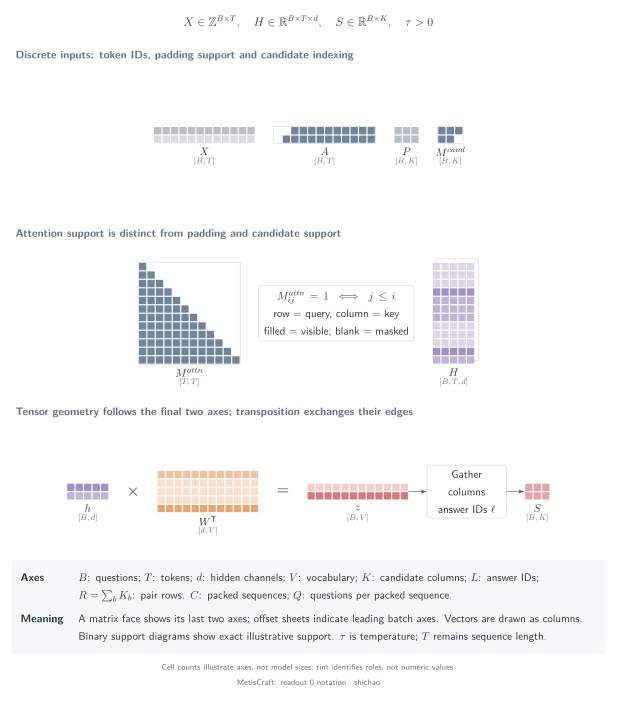

# Tensor notation, indices and masks

## Question

What does one tensor entry represent, and which axes does an operator select or reduce? The distinction between a representation, an index and a mask is essential: arrays with compatible shapes can still refer to different objects.



[SVG](../../tensor-analysis/figures/readout-0-notation.en.svg) · [PDF](../../tensor-analysis/figures/readout-0-notation.en.pdf) · [TikZ](../../tensor-analysis/figures/readout-0-notation.en.tex)

## Tensors and semantics

| Symbol / code | Domain and shape | Meaning |
|---|---|---|
| \(B\) | Positive integer | Number of decision questions in a batch |
| \(T\) | Positive integer | Padded token width of a model input batch |
| \(d,V,d_h\) | Positive integers | Backbone hidden width, vocabulary size, scalar-head hidden width |
| \(K_b,K_{\max}\) | Positive integers | Valid candidates for question \(b\), largest candidate count in the batch |
| \(R=\sum_bK_b\) | Positive integer | Expanded input rows in scalar `pairs` |
| \(C,Q\) | Positive integers | Packed sequences and questions per sequence in comparison architectures; \(B=CQ\) only when counts are equal |
| \(X\), `input_ids` | Integer \([B,T]\), or \([R,T]\) for pairs | Vocabulary IDs, not continuous features |
| \(A\), `attention_mask` | Integer 0/1 with the same shape as \(X\) | Valid token locations; 1 means non-padding |
| \(M^{\mathrm{attn}}\) | Conceptual Boolean token-to-token relation | Whether a query position can read a key position |
| \(H\) | Floating point \([B,T,d]\), or \([R,T,d]\) | Contextualized token representations |
| \(t_{b,k}\), `positions` | Integer \([B,K_{\max}]\) | Token location from which a list candidate is read |
| \(\ell_{b,k}\), `codes` | Integer candidate-code array | Vocabulary column assigned to an answer code |
| \(M^{\mathrm{cand}}\), `mask` | Boolean \([B,K_{\max}]\) | Valid candidate columns; independent of token padding |
| \(S,Y\) | Floating point \([B,K_{\max}]\) | Readout scores and aligned supervision targets |
| \(P_b,\tau_b\) | Probabilities \([K_b]\), positive scalar | Valid outcome probabilities and selected temperature |

For `noul`, \(K_b=1\) represents one Bernoulli logit. The answer-token readout nevertheless gathers **two vocabulary columns**, yes and no, before subtracting them. Thus the width of `codes` need not equal the width of the final candidate mask.

The code stores linear weights as \([d_{\mathrm{out}},d_{\mathrm{in}}]\). A row-vector representation therefore uses `h @ W.T + bias`; a diagram may draw the transposed matrix so its contracted \(d_{\mathrm{in}}\) edge meets the hidden representation.

## Operator chain

1. Tokenization maps text to integer vocabulary IDs.
2. Left padding aligns the final valid token across rows. Position IDs count valid tokens from zero.
3. The backbone converts IDs into contextualized floating-point representations using its attention mechanism.
4. `gather` selects locations or vocabulary columns; it does not average them.
5. A linear layer contracts the hidden axis; scatter restores pair scores to their owning questions.
6. Candidate masking removes nonexistent columns before categorical normalization or loss reduction.

These are three separate masks:

- **Padding:** token position \(t\) exists in this input row.
- **Attention visibility:** token \(i\) is allowed to read token \(j\).
- **Candidate validity:** output column \(k\) exists for this question.

MetisCraft supplies a 2-D padding mask to its causal backbone. It does not construct a branch-isolation mask for the current list or pairs paths. A Boolean visibility diagram does not specify whether an implementation uses dense or sparse kernels.

## Equations

For left-padded row \(b\), the logical position is

\[
\mathrm{pos}_{b,t}=\max\left(0,\sum_{u=0}^{t}A_{b,u}-1\right).
\]

List readout selects token positions without changing their meaning:

\[
G_{b,k,j}=H_{b,t_{b,k},j},\qquad
[B,T,d]\xrightarrow{\mathrm{gather\ on}\ T}[B,K_{\max},d].
\]

The idealized causal relation among non-padding positions is

\[
M^{\mathrm{attn}}_{b,i,j}=A_{b,i}A_{b,j}\,\mathbf{1}[j\le i].
\]

This describes visibility, not the backbone's internal mask format or kernel. A hidden state can depend on permitted earlier tokens, while future positions cannot influence that state in a causal decoder.

## Small example

Two token rows of lengths 3 and 5 become:

```text
input_ids      [PAD PAD x0 x1 x2]   [y0 y1 y2 y3 y4]
attention_mask [ 0   0   1  1  1]   [ 1  1  1  1  1]
position_ids   [ 0   0   0  1  2]   [ 0  1  2  3  4]
```

If the first question has two candidates and the second has three, their candidate mask is `[[1, 1, 0], [1, 1, 1]]`. The third column in the first row is neither an extra negative example nor a null option. It must not enter that row's softmax denominator.

An option ID such as `billing`, its local candidate index `0`, its displayed code `A`, the vocabulary ID of `A`, and the token location of a candidate's final word are five different objects. The collator retains the conversions needed by the selected readout.

## Source map

The source baseline is commit `6b9701da7814111b13d8882f48288f4df46dc983`.

- [`Record.target_size`](../../../src/metiscraft/data/contract.py#L130): the valid answer-space width.
- [`Encoded`](../../../src/metiscraft/modeling/prompts.py#L126): code IDs, readout positions and pair sequences.
- [`left_pad`](../../../src/metiscraft/train/collate.py#L21): physical offsets and logical positions.
- [`Collator`](../../../src/metiscraft/train/collate.py#L76): candidate masks and pair ownership.
- [`DecisionModel.forward`](../../../src/metiscraft/modeling/model.py#L55): gather, last-token selection and scatter.

The [CPU verification script](../../../scripts/verify_tensor_examples.py) independently constructs a tokenizer and tiny transformer, then checks the same conversions and mask behavior without repository test helpers.

## Scope

Notation describes tensor meaning, not speed or accuracy. Packed comparison architectures use \(C\) and \(Q\); they do not reuse \(R\), which is reserved for MetisCraft pairs. For unequal packed question counts, \(B=\sum_{c=1}^{C}Q_c\). Padding hidden states and invalid candidate columns have no task-level interpretation.

Continue with [answer-token readout](answer-token.md) or [scalar heads](scalar-heads.md).
