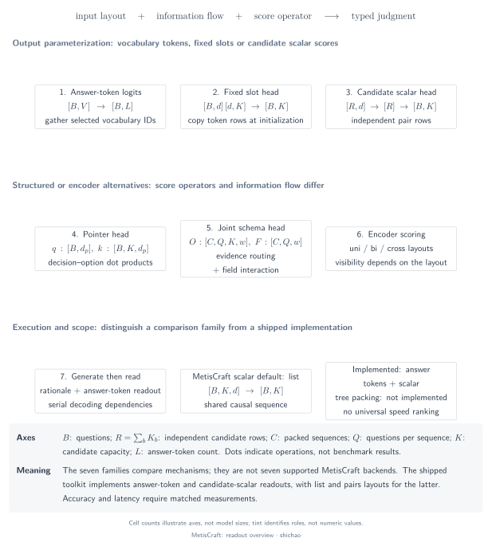
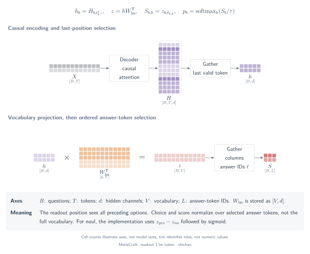
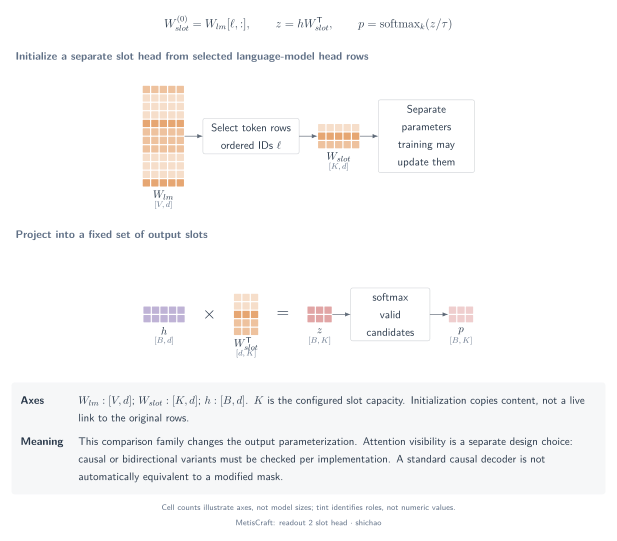
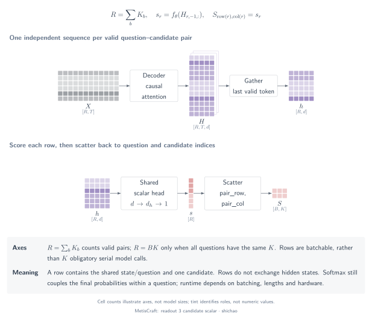
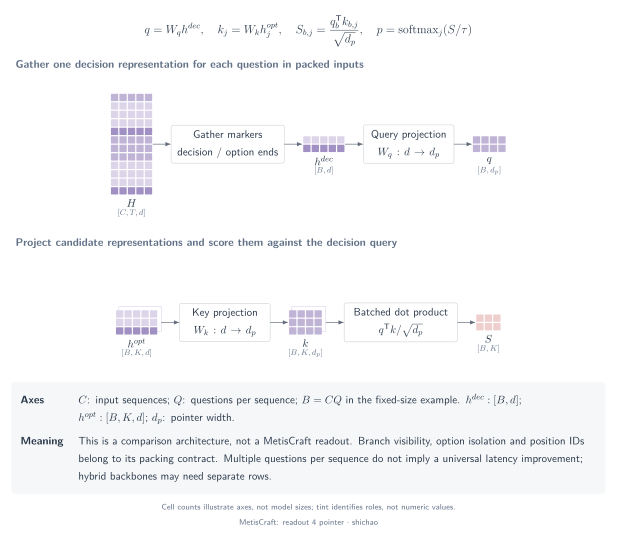
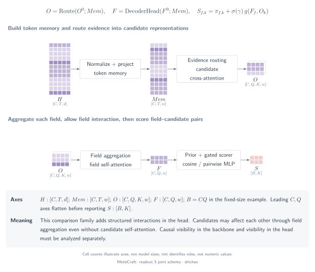
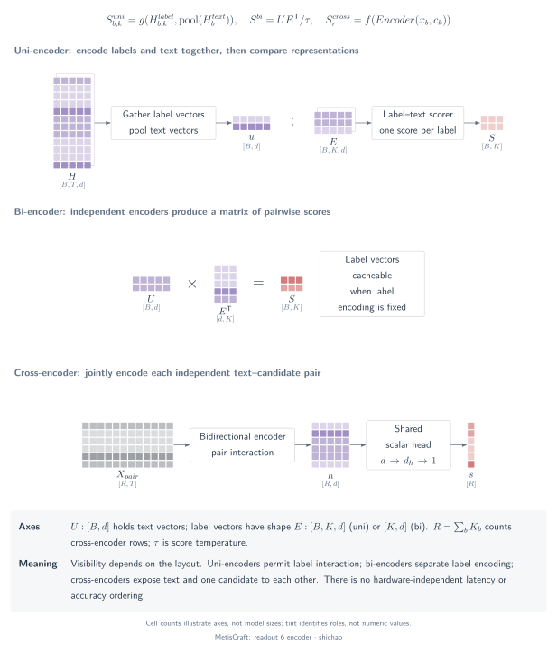
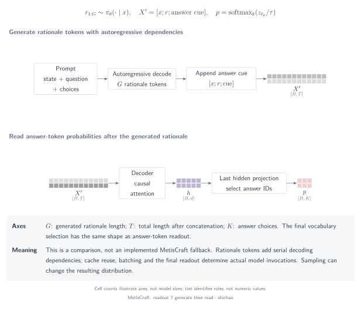

# Seven readout families: representations, interaction and normalization

[Model architecture atlas: MetisCraft, Tev1 and 14 inspected open implementations](architectures.md). The atlas separates concrete checkpoint paths from generic mechanism families.

## Question

Where does each candidate score come from, and which inputs can influence it? Readout families differ in the representations they select, the interactions they permit and the axis they normalize. The taxonomy describes mechanisms, not a ranking or a checkpoint compatibility promise.

[SVG](../../tensor-analysis/figures/readout-overview.en.svg) · [PDF](../../tensor-analysis/figures/readout-overview.en.pdf) · [TikZ](../../tensor-analysis/figures/readout-overview.en.tex)

## Tensors and semantics

The [notation guide](notation.md) defines \(B,T,d,K,V\). Scalar pairs use \(R=\sum_bK_b\) input rows. Packed comparison architectures use \(C\) sequences and \(Q_c\) questions per sequence, so \(B=\sum_cQ_c\). A pointer projection has width \(d_p\); joint-schema representations below have width \(w\). These are distinct axes.

MetisCraft implements **family 1 and family 3**, with separate list and pairs layouts for family 3. The remaining diagrams explain comparison architectures; selecting them in a recipe or loading their third-party checkpoints is not supported.

## Operator chains and equations

### 1. Answer-token readout

**Question:** which answer code is preferred at the end of the prompt? **Tensors:** a final hidden representation \([B,d]\), LM weights \([V,d]\), and per-question code indices select \([B,K]\) scores.

`prompt → causal backbone → final hidden → vocabulary logits → gather code columns → typed normalization`

\[
s_{b,k}=(W_{\mathrm{lm}}h_b)_{\ell_{b,k}}.
\]

This bias-free formula gathers before candidate softmax. Earlier option text does not read later option text under causal attention, but the final decision position reads all preceding options. See the [implemented path and worked example](answer-token.md).

[SVG](../../tensor-analysis/figures/readout-1-lm-token.en.svg) · [PDF](../../tensor-analysis/figures/readout-1-lm-token.en.pdf) · [TikZ](../../tensor-analysis/figures/readout-1-lm-token.en.tex)

### 2. LM-initialized fixed-slot head

**Question:** can a fixed output slot be trained separately from the full LM vocabulary? **Tensors:** \(h:[B,d]\), a slot matrix \([K_{\mathrm{slot}},d]\) and logits \([B,K_{\mathrm{slot}}]\).

`final hidden → slot projection → valid-slot masking → normalization`

\[
W_{\mathrm{slot}}^{(0)}=W_{\mathrm{lm}}[\ell,:],\qquad
s_b=W_{\mathrm{slot}}h_b.
\]

LM-row initialization is a starting condition, not a permanent equality after training. Attention visibility is a separate design choice. A noncausal training mask cannot be replaced with ordinary causal serving merely by copying trained rows back into an LM head. Fixed-version examples and their attention requirements are recorded in the [support matrix](../support-matrix.md).

[SVG](../../tensor-analysis/figures/readout-2-slot-head.en.svg) · [PDF](../../tensor-analysis/figures/readout-2-slot-head.en.pdf) · [TikZ](../../tensor-analysis/figures/readout-2-slot-head.en.tex)

### 3. Candidate-scalar head

**Question:** how can one shared function score variable candidates? **Tensors:** candidate representations \([B,K,d]\), or flattened \([R,d]\), and one scalar per candidate.

`candidate-specific hidden → shared MLP → ownership restoration → softmax or sigmoid`

\[
s_{b,k}=w_2^{\mathsf T}\operatorname{GELU}(W_1h_{b,k}+b_1)+b_2.
\]

The diagram shows **pairs**: each input row contains one candidate, so other candidates do not affect its raw score when that row stays fixed. MetisCraft's default **list** puts candidates in a single causal sequence, where later candidate representations can depend on earlier candidates. These layouts share a head shape, not an information-flow guarantee. See [both implemented paths](scalar-heads.md).

[SVG](../../tensor-analysis/figures/readout-3-candidate-scalar.en.svg) · [PDF](../../tensor-analysis/figures/readout-3-candidate-scalar.en.pdf) · [TikZ](../../tensor-analysis/figures/readout-3-candidate-scalar.en.tex)

### 4. Pointer readout

**Question:** how does a decision representation select an option representation? **Tensors:** decision states \(h^D:[B,d]\), option states \(E:[B,K,d]\), projected queries \([B,d_p]\) and keys \([B,K,d_p]\).

`gather decision / option locations → two projections → dot product over d_p → candidate normalization`

\[
s_{b,k}=\frac{\langle W_qh_b^D+c_q,\,W_ke_{b,k}+c_k\rangle}{\sqrt{d_p}}.
\]

[Kev at `2074cc4`](https://github.com/jaredpalmer/kev/blob/2074cc44256200bb37540103fa4572901faa10f3/kev/model.py) supplies the concrete pointer example: option-end and decision-marker representations, question-branch isolation, and optional option isolation. A shared decision representation may depend on all options even when their own representations are isolated. Its hybrid-backbone row path also shows why a block mask is not universally executable by every backbone.

[SVG](../../tensor-analysis/figures/readout-4-pointer.en.svg) · [PDF](../../tensor-analysis/figures/readout-4-pointer.en.pdf) · [TikZ](../../tensor-analysis/figures/readout-4-pointer.en.tex)

### 5. Candidate-set interaction / joint-schema head

**Question:** how can options and fields contribute to a joint decision? **Tensors:** candidate queries \(O:[N,w]\), field representations \(F:[B,w]\), token memory \([C,T,w]\), and an owner index mapping each of the \(N=\sum_bK_b\) candidates to a field.

`pool spans → build candidate queries → read token memory → aggregate by owner → field interaction → compare each field with its candidates`

An explicit, illustrative field-aggregation core is

\[
\alpha_n=\frac{\exp(O_n^{\mathsf T}F_{g(n)}/\sqrt w)}
{\sum_{j:g(j)=g(n)}\exp(O_j^{\mathsf T}F_{g(n)}/\sqrt w)},\quad
\bar O_b=\sum_{n:g(n)=b}\alpha_nO_n.
\]

Here \(g(n)\) is an **index**, not a floating feature. The product contracts the width axis after selecting the owning field. A joint head can combine field self-attention, memory cross-attention and per-candidate scoring; the exact layers and loss belong to the referenced implementation. [Clef's fixed-version source](https://huggingface.co/Cloudflare/clef/tree/cfddda043dd190ef3b01cff449d5ee8cff1e8ec6) is the comparison reference. The compact formula explains aggregation and does not claim to reproduce its entire model.

[SVG](../../tensor-analysis/figures/readout-5-joint-schema.en.svg) · [PDF](../../tensor-analysis/figures/readout-5-joint-schema.en.pdf) · [TikZ](../../tensor-analysis/figures/readout-5-joint-schema.en.tex)

### 6. Encoder-based candidate / label scoring

**Question:** can bidirectional representations score labels without next-token prediction? **Tensors:** text representations \(U:[B,d]\), label representations \(E:[B,K,d]\), or independently encoded label matrix \([K,d]\).

`bidirectional encoder → gather / pool text and labels → candidate scorer → typed normalization`

\[
s_{b,k}=\langle u_b,e_{b,k}\rangle
\quad\text{or, for shared label embeddings,}\quad S=UE^{\mathsf T}.
\]

In a joint encoder, label tokens may read one another and the text. In a dual encoder, cached label embeddings do not depend on this input text. A cross-encoder instead encodes each text/candidate pair jointly. These are separate layouts; none follows from the word “encoder” alone. [GLiClass](https://github.com/Knowledgator/GLiClass) is an encoder-family reference, not a claim that every supported scorer equals this illustrative dot product. No latency claim is inferred from shape or parameter count.

[SVG](../../tensor-analysis/figures/readout-6-encoder.en.svg) · [PDF](../../tensor-analysis/figures/readout-6-encoder.en.pdf) · [TikZ](../../tensor-analysis/figures/readout-6-encoder.en.tex)

### 7. Generate reasoning, then read the answer distribution

**Question:** what changes when a sampled rationale becomes part of the decision context? **Tensors:** input tokens, \(G\) generated rationale tokens, a final vocabulary vector \([B,V]\), and gathered answer scores \([B,K]\).

`prompt → autoregressive rationale generation → answer cue → gather answer-code logits → candidate normalization`

\[
r_{1:G}\sim\pi_\theta(\cdot\mid x),\qquad
s_{b,k}=\left(W_{\mathrm{lm}}H_{b,t_b^\star,:}(x,r)\right)_{\ell_{b,k}},\qquad
p_b=\operatorname{softmax}(s_b).
\]

Gather precedes normalization over the answer space. Generation introduces sequential decoding and possibly sampling variability. Counting model invocations depends on prefill, caching and the answer-cue procedure; \(G\) is a decode dependency length, not a latency measurement. This family is a conceptual comparison, not a MetisCraft fallback. It must not be confused with the toolkit's two-position teacher-forced completion loss.

[SVG](../../tensor-analysis/figures/readout-7-generate-then-read.en.svg) · [PDF](../../tensor-analysis/figures/readout-7-generate-then-read.en.pdf) · [TikZ](../../tensor-analysis/figures/readout-7-generate-then-read.en.tex)

## Small examples and comparison axes

| Mechanism | Source of candidate interaction | Computational rows / packing | Output |
|---|---|---|---|
| Answer token | Final state reads preceding options | \(B\) question rows | \([B,K]\) |
| Fixed slot | Chosen backbone visibility and final state | \(B\) rows; fixed slot capacity | \([B,K_{\mathrm{slot}}]\) |
| Scalar pairs | Independent raw row scores; categorical denominator couples probabilities | \(R=\sum_bK_b\) rows | Restored \([B,K_{\max}]\) |
| Scalar list | Later candidate states read earlier candidates | \(B\) rows | \([B,K_{\max}]\) |
| Pointer | Option/decision visibility plus a shared decision query | Packed \(C\) sequences or question rows, implementation-dependent | One distribution per question |
| Joint schema | Candidate summaries, field interaction and token memory | Packed fields and owner indices | One distribution per field |
| Encoder | Joint, dual or pair layout determines visibility | Layout-dependent | \([B,K]\) |
| Generate then read | Rationale and final state | Prefill plus sequential decoding | \([B,K]\) after generation |

Rows, token count, batch calls and autoregressive dependency length are different quantities. A packed pass returning \(Q\) decisions is not “a fractional forward pass per question,” and a pairs batch of \(K\) rows is not necessarily \(K\) sequential calls.

Constructed scores \([0,1]\) give \([0.268941,0.731059]\). Adding a third independent score 2 gives \([0.090031,0.244728,0.665241]\): the original scores remain fixed while their categorical probabilities change. For a pointer example, query \([1,0]\) and keys \([1,0]\), \([0,1]\) produce unscaled scores 1 and 0; the actual projection width determines the scaling factor. These arithmetic examples do not compare trained models.

## Source map and attribution

- MetisCraft code baseline: `6b9701da7814111b13d8882f48288f4df46dc983`; [`DecisionModel`](../../../src/metiscraft/modeling/model.py#L55), [`PromptBuilder`](../../../src/metiscraft/modeling/prompts.py#L136) and [`judgments`](../../../src/metiscraft/judgments/__init__.py#L74).
- The [support matrix](../support-matrix.md) records fixed ecosystem revisions, licenses and the distinction between source checks and reproduction. External examples in this taxonomy are not runtime dependencies.
- Pointer source: [Kev `2074cc4`, `kev/model.py`](https://github.com/jaredpalmer/kev/blob/2074cc44256200bb37540103fa4572901faa10f3/kev/model.py). Joint-schema reference: [Clef `cfddda0`](https://huggingface.co/Cloudflare/clef/tree/cfddda043dd190ef3b01cff449d5ee8cff1e8ec6). Additional encoder background: [GLiClass source](https://github.com/Knowledgator/GLiClass), checked 2026-11-09; the link is a project reference rather than a frozen benchmark result.
- The earlier shared-prefix teaching approach drew on the independently authored [wdkns architecture slides, revision `6b8729b`](https://github.com/wdkns/modern_genai_bilibili/blob/6b8729b923d17863014ac6e0ff7715fc84473300/slides/jev_architecture-v2.pdf). These figures are independently drawn; this acknowledgment does not assign invention of tree attention to the slides' author.

## Scope

The CPU checks exercise MetisCraft's implemented readouts, not all seven external families. Comparison equations isolate mechanisms and omit implementation-specific residuals, normalization, adapters and memory policies unless stated. Tensor equivalence alone does not prove equal learned weights, task accuracy, throughput, or compatibility with a serving engine. Use the [walkthrough](walkthrough.md) to present the implemented chain with its evidence boundaries.
