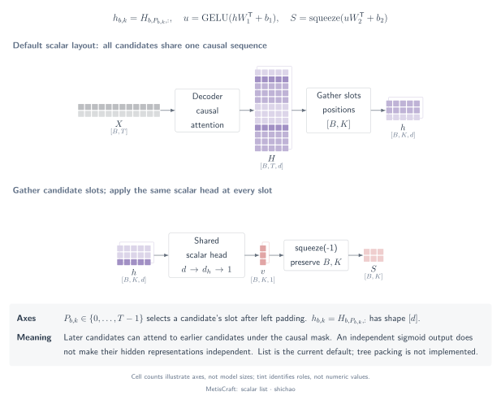
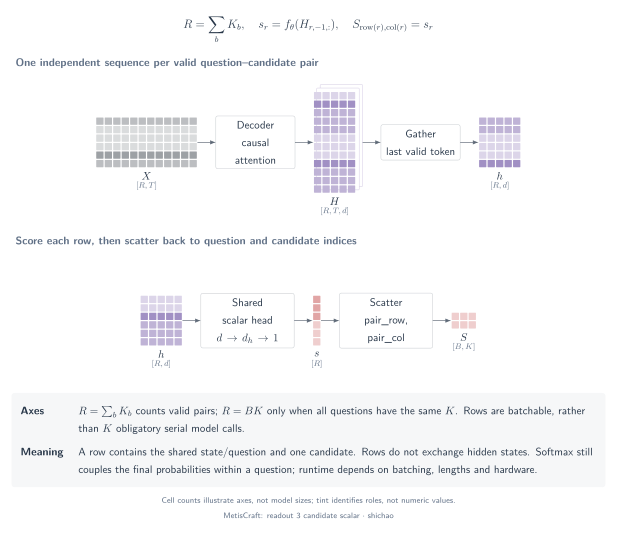

# Candidate-scalar heads: list and pairs

A candidate-scalar head maps a candidate representation to one real-valued score. The head's shape does not determine which candidates can influence that representation: **sequence layout and attention visibility do**.

## Question

When are candidate scores independent of other candidates, and what changes when all candidates share one sequence? MetisCraft exposes two layouts, `list` and `pairs`, with the same scalar MLP and different backbone inputs. The default is `list`.

## Tensors and semantics

| Object | `list` | `pairs` |
|---|---|---|
| Input sequences | \([B,T]\) | \([R,T_{\mathrm{pair}}]\), \(R=\sum_b K_b\) |
| Backbone output | \([B,T,d]\) | \([R,T_{\mathrm{pair}},d]\) |
| Readout indices | Candidate ends \(I:[B,K_{\max}]\) | Final valid token of each pair sequence |
| Candidate representations | \([B,K_{\max},d]\) after gather | \([R,d]\) |
| Scalar scores | \([B,K_{\max}]\) | \([R]\), scattered to \([B,K_{\max}]\) |
| Additional alignment | Candidate indices stay in Record order | `pair_row` and `pair_col` map pair rows to question/candidate columns |

For noul, either layout uses one representation and one binary score. A pairs batch need not have equal candidate counts, so \(R=B K\) is only the fixed-cardinality special case.

## Operator chain

### List: gather candidate ends in one causal sequence

The prompt contains state, question and all candidate segments. Each candidate is read at its own segment's final token. `gather` changes the selected sequence axis into a candidate axis; it does not create independent candidate contexts.



[SVG](../../tensor-analysis/figures/scalar-list.en.svg) · [PDF](../../tensor-analysis/figures/scalar-list.en.pdf) · [TikZ](../../tensor-analysis/figures/scalar-list.en.tex)

```python
indices = positions[..., None].expand(-1, -1, H.size(-1))  # [B, K_max, d]
G = H.gather(1, indices)                                 # [B, K_max, d]
S = scalar_head(G)                                      # [B, K_max]
```

Later candidates can attend to preceding candidate text. Training-time shuffling changes the prompt order, while the gather indices restore the Record's candidate order. That alignment is not a guarantee of order-invariant scores.

### Pairs: score separate sequences and scatter them back

Each input row contains the state, question and one candidate. The model gathers the final hidden state from each row, scores it, then scatters the results to the question/candidate matrix.



[SVG](../../tensor-analysis/figures/readout-3-candidate-scalar.en.svg) · [PDF](../../tensor-analysis/figures/readout-3-candidate-scalar.en.pdf) · [TikZ](../../tensor-analysis/figures/readout-3-candidate-scalar.en.tex)

```python
h = H_pairs[:, -1]                    # [R, d]
s = scalar_head(h)                    # [R]
S = s.new_zeros(candidate_mask.shape)  # [B, K_max]
S[pair_row, pair_col] = s
```

All pair rows can be evaluated in one batched backbone call. The larger row count is not a count of sequential model calls. Padding columns in `S` remain invalid and are excluded by the candidate mask.

## Equations

The same two-layer head contracts the feature axis while preserving all leading axes:

\[
U=\operatorname{GELU}(G W_1^{\mathsf T}+b_1),\qquad
S=\operatorname{squeeze}_{-1}(U W_2^{\mathsf T}+b_2),
\]

\[
(B\times K_{\max}\times d)(d\times d_h)
\longrightarrow B\times K_{\max}\times d_h,
\qquad
(B\times K_{\max}\times d_h)(d_h\times1)
\longrightarrow B\times K_{\max}\times1.
\]

For pairs, replace the leading \([B,K_{\max}]\) axes with \([R]\), then use the owner indices to scatter. The head is evaluated in fp32; its actual implementation also includes configurable dropout before the final linear projection.

Normalization depends on the task: choice/score use softmax; multi-label uses sigmoid per valid candidate. Independent sigmoid events can still use causally coupled list representations.

## Small example

For independent pairs with raw scores \([0,1]\), softmax gives \([0.268941,0.731059]\). Add an unrelated candidate with score \(2\): the first two **raw scores remain unchanged**, while their probabilities become \([0.090031,0.244728]\). The change comes from the softmax denominator, not new information in their pair sequences.

For a list sequence `[prefix, candidate A, candidate B]`, changing B cannot affect A's earlier hidden state when the prefix and truncation are fixed. Changing A can affect B. The [CPU verification script](../../../scripts/verify_tensor_examples.py) checks this asymmetry with a real tiny transformer, verifies gather/MLP/scatter, and checks ragged candidate masks.

## Source map

- [`candidate_list`](../../../src/metiscraft/modeling/prompts.py#L213): sequence order and candidate-end indices.
- [`candidate_pairs`](../../../src/metiscraft/modeling/prompts.py#L237): one sequence per candidate.
- [`Collator`](../../../src/metiscraft/train/collate.py#L76): candidate masks, padding offsets and pair ownership.
- [`ScalarHead` and `DecisionModel.forward`](../../../src/metiscraft/modeling/model.py#L14): MLP, gather and scatter.
- [Customer-routing recipe](../../../recipes/banking77_support/qwen3-0.6b-base_candidate-scalar.yaml): an actual `list` configuration.

## Scope

Independent pairs, causal lists and isolated tree branches are different layouts. MetisCraft implements the first two. Prefix-tree packing with branch-specific visibility is a research comparison, not a current execution path; neither a sparse-looking mask nor a shared prefix establishes a sparse kernel or measured speedup.

Truncation can change the shared state when a list's total candidate text grows, so causal-invariance comparisons must hold the prefix and token budget fixed. `infer_permutations` currently accepts only `1`; no multi-order inference averaging is implied by training shuffling. Continue with [training and calibration](training-calibration.md) or the [seven-family comparison](readout-comparison.md).
