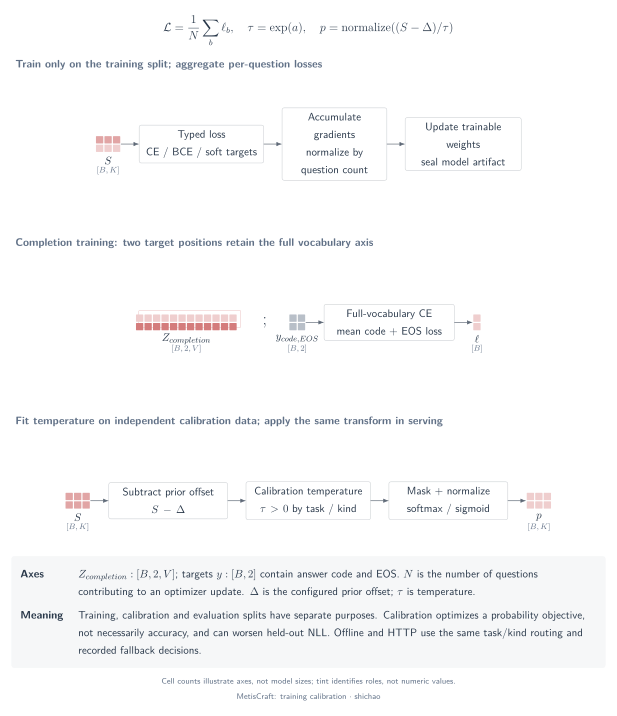

# Training targets, calibration and response semantics

## Question

Which objective trains a score, which data fit its temperature, and what does the returned probability mean? Training loss, calibration, a discrete decision, an expected score and `confidence` answer different questions.

[SVG](../../tensor-analysis/figures/training-calibration.en.svg) · [PDF](../../tensor-analysis/figures/training-calibration.en.pdf) · [TikZ](../../tensor-analysis/figures/training-calibration.en.tex)

## Tensors and semantics

| Object | Shape | Meaning |
|---|---|---|
| Scores \(S\) | \([B,K_{\max}]\) | Unnormalized readout outputs |
| Targets \(Y\) | \([B,K_{\max}]\) | Aligned hard-label vectors or supplied soft supervision |
| Candidate mask \(M^{\mathrm{cand}}\) | \([B,K_{\max}]\) | Columns that belong to each question |
| Completion logits \(Z\) | \([B,2,V]\) | Full-vocabulary next-token logits at the prompt end and appended answer code |
| Completion targets | Integer \([B,2]\) | Answer-code ID followed by EOS ID |
| Temperature \(\tau\) | Positive scalar per selected group | Rescales scores without adding output classes |

Choice and score hard labels become one-hot categorical targets. `ordinal_soft` constructs a normalized Gaussian-shaped target around an ordered level; it is not an ordinal-regression head. Supplied categorical soft targets sum to one. `noul` uses one Bernoulli target; multi-label uses one target per candidate. Soft-only supervision does not create a hard ground-truth label for accuracy reporting.

## Operator chain

1. Validate distinct training, calibration and evaluation purposes and group isolation **before loading the model**.
2. Train readout/backbone parameters on training targets with the configured objective.
3. Collect valid scores on the held-out calibration split; apply the configured multi-label logit correction.
4. Fit temperature by negative log likelihood, separately for supported task/type groups and type fallbacks.
5. Select the same group in offline prediction and HTTP serving, normalize the same scores and assemble typed outputs.

`completion` is teacher-forced training: append the correct answer code to the input, then predict the code from the preceding prompt and EOS from that code. It does not sample a rationale. Inference still reads the code logits at the prompt end.

## Equations

For a categorical question, with valid columns \(\mathcal K_b\),

\[
\mathcal L_b^{\mathrm{cat}}=-\sum_{k\in\mathcal K_b}y_{b,k}\log p_{b,k}.
\]

For multi-label supervision, the per-question reduction averages valid candidate losses:

\[
\mathcal L_b^{\mathrm{multi}}=\frac{1}{K_b}\sum_{k\in\mathcal K_b}
\mathrm{BCEWithLogits}(s_{b,k},y_{b,k}).
\]

`noul` uses one BCE term. The implementation returns the **sum over questions and the question count**; the training loop normalizes by the number of questions, including unequal accumulation tails. A multi-label row with many candidates does not receive a larger weight merely because it has more columns. Optional positive-class weighting applies inside multi-label BCE, and optional Brier regularization applies to categorical outputs.

For the actual optimizer-step question set \(\mathcal B\), the gradient is \(\nabla_\theta\bigl(|\mathcal B|^{-1}\sum_{b\in\mathcal B}\mathcal L_b\bigr)\). Gradients flow through the selected readout into whichever backbone or adapter parameters the recipe makes trainable. Integer token IDs, gather indices and masks are routing data, not trainable parameters. MetisCraft uses AdamW, with a separately configurable learning rate for the scalar head.

For completion training,

\[
\mathcal L_b^{\mathrm{completion}}=
\frac{1}{2}\left(\mathrm{CE}_V(Z_{b,0,:},a_b)+\mathrm{CE}_V(Z_{b,1,:},\mathrm{EOS})\right).
\]

This is a full-vocabulary objective, unlike categorical CE restricted to selected answer codes.

Temperature is fitted on held-out corrected scores \(\bar s=s-\delta\):

\[
\tau^*=\arg\min_{\tau>0}\sum_{b\in\mathcal D_{\mathrm{calib}}}
\mathcal L_b(\bar s_b/\tau,y_b).
\]

The fitter optimizes \(\log\tau\) and clamps the final temperature to \([0.05,20]\). If multi-label training uses `pos_weight=w`, inference subtracts \(\delta=\log w\) before calibration; this is a model-based odds correction, not a guarantee of empirical calibration.

Routing tries `task_id|kind`, then `*|kind`, then temperature 1. The default minimum for a task-specific fit is 20 calibration rows. Prediction metadata records the selected group and fallback reason. HTTP question names map to known `task_id` values; a single-task artifact can map automatically, while ambiguous multi-task requests require explicit configuration.

## Small example

For constructed scores \([0,1,2]\), temperature 1 yields \([0.090031,0.244728,0.665241]\). Temperature 2 yields \([0.186324,0.307196,0.506480]\). The modal class is unchanged, but its probability decreases. Positive temperature preserves within-row score ordering; it does not correct option-order bias or improve accuracy by itself.

The [CPU verification script](../../../scripts/verify_tensor_examples.py) fits a synthetic calibration distribution constructed with temperature 2, then checks actual `Record` and in-process HTTP predictions with three distinct task temperatures: 0.5, 2.0 and 1.5. These are software and numerical checks, not results from a trained application model.

### Probability, score and confidence

For MetisCraft `0.1.0rc1`:

- `probabilities` is the post-correction, post-temperature distribution.
- Record `decision` for `score` is the modal level index. HTTP `score` is the expectation \(\sum_i i p_i\), with zero-based level indices.
- HTTP choice/score `confidence` is \(\max_i p_i\). `noul` returns the probability of yes without a separate confidence field.
- Record `uncertainty` is \(1-\max_i p_i\); for `noul`, it is \(1-\max(p,1-p)\). It is not a separately estimated error probability.

The [official TypeSafe confidence definition](https://docs.typesafe.ai/confidence), checked **2026-11-09**, differs. For a choice with \(n>1\) options it defines

\[
c_{\mathrm{choice}}=\frac{p_{\max}-1/n}{1-1/n}.
\]

For an ordered score distribution with \(n>1\) levels and modal level \(m\), it defines

\[
c_{\mathrm{score}}=\max\left(0,1-
\frac{\sum_i p_i|i-m|}{\frac{1}{n}\sum_i\left|i-\frac{n-1}{2}\right|}\right).
\]

For constructed choice probabilities \([0.6,0.3,0.1]\), MetisCraft reports `confidence=0.6`; the documented TypeSafe statistic is 0.4. For score probabilities \([0.2,0.5,0.3]\), the expectation is 1.1, MetisCraft confidence is 0.5 and the documented TypeSafe statistic is 0.25. Those concentration statistics are not independent measurements of correctness. This chapter documents the difference; it does not change the version's response contract.

## Source map

The source baseline is commit `6b9701da7814111b13d8882f48288f4df46dc983`.

| Mechanism | Source |
|---|---|
| Dataset-purpose checks before model construction | [`run_recipe`](../../../src/metiscraft/pipeline.py#L99), [`data.usage`](../../../src/metiscraft/data/usage.py#L23) |
| Hard and soft target construction | [`target_vector`](../../../src/metiscraft/judgments/__init__.py#L23) |
| Full-vocabulary completion loss | [`completion_loss`](../../../src/metiscraft/judgments/__init__.py#L63) |
| Categorical/Bernoulli losses and reductions | [`batch_loss`](../../../src/metiscraft/judgments/__init__.py#L74) |
| Accumulated mean gradients and AdamW updates | [`accumulate` and `train_loop`](../../../src/metiscraft/train/loop.py#L69) |
| Multi-label prior correction | [`prior_shift`](../../../src/metiscraft/judgments/__init__.py#L101) |
| Temperature fitting and routing | [`calibrate.py`](../../../src/metiscraft/calibrate.py#L35) |
| Corrected inference scores | [`predict`](../../../src/metiscraft/evaluate/infer.py#L43) |
| Record output and HTTP response | [`Predictor`](../../../src/metiscraft/serve/predictor.py#L126) |

External contract references: [System One API](https://docs.typesafe.ai/api/system-one), [Choice](https://docs.typesafe.ai/primitives/choice), [Score](https://docs.typesafe.ai/primitives/score). The public interface does not establish Jev's hidden implementation.

## Scope

Calibration quality must be measured on data that were not used to fit temperature. Accuracy, NLL, Brier score and reliability summaries answer different evaluation questions. A reduction in calibration-set NLL does not guarantee improvement on another distribution; [the Tev1 record](../reproductions/tev1.md) keeps the observed limitations beside its results. Repeated calibration/evaluation choices can also overfit a public benchmark.

Continue with the [readout comparison](readout-comparison.md) or the [five-minute walkthrough](walkthrough.md).
