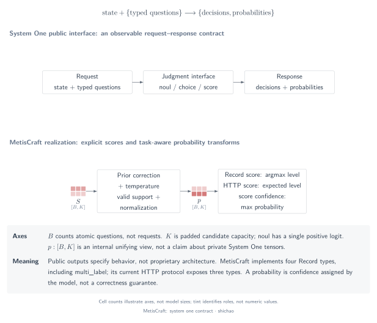
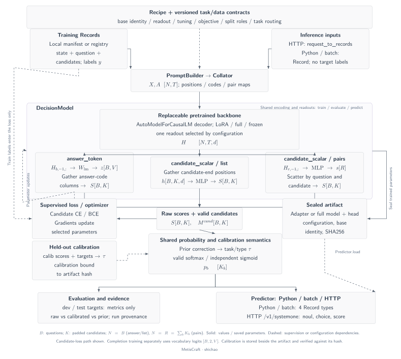
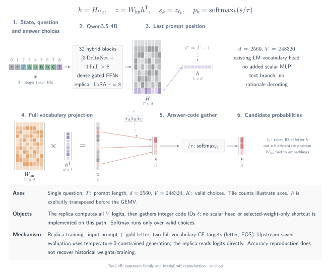

# A five-minute tour of System One and MetisCraft

[Model architecture atlas: MetisCraft, Tev1 and 14 inspected open implementations](architectures.md). The atlas separates concrete checkpoint paths from generic mechanism families.

## Question

How can you explain a typed decision model coherently, from its interface to its tensors and evidence? This route follows one question through the implemented toolkit, then places it in the broader readout landscape. It reuses the chapter's figures and source links rather than introducing a separate demonstration system.

## Tensors and semantics

Keep three objects visible throughout: **question**, **candidate score**, **probability**. A request can contain multiple questions; each becomes a `Record`. A hidden vector is a learned representation. A readout converts it into candidate scores. Normalization assigns probability semantics to those scores.

| Time | Explain | Show |
|---|---|---|
| 0:00–0:45 | The public typed-decision contract | Contract figure and one choice question |
| 0:45–1:30 | A question becomes a tensor batch | Flow figure; \([B,T]\) → \([B,T,d]\) |
| 1:30–2:45 | Two readout families, three paths | Answer-token, scalar list and scalar pairs |
| 2:45–3:45 | Supervision and calibrated output | Completion / categorical targets and temperature routing |
| 3:45–5:00 | Verification and measured limits | CPU script, Tev1 evidence and comparison overview |

## Operator chain

### 1. Start with one concrete question

Use a small, explicitly constructed request:

```json
{
  "state": "A customer asks for a refund after a duplicate charge.",
  "questions": {
    "route": {
      "type": "choice",
      "instructions": "Select the support team.",
      "criteria": {
        "billing": "Charges, payments and refunds",
        "technical": "Product faults and troubleshooting"
      }
    }
  }
}
```

The result is a distribution over these two IDs, not free-form prose. This request illustrates the contract; no predicted probabilities are claimed for this invented input. The [System One contract](index.md) separates the public API from any private architecture.



[SVG](../../tensor-analysis/figures/system-one-contract.en.svg) · [PDF](../../tensor-analysis/figures/system-one-contract.en.pdf) · [TikZ](../../tensor-analysis/figures/system-one-contract.en.tex)

### 2. Follow the tensors

The request adapter creates one Record per named question. The collator tokenizes, left-pads and retains candidate identities. A causal backbone returns \(H:[B,T,d]\). Padding validity, token visibility and candidate validity are separate relations; the [notation page](notation.md) gives their exact meanings.



[SVG](../../tensor-analysis/figures/metiscraft-architecture.en.svg) · [PDF](../../tensor-analysis/figures/metiscraft-architecture.en.pdf) · [TikZ](../../tensor-analysis/figures/metiscraft-architecture.en.tex)

### 3. Contrast the implemented readouts

**Answer token:** select the final prompt representation, project to vocabulary logits and gather the valid answer-code columns. `noul` subtracts no from yes before sigmoid. **Scalar list:** gather one end-of-candidate representation from a shared causal sequence, then apply a shared MLP. **Scalar pairs:** score each question/candidate input row with the same MLP and scatter scores back by ownership.

The central distinction is information flow. Later candidates can affect earlier candidates' final probabilities through softmax even when their raw pairs scores remain independent. In list layout, earlier candidates can additionally affect later candidates' contextual representations. See [answer token](answer-token.md) and [scalar heads](scalar-heads.md) for the corresponding diagrams and downloadable sources.

**Concrete contrast: Tev1-4B.** Its 32-layer hybrid Qwen3.5 backbone feeds the original LM vocabulary head. The MetisCraft replica uses full-vocabulary projection followed by answer-code gather, with letter/EOS completion training; it does not use the customer-routing scalar MLP.



[SVG](../../tensor-analysis/figures/tev1-architecture.en.svg) · [PDF](../../tensor-analysis/figures/tev1-architecture.en.pdf) · [TikZ](../../tensor-analysis/figures/tev1-architecture.en.tex)

### 4. Explain training separately from probability calibration

The training objective updates model parameters. Held-out temperature fitting rescales scores. Evaluation measures behavior on another split. At inference, the selected task/type temperature and fallback reason are recorded; offline and HTTP use the same selection logic.

Completion training predicts answer code and EOS with full-vocabulary logits \([B,2,V]\); it is not sampled reasoning. A score distribution can yield a modal level or an expected level, so the output field must be named explicitly. The [training and calibration page](training-calibration.md) also records the difference between rc1 `confidence` and TypeSafe's published concentration statistics.

## Equations

The entire categorical path can be summarized as

\[
X\xrightarrow{\mathrm{backbone}}H
\xrightarrow{\mathrm{readout}}S,
\qquad
p_{b,k}=\frac{\exp((s_{b,k}-\delta_b)/\tau_b)}
{\sum_{j\in\mathcal K_b}\exp((s_{b,j}-\delta_b)/\tau_b)}.
\]

The readout determines how scores are obtained; the denominator couples the valid outcomes. For `noul` and multi-label, replace categorical softmax with the corresponding sigmoid events. Score expectation is \(\sum_i i p_i\), while the modal level is \(\arg\max_i p_i\).

## Small example and runnable verification

Use constructed logits \([0,1,2]\): probabilities are approximately \([0.090031,0.244728,0.665241]\), the modal level is 2 and the expected level is 1.575210. These numbers demonstrate arithmetic and must not be presented as a customer-task result.

From a source checkout with its runtime dependencies and `httpx` installed, run:

```bash
CUDA_VISIBLE_DEVICES='' OMP_NUM_THREADS=1 python scripts/verify_tensor_examples.py
```

The [standalone script](../../../scripts/verify_tensor_examples.py) builds a local random tokenizer/model without downloads or repository test helpers. It verifies:

- Vocabulary gather and yes-minus-no binary reduction.
- Scalar list gather/MLP and pair ownership/scatter with ragged masks.
- Directional causal visibility and independent pairs scores versus a changing softmax denominator.
- Teacher-forced code/EOS logits and the full-vocabulary objective.
- Recovery of a known synthetic temperature and explicit group fallback.
- Record and in-process HTTP probability agreement with distinct task temperatures.

Success means every check prints `PASS` and the process exits with code 0. `--language zh` selects Chinese progress text; `--output /tmp/metiscraft-tensor-examples.json` optionally writes the numeric evidence. No training effectiveness, throughput or third-party architecture is verified by these checks. To run a complete installed-package workflow, follow the [CPU Cookbook](../cookbook/first-model.md).

## Source map and measured evidence

The implementation described here is anchored to commit `6b9701da7814111b13d8882f48288f4df46dc983`. Follow [`request_to_records`](../../../src/metiscraft/data/jev.py#L146) → [`Collator`](../../../src/metiscraft/train/collate.py#L39) → [`DecisionModel.forward`](../../../src/metiscraft/modeling/model.py#L55) → [`probabilities`](../../../src/metiscraft/judgments/__init__.py#L112) → [`Predictor`](../../../src/metiscraft/serve/predictor.py#L126).

For **trained-model evidence**, use the [Tev1 reproduction record](../reproductions/tev1.md): the 4B run reaches **873/1,000 (87.3%)** on the main set and **298/300 (99.33%)** on policy transfer, versus the upstream 88.0% and 100%. Both satisfy the accuracy tolerances set before inspection. The record links the recipe, pinned inputs and per-question comparisons, and retains the single-seed, public-development-set and worsened-NLL limitations. This is neither recovery of the historical hosted training run nor equality of learned weights.

## Scope

Finish by showing the [seven-family comparison](readout-comparison.md). It explains where the implemented readouts sit and which architectures remain comparisons. MetisCraft is a **JevLike toolkit** for preparing data, training, calibrating, evaluating and serving typed decision models. Public evidence supports that workflow and the stated experiments; it does not establish the private Jev architecture or universal superiority.

For a deeper discussion, answer three questions with the diagrams: **which representation is read, which inputs can influence it, and where is normalization applied?**
