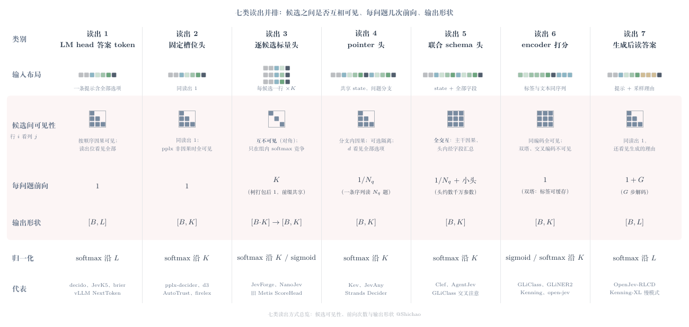
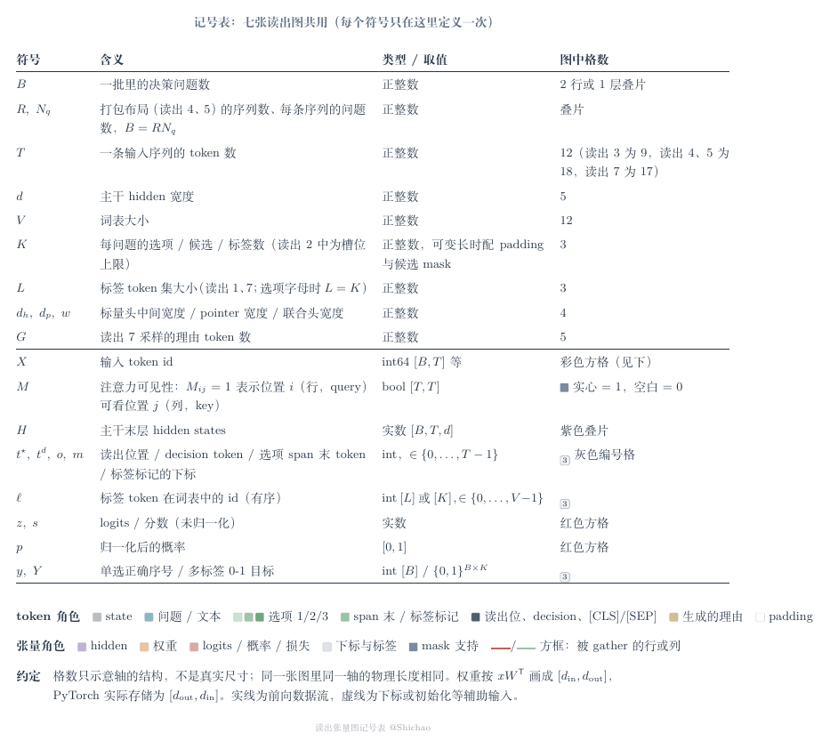
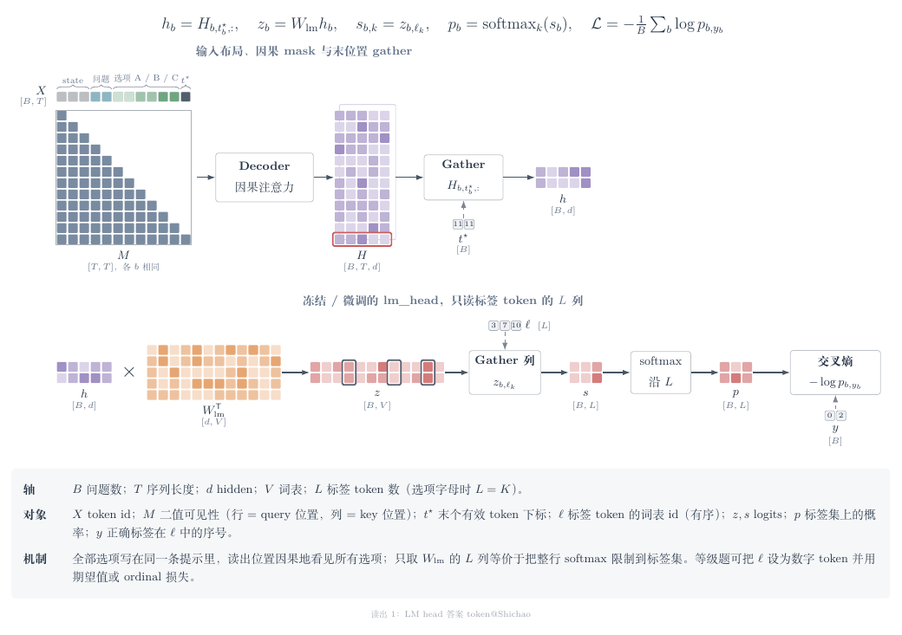
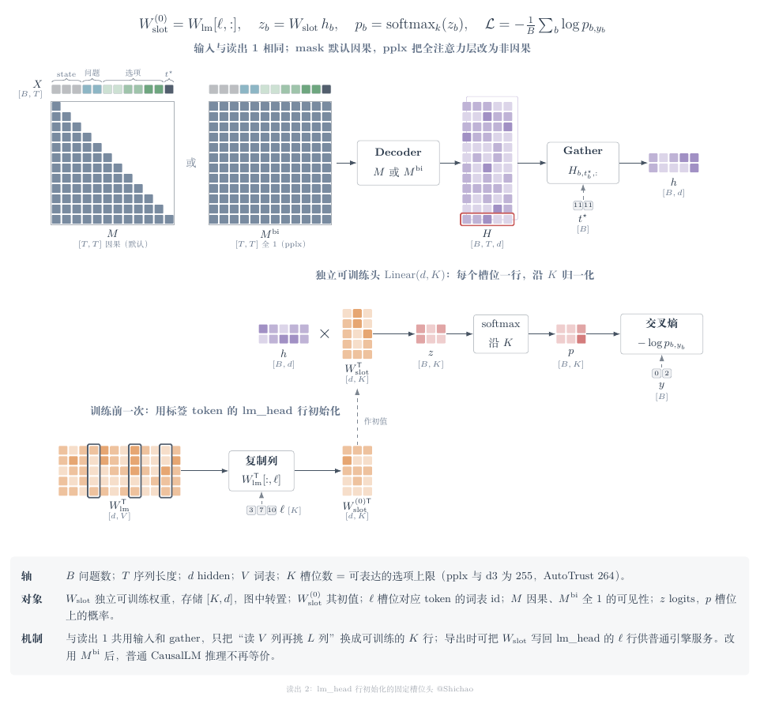
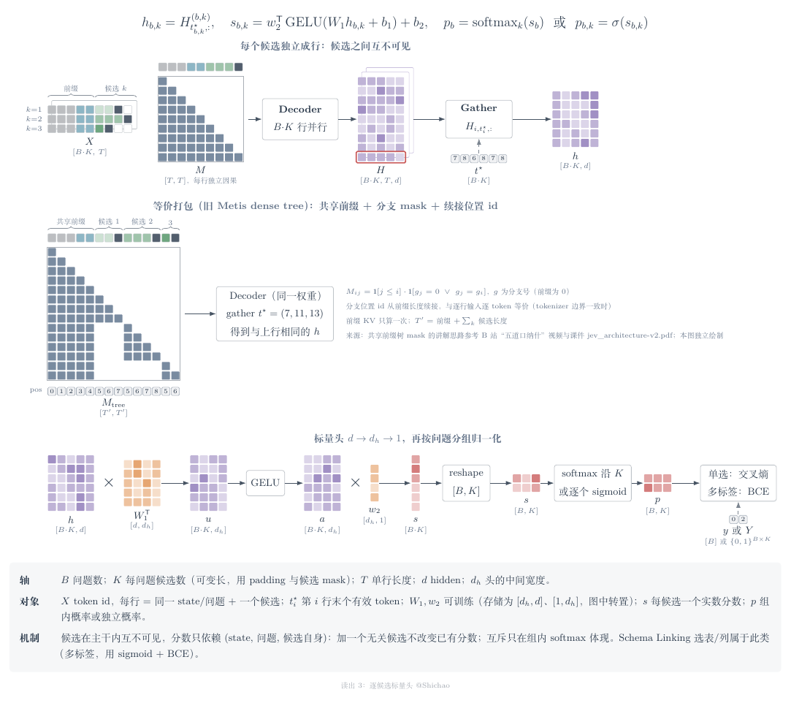
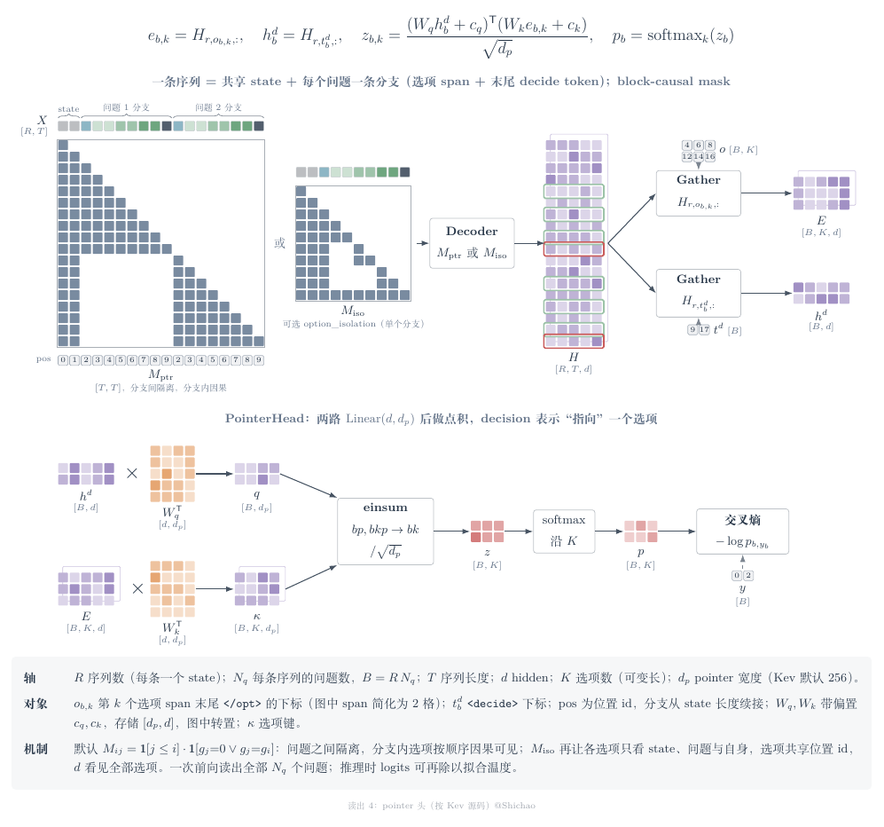
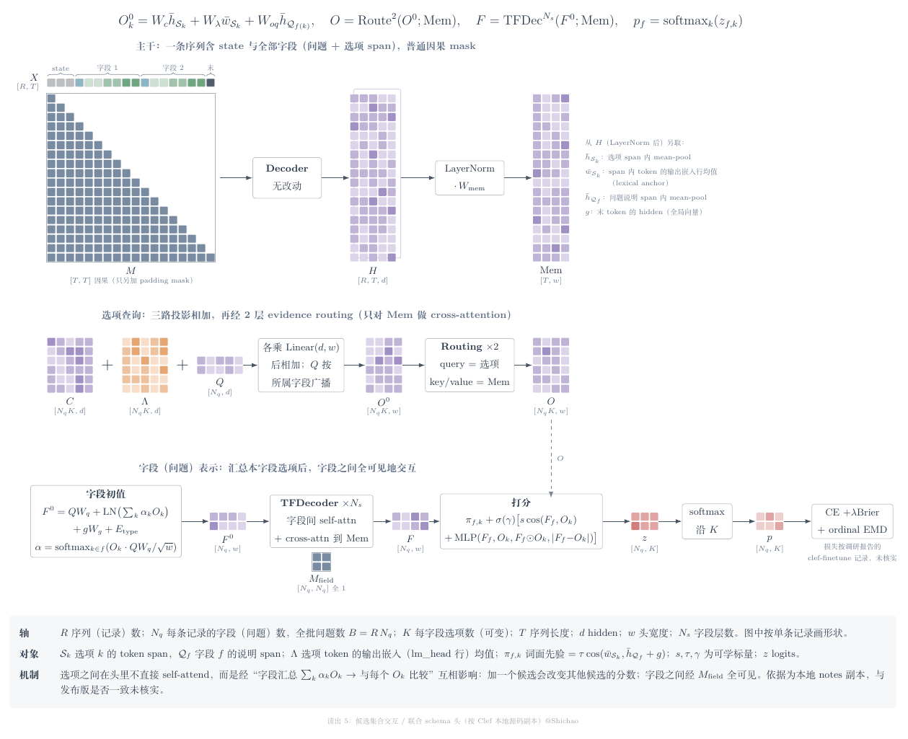
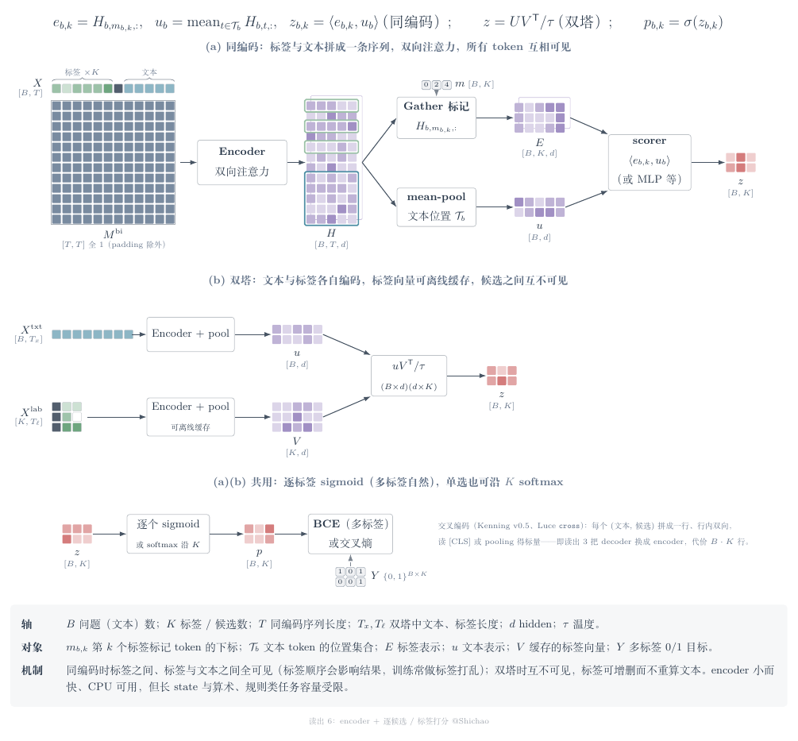
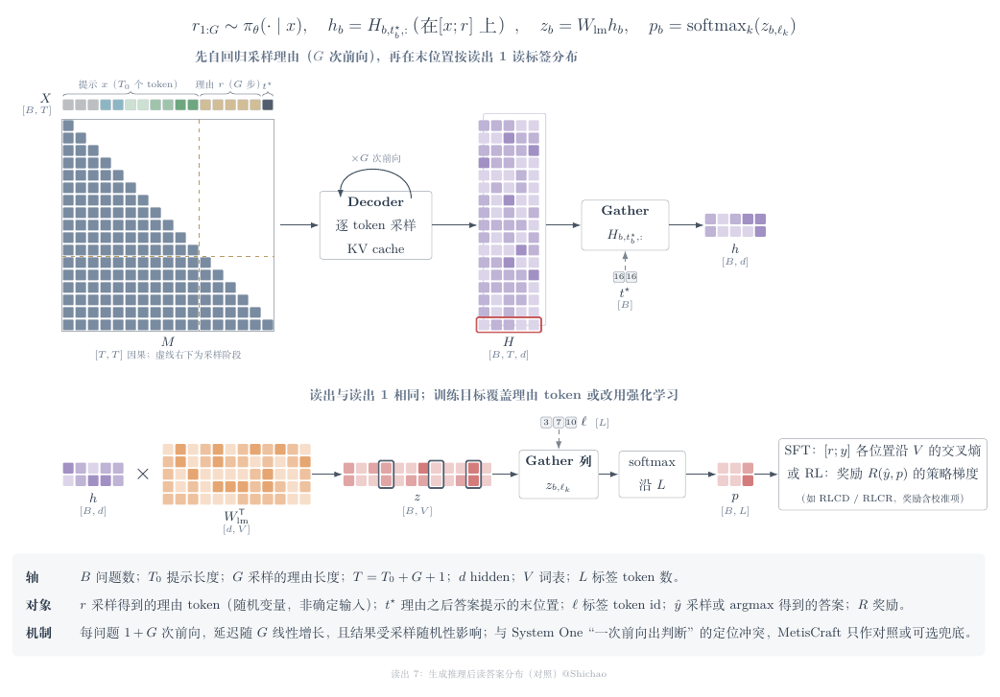

# 判断读出与张量图

本页以张量图比较七类读出。MetisCraft 当前实现答案 token 和逐候选标量头；其他机制用于理解生态项目，不能据此认定可在本包直接训练。项目和来源见[支持矩阵](../support-matrix.md)。

| 图 | 文件 |
|---|---|
| 记号表 | `readout-0-notation.{tex,pdf,png}` |
| ① LM head 答案 token | `readout-1-lm-token.*` |
| ② 固定槽位头 | `readout-2-slot-head.*` |
| ③ 逐候选标量头 | `readout-3-candidate-scalar.*` |
| ④ pointer 头 | `readout-4-pointer.*` |
| ⑤ 联合 schema 头 | `readout-5-joint-schema.*` |
| ⑥ encoder 打分 | `readout-6-encoder.*` |
| ⑦ 生成后读答案 | `readout-7-generate-then-read.*` |
| 七类总览 | `readout-overview.*` |

共用的配色和宏在 `readout-style.tex`。编译命令：`tectonic <图>.tex`，然后 `pdftoppm -r 110 -png -singlefile <图>.pdf <图>`。



## 记号



与 `readout-0-notation` 一致：

| 符号 | 含义 |
|---|---|
| `B` | 一批里的决策问题数 |
| `R, N_q` | 打包布局（④⑤）中的序列数和每条序列的问题数，`B = R*N_q` |
| `T` | 序列长度 |
| `d` | 主干 hidden 宽度 |
| `V` | 词表大小 |
| `K` | 每问题的选项、候选或标签数；在②中是槽位上限 |
| `L` | 标签 token 集大小（①⑦；选项字母时 `L = K`） |
| `d_h, d_p, w` | 标量头中间宽度、pointer 宽度、联合头宽度 |
| `G` | ⑦中采样的理由 token 数 |
| `M` | 注意力可见性，`M[i, j] = 1` 表示 query 位置 i 可以看 key 位置 j |
| `t*, t_d, o, m` | 读出位置、decision token、选项 span 末 token、标签标记各自的下标 |
| `ell` | 标签 token 的词表 id（有序） |
| `z / s, p` | logits 或分数；概率 |
| `y, Y` | 单选时正确选项的序号；多标签时的 0/1 目标 |

伪代码默认 `H = backbone(X, attn_mask=M).last_hidden_state`。张量形状写在注释里。权重按 PyTorch 习惯存为 `[d_out, d_in]`，图里画的是转置后的 `[d_in, d_out]`。

---

## ① LM head 答案 token



一条提示里放 state、问题和全部选项。取末个有效位置的下一 token logits，只保留标签 token（yes/no、选项字母、等级数字）对应的 L 列，再做 softmax。

$$h_b=H_{b,t^\star_b,:},\quad z_b=W_{\mathrm{lm}}h_b,\quad s_{b,k}=z_{b,\ell_k},\quad p_b=\mathrm{softmax}_k(s_b),\quad \mathcal L=-\tfrac1B\sum_b\log p_{b,y_b}$$

```python
H = backbone(X, attn_mask=causal).last_hidden_state   # [B, T, d]
h = H[torch.arange(B), t_star]                         # [B, d]    t_star: [B] 末个有效 token
z = h @ W_lm.T                                         # [B, V]    W_lm: [V, d]（可只算 L 行）
s = z[:, ell]                                          # [B, L]    ell: [L] 标签 token id
p = s.softmax(-1)                                      # [B, L]
loss = F.cross_entropy(s, y)                           # y: [B]，取值 0..L-1
# 等级题：ell 设为 "1".."5" 等数字 token，可改用期望值回归或 ordinal（CDF）损失
# 全词表 SFT：F.cross_entropy(z, ell[y])，即 V 上的普通 next-token 损失
```

- 选项能互相看见，读出位置能看见全部选项。每问题一次前向，共享 state 时可复用前缀缓存。
- 优点：基座不用改，任何推理引擎都能服务，最容易蒸馏。缺点：有位置偏差和标签先验；选项数受"每个选项一个标签 token"的限制。
- 代表项目：decido-26b、Quyet、Mapika/decider、JevK5、Nimble、Plumb、Hmm、Tev1、SemIf、brier（L0/L1）、Kenning-XL、vLLM `NextTokenStrategy`。

## ② lm_head 行初始化的固定槽位头



输入和 gather 与①相同。头换成独立的 `Linear(d, K)`，第 k 行用槽位 k 对应 token 在 lm_head 中的那一行初始化。

$$W_{\mathrm{slot}}^{(0)}=W_{\mathrm{lm}}[\ell,:],\quad z_b=W_{\mathrm{slot}}h_b,\quad p_b=\mathrm{softmax}_k(z_b)$$

```python
slot = nn.Linear(d, K, bias=False)                     # weight: [K, d]
slot.weight.data.copy_(W_lm[ell])                      # ell: [K]，只在训练前做一次
H = backbone(X, attn_mask=causal_or_full).last_hidden_state   # [B, T, d]
h = H[torch.arange(B), t_star]                         # [B, d]
z = slot(h)                                            # [B, K]
loss = F.cross_entropy(z, y)                           # 沿 K 做 softmax
# 导出：W_lm[ell] = slot.weight，即可用普通引擎按①的方式服务
```

- pplx-decider 把全注意力层的 mask 改成全 1（`M^bi`），让选项双向可见。这样普通 CausalLM 推理就不再与训练等价，模型卡里写明了这一点。
- 槽位数上限固定：pplx 和 d3 是 255 行，AutoTrust 是 264 槽。
- 代表项目：AutoTrust JEV（槽位合并进 lm_head）、pplx-decider、**d3**（255 码 readout，文件布局和基座 revision 都与 pplx 相同）、firelex/jeff、imajev。

## ③ 逐候选标量头



每个候选单独成一行：同一 state、同一问题加上一个候选，取末 token 的 hidden，经 MLP 得到一个标量，再在同一问题的候选之间做 softmax。多标签任务改用逐个 sigmoid。

$$s_{b,k}=w_2^{\mathsf T}\,\mathrm{GELU}(W_1h_{b,k}+b_1)+b_2,\quad p_b=\mathrm{softmax}_k(s_b)\ \text{或}\ \sigma(s_{b,k})$$

```python
Xr = X_rows.view(B * K, T)                             # 每行 = 前缀 + 候选 k + 读出位
H = backbone(Xr, attn_mask=causal).last_hidden_state   # [B*K, T, d]
h = H[torch.arange(B * K), t_star]                     # [B*K, d]   t_star: [B*K]
u = h @ W1.T + b1                                      # [B*K, d_h] W1: [d_h, d]
s = (F.gelu(u) @ w2.T + b2).squeeze(-1)                # [B*K]      w2: [1, d_h]
s = s.view(B, K).masked_fill(~cand_mask, -inf)         # [B, K]
loss = F.cross_entropy(s, y)                           # 单选
# 多标签（如 Schema Linking 选表/列）：F.binary_cross_entropy_with_logits(s, Y.float())
# 共享前缀树打包：一条 [T'] 序列，M_tree[i,j] = (j<=i) & (g[j]==0 | g[j]==g[i])，
# 分支的位置 id 从前缀长度接着往下编；gather 各分支末位得到同一个 h
```

- 候选之间互不可见。加一个无关候选不会改变已有候选的分数，互斥关系只体现在组内 softmax。
- 每问题前向 K 行，用共享前缀树打包后可以一次算完。
- 代表项目：JevForge（两层 GELU）、NanoJev（共享标量头）、Kenning cross-encoder（encoder 版本，见⑥）、Von、**旧 Metis ScoreHead**。业务上，Schema Linking 的表/列选择也属于这一类。
- 调研报告专题 1 把 d3 列在这一类，是错的；d3 应归②。

## ④ pointer 头（按 Kev @2074cc4 `kev/model.py`）



一条序列的布局是 `<state> state` 后接每个问题的分支 `<q> instr (<opt> o </opt>)×K <decide>`。

- mask（`branch_mask_batch`）：分支能看见 state 和本分支（因果），看不见其他问题的分支。
- 位置 id：每个分支都从 `len(state)` 开始编。
- 选项表示：取每个选项 span 末尾 `</opt>` 处的 hidden（`opt_idx`）。
- decision 表示：取 `<decide>` 处的 hidden（`decide_idx`）。
- `PointerHead`：`q, k = nn.Linear(d, dp), nn.Linear(d, dp)`，`z = k(h_opts) @ q(h_decide) / sqrt(dp)`；`dp` 默认 256。推理时 logits 再除以拟合得到的温度。

$$z_{b,k}=\frac{(W_qh^{d}_b+c_q)^{\mathsf T}(W_ke_{b,k}+c_k)}{\sqrt{d_p}},\quad p_b=\mathrm{softmax}_k(z_b)$$

```python
H = backbone(X, attn_mask=M_ptr, position_ids=pos).last_hidden_state  # [R, T, d]
E  = H[r_of_q[:, None], o]                            # [B, K, d]   o: [B, K]，</opt> 下标
hd = H[r_of_q, t_d]                                    # [B, d]      t_d: [B]，<decide> 下标
q = Wq(hd)                                             # [B, d_p]    nn.Linear(d, d_p)，带偏置
kappa = Wk(E)                                          # [B, K, d_p]
z = torch.einsum('bp,bkp->bk', q, kappa) / d_p ** 0.5  # [B, K]
loss = F.cross_entropy(z.masked_fill(~opt_mask, -inf), y)
# M_ptr[i,j] = (j<=i) & (seg[j]==0 | seg[j]==seg[i])
# option_isolation：选项 token 只看 state、问题和自身 span；选项共享位置 id；<decide> 看全部
```

- 默认情况下，分支内的选项按顺序因果可见；打开 `option_isolation` 后，选项之间互不可见。两种情况下 `<decide>` 都能看见全部选项，所以候选之间的信息经 decision token 汇合。一次前向能读出 N_q 个问题。
- Qwen3.5 这类混合架构（含 Gated DeltaNet）无法执行 block-causal mask，Kev 对这类模型改为逐行前向（`is_hybrid`、`forward_rows_batch`）。
- 其他项目的做法（未逐个核对源码）：JevAny 沿用 Kev 系布局，另有 `lm_token` 模式；Verdict 2.0 用 marker-pointer；有的实现对 span 做 mean-pool 而不是取末 token。
- 代表项目：Kev、JevAny、Strands Decider、NeoHorse-Jev、IluvatarLabs/kev、Verdict 2.0。

## ⑤ 候选集合交互 / 联合 schema 头（按 Clef 的 `joint_schema_model.py`）



主干是**普通因果 LM**，不改 mask，只有 2D padding mask。一条序列依次是 system、`STATE:`、全部字段（每个字段含 `INSTRUCTION` span 和若干 `OPTION` span）、suffix。头的计算分三步：

1. **选项查询**：`O0 = W_c·mean_span(H) + W_λ·mean(lm_head 行) + W_oq·问题向量`。中间一项就是 lexical anchor。之后经 2 层 `EvidenceRoutingLayer`，这一层只让选项对 `Mem = W_mem·LN(H)` 做 cross-attention，选项之间不做 self-attention。
2. **字段表示**：`F0 = 问题投影 + LN(Σ_k α_k O_k) + 全局向量（末 token）投影 + 类型嵌入`，其中 α 是在本字段选项上的 softmax。再经 N_s 层 `TransformerDecoderLayer`：字段之间做 self-attention（全可见），同时对 `Mem` 做 cross-attention。
3. **打分**：`z = 词面先验 π + σ(γ)·[s·cos(F_f, O_k) + MLP([F, O, F⊙O, |F−O|])]`。

$$O=\mathrm{Route}^{2}(O^{0};\mathrm{Mem}),\quad F=\mathrm{TFDec}^{N_s}(F^{0};\mathrm{Mem}),\quad z_{f,k}=\pi_{f,k}+\sigma(\gamma)\big[s\cos(F_f,O_k)+\mathrm{MLP}(\cdot)\big]$$

```python
H = LN(backbone(X, attn_mask=pad_only_causal).last_hidden_state[r])  # [T, d]，单条记录
Mem = H @ W_mem.T                                      # [T, w]
Qv  = stack([H[a:b].mean(0) for a, b in q_spans])      # [N_q, d]
C   = stack([H[a:b].mean(0) for a, b in opt_spans])    # [N_q*K, d]
Lam = stack([W_lm[X[r, a:b]].mean(0) for a, b in opt_spans])  # [N_q*K, d]
g   = H[-1]                                            # [d]
O = Wc(C) + Wlam(Lam) + Woq(Qv)[owner]                 # [N_q*K, w]
for layer in routing: O = layer(O, Mem)                # 只 cross-attn 到 Mem
Fq = Wq(Qv)                                            # [N_q, w]
alpha = segment_softmax(O @ Fq[owner] / w**0.5, owner) # 每字段内对选项归一化
F = Fq + LN(segment_sum(alpha * O, owner)) + Wg(g) + E_type[types]   # [N_q, w]
for layer in tf_layers: F = layer(F, Mem)              # 字段间 self-attn（无 mask）+ cross-attn
z = prior + sigmoid(gate) * (s * cos(F[owner], LN(O)) + mlp(cat(F[owner], O, F*O, |F-O|)))
p = segment_softmax(z, owner)                          # 每字段沿 K
```

- 候选之间是否可见：在主干里，后面的选项因果地看得见前面的选项；在头里，选项经"字段汇总 → 与每个 O_k 比较"互相影响，加一个候选会改变其他候选的分数；字段之间全可见。
- 未核实的两点：这份本地副本是否与发布版逐行一致；训练损失 CE + λBrier + ordinal EMD 取自调研报告对 clef-finetune 的记录，`joint_schema_model.py` 里没有这部分。
- 代表项目：Clef JointSchemaHead、AgentJev 集合 Transformer、NanoJev 集合注意力残差、Laya 两层 Transformer 头、GLiClass CrossAttn/Hopfield scorer。

## ⑥ encoder + 逐候选/标签打分



分两种结构：

- **同编码**（GLiClass uni-encoder）：`<<LABEL>>名称 ... <<SEP>> 文本` 拼成一条序列，用双向注意力。取标签标记 token 的 hidden 作为标签表示，对文本做 mean-pool，再交给 scorer。
- **双塔**：文本和标签各自编码，标签向量可以离线缓存。

此外还有交叉编码（Kenning v0.5、Luce `cross`）：每个 (文本, 候选) 拼成一行，行内双向，相当于把③的 decoder 换成 encoder。

$$z_{b,k}=\langle H_{b,m_{b,k},:},\ \mathrm{mean}_{t\in\mathcal T_b}H_{b,t,:}\rangle\ \text{（同编码）},\qquad z=UV^{\mathsf T}/\tau\ \text{（双塔）},\qquad p=\sigma(z)$$

```python
# 同编码
H = encoder(X, attn_mask=pad_mask).last_hidden_state   # [B, T, d]，双向
E = H[torch.arange(B)[:, None], m]                     # [B, K, d]   m: [B, K] 标签标记下标
u = (H * text_mask[..., None]).sum(1) / text_mask.sum(1, keepdim=True)  # [B, d]
z = torch.einsum('bkd,bd->bk', E, u)                   # [B, K]（GLiClass 另有 MLP 等多种 scorer）
# 双塔
u = pool(encoder(X_txt))                               # [B, d]
V = pool(encoder(X_lab))                               # [K, d]，可缓存
z = u @ V.T / tau                                      # [B, K]
loss = F.binary_cross_entropy_with_logits(z, Y.float())   # 多标签；单选用 cross_entropy
```

- 同编码时标签之间全可见，标签顺序会影响结果，训练时常打乱标签顺序。双塔时标签之间互不可见，增删标签不用重算文本。
- 延迟在 35–50 ms 量级，CPU 也能跑；但长 state 和算术、规则类任务受容量限制。
- 代表项目：GLiClass（5 种布局、7 种 scorer）、GLiNER2、GLiFormer、Shalimov04/open-jev、Von、Kenning、nullspan、sysone-0.4B。

## ⑦ 生成推理后读答案分布（只作对照）



先采样一段理由 r（G 步解码），再在 `[x; r; 答案提示]` 的末位置按①读标签分布。

$$r_{1:G}\sim\pi_\theta(\cdot\mid x),\quad p_b=\mathrm{softmax}_k\big(W_{\mathrm{lm}}H_{b,t^\star_b,:}\big)_{\ell}$$

```python
seq = model.generate(x, max_new_tokens=G, do_sample=True)   # [B, T0+G]，G 次前向（KV cache）
seq = torch.cat([seq, answer_cue], 1)                       # [B, T]
H = model(seq).last_hidden_state                            # [B, T, d]
s = (H[torch.arange(B), t_star] @ W_lm.T)[:, ell]           # [B, L]
p = s.softmax(-1)
# 训练：SFT 在 [r; y] 各位置沿 V 做 CE；或 RL（RLCD / RLCR，奖励含校准项）
```

- 每问题需要 1+G 次前向，结果还受采样随机性影响，与 System One"一次前向出判断"的定位冲突。MetisCraft 只把它当对照或可选兜底。
- 代表项目：OpenJev-RLCD、Kenning-XL deliberate 模式、AutoTrust "thinking on"。

---

## 总览：三点差异

| | 候选之间是否互相可见 | 每问题前向次数 | 输出形状 |
|---|---|---|---|
| ① | 因果可见，读出位看见全部选项 | 1 | `[B, L]` |
| ② | 同①；pplx 非因果时全可见 | 1 | `[B, K]` |
| ③ | 互不可见 | K（树打包后 1） | `[B*K] → [B, K]` |
| ④ | 分支内因果，可选隔离；decision token 看见全部 | 1/N_q | `[B, K]` |
| ⑤ | 全交互（头内经字段汇总；字段之间全可见） | 1/N_q，另加一个小头 | `[B, K]` |
| ⑥ | 同编码时全可见；双塔或交叉编码时不可见 | 1（双塔的标签可缓存） | `[B, K]` |
| ⑦ | 同①，还能看见生成的理由 | 1+G | `[B, L]` |

## 来源与致谢（待确认）

- ③中共享前缀树 mask、分支位置 id 的讲解思路，参考了 Bilibili 创作者"五道口纳什"的视频（[作者主页](https://space.bilibili.com/59807853)）和 GitHub 课件 [wdkns/modern_genai_bilibili `slides/jev_architecture-v2.pdf`](https://github.com/wdkns/modern_genai_bilibili/blob/6b8729b923d17863014ac6e0ff7715fc84473300/slides/jev_architecture-v2.pdf)（版本 `6b8729b`）。说法与旧版 tag `metis-v0.1.0` 的 `ACKNOWLEDGEMENTS.md` 一致。具体视频标题和 BV 号仍待补齐。本目录的图都是独立绘制，没有使用原课件素材；这项致谢不表示 tree attention 算法是该作者首创。
- ④按 [jaredpalmer/kev @2074cc4](https://github.com/jaredpalmer/kev/tree/2074cc44256200bb37540103fa4572901faa10f3) 的 `kev/model.py` 画（`encode`、`branch_mask_batch`、`PointerHead`）。
- ⑤按 [`Cloudflare/clef`](https://huggingface.co/Cloudflare/clef) 中 `joint_schema_model.py` 的本机副本画。
- 其余各类的代表项目和自报数字取自调研报告专题 1，未逐一核对源码。
- 绘图规范来自 `tensor-formula-viz` 技能；配色和"同名张量跨行复用"的做法沿用旧版（tag `metis-v0.1.0`）的 `docs/architecture/figures/metis-tensor-*.tex`。

## 未完成

9 张图都已编译成 PDF 和 PNG，并逐张看过渲染。没有剩下的步骤，只有以下几点待定：
- 是否加大标题和分区底色；
- 图里的类别编号写成"读出 N"（字体缺 ①–⑦），这份说明里写 ①–⑦，是否接受；
- 各图示意用的 T 不统一，是否要统一；
- 五道口纳什的具体视频标题和 BV 号待补。
