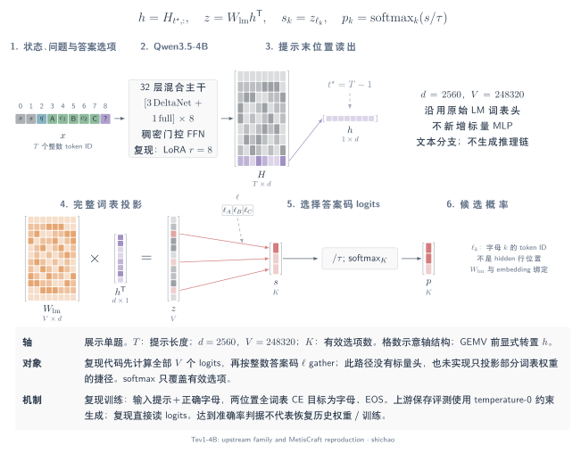

# Tev1-4B 复现

MetisCraft 使用公开数据构建器与建议配方重训 Tev1 类模型，核对数据、提示、逐题输出和预先约定的准确率标准。**4B 达到预定准确率标准；没有恢复原版权重或历史托管训练作业。**

来源固定为 [togethercomputer/tev1@1dde778](https://github.com/togethercomputer/tev1/tree/1dde7782382c9f49d627153759b8d1deab426ce0)，2026-11-05 读取，2026-11-07 完成原版读出与逐题核对。

## 模型架构



[SVG](../tensor-analysis/figures/tev1-architecture.zh.svg) · [PDF](../tensor-analysis/figures/tev1-architecture.zh.pdf) · [TikZ](../tensor-analysis/figures/tev1-architecture.zh.tex)

**Tev1 是 Qwen3.5-4B 的决策任务微调模型，使用原有 LM head 预测答案字母。** [上游说明](https://github.com/togethercomputer/tev1/blob/1dde7782382c9f49d627153759b8d1deab426ce0/README.md)公开了 LoRA 监督微调方法；[固定版本模型卡](https://huggingface.co/togethercomputer/Tev1-4B-experimental/blob/0b7becf017daa0e5eb222f8ce7483c8c8259c52f/README.md)说明它保留标准 next-token 输出头。MetisCraft 的 4B 复现采用相同读出家族。

| 部分 | 公开架构与本次复现 |
|---|---|
| 基座 | 原版为 Qwen3.5-4B；本次固定 `Qwen/Qwen3.5-4B@851bf6e8`，使用文本因果语言模型分支。 |
| 混合主干 | 32 层，隐藏宽度 2,560；每组 3 层 Gated DeltaNet 线性注意力与 1 层 gated full attention，共 24 + 8 层；各层包含稠密 FFN。 |
| 输出投影 | 沿用与 token embedding 共享权重的 LM head，词表宽度 248,320；读出采用 `answer_token`。 |
| 微调与目标 | `all-linear` LoRA：r=8、alpha=16、dropout=0；`chat_json` 非思考提示；教师强制 `completion` 训练，只对答案字母和 EOS 计算全词表交叉熵。 |
| 推理协议 | MetisCraft 读取候选字母 logits 并按候选归一化；上游保存结果使用 temperature=0 的选项 regex 约束生成。 |

[原版配置](https://huggingface.co/togethercomputer/Tev1-4B-experimental/blob/0b7becf017daa0e5eb222f8ce7483c8c8259c52f/config.json)与[本次基座配置](https://huggingface.co/Qwen/Qwen3.5-4B/blob/851bf6e806efd8d0a36b00ddf55e13ccb7b8cd0a/config.json)逐字一致，层布局也见 [Qwen 固定版本模型说明](https://huggingface.co/Qwen/Qwen3.5-4B/blob/851bf6e806efd8d0a36b00ddf55e13ccb7b8cd0a/README.md)。配置相同不代表训练权重相同或恢复了历史托管任务。LoRA 设置对齐的是[公开建议](https://github.com/togethercomputer/tev1/blob/1dde7782382c9f49d627153759b8d1deab426ce0/docs/TRAINING.md)；本次[配方](../../recipes/tev1/qwen3.5-4b_chat-completion.yaml)不拼接样本。公开配置包含视觉模块，但本次实验与 MetisCraft 接口只验证文本任务。

### 张量对象与索引

以下说明我方 4B 推理实现。\(B\) 为问题数，\(T\) 为填充后的序列长度，\(K_b\) 为问题 \(b\) 的有效选项数，\(K_{\max}\) 为批内最大选项数，\(V=248320\)。

| 对象 | 类型与形状 | 一个元素的含义 |
|---|---|---|
| `input_ids` \(X\) | int64，\([B,T]\) | 词表 ID，取值 \(0\ldots V-1\)；不是选项下标。 |
| `attention_mask` \(M\) | int64，\([B,T]\) | 1 为有效输入 token，0 为左侧 padding；不是完整的注意力概率矩阵。 |
| 末位索引 \(t_b\) | 整数，\([B]\) 的概念索引 | \(\max\{t:M_{b,t}=1\}\)；当前左填充使每行 \(t_b=T-1\)。 |
| 隐状态 \(H\)、决策表示 \(h\) | 浮点，\([B,T,2560]\)、\([B,2560]\) | \(h_b=H_{b,t_b,:}\)，表示整条提示的末位上下文。 |
| LM 权重 \(W_{\mathrm{lm}}\) | 浮点，\([V,2560]\) | 每行对应一个词表 token 的输出投影。 |
| 词表 logits \(Z\) | float32，\([B,V]\) | \(Z=hW_{\mathrm{lm}}^{\mathsf T}\)，尚未归一化。 |
| `codes` \(\ell\) | int64，\([B,K_{\max}]\) | 选项字母的词表 ID；\(\ell_{b,k}\) 将候选列映射到词表列。 |
| 候选 `mask` \(C\) | bool，\([B,K_{\max}]\) | True 为有效候选；与 token padding mask 的轴不同。 |
| 候选分数 \(S\)、概率 \(p_b\) | 浮点，\([B,K_{\max}]\)、每题 \([K_b]\) | 分数来自代码列；概率只对该题有效候选归一化。 |

### 算子链与概率

`状态／问题／全部选项 → 非思考 chat 模板 → 左填充 → 混合因果主干 → 末位表示 → 完整 LM 投影 → gather 字母列 → 选择有效候选 → softmax`

\[
h_b=H_{b,t_b,:},\qquad
Z=hW_{\mathrm{lm}}^{\mathsf T},\qquad
S_{b,k}=Z_{b,\ell_{b,k}},\qquad
p_{b,k}=\frac{\exp(S_{b,k}/\tau_b)}{\sum_{j=0}^{K_b-1}\exp(S_{b,j}/\tau_b)}.
\]

矩阵乘法收缩隐藏轴：\((B\times2560)(2560\times V)\rightarrow B\times V\)。当前 [`DecisionModel.forward`](../../src/metiscraft/modeling/model.py#L62)确实先计算完整词表 logits，再 `gather`；`H[:, -1]` 等价于这里的末有效位置选择。[组批代码](../../src/metiscraft/train/collate.py#L21)以有效 mask 的累积值生成 `position_ids`，左侧 padding 不增加有效 token 的位置编号。预测时[按有效候选数切除填充列](../../src/metiscraft/evaluate/infer.py#L49)，再[归一化](../../src/metiscraft/judgments/__init__.py#L112)。候选空间概率的分母仅包含有效答案码，通常不同于全词表 softmax 中该字母的概率。

全部候选共同出现在同一因果提示中：前面的选项不能读取后面的选项，最终答案位置可以读取前面的全部提示。改变选项顺序可能改变上下文表示与 logits；候选共同参与 softmax 分母也会耦合概率。

**教学数例：** 三个有效候选的 logits 为 \([0,1,2]\) 时，\(\tau=1\) 得到 \([0.090031,0.244728,0.665241]\)，\(\tau=2\) 得到 \([0.186324,0.307196,0.506480]\)。正温度缩放保留最大分数的候选，只改变概率分布；这些构造数字不是 Tev1 的实测结果。

### 训练目标与推理读出

`completion` 训练将正确字母追加到输入，使用 \(H[:, -2:]\) 经 LM head 得到 \([B,2,V]\) logits，分别预测答案字母与 EOS。损失是这两个位置的**全词表**交叉熵平均；推理不追加真值，读取提示末位并在候选子集上归一化。源码见 [`Collator`](../../src/metiscraft/train/collate.py#L105)和 [`completion_loss`](../../src/metiscraft/judgments/__init__.py#L63)。该区别也意味着候选空间 CE 与本配方的 completion 目标不能混称。

图示与通用推导见[答案 token 张量解析](../zh/tensor-analysis/answer-token.md)及[训练、校准与输出](../zh/tensor-analysis/training-calibration.md)。上游的[实际请求代码](https://github.com/togethercomputer/tev1/blob/1dde7782382c9f49d627153759b8d1deab426ce0/examples/decide.py)还包含约束生成、非思考模板和 logprobs 参数；读出家族相同不意味着服务协议、校准或延迟相同，也不用于推断 Jev 未公开的内部架构。

## 结果与原版对照

| 题集 | MetisCraft 2B | MetisCraft 4B | 原版 Tev1 4B | 4B 差距 |
|---|---:|---:|---:|---:|
| 主集，1,000 题 | 864/1,000 · 86.4% | **873/1,000 · 87.3%** | 880/1,000 · 88.0% | −0.70 个百分点 |
| 政策迁移，300 题 | 276/300 · 92.0% | **298/300 · 99.33%** | 300/300 · 100% | −0.67 个百分点 |

标准在 2026-11-06 查看结果前确定：2B 主集与原版相差不超过 5 个百分点，迁移集接近 100%；4B 与原版准确率相差不超过 2 个百分点。2B 仅主集通过；4B 两项通过，门槛未调整。

公开题属于开发中使用过的问题，不能视为未接触的最终测试。原版还有另行标记的 v2 最终评测，本次未使用。

### 逐题一致性

全部 1,300 题的 ID、输入、金标、选项内容与顺序已核对一致。主集答案一致 946/1,000（94.6%），迁移集 298/300（99.33%）。主集双方都对 852 题，仅 MetisCraft 对 21 题，仅原版对 28 题，双方都错 99 题；不设结果出来后的额外一致率门槛。

主集的选择题为 822/900（91.33%），原版 828/900（92.0%）；SST-5 为 51/100（51.0%），原版 52/100（52.0%）。2B 的 SST-5 为 57.0%，因此并非每个子项都随规模提高。

### 概率与校准

| 4B 指标 | 原始 | 温度校准后 |
|---|---:|---:|
| 主集按题加权 NLL | 0.3019 | 0.3035 |
| 政策迁移 NLL | 0.0522 | 0.0990 |

policy 温度为 0.476；正温度不改变这些题的 argmax，但 NLL 恶化，不能宣称校准全面改善。2B 的主集 choice ECE 为 0.027→0.019；迁移 NLL 为 0.20→0.44，温度 0.27，原因尚未确定。

## 运行条件与训练差异

4B 运行 `20261106-183017-f4cb8155` 使用 [4B 配方](../../recipes/tev1/qwen3.5-4b_chat-completion.yaml)、`tev1/rev-1dde7782`、`Qwen/Qwen3.5-4B@851bf6e8`，单张 RTX 3090。1,052 个优化步耗时 22,620.72 秒（约 6 小时 17 分）。封存源码清单 SHA-256 为 `00db1319eec8a5e936da53dc55f1ef57c23dfae9c1e8e196bacce28227d16d1b`，产物与校准文件校验及父产物绑定通过。

2B 使用 `Qwen/Qwen3.5-2B@15852e8c`，1,052 步约 7.2 小时、显存峰值约 6 GB。资源测量只描述该配置；不代表任意设备或序列长度的性能。

| 设置 | 原版公开建议 | MetisCraft |
|---|---|---|
| 基座 | Qwen3.5-4B | 固定版本的 2B 对照与 4B |
| 微调 | LoRA 全部线性层，r=8、alpha=16、dropout=0 | 相同 |
| 优化 | 1 epoch，5e-5，cosine，warmup 0.03，梯度裁剪 1 | 相同建议值 |
| 长度 | 2,048，packing | 2,048，不拼接样本 |
| 批量 | 8 条打包序列，每步约 36 题 | batch 4 × grad_accum 9，每步目标 36 题 |
| 目标 | 仅答案字母与 EOS | `completion` 全词表目标 |
| 提示 | 非思考 chat 模板，系统提示与 JSON | `chat_json`，43,708 条逐 token 一致 |

Together 托管任务的 ID、上传哈希和实际超参未留存，获取历史任务时返回 403；仓库明确提供的是建议配方。因此上述一致性是与公开建议比较。

原版 [evaluation.json](https://github.com/togethercomputer/tev1/blob/1dde7782382c9f49d627153759b8d1deab426ce0/runs/new-v1/evaluation.json) 的 88.0%／100% 使用温度 0、按选项 regex 约束生成；MetisCraft 取候选字母 logits 的最大值。它们不能描述成相同的无约束全词表首 token 协议；无约束诊断未做。

### 历史训练消费与配置身份

37,840 条记录按 batch 4 产生 9,460 个微批。旧循环为凑满 1,052 个优化步，在尾步多读取下一轮 8 个微批，即 **32 次额外样本呈现**，不是 32 条新增独立样本；`epochs_seen=2` 与此一致。当前循环在轮尾提交剩余微批，遵守配置预算。没有为文档更新重跑该实验。

历史 `config.sha256`／`recipe_sha256` 对应路径解析前配方，保存的 `config.yaml` 已解析；可由冻结配方与记录的覆盖项重建输入哈希。当前版本分别记录原始与解析配置，历史文件不回写，原评测数字不变。

## 数据与提示重建

| 来源 | 训练条数 | 固定版本 |
|---|---:|---|
| MultiNLI | 5,000 | `nyu-mll/multi_nli@da70db2a` |
| BoolQ | 3,000 | `google/boolq@35b264d0` |
| Banking77 | 3,000 | `legacy-datasets/banking77@f5412156` |
| AG News | 1,500 | `fancyzhx/ag_news@eb185aad` |
| SST-5 | 2,000 | `SetFit/sst5@e51bdcd8` |
| 合成政策判断 | 13,500 | 确定性生成器 |
| 优先级路由 | 6,000 | 确定性生成器 |
| 合成研究分类 | 3,840 | 生成器与分类表 |

训练共 37,840 条、16,929,529 token，最长 1,526 token；new-v1 dev 共 4,568 条。合成部分来自规则和模板，不用教师模型或 Jev 输出。记录来源遵守原数据条款，不将混合数据训练产物标为可商用。

```bash
pip install -e ".[reproduce]" flash-linear-attention
metiscraft data prepare tev1
```

外部构建器固定源码树和五个上游数据版本，通过包装层提供本地输入并隔离 Hub 下载；原样执行四个构建脚本、三个校验脚本，再转换为 Record。状态键序与选项顺序保留。公开的 **21 个哈希全部匹配**：7 个 new-v1 最终文件、12 个中间文件、2 个评测集；43,708 条记录全部可还原原消息。

| MetisCraft 划分 | 来源 | 条数 |
|---|---|---:|
| train | new-v1 train | 37,840 |
| calib、dev | new-v1 dev，按组哈希对半分 | 2,448 + 2,120 |
| test | v1 test | 1,000 |
| eval_only | v1 policy_transfer | 300 |

拟合与评测之间无输入或组重叠，去重未删行。SST-5 为 score，其余为 choice；BoolQ 保留原版两个字母选项，原类型记录在 provenance。`task_id=tev1/<source>` 用于分源校准与报告。

构建环境为 Python 3.11、datasets 5.1.0、transformers 5.22.1，原版锁定 3.12／4.8.5／5.17.0。通过显式 `Qwen2Tokenizer` 复原原版 token 计数：新分词器在两条含天城文／泰米尔文组合符的 BoolQ 段落分别少计 2／8 token。差异影响三个 train 文件的计数哈希，不影响提示文本；训练仍使用基座自身分词器。

## 结论与适用边界

本次支持“同一批公开题上的预定准确率复现达标、逐题行为接近”。它不证明权重等同、历史训练恢复或未接触任务上的泛化；单种子、读出协议差异和校准限制均保留。操作与模型准备见[Tev1 配方](../../recipes/tev1/README.md)，机制见[训练、校准与输出](../zh/tensor-analysis/training-calibration.md)。
