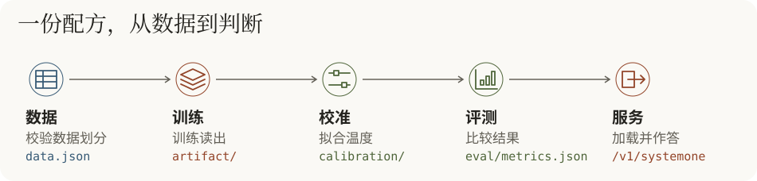

---
hide:
  - toc
---

# *JevLike* 模型工具包

训练、复现与部署类型化判断模型。一份配方，串起训练、校准、评测和服务。

[开始使用](cookbook/first-model.md){ .md-button .md-button--primary }
[浏览 Cookbook](cookbook/index.md)

[0.1.0 正式版](https://github.com/Shichaoxx/MetisCraft/releases/tag/v0.1.0) · [安装说明](installation.md)

## 从一条真实响应开始

<blockquote lang="en">My card was stolen this morning and there are two payments on it that I did not make.</blockquote>

<svg class="choice-readout" viewBox="0 0 335 156" role="img" aria-label="模型从六个客服队列中选出了安全团队 security。"><use href="../visuals/figures/choice-readout.svg#readout"></use></svg>

这条银行卡被盗的消息是为演示编写的，队列选择来自客服分流模型的实测响应。[查看请求与响应](cookbook/decision.md)

查看模型给出的概率

<dl><dt>queue.confidence</dt><dd>0.9999995054983101</dd><dt>urgent.noul</dt><dd>0.9999314182034214</dd></dl>

## Tev1 4B 复现结果

### 主决策集

**87.3%**

1,000 题中答对 873 题 · 原版 Tev1 **88.0%**

### 政策迁移

**99.33%**

300 题中答对 298 题 · 原版 Tev1 **100%**

两项预先设定的准确率指标均达标。复现实验采用单个随机种子，在同一批公开开发题上评测。我们未取得原始训练记录，校准可能使负对数似然变差。

[复现记录与限制](../reproductions/tev1.md) · [训练配方](../../recipes/tev1/README.md)

## 从这里开始

- [认识一次判断](cookbook/decision.md) · 读懂六个客服队列的预测概率和独立的紧急程度判断。
- [跑通第一个模型](cookbook/first-model.md) · 在 CPU 上完成示例，无需下载权重。
- [接入自己的任务](cookbook/own-task.md) · 替换数据和基座模型，沿用同一条训练与部署路径。

## 判断有类型，过程有依据

Python 和批量预测支持是非、选择、等级和多标签判断。HTTP `/v1/systemone` 支持前三种。

[配方与真实结果](limitations.md) · [数据格式](data.md) · [训练与校准](training.md) · [预测与服务](serving.md)

<picture>
  <source media="(max-width: 600px)" srcset="../visuals/figures/pipeline-mobile-zh.svg">
  
</picture>

## 理解计算机制

从 [JevLike 的任务、数据与模型架构](tensor-analysis/introduction.md)入门。[原理与张量解析](tensor-analysis/index.md)从 System One 契约展开答案 token 和标量头计算。[五分钟技术导览](tensor-analysis/walkthrough.md)串联矢量图、数值例与源码依据。
