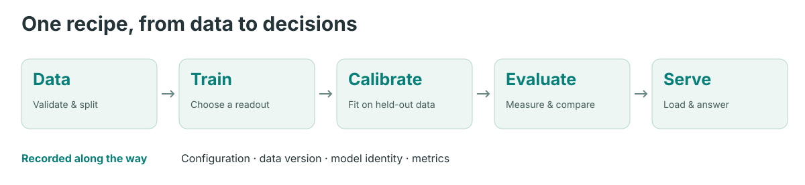

# MetisCraft

训练一次前向就能给出类型化判断和概率的决策模型。MetisCraft 用一份配方串起数据准备、
训练、校准、评测与服务，支持通用 judge，也支持特定业务场景。

<picture>
  <source media="(max-width: 600px)" srcset="../visuals/figures/pipeline-mobile.svg">
  
</picture>

当前发行候选版是 **0.1.0rc1**，尚未发布到 PyPI。先[安装](installation.md)，再运行
[CPU 快速上手](quickstart.md)。示例使用随机初始化的小模型和构造数据，只检查软件流程，
不能据此判断真实模型效果。

## 支持哪些判断？

| 类型 | 输出 | Record API | HTTP `/v1/systemone` |
|---|---|---|---|
| `noul` | 是／真的概率 | 支持 | 支持 |
| `choice` | 一个选项及选项概率分布 | 支持 | 支持 |
| `score` | 有序等级的概率分布 | 支持 | 支持 |
| `multi_label` | 各候选独立的概率 | 支持 | 不支持 |

提供两种读出：答案 token logits 适用于 `noul`、`choice`、`score`；逐候选标量头支持全部
四种类型。LoRA、全参微调与冻结基座可通过配置选择。温度校准只拟合独立的校准集，
评测同时报告校准前后的结果。

## 从哪里开始？

- [快速上手](quickstart.md)：在 CPU 上完成导入、训练、评测与服务。
- [接入自己的数据](data.md)：直接导入有监督 JSONL，无需修改数据注册表。
- [训练](training.md)：准备经过校验的本地基座，配置训练配方。
- [服务](serving.md)：加载产物，保持任务级校准路由一致。
- [当前边界](limitations.md)：功能范围与已有证据的限制。

深入说明见 [cookbook](../cookbook/README.md)、[读出笔记](../readouts/README.md)和
[研究支持矩阵](../support-matrix.md)。项目进度统一记录在[状态页](../status.md)。

[English](../en/index.md)
