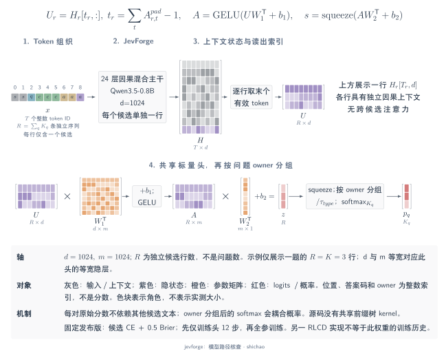

# JevForge 的逐候选打分

在一道客服分流题中加入第三个队列，原来两个队列的分数也会变吗？JevForge 分两步作答。它先将同一条消息分别与每个候选组合，逐行计算原始分数，再让同一题的候选分配总和为 1 的概率。下面追踪源码 `039badb` 的推理路径，并核对 JevForge-0.8B 发布修订 `5ca7c08` 的模型配置。[推理入口](https://github.com/zwliJay/jev-forge/blob/039badbafc242b4f8105a59e27f789320efe6e9c/jevforge/predict.py#L111-L129) · [发布配置](https://huggingface.co/AndeyTait/JevForge-0.8B/blob/5ca7c0861a0d9b72629a7bc40130a8f154c4840f/config.json)

## 一个候选占一行

给定同一份材料和问题，编码器只需分词一次得到公共前缀，然后将这串 token ID 复制到每个候选的行首。每行依次包含材料、题型、问题指令、当前候选和末尾的 `<|oj:answer|>` 标记。三种题型有不同的候选写法。[提示构造](https://github.com/zwliJay/jev-forge/blob/039badbafc242b4f8105a59e27f789320efe6e9c/jevforge/encode.py#L24-L66) · [候选 ID](https://github.com/zwliJay/jev-forge/blob/039badbafc242b4f8105a59e27f789320efe6e9c/jevforge/schema.py#L51-L58)

| 题型 | 同一道题各行的区别 |
| --- | --- |
| `choice` | 每行写一个选项的键和描述，例如 `[cards] Card services`。 |
| `score` | 每行写一个等级的序号和说明，例如 `level 0: low`。调整等级顺序会改变序号。 |
| `noul` | 两行分别写 `no` 和 `yes`。若提供真假判定标准，两段说明会进入两行共有的问题前缀。 |

两道题各有两个和三个候选时，一次批处理包含五行。预测器从右侧填充各行，并用整数索引 `owner` 记住每行所属的题。模型根据每行有效 token 数，取最后一个有效位置的隐藏向量，也就是末尾答案标记结束处的表示。答题时走到这里，主干已经看过本行里的候选描述。[组批与分组](https://github.com/zwliJay/jev-forge/blob/039badbafc242b4f8105a59e27f789320efe6e9c/jevforge/predict.py#L83-L104) · [最后位置与标量头](https://github.com/zwliJay/jev-forge/blob/039badbafc242b4f8105a59e27f789320efe6e9c/jevforge/model.py#L28-L40)

[浅色 SVG](../../tensor-analysis/figures/architecture-jevforge.zh.svg) · [深色 SVG](../../tensor-analysis/figures/architecture-jevforge.zh.dark.svg) · [PDF](../../tensor-analysis/figures/architecture-jevforge.zh.pdf) · [可编辑 TikZ](../../tensor-analysis/figures/architecture-jevforge.zh.tex)

0.8B 版本使用 Qwen3.5 主干，24 层中有 18 层线性注意力和 6 层完整注意力。读出头对每个末位向量应用同一组参数，依次经过 `1024 → 1024` 线性层、GELU 和 `1024 → 1` 线性层。上图中的每行最终得到一个标量。沿本版本的 `decide → _forward → model` 路径追踪，传入主干的是包含前缀的完整行；这条执行路径没有把公共前缀的 KV 缓存传给各候选。[主干配置](https://huggingface.co/AndeyTait/JevForge-0.8B/blob/5ca7c0861a0d9b72629a7bc40130a8f154c4840f/backbone/config.json#L7-L44) · [实际前向调用](https://github.com/zwliJay/jev-forge/blob/039badbafc242b4f8105a59e27f789320efe6e9c/jevforge/predict.py#L83-L104)

## 加入第三个队列

固定模型、材料、指令以及 A、B 的键和描述。给这道 `choice` 题加入 C，原来两行的 token 内容没有变化。在这个逐行计算中，A、B 的原始分数仍由各自的输入决定。变化发生在下一步：预测器按题收拢分数，在同一道题的所有候选之间做 softmax。[概率转换与返回字段](https://github.com/zwliJay/jev-forge/blob/039badbafc242b4f8105a59e27f789320efe6e9c/jevforge/predict.py#L121-L147)

把温度设为 1，用指定的教学分数计算。假设 A 的分数为 \(\ln 4\)，B 为 0，新加入的 C 为 \(\ln 3\)。

| 当前题的候选 | 指数权重 | P(A) | P(B) | P(C) |
| --- | --- | ---: | ---: | ---: |
| A、B | 4，1 | 80% | 20% | — |
| A、B、C | 4，1，3 | 50% | 12.5% | 37.5% |
| 移除 C | 4，1 | 80% | 20% | — |

A 和 B 的概率比始终为 4∶1。若 C 被加到**另一道题**，它进入另一题的分母，本题仍得到 80% 和 20%。这里还能核对一个容易看错的字段：当三选一的最高概率为 50% 时，JevForge 返回的 `choice.confidence` 为 0.25。这个字段按候选数和最高概率计算，均匀分布对应 0，全部概率集中到一项时对应 1。[confidence 定义](https://github.com/zwliJay/jev-forge/blob/039badbafc242b4f8105a59e27f789320efe6e9c/jevforge/predict.py#L17-L22)

## 训练与温度

该发布版的训练脚本对每题的目标分布计算交叉熵，另加预测概率与目标概率之间平方差之和的 0.5 倍。前 12 个更新步只训练读出头，之后也更新主干。脚本载入选好的检查点，再在校准集上按题型拟合温度。该修订写入配置的温度是 `choice 1.085`、`noul 1.2835`、`score 1.0785`。正常推理先用对应温度除该题的原始分数，再做 softmax；调用者也可以显式指定温度。[训练与损失](https://huggingface.co/AndeyTait/JevForge-0.8B/blob/5ca7c0861a0d9b72629a7bc40130a8f154c4840f/training-code/train_curated_v3.py#L68-L81) · [校准和保存](https://huggingface.co/AndeyTait/JevForge-0.8B/blob/5ca7c0861a0d9b72629a7bc40130a8f154c4840f/training-code/train_curated_v3.py#L104-L107) · [发布温度](https://huggingface.co/AndeyTait/JevForge-0.8B/blob/5ca7c0861a0d9b72629a7bc40130a8f154c4840f/config.json#L4-L10) · [推理覆盖规则](https://github.com/zwliJay/jev-forge/blob/039badbafc242b4f8105a59e27f789320efe6e9c/jevforge/predict.py#L106-L125)

本次核对了固定源码与发布文件，并用字节级测试分词器和微型主干执行了上游编码、取位、分组与归一化代码。表中的数值单独用教学分数计算。此次未加载 JevForge 发布权重或复测榜单。要在 MetisCraft 中研究逐候选输入，可对照 [scalar-pairs 布局](../tensor-analysis/scalar-heads.md)；两套产物的加载格式各自独立。
