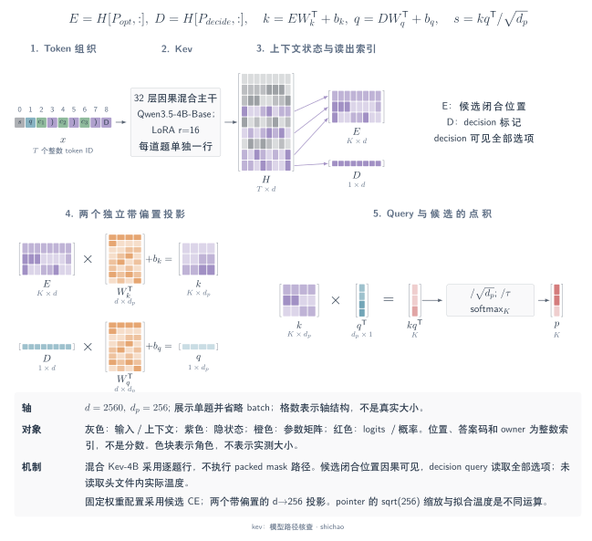

# Kev-4B 的指针读出

本文核查 Kev 源码 `2074cc4` 的 PyTorch 路径。作者的模型卡将 Kev-4B 描述为 Qwen3.5-4B-Base 上的 rank-16 LoRA 与指针头。基座配置给出 32 层、隐藏宽度 2,560，包含 24 层线性注意力和 8 层完整注意力。[作者模型卡](https://github.com/jaredpalmer/kev/blob/2074cc44256200bb37540103fa4572901faa10f3/docs/model-cards/kev-4b.md#L69-L75) · [作者实验配置](https://github.com/jaredpalmer/kev/blob/2074cc44256200bb37540103fa4572901faa10f3/experiments/q35-4b.json#L2-L12) · [固定基座配置](https://huggingface.co/Qwen/Qwen3.5-4B-Base/blob/1001bb4d826a52d1f399e183466143f4da7b741b/config.json)

## 输入位置与读出

逻辑输入是在状态后追加问题分支：`<q> instruction <opt> option </opt> … <decide>`。此混合主干为每个问题执行一条因果行，其中包含状态与该问题的完整分支。指针头分别读取最终 `<decide>` 的表示，以及各候选闭合 `</opt>` 的表示，再通过两个独立的带偏置线性层，将宽度从 2,560 投影到 \(d_p=256\)。

[SVG](../../tensor-analysis/figures/architecture-kev.zh.svg) · [Dark SVG](../../tensor-analysis/figures/architecture-kev.zh.dark.svg) · [PDF](../../tensor-analysis/figures/architecture-kev.zh.pdf) · [TikZ](../../tensor-analysis/figures/architecture-kev.zh.tex)

\[
\begin{aligned}
H&:[B,T,2560]
 \xrightarrow{\mathrm{gather}}
 D:[B,2560],\ E:[R,2560],\\
Q&=DW_q^{\mathsf T}+b_q:[B,256],\qquad
K=EW_k^{\mathsf T}+b_k:[R,256],\\
z_r&=\frac{\langle K_r,Q_{g(r)}\rangle}{\sqrt{256}},
\qquad p_b=\operatorname{softmax}(z_b/\tau).
\end{aligned}
\]

其中 \(B\) 是问题行数，\(T\) 是补齐后的序列长度，\(R\) 是有效候选总数，\(g(r)\) 是候选 \(r\) 所属题目的索引。点积沿投影维度求和，同一题的候选进入该题的 softmax。投影向量未经 L2 归一化。指针缩放系数 \(1/\sqrt{256}\) 由投影宽度决定，推理温度 \(\tau\) 单独设定。[候选与决策标记索引](https://github.com/jaredpalmer/kev/blob/2074cc44256200bb37540103fa4572901faa10f3/kev/model.py#L107-L126) · [投影与缩放](https://github.com/jaredpalmer/kev/blob/2074cc44256200bb37540103fa4572901faa10f3/kev/model.py#L205-L223) · [按题归一化](https://github.com/jaredpalmer/kev/blob/2074cc44256200bb37540103fa4572901faa10f3/kev/model.py#L494-L505)

## 问题行与前缀复用

在 Kev-4B 的每一行中，后面的候选可以读取前面的候选，题末决策标记可以读取该题全部候选。源码根据基座配置里的 `linear_attention` 层选择逐题行，并拒绝在这条混合主干路径上启用候选隔离。对于适用的纯注意力主干，源码还提供 packed 分块因果掩码，可进一步限制同题候选之间的可见性。[混合主干检测](https://github.com/jaredpalmer/kev/blob/2074cc44256200bb37540103fa4572901faa10f3/kev/model.py#L69-L72) · [布局与候选隔离限制](https://github.com/jaredpalmer/kev/blob/2074cc44256200bb37540103fa4572901faa10f3/kev/model.py#L257-L264) · [packed 掩码](https://github.com/jaredpalmer/kev/blob/2074cc44256200bb37540103fa4572901faa10f3/kev/model.py#L154-L183)

逐题成行描述的是每道题能读取哪些输入。具体到 PyTorch 的 `probs` 入口，来自同一状态的多个问题可以先算一次状态前缀，再从缓存继续各题的分支。因此不能直接用问题行数推算状态前缀被编码了几次。[概率入口与前缀复用](https://github.com/jaredpalmer/kev/blob/2074cc44256200bb37540103fa4572901faa10f3/kev/model.py#L396-L410)

## 训练目标与核验范围

发布版 `6cfce5c` 的这段训练从已有检查点继续。配置记录 `head_dim=256`、`option_isolation=0`，并将 `brier_w`、`ord_w` 和 `perm_kl` 设为零。这些取值只描述该训练阶段；拟合后的推理温度另存在模型产物中。[该阶段的发布配置](https://huggingface.co/jaredpalmer/kev-4b/blob/6cfce5c2fa4b4bd64026336ab649c5ca78857d52/training_config.json)

训练代码支持按题使用硬标签或软目标交叉熵。推理时，指针头在评估模式下使用保存的温度。作者的校准脚本把温度及其来源写入检查点元数据。具体检查点的温度数值需要按版本核对。[候选损失](https://github.com/jaredpalmer/kev/blob/2074cc44256200bb37540103fa4572901faa10f3/kev/train.py#L41-L61) · [温度写入](https://github.com/jaredpalmer/kev/blob/2074cc44256200bb37540103fa4572901faa10f3/scripts/calibrate_checkpoint.py#L135-L151)

以上内容来自固定版本的源码与作者资料。本次未加载 Kev 权重或复测性能。MetisCraft 当前支持的读出与载入格式见[实现范围](../limitations.md)。如需练习从分数计算概率，见[候选打分与概率](candidate-scores.md)。
