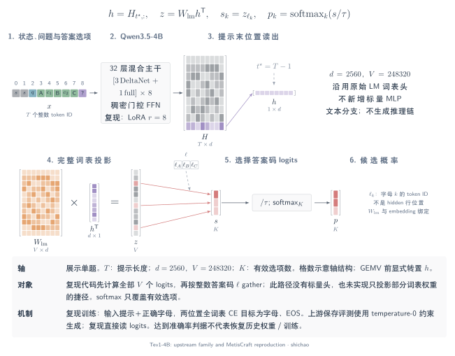

# Tev1-4B 的答案字母读出

在作者的订阅扣费示例中，`A` 对应重复扣费，`B` 对应取消订阅。模型看到客户消息、问题和本题的选项。它只需返回一个字母，客户端再按这道题的映射表查出业务键，例如 `A → duplicate_charge`。同一字母在下一道题里可以有完全不同的含义。[原始示例](https://github.com/togethercomputer/tev1/blob/1dde7782382c9f49d627153759b8d1deab426ce0/examples/charge-dispute.json) · [客户端的映射](https://github.com/togethercomputer/tev1/blob/1dde7782382c9f49d627153759b8d1deab426ce0/examples/decide.py#L44-L51)

## 训练时的两个预测位置

Tev1 使用 Qwen3.5-4B 原有的语言模型输出头。下面沿 MetisCraft 的 4B 复现配方，追踪一道正确答案为 `A` 的单选题。训练时，将正确字母接在提示末尾，只在下面两个位置计算损失。[作者对模型的说明](https://github.com/togethercomputer/tev1/blob/1dde7782382c9f49d627153759b8d1deab426ce0/README.md#L20-L31) · [复现配方](../../../recipes/tev1/qwen3.5-4b_chat-completion.yaml)

| 已读到的位置 | 下一个 token 的目标 | 交叉熵分母 |
| --- | --- | --- |
| 提示末尾，所有选项均已给出 | 正确字母 `A` | 完整词表 |
| 提示及正确字母 `A` 的末尾 | 序列结束标记 EOS | 完整词表 |

第一步教模型作答，第二步教它在作答后结束。复现代码一次取得这两个位置的词表分数，分别计算交叉熵，再对两个损失取平均。因此，即使 `A` 的分数高于其余候选字母，词表里另一个分数很高的 token 仍会增大第一步的损失。[组批与目标](https://github.com/Shichaoxx/MetisCraft/blob/e9a100bc6cb781270c9935a225e087f1f9167d7a/src/metiscraft/train/collate.py#L104-L117) · [两处读出](https://github.com/Shichaoxx/MetisCraft/blob/e9a100bc6cb781270c9935a225e087f1f9167d7a/src/metiscraft/modeling/model.py#L55-L67) · [损失计算](https://github.com/Shichaoxx/MetisCraft/blob/e9a100bc6cb781270c9935a225e087f1f9167d7a/src/metiscraft/judgments/__init__.py#L63-L71)



[矢量图](../../tensor-analysis/figures/tev1-architecture.zh.svg) · [PDF](../../tensor-analysis/figures/tev1-architecture.zh.pdf) · [可编辑 TikZ](../../tensor-analysis/figures/tev1-architecture.zh.tex)

## 推理时怎样选一个字母

作者保存的评测使用温度为 0 的约束生成。客户端按本题的字母表构造正则表达式，例如 `(A|B|C|D)`，然后检查返回文本是否恰好对应一个选项。[请求构造](https://github.com/togethercomputer/tev1/blob/1dde7782382c9f49d627153759b8d1deab426ce0/examples/decide.py#L34-L51) · [上游评测协议](https://github.com/togethercomputer/tev1/blob/1dde7782382c9f49d627153759b8d1deab426ce0/runs/new-v1/evaluation.json#L1-L13)

复现评测只送入提示。模型在提示末位得到一整行词表分数，按本题字母的 token ID 取列，再在有效选项之间归一化。这样可以直接得到首选字母以及候选概率，无需再预测 EOS。比较两份结果时，先核对每道题的选项顺序与字母映射。若要把不同答案归因于解码方式，还需要在**同一份权重和相同提示**上运行两种协议；现有对照涉及两份模型权重。[答案 token 计算](../tensor-analysis/answer-token.md) · [复现记录](../../reproductions/tev1.md)

## 相差七道正确题，哪些选择变了

| 历史评测 | 作者的端点 | MetisCraft 重训模型 | 两者选择相同字母 |
| --- | ---: | ---: | ---: |
| 主决策集 | 880 / 1,000 正确 | 873 / 1,000 正确 | 946 / 1,000 |
| 政策迁移集 | 300 / 300 正确 | 298 / 300 正确 | 298 / 300 |

<figure class="tev1-agreement">
<figcaption>主决策集的逐题对照</figcaption>
<div class="tev1-group">
<p>全部 1,000 题</p>
<div class="tev1-strip" aria-hidden="true" style="grid-template-columns: 946fr 54fr">
<span data-outcome="same"></span>
<span data-outcome="different"></span>
</div>
<ul role="list">
<li data-outcome="same"><strong>946</strong> 选同一字母</li>
<li data-outcome="different"><strong>54</strong> 选不同字母</li>
</ul>
</div>
<div class="tev1-group">
<p>展开 54 道选择不同的题</p>
<div class="tev1-strip" aria-hidden="true" style="grid-template-columns: 28fr 21fr 5fr">
<span data-outcome="upstream"></span>
<span data-outcome="retrained"></span>
<span data-outcome="wrong"></span>
</div>
<ul role="list">
<li data-outcome="upstream"><strong>28</strong> 仅作者端点答对</li>
<li data-outcome="retrained"><strong>21</strong> 仅重训模型答对</li>
<li data-outcome="wrong"><strong>5</strong> 双方均答错</li>
</ul>
</div>
</figure>

两者同选的 946 题里，有 852 题双方都答对，94 题选中同一个错误答案。把图中两组「仅一方答对」相减，28 − 21 = 7，就是准确率表里七道题的净差。这些计数来自同一批公开开发题上的历史对照。重训采用单个随机种子，作者公开的是建议设置，历史训练任务的完整配置仍不可得。[复现记录与逐题一致性](../../reproductions/tev1.md#逐题一致性) · [作者的训练说明](https://github.com/togethercomputer/tev1/blob/1dde7782382c9f49d627153759b8d1deab426ce0/docs/TRAINING.md#L1-L18)

**复核作者结果。** 将[固定提交的逐题结果](https://raw.githubusercontent.com/togethercomputer/tev1/1dde7782382c9f49d627153759b8d1deab426ce0/evaluation/new-v1-4b/results.jsonl)保存为 `results.jsonl`，在同一目录运行下面的 Python 代码。它逐题对照预测字母与正确字母，本次核对得到 `test 880/1000` 和 `policy_transfer 300/300`。本轮使用保存的输出核算，未重新训练或调用推理端点。

```python
import json
from pathlib import Path

with Path("results.jsonl").open(encoding="utf-8") as file:
    rows = [json.loads(line) for line in file]

for split in ("test", "policy_transfer"):
    cases = [row for row in rows if row["split"] == split]
    hits = sum(row["predicted"] == row["gold"] for row in cases)
    print(split, f"{hits}/{len(cases)}")
```
