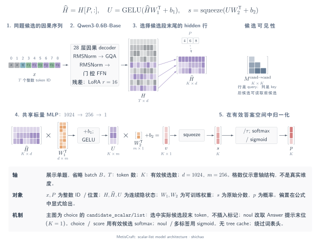

# 模型结构与训练产物

MetisCraft 的配方指定模型如何把一条 Record 变成候选分数。下面先用客服分流模型定位候选读出，再沿同一套数据约定查看训练结果如何保存、校准和加载。图中数值维度来自该配方。

[浅色 SVG](../../tensor-analysis/figures/metiscraft-architecture.zh.svg) · [深色 SVG](../../tensor-analysis/figures/metiscraft-architecture.zh.dark.svg) · [PDF](../../tensor-analysis/figures/metiscraft-architecture.zh.pdf) · [可编辑 TikZ](../../tensor-analysis/figures/metiscraft-architecture.zh.tex)

## 共享的模型核心

1. **Record 与配方契约。** `Record` 分开保存输入、答案定义、监督、任务 ID 与来源；配方选择基座、微调方式、读出、目标和划分用途。HTTP 请求也转换到同一个 Record 契约。
2. **提示构造与组批。** `PromptBuilder` 定义哪些输入 token 表示候选；`Collator` 进行序列填充，构造 token ID、padding mask、答案码或候选位置索引。答案 token 和 scalar-list 每问题使用一条序列，scalar-pairs 每候选使用一条序列。
3. **DecisionModel。** 可替换的预训练 decoder 返回隐状态。配方**选择三条路径之一**：答案 token 的词表投影与答案码 gather；scalar-list 的候选 gather 与共享 MLP；scalar-pairs 的逐行打分与问题／候选 scatter。三条路径不是集成投票。
4. **类型化分数与概率。** 候选 mask 标识有效列；判断类型决定分类 softmax 或逐事件 sigmoid。先验修正、任务／类型温度选择由评测和预测路径共用。

令 \(N\) 为编码序列数、\(B\) 为问题数、\(R=\sum_bK_b\)，公共接口为

\[
X,A\in\mathbb{Z}^{N\times T}\;\longrightarrow\;
H\in\mathbb{R}^{N\times T\times d}\;\longrightarrow\;
S\in\mathbb{R}^{B\times K_{\max}}.
\]

答案 token／list 使用 \(N=B\)，pairs 使用 \(N=R\)。Padding mask 取二值，ID 和位置索引为整数，隐状态与分数为浮点数。无效分数列没有答案含义，归一化前会排除；`noul` 的答案 token 路径先将 yes／no 词表分数化为 logit 差。

## 训练与部署通过产物衔接

监督进入相应判断类型的 CE／BCE 损失，梯度更新选定的 LoRA、完整模型和／或读出参数。答案 token 的 `completion` 是独立训练路径：它产生 \([B,2,V]\) 全词表 logits，预测答案码和 EOS；其 CE 不作用于主路径图示的候选分数张量。

训练封存模型／adapter 参数、可选标量头、配置、经过验证的基座身份及校验清单。校准单独保存，并绑定产物哈希；绑定不匹配时拒绝加载。`Predictor.load` 重建所选模型，Python、批量和 HTTP 共用组批、修正与温度语义。评测将预测与 dev／test 目标比较，分别记录原始、校准和先验结果。

模型支持的任务类型、第三方架构适配与当前限制，见[实现边界](../limitations.md)。

[工程流程图](../../tensor-analysis/figures/metiscraft-workflow.zh.svg)标出 Record、组批、损失计算、产物封存和服务之间的数据流。

| 架构边界 | 源码 |
|---|---|
| 数据与配置 | [`Record`](../../../src/metiscraft/data/contract.py)、[`Recipe`](../../../src/metiscraft/config.py) |
| 张量构造与模型路径 | [`PromptBuilder`](../../../src/metiscraft/modeling/prompts.py)、[`Collator`](../../../src/metiscraft/train/collate.py)、[`DecisionModel`](../../../src/metiscraft/modeling/model.py) |
| 训练、评测与封存 | [`pipeline`](../../../src/metiscraft/pipeline.py)、[`trace`](../../../src/metiscraft/trace.py) |
| 加载、校准路由与输出 | [`Predictor`](../../../src/metiscraft/serve/predictor.py)、[`judgments`](../../../src/metiscraft/judgments/__init__.py) |
