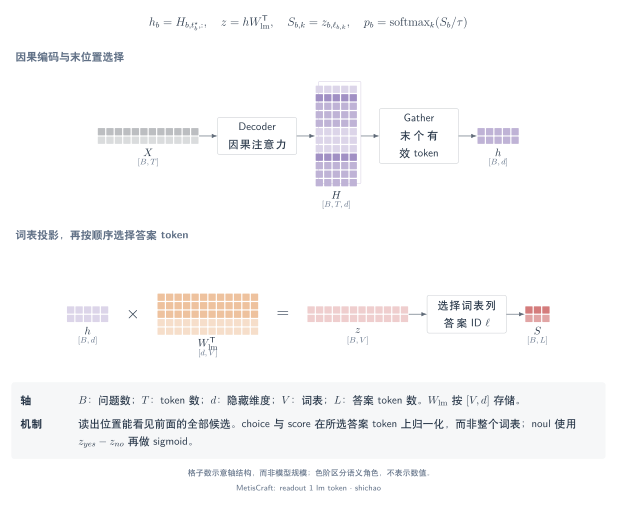

# 答案 token 读出

答案 token 读出复用语言模型的输出投影，读取有限答案码对应的分数。MetisCraft 用它处理 `noul`、`choice` 和 `score`，Tev1 配方也采用这一路径。

## 本页问题

词表分布中的哪些部分对应应用的答案空间？需要明确区分**候选索引** \(k\)、`security` 一类的**候选 ID**，以及答案码的**词表索引** \(\ell_{b,k}\)。三者通过显式码表关联。



[SVG](../../tensor-analysis/figures/readout-1-lm-token.zh.svg) · [PDF](../../tensor-analysis/figures/readout-1-lm-token.zh.pdf) · [TikZ](../../tensor-analysis/figures/readout-1-lm-token.zh.tex)

## 张量与语义

| 张量 | 形状 | 含义 |
|---|---|---|
| \(H\) | \([B,T,d]\) | 输入 token 的上下文化表示 |
| \(h\) | \([B,d]\) | 提示末位的隐状态 |
| \(W_{\mathrm{lm}}\) | \([V,d]\) | 以 PyTorch 方向存储的词表投影 |
| \(Z\) | \([B,V]\) | 全词表下一 token logits |
| \(\ell\) | \([B,K_{\mathrm{code},\max}]\) | 各问题答案码的词表索引 |
| \(S\) | \([B,K_{\max}]\) | 选择答案码并转换二元分数后的任务分数 |

Plain 提示对选择题采用单 token 字母码，对等级题采用从零开始的数字码。`chat_json` 对两者都采用字母码，并将完整 JSON 载荷放入分词器的非思考对话模板。`noul` 在 plain 提示中使用 `yes` 与 `no`。分词器必须将所需答案码编码为彼此不同的单 token。

## 算子链

1. 渲染状态、问题与候选定义，对批次做左填充。
2. 读取 `H[:, -1]`；左填充保证每行最后一列都是有效提示位置。
3. 应用 LM 输出投影，再按每个问题各自的码表 `gather` 词表列。
4. 对 choice 与 score，仅归一化有效候选分数；对 noul，以 yes logit 减去 no logit，再对这个差值做 sigmoid。

```python
h = H[:, -1]                              # [B, d]
Z = lm_head(h)                            # [B, V]
S_codes = Z.gather(1, codes)               # [B, K_code_max]
S_noul = S_codes[noul_rows, 0] - S_codes[noul_rows, 1]
```

这里执行的是类别码选择，不是对生成文本进行解析。MetisCraft 的这一推理路径不需要采样答案字符串。

## 关键公式

对于无偏置的 LM head，矩阵乘法收缩隐特征轴：

\[
H_{\mathrm{last}}W_{\mathrm{lm}}^{\mathsf T}:
(B\times d)(d\times V)\longrightarrow B\times V,
\qquad s_{b,k}=Z_{b,\ell_{b,k}}.
\]

对 choice 或 score：

\[
p_{b,k}=\operatorname{softmax}_{k\in\mathcal K_b}(s_{b,k}/\tau_b).
\]

对 noul，两个词表分数变成一个二元 logit：

\[
\Delta_b=Z_{b,\ell_{\mathrm{yes}}}-Z_{b,\ell_{\mathrm{no}}},
\qquad p_b=\sigma(\Delta_b/\tau_b).
\]

温度为一时，它等于只对这两个答案码做 softmax 后的 yes 概率；通常不等于在全词表上归一化得到的 yes token 概率。

## 小型示例

假设选中的答案码 logits 为 \([0,1,2]\)，候选空间归一化结果为 \([0.090031,0.244728,0.665241]\)，不受未选词表列 logits 的影响。若 yes/no logits 为 \([2,0]\)，二元 logit 为 \(2\)，肯定概率为 \(0.880797\)。

这些是构造数值。[CPU 验证脚本](../../../scripts/verify_tensor_examples.py)使用随机初始化的 transformer 核对 gather 与 logit 差值恒等式，不测量模型效果。

## 源码与依据

- [`build_codebook`、`level_codes`、`yes_no_codes`](../../../src/metiscraft/modeling/prompts.py#L87)：合法单 token 答案码。
- [`answer_token` 与 `chat_json`](../../../src/metiscraft/modeling/prompts.py#L164)：码表与提示对齐。
- [`Collator`](../../../src/metiscraft/train/collate.py#L112)：按问题组织答案码索引张量。
- [`DecisionModel.forward`](../../../src/metiscraft/modeling/model.py#L62)：词表投影、gather 与 noul 转换。
- [Tev1 4B 配方](../../../recipes/tev1/qwen3.5-4b_chat-completion.yaml)：`chat_json` 与全词表 completion 训练。

## 适用边界

自回归提示中，后面的选项可以看到前面的选项；这是有方向的因果可见性，不是双向交互。答案码、选项顺序与截断都可能影响结果。Plain 提示只截断状态；`chat_json` 会拒绝超长的完整提示。

Completion 训练使用另一条 \([B,2,V]\) 路径，分别预测答案码与 EOS，不应与候选空间 CE 或推理 token 生成混淆，详见[训练与校准](training-calibration.md)。答案 token 读出不支持 `multi_label`；工具包也未据此声明已接入外部推理引擎或前缀缓存。
