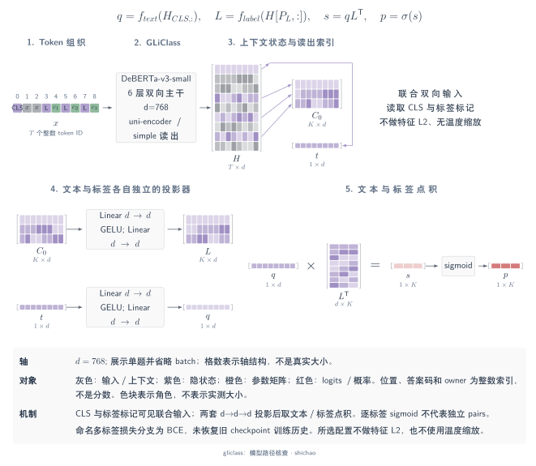
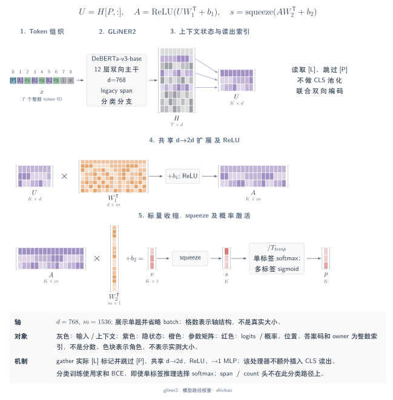
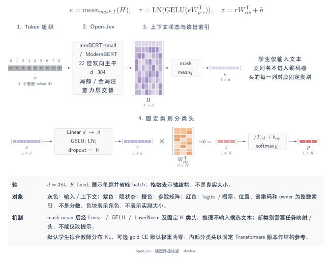
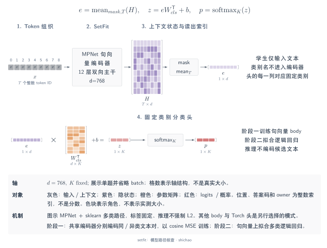
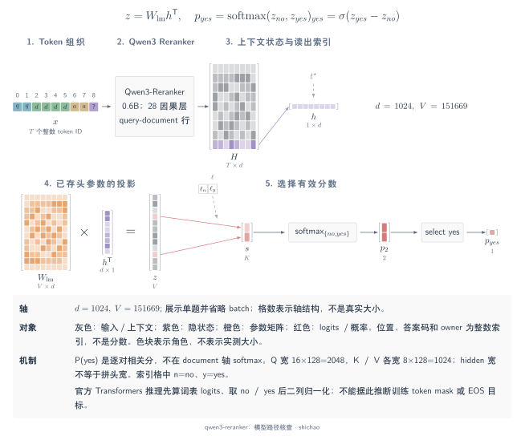

# 编码器分类与逐对重排模型

以下五个例子区分**动态候选文本**与**固定任务分类头**，以及联合编码与独立 pair 打分。每节都选择明确模式并固定依据版本。图示说明静态核对的源码路径，不代表本地运行、训练或性能复现。记 \(B\) 为批大小、\(T\) 为编码长度、\(C\) 为运行时候选数、\(K\) 为固定任务类别数、\(N\) 为独立 query–document pair 数；相应读出与归一化排除填充位置。

## GLiClass

这里选择 `knowledgator/gliclass-small-v1.0@66a80146`，按官方库 `af82d425` 解释其结构：**uni-encoder、首 token pooling、simple 点积 scorer**，推理选多标签模式。这一选择不代表所有 GLiClass 变体。`prompt_first=false` 且无额外样例或任务提示时，输入为 `[CLS] text <<LABEL>> label_1 … <<LABEL>> label_C <<SEP>> [SEP]`，外层控制 token 由 tokenizer 加入。输入函数的实际返回语句把 text 放在 labels 前，应以此为准，而非采用其文档字符串中的另一顺序。

[SVG](../../tensor-analysis/figures/architecture-gliclass.zh.svg) · [Dark SVG](../../tensor-analysis/figures/architecture-gliclass.zh.dark.svg) · [PDF](../../tensor-analysis/figures/architecture-gliclass.zh.pdf) · [TikZ](../../tensor-analysis/figures/architecture-gliclass.zh.tex)

DeBERTa-v3-small 含六层、隐藏宽度 768、12 个注意力头，FFN 宽度为 3,072。双向编码结果为 \(H:[B,T,768]\)；首位状态 \([B,768]\) 与各 `<<LABEL>>` 状态 \([B,C,768]\) 分别经过独立的 `768 → 768 → 768` GELU 投影。沿特征轴点积得到 \(S:[B,C]\)，多标签推理逐项应用 sigmoid。文本、标签及标签之间共享编码上下文，因此增加候选可能改变已有候选的原始分数；输出采用 sigmoid 不表示候选表示彼此独立。

所核对的多标签训练分支采用带可选 focal 加权的 BCE；参考 checkpoint 的 focal 系数关闭时，该分支退化为普通 BCE。配置没有恢复历史 `problem_type` 或训练配方，论文中的可选 PPO 流程也不能据此归到这些权重。对 MetisCraft 而言，GLiClass 提供动态标签与候选共享上下文的对照；MetisCraft 的 scalar-list 使用因果候选末位表示和 MLP，计算路径不同，机制比较不构成 checkpoint 导入或复现证据。

主要来源：

- [固定 checkpoint 配置与 tokenizer 元数据](https://huggingface.co/knowledgator/gliclass-small-v1.0/commit/66a80146c51756e463e93b142919d5862fd0038d)。
- [固定输入构造](https://github.com/Knowledgator/GLiClass/blob/af82d425c0259a6f46f240bb0633fcdab821eaea/gliclass/pipeline.py#L598-L659)。
- [固定 encoder、读出与损失分派](https://github.com/Knowledgator/GLiClass/blob/af82d425c0259a6f46f240bb0633fcdab821eaea/gliclass/model.py)。
- [GLiClass 论文 v1](https://arxiv.org/html/2508.07662v1)：架构变体与训练流程。

## GLiNER2

这里选择 `fastino/gliner2-base-v1` 的 **span 架构普通分类分支**，checkpoint 配置固定为 `784e0b98`，库代码固定为 `ca4f6823`；不将它与后续 boundary 架构或约束联合解码混合。基本 schema 转成 `( [P] task ( [L] label_1 … [L] label_C ) ) [SEP_TEXT] text`，多 schema 间用 `[SEP_STRUCT]` 分隔。Processor 将分词后的片段直接转为 ID，这条路径不增加 CLS 读出。

[SVG](../../tensor-analysis/figures/architecture-gliner2.zh.svg) · [Dark SVG](../../tensor-analysis/figures/architecture-gliner2.zh.dark.svg) · [PDF](../../tensor-analysis/figures/architecture-gliner2.zh.pdf) · [TikZ](../../tensor-analysis/figures/architecture-gliner2.zh.tex)

DeBERTa-v3-base 含 12 层双向编码器、12 个头，隐藏宽度 768，FFN 宽度 3,072，输出 \(H:[B,T,768]\)。结构位置索引选取 \(C\) 个 `[L]` 状态并跳过 `[P]`，得到 \(U:[B,C,768]\)。共享的 `768 → 1536 → 1` ReLU MLP 为各标签打分，产生 \(S:[B,C]\)。分类分支不另池化文本向量，也不计算文本与标签向量的点积；schema 中的标签及文本通过同一个双向编码器交换信息。

训练对这些 logits 求逐标签 BCE 之和。推理先除以可配置的正温度；`class_act=auto` 在单标签模式沿候选轴做 softmax，在多标签模式逐项做 sigmoid，训练损失与推理归一化是两项选择。Span 与 count 损失属于其他任务分支。对 MetisCraft 而言，这里比较 schema 条件化分类机制；类型化决策接口不等于已经提供 GLiNER2 的 span、boundary 或抽取头，也不应将所选 span 路径写成 2025 论文或后续整个家族的完整结构。

主要来源：

- [固定 span checkpoint 配置](https://huggingface.co/fastino/gliner2-base-v1/blob/784e0b98a34f167e3fe20a4d217e039aa29c408e/config.json)。
- [固定 schema 构造与标记路由](https://github.com/fastino-ai/GLiNER2/blob/ca4f68235b50fe4c3ecf3876851d748fe4b15c6c/gliner2/processor.py)。
- [固定 span 分类头与 BCE 损失](https://github.com/fastino-ai/GLiNER2/blob/ca4f68235b50fe4c3ecf3876851d748fe4b15c6c/gliner2/models/span/model.py)。
- [固定分类推理与激活](https://github.com/fastino-ai/GLiNER2/blob/ca4f68235b50fe4c3ecf3876851d748fe4b15c6c/gliner2/inference/runtime.py#L880-L915)。

## Open-Jev

本节对应 **Shalimov04/open-jev 的固定任务学生**，仓库固定为 `6126df4b`，默认基座 `jhu-clsp/mmBERT-small` 的结构配置固定为 `ffaae3d4`。它与同名的 ZefanCai/Open-Jev 数据集不同。学生接收任务模板生成的文本，固定标签用于设置 `num_labels` 与标签映射，不是运行时候选菜单；教师则另行接收任务与字母编码的选项，生成软目标。

[SVG](../../tensor-analysis/figures/architecture-open-jev.zh.svg) · [Dark SVG](../../tensor-analysis/figures/architecture-open-jev.zh.dark.svg) · [PDF](../../tensor-analysis/figures/architecture-open-jev.zh.pdf) · [TikZ](../../tensor-analysis/figures/architecture-open-jev.zh.tex)

mmBERT-small 配置采用 ModernBERT 家族编码器：22 层、宽度 384、六个注意力头，FFN 宽度为 1,152。\(H:[B,T,384]\) 经 attention-mask mean pooling 得到 \([B,384]\)；参考序列分类头依次执行 `384 → 384`、GELU、LayerNorm，再以 `384 → K` 分类器产生 \(Z:[B,K]\)，每列绑定一个已训练类别。Open-Jev 没有锁定 Transformers 依赖版本，图中的头展开采用 **Transformers v4.51.3 作为固定结构参考**，不声称恢复作者的实际运行环境。

默认训练最小化 \(\mathrm{KL}(p_{\mathrm{teacher}}\parallel\operatorname{softmax}(Z))\)，可选 `gold_weight` 再加入 gold CE。`calib` 同时用于选择学生和后验拟合 `logits / T + bias`，这些用途并非来自相互独立的数据集。类别偏置通过 held-out NLL 与纯温度方案比较后选择；无 gold 时另有 teacher-soft 目标与声明先验的路径。对 MetisCraft 而言，主要参考是固定任务蒸馏与校准流程。仓库另列的 `open-jev-base` pair scorer 实验，不使这条主学生路径成为通用运行时菜单分类器；本节也没有复现任一路径的结果。

主要来源：

- [固定学生训练与纯文本输入](https://github.com/Shalimov04/open-jev/blob/6126df4b8d9163af835048476a7eee0858b81dbb/openjev/train.py)。
- [固定 mmBERT-small 配置](https://huggingface.co/jhu-clsp/mmBERT-small/blob/ffaae3d46e9b171c3a001dfd4252b71d62a18c78/config.json)。
- [分类头的固定 Transformers 参考](https://github.com/huggingface/transformers/blob/5f4ecf2d9f867a1255131d2461d75793c0cf1db2/src/transformers/models/modernbert/modeling_modernbert.py#L1178-L1253)。
- [固定校准实现](https://github.com/Shalimov04/open-jev/blob/6126df4b8d9163af835048476a7eee0858b81dbb/openjev/calibrate.py)。

## SetFit

这里选择**两阶段 SetFit：Sentence Transformer 主体加 scikit-learn 逻辑回归头**，任务限定为单标签多类分类。方法依据论文 v1，库代码固定为 `d70dad84`；具体参考主体为 `sentence-transformers/paraphrase-mpnet-base-v2@b2b82f2e`。其他 Sentence Transformer 主体与可微分类头属于另选配置。

[SVG](../../tensor-analysis/figures/architecture-setfit.zh.svg) · [Dark SVG](../../tensor-analysis/figures/architecture-setfit.zh.dark.svg) · [PDF](../../tensor-analysis/figures/architecture-setfit.zh.pdf) · [TikZ](../../tensor-analysis/figures/architecture-setfit.zh.tex)

参考 MPNet 含 12 层、宽度 768、12 个注意力头，FFN 宽度为 3,072。每条文本独立生成 \(H:[B,T,768]\)，经 attention-mask mean pooling 得到 \(E:[B,768]\)。第一阶段中，两条文本分别通过参数共享的主体；同类与异类 pair 分别以 1 和 0 为目标，对句向量余弦相似度计算 MSE，两侧 token 之间没有交叉注意力。第二阶段用适配后的主体编码原始有标签样本，再拟合固定类别的逻辑回归权重。推理时，文本向量经 `768 → K` 映射得到 \([B,K]\) logits 和多类概率；类名不作为候选文本编码。

主体训练默认采用 `CosineSimilarityLoss`，损失中的余弦计算不表示导出的句向量始终为单位长度；库的 `normalize_embeddings` 默认关闭。对 MetisCraft 而言，SetFit 是有监督少样本、固定标签集合的基线。比较时应披露每类标注数与 pair 采样，因为这与未经当前任务训练的评测设置有不同监督预算。主体、库与论文是不同层次的固定依据，不代表已经恢复作者实验环境或导入其 checkpoint。

主要来源：

- [SetFit 论文 v1](https://arxiv.org/html/2209.11055v1)：§3.1 与图 2。
- [固定 SetFit 主体／头拟合与加载](https://github.com/huggingface/setfit/blob/d70dad84de757d30f03465d120e0d3fad2c725b0/src/setfit/modeling.py)。
- [固定默认训练目标](https://github.com/huggingface/setfit/blob/d70dad84de757d30f03465d120e0d3fad2c725b0/src/setfit/training_args.py#L178-L193)与[固定余弦 MSE 实现](https://github.com/huggingface/sentence-transformers/blob/ba908be1e939b61e961eedeb78ba3a0e409b7af8/sentence_transformers/losses/CosineSimilarityLoss.py)。
- [固定 MPNet 配置](https://huggingface.co/sentence-transformers/paraphrase-mpnet-base-v2/blob/b2b82f2ed502d476516d22add63f309e8e9ff6bd/config.json)与[mean pooling 结构](https://huggingface.co/sentence-transformers/paraphrase-mpnet-base-v2/blob/b2b82f2ed502d476516d22add63f309e8e9ff6bd/README.md)。

## Qwen3-Reranker

这里选择模型版本 `e61197ed` 中 **Qwen3-Reranker-0.6B 官方 Transformers 概率路径**。每个 query–document pair 单独形成一条因果输入：system 判断指令、`<Instruct>`／`<Query>`／`<Document>` 字段，以及以空 `<think>…</think>` 块结束的 assistant 后缀。读出使用最后一个**输入位置**的下一 token 分布，无需先生成答案。

[SVG](../../tensor-analysis/figures/architecture-qwen3-reranker.zh.svg) · [Dark SVG](../../tensor-analysis/figures/architecture-qwen3-reranker.zh.dark.svg) · [PDF](../../tensor-analysis/figures/architecture-qwen3-reranker.zh.pdf) · [TikZ](../../tensor-analysis/figures/architecture-qwen3-reranker.zh.tex)

主干含 28 层、隐藏宽度 1,024，SwiGLU 中间宽度 3,072。16 个 query 头和八个 key/value 头的每头宽度均为 128，因此 Q 投影宽度为 **2,048**，K、V 各为 **1,024**，拼头后的注意力输出再从 2,048 投回 1,024。这是 GQA 的实际维度，不能将隐藏宽度直接等分为 16 份。最终状态 \(H:[N,T,1024]\) 提供 \(h_{\mathrm{end}}:[N,1024]\)，已有 LM head 产生词表 logits \([N,151669]\)；选取 `no` 与 `yes` 两列得到 \([N,2]\)，沿这**两列**做 softmax 得到 yes 分数。不同 document 不共享注意力上下文，也不共享 softmax 分母。

论文 v1 报告对正确 `yes`／`no` 标签 token 的似然做 SFT，随后合并 checkpoint；推理的二列公式不能证明训练只用了二元 BCE 头。较新的 Sentence Transformers 包装器默认返回 `yes − no` 原始 logit 差，应用 sigmoid 后才得到对应的 0–1 分数。对 MetisCraft 而言，所选模式与 answer-token 二元读出属于同类机制，输入按独立 pair 组织；这一关系不构成 checkpoint 转换或重排性能复现，也不应将输出写成 document 候选集合上的类别分布。

主要来源：

- [固定 0.6B 模型配置](https://huggingface.co/Qwen/Qwen3-Reranker-0.6B/blob/e61197ed45024b0ed8a2d74b80b4d909f1255473/config.json)。
- [固定官方推理示例与包装器分数语义](https://huggingface.co/Qwen/Qwen3-Reranker-0.6B/blob/e61197ed45024b0ed8a2d74b80b4d909f1255473/README.md)。
- [固定 Qwen3 注意力与 LM head 实现](https://github.com/huggingface/transformers/blob/5f4ecf2d9f867a1255131d2461d75793c0cf1db2/src/transformers/models/qwen3/modeling_qwen3.py)。
- [Qwen3 Embedding 报告 v1](https://arxiv.org/html/2506.05176v1)：重排结构与公式 2。

## 基座结构索引

**DeBERTaV3** 与 **ModernBERT** 在此仅作为基座索引，不另计为 JevLike 成品。[固定 DeBERTa-v3-base 配置](https://huggingface.co/microsoft/deberta-v3-base/blob/5f32929a4206c500f4044bf7778298aedc77531a/config.json)给出 12 层、宽度 768、内容／相对位置注意力与 3,072 宽的 GELU FFN，GLiClass 所选 small 变体为六层。[固定 ModernBERT-base 配置](https://huggingface.co/answerdotai/ModernBERT-base/blob/5756c58a31a2478f9e62146021f48295a92c3da5/config.json)给出 22 层、宽度 768、交替全局／局部双向注意力、RoPE 与 1,152 宽的门控 FFN；Open-Jev 所选 mmBERT-small 则使用同一家族的 384 宽配置。基座可用不等于已经具备任务候选布局、训练完成的决策头或 checkpoint 适配器。

[返回模型架构图谱](architectures.md)

[English](../../en/tensor-analysis/architectures-encoders.md)
