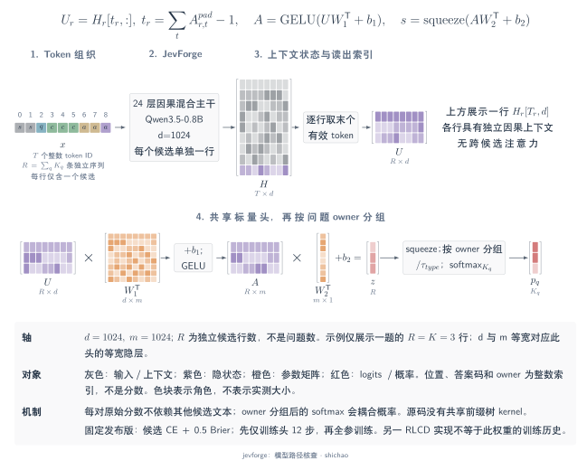
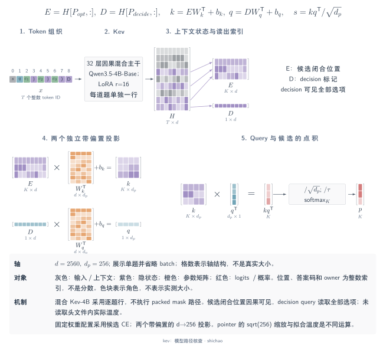
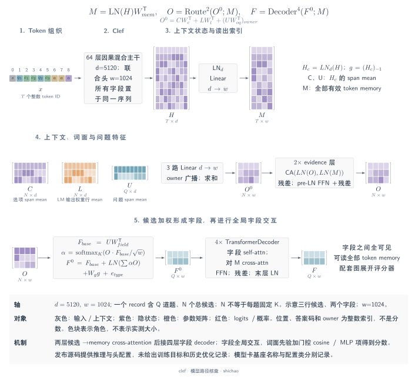
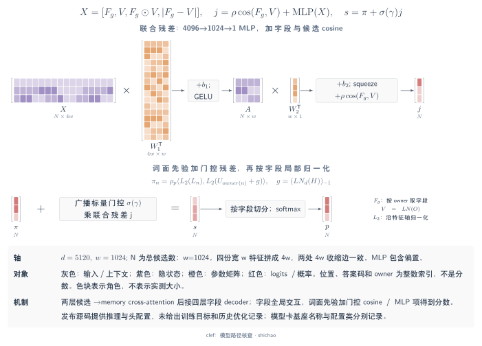
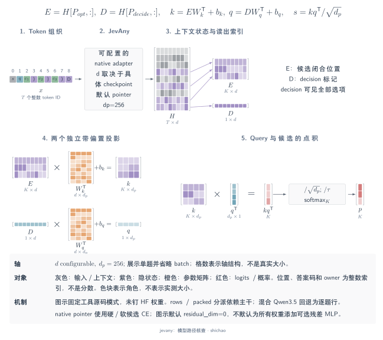
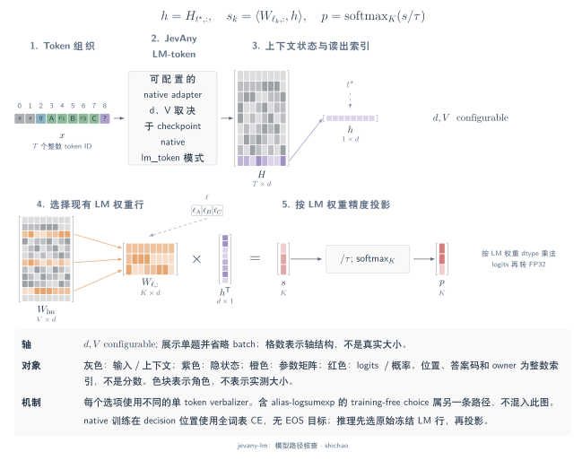

# 标量、指针与联合 schema 架构

这四个项目在 token 计算链的不同位置接入决策头。以下内容来自 2026-11-10 对固定源码与发布元数据的检查，用于与 MetisCraft 对照；本页没有报告这些项目的训练运行、检查点导入或精度复现。

记 \(B\) 为问题数，\(K_b\) 为问题 \(b\) 的候选数，\(R=\sum_bK_b\)。一条问题行与一条候选行是不同的计算对象。以下最终 softmax 均在同一问题的合法候选轴上归一化。

## JevForge：每条候选路径输出一个独立标量

参考版本为 JevForge 源码 `039badb`，以及 `AndeyTait/JevForge-0.8B` 的 `5ca7c08` 发布版本。发布配置使用 Qwen3.5-0.8B，隐藏宽度 1,024，共 24 层，其中 18 层为线性注意力、6 层为完整注意力。

每条输入行包含状态、一个问题和一个候选。原生渲染格式为 `<|oj:state|> … <|oj:question|> … candidate … <|oj:answer|>`。编码器将问题前缀复制到各候选路径，再对 \(R\) 条路径右侧补齐。模型读取每条路径最后一个真实 token，即末尾答案标记结束处的表示。共享头为 `Linear(1024,1024) → GELU → Linear(1024,1)`，两个线性层均含偏置。

[SVG](../../tensor-analysis/figures/architecture-jevforge.zh.svg) · [Dark SVG](../../tensor-analysis/figures/architecture-jevforge.zh.dark.svg) · [PDF](../../tensor-analysis/figures/architecture-jevforge.zh.pdf) · [TikZ](../../tensor-analysis/figures/architecture-jevforge.zh.tex)

\[
I:[R,T]\ \longrightarrow\ H:[R,T,1024]
\ \xrightarrow{\mathrm{gather}}\ U:[R,1024]
\ \xrightarrow{\mathrm{MLP}}\ z:[R]
\ \xrightarrow{\text{按 owner 分组}}\ (z_b:[K_b])_b.
\]

对于真实 token 掩码 \(A:[R,T]\)，读出位置为 \(t_r=\sum_t A_{r,t}-1\)，因此 \(U_r=H_{r,t_r,:}\)。整数 owner 索引将标量归回所属问题。推理使用 \(p_b=\operatorname{softmax}(z_b/\tau_{\mathrm{type}})\)。某个候选的原始分数依赖其自身输入行；分类分母则使其概率与其他候选耦合。源码将独立行批量执行，不能据此认定实现了共享前缀的树注意力内核。

固定发布版的训练脚本使用目标分布交叉熵，加上 \(0.5\sum_k(p_{b,k}-y_{b,k})^2\)；前 12 步仅更新头，随后开启主干更新。MetisCraft 的 [scalar-pairs 布局](scalar-heads.md) 可以表达对应的独立行机制。其默认 scalar-list 将全部候选放在同一因果序列中，已有 0.6B 运行配方使用 `1024 → 256 → 1` 头。这些机制对应关系并不提供 JevForge 检查点加载能力。

固定来源：[提示编码](https://github.com/zwliJay/jev-forge/blob/039badbafc242b4f8105a59e27f789320efe6e9c/jevforge/encode.py#L24-L66)、[标量头与 token gather](https://github.com/zwliJay/jev-forge/blob/039badbafc242b4f8105a59e27f789320efe6e9c/jevforge/model.py#L20-L49)、[发布版主干配置](https://huggingface.co/AndeyTait/JevForge-0.8B/blob/5ca7c0861a0d9b72629a7bc40130a8f154c4840f/backbone/config.json)、[发布版训练目标](https://huggingface.co/AndeyTait/JevForge-0.8B/blob/5ca7c0861a0d9b72629a7bc40130a8f154c4840f/training-code/train_curated_v3.py#L70-L80)。

## Kev：用决策 query 指向候选结束位置

参考版本为 Kev 源码 `2074cc4`，以及 `jaredpalmer/kev-4b` 的 `6cfce5c`。发布配置指定 Qwen3.5-4B-Base `1001bb4`，隐藏宽度 2,560，共 32 层，使用 rank-16 LoRA。主干含 24 层线性注意力与 8 层完整注意力。

逻辑输入是在状态后追加问题分支：`<q> instruction <opt> option </opt> … <decide>`。此混合主干为每个问题执行一条因果行，其中包含状态与该问题的完整分支。指针头分别读取最终 `<decide>` 的表示，以及各候选闭合 `</opt>` 的表示，再通过两个独立的带偏置线性层，将宽度从 2,560 投影到 \(d_p=256\)。

[SVG](../../tensor-analysis/figures/architecture-kev.zh.svg) · [Dark SVG](../../tensor-analysis/figures/architecture-kev.zh.dark.svg) · [PDF](../../tensor-analysis/figures/architecture-kev.zh.pdf) · [TikZ](../../tensor-analysis/figures/architecture-kev.zh.tex)

\[
\begin{aligned}
H&:[B,T,2560]
 \xrightarrow{\mathrm{gather}}
 D:[B,2560],\ E:[R,2560],\\
Q&=DW_q^{\mathsf T}+b_q:[B,256],\qquad
K=EW_k^{\mathsf T}+b_k:[R,256],\\
z_r&=\frac{\langle K_r,Q_{g(r)}\rangle}{\sqrt{256}},
\qquad p_b=\operatorname{softmax}(z_b/\tau).
\end{aligned}
\]

其中 \(g(r)\) 是候选 \(r\) 所属问题的整数索引。点积收缩宽度轴，最终 softmax 归一化候选轴。指针头不对投影向量做 L2 归一化。\(1/\sqrt{256}\) 属于指针打分，而 \(\tau\) 是另外的推理温度。

在一条行内，后面的候选可以读取前面的候选，决策标记可以读取全部候选；不同问题保持隔离。同一源码也为适合的纯注意力主干提供 packed 分块因果掩码：位置 \(i\) 的 query 仅能读取满足 \(j\leq i\)、且属于状态或同一问题的 key。可选的候选隔离会继续限制候选跨度的可见性，并重置其位置编号；固定的混合主干 Kev-4B 路径拒绝该设置，因此其主架构图应采用问题行。

训练代码在每题候选上计算硬标签或软目标交叉熵。发布配置中，所检查阶段的辅助损失开关权重均为零。存储的温度只在评估模式应用；本页未读取权重以确认其数值。MetisCraft 当前读出没有实现该指针头及其检查点格式；支持 Kev 需要补齐两类位置 gather、指针参数与检查点加载路径。

固定来源：[编码、指针头与行布局分派](https://github.com/jaredpalmer/kev/blob/2074cc44256200bb37540103fa4572901faa10f3/kev/model.py)、[基座配置](https://huggingface.co/Qwen/Qwen3.5-4B-Base/blob/1001bb4d826a52d1f399e183466143f4da7b741b/config.json)、[发布版训练配置](https://huggingface.co/jaredpalmer/kev-4b/blob/6cfce5c2fa4b4bd64026336ab649c5ca78857d52/training_config.json)、[候选损失](https://github.com/jaredpalmer/kev/blob/2074cc44256200bb37540103fa4572901faa10f3/kev/train.py#L41-L61)。

## Clef：证据路由、字段交互与门控联合打分

参考版本为 `Cloudflare/clef` 的 `cfddda0`。模型卡将基座命名为 Qwen3.8-27B；发布配置使用 `Qwen3_5ForConditionalGeneration` 类。配置声明隐藏宽度 \(d=5120\)，共 64 层，其中 48 层为线性注意力、16 层为完整注意力。联合头的宽度为 \(w=1024\)，含两层证据路由、四层字段 decoder、16 个注意力头，前馈宽度为 4,096。

Clef 将状态和完整 schema 编入同一序列，末尾追加 assistant 决策后缀。编码器记录指令与候选的左闭右开 token 跨度，再取得主干的最终隐藏状态。它保留 schema 和后缀，将状态截到剩余长度预算。头部先移除补齐位置，再逐条记录计算。

[SVG](../../tensor-analysis/figures/architecture-clef-scorer.zh.svg) · [PDF](../../tensor-analysis/figures/architecture-clef-scorer.zh.pdf) · [TikZ](../../tensor-analysis/figures/architecture-clef-scorer.zh.tex)

[SVG](../../tensor-analysis/figures/architecture-clef.zh.svg) · [Dark SVG](../../tensor-analysis/figures/architecture-clef.zh.dark.svg) · [PDF](../../tensor-analysis/figures/architecture-clef.zh.pdf) · [TikZ](../../tensor-analysis/figures/architecture-clef.zh.tex)

对一条记录，记 \(T\) 为真实 token 数、\(Q\) 为字段数、\(N=\sum_{q=1}^{Q}K_q\) 为总候选数。头先沿主干宽度应用 LayerNorm，然后构造：

- token memory \(M:[1,T,1024]\)，由归一化的隐藏状态 \([T,5120]\) 投影得到；
- 指令跨度均值 \(U:[Q,5120]\)、候选上下文均值 \(C:[N,5120]\)，以及序列最后位置的全局向量 \(g:[5120]\)；
- 词汇候选均值 \(L:[N,5120]\)：按候选跨度内的 token ID，读取原始 LM **输出 embedding 表的行**并求均值。

三个无偏置投影构成候选 query：
\[
O_n=W_cC_n+W_\ell L_n+W_{oq}U_{\operatorname{owner}(n)}
\in\mathbb R^{1024}.
\]
两层证据路由以 \(O:[1,N,1024]\) 为 query，对完整 token memory 做交叉注意力。每层包括前置归一化、注意力残差，以及 `1024 → 4096 → 1024` 前馈残差；这些层不含候选 self-attention。

随后按字段拆分候选。在每个字段内，候选与字段向量的点积经过 softmax，生成候选加权摘要。初始字段表示由投影后的指令、归一化候选摘要、投影后的全局向量和可学习问题类型 embedding 相加得到。四层前置归一化的 Transformer decoder 继续执行字段 self-attention、token-memory cross-attention 和前馈更新。这些头部层没有传入字段掩码或 memory 掩码。最终 LayerNorm 输出 \(F:[Q,1024]\)。

标量分数保留两个分支。词汇先验比较 L2 归一化后的 \(L_n\) 与 \(U_q+g\)；联合分支将字段—候选余弦相似度，与四组宽度为 \(w\) 的特征组成的 MLP 分数相加：
\[
\begin{aligned}
X_{q,k}&=[F_q;\widehat O_{q,k};
 F_q\odot\widehat O_{q,k};|F_q-\widehat O_{q,k}|]\in\mathbb R^{4096},\\
z_{q,k}&=\rho_p\langle\operatorname{norm}(L_{q,k}),
                   \operatorname{norm}(U_q+g)\rangle\\
&\quad+\sigma(a)\left[
 \rho_j\operatorname{cos}(F_q,\widehat O_{q,k})
 +\operatorname{MLP}_{4096\to1024\to1}(X_{q,k})\right].
\end{aligned}
\]
其中 \(\widehat O\) 是经过 LayerNorm 的路由候选向量；\(\rho_p,\rho_j\) 是上限为 100 的可学习正缩放，\(a\) 是可学习标量门控。训练后的数值属于检查点参数。最终输出为 \(\operatorname{softmax}_k(z_{q,k})\)。

尽管主干为因果计算，头部仍读取完整 token memory 并混合字段表示。因此，后续候选与其他字段可以影响最终候选分数。发布源码和模型卡没有提供训练损失实现或完整训练配方。MetisCraft 当前候选标量头不包含这套 schema 编码器、证据路由、字段 decoder 和门控打分器；支持 Clef 需要这些组件及其检查点加载器。

固定来源：[编码与完整联合头](https://huggingface.co/Cloudflare/clef/blob/cfddda043dd190ef3b01cff449d5ee8cff1e8ec6/joint_schema_model.py)、[头配置](https://huggingface.co/Cloudflare/clef/blob/cfddda043dd190ef3b01cff449d5ee8cff1e8ec6/joint_head_config.json)、[主干配置](https://huggingface.co/Cloudflare/clef/blob/cfddda043dd190ef3b01cff449d5ee8cff1e8ec6/config.json)、[模型卡](https://huggingface.co/Cloudflare/clef/blob/cfddda043dd190ef3b01cff449d5ee8cff1e8ec6/README.md)。

## JevAny：适配主干之上的两条 native 读出

参考版本为 JevAny 工具源码 `7832fd7`。此版本固定实现，而本页没有选择某个具体的 JevAny Hub 检查点，因此主干宽度 \(d\)、层数与微调配置仍取决于所选检查点。

Native 输入使用状态、问题指令、候选跨度和最终决策标记。Adapter 选择相互隔离的因果问题行，或其支持的 packed 分支布局。在所检查的文本 adapter 中，packed 执行仅对白名单内、没有滑动窗口的完整注意力 Llama/Mistral 配置放行；其他配置使用行布局。候选隔离要求主干支持 packed 掩码。

[SVG](../../tensor-analysis/figures/architecture-jevany.zh.svg) · [Dark SVG](../../tensor-analysis/figures/architecture-jevany.zh.dark.svg) · [PDF](../../tensor-analysis/figures/architecture-jevany.zh.pdf) · [TikZ](../../tensor-analysis/figures/architecture-jevany.zh.tex)

Native **pointer** 路径在决策标记处读取 \(D:[B,d]\)，在候选结束处读取 \(E:[R,d]\)。带偏置投影得到 query \([B,d_p]\) 与 key \([R,d_p]\)，随后按 owner 选择 query、点积并除以 \(\sqrt{d_p}\)，最后应用推理温度和每题 softmax。源码默认 \(d_p=256\)、`residual_dim=0`。配置启用时，可选残差对 query 与 key 的逐元素乘积使用 `d_p → residual_dim → 1` 的 GELU 网络；默认设置不包含该分支。

Native **LM-token** 路径为每个候选添加冻结的、彼此不同的单 token verbalizer 前缀，并使用原始冻结 LM 投影 \(W_{\mathrm{lm}}:[V,d]\) 读取决策状态 \(D_b:[d]\)。训练与推理的输出支持集不同：
\[
\begin{array}{ll}
\text{训练：}&D_b\to W_{\mathrm{lm}}D_b:[V]
 \to\operatorname{logsoftmax}_V\to\text{目标 verbalizer CE},\\
\text{推理：}&W_b=W_{\mathrm{lm}}[\ell_{b,1:K_b},:]:[K_b,d],
 \quad D_b\to W_bD_b:[K_b]\to\operatorname{softmax}_{K_b}.
\end{array}
\]
推理先选择权重行再投影，并应用配置温度。训练保留全词表分母，在 verbalizer ID 上接收硬标签或软目标分布。它监督决策位置；所检查的损失没有增加 EOS 目标。

Pointer 训练实现了候选交叉熵和可选的实验性 RLCR 目标；此源码将 RLCR 限定在 pointer 模式。代码具备这些选项，并不能确定一个未固定检查点的训练历史。MetisCraft 的 answer-token 路径同样读取候选代码 logits，但提示构造、损失支持集与产物加载需要分别核对；JevAny 指针检查点格式也独立于 MetisCraft 当前产物。

JevAny 另提供 **training-free choice-token 读出**，本页将其与上图两条 native 路径分开说明。它使用独立的候选 ID 提示，最多支持 52 个 `A–Z、a–z` 符号。所有解码后恰好等于该符号的 token ID，先通过 log-sum-exp 汇成符号 log mass \(m_k\)，再输出 \(p_k=\operatorname{softmax}_k(m/\tau)\)。该 alias 聚合不同于 native LM-token 冻结的单 ID verbalizer 表，不应合并到其架构图中。

固定来源：[native 模型与读出](https://github.com/SimpleJev/JevAny/blob/7832fd7ba3b0ba4205bf9f6d3457a7256e11e24e/jevany/model.py)、[adapter 与 packed 掩码选择](https://github.com/SimpleJev/JevAny/blob/7832fd7ba3b0ba4205bf9f6d3457a7256e11e24e/jevany/backbones.py#L228-L234)、[native 训练损失](https://github.com/SimpleJev/JevAny/blob/7832fd7ba3b0ba4205bf9f6d3457a7256e11e24e/jevany/train.py#L28-L85)、[training-free 提示与 alias 聚合](https://github.com/SimpleJev/JevAny/blob/7832fd7ba3b0ba4205bf9f6d3457a7256e11e24e/jevany/letter_readout.py)。

### Native LM-token 读出

[SVG](../../tensor-analysis/figures/architecture-jevany-lm.zh.svg) · [PDF](../../tensor-analysis/figures/architecture-jevany-lm.zh.pdf) · [TikZ](../../tensor-analysis/figures/architecture-jevany-lm.zh.tex)

[返回模型架构图谱](architectures.md)

[English](../../en/tensor-analysis/architectures-structured.md)
