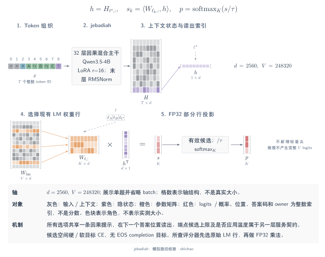
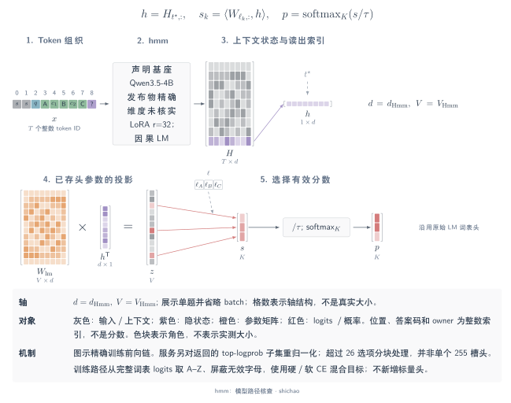
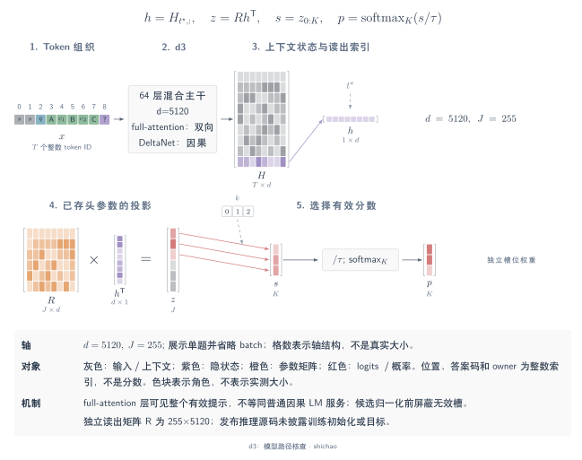
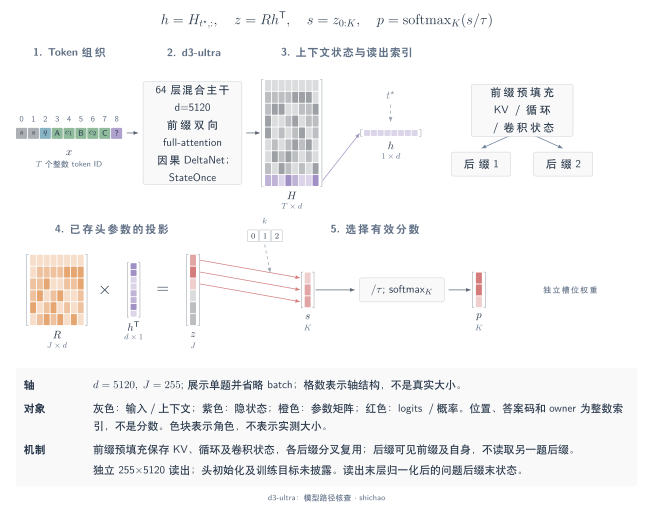
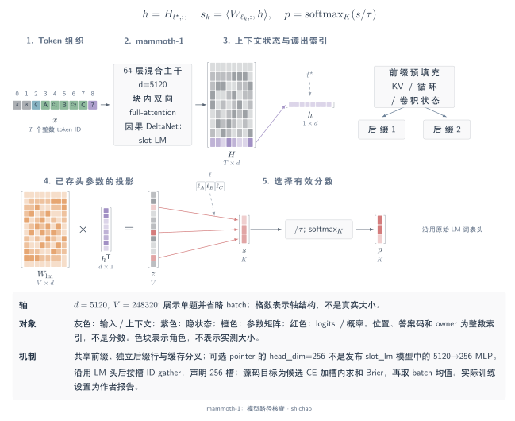

# 答案 token 与固定槽位模型架构

本页按固定源码与 checkpoint 版本描述架构，分别记录配置、可执行读出逻辑和作者自报的训练历史。读出属于同一家族，不代表 checkpoint 兼容或训练已经复现。下列形状在影响计算时保留 batch 轴。

## jebadiah

参考 checkpoint 为 **frontier-infra/jebadiah-4b-v2@872ae9509607761d4484ab49270311d9308bba18**，源码为 **getainode/jebadiah@a7e8108fbedaa08faa016bf4aeaa7c281b068639**。发布元数据将基座固定为 Qwen3.5-4B 的 `851bf6e806efd8d0a36b00ddf55e13ccb7b8cd0a` 版本。

[SVG](../../tensor-analysis/figures/architecture-jebadiah.zh.svg) · [Dark SVG](../../tensor-analysis/figures/architecture-jebadiah.zh.dark.svg) · [PDF](../../tensor-analysis/figures/architecture-jebadiah.zh.pdf) · [TikZ](../../tensor-analysis/figures/architecture-jebadiah.zh.tex)

每题形成一条因果序列：系统指令、状态、问题、带标签的选项和关闭思考的 assistant 前缀。随模型提供的 scorer 使用文本 CausalLM 分支。主干为 32 层、隐藏宽度 2,560，每组三层 Gated DeltaNet 加一层 full-attention，共八组。所有选项位于同一序列，后选项可以依赖前选项。

scorer 先取提示末个有效 token 的表示，并在乘法**之前**选出现有 LM 头中候选字母对应的权重行。采用右侧 padding 时，行索引为 \(t_b=\sum_t M_{b,t}-1\)：

\[
h_b=H_{b,t_b,:}\in\mathbb R^{2560},\qquad
W_c=W_{\mathrm{lm}}[\ell]\in\mathbb R^{B\times K_{\max}\times2560},\qquad
s_{b,k}=\sum_j (W_c)_{b,k,j}(h_b)_j .
\]

点积使用 FP32。无效候选列置为 \(-\infty\)，有效分数经温度缩放和候选 softmax 得到概率。这里选取的是已有 \(248320\times2560\) LM 矩阵的部分行，没有附加标量头。

训练实现对源分布或硬标签计算候选空间交叉熵；发布配方对 score 问题使用有序目标。LoRA 合并与历史训练配方属于作者记录。MetisCraft 的答案 token 读出可以表达同类决策，但当前前向先投影完整词表，再 gather 候选列；其 Tev1 completion 目标也不同于 jebadiah 的候选 CE。保留视觉配置不代表图像决策经过训练或校准。

固定来源：

- [Checkpoint 配置](https://huggingface.co/frontier-infra/jebadiah-4b-v2/blob/872ae9509607761d4484ab49270311d9308bba18/config.json)
- [发布 scorer：位置选择、LM 权重行 gather 与 softmax](https://huggingface.co/frontier-infra/jebadiah-4b-v2/blob/872ae9509607761d4484ab49270311d9308bba18/scripts/jebadiah_model.py)
- [训练目标与候选空间损失](https://github.com/getainode/jebadiah/blob/a7e8108fbedaa08faa016bf4aeaa7c281b068639/train/train_jebadiah.py)
- [发布的基座、adapter 与温度元数据](https://huggingface.co/frontier-infra/jebadiah-4b-v2/blob/872ae9509607761d4484ab49270311d9308bba18/jebadiah.json)

## Hmm

参考发布版本为 **n4ze3m/Qwen3.5-4B-Hmm@adcef8b4701704a37c33053a8a262a7bd076a511**，源码为 **n4ze3m/hmm@78d8d4a62a41857ce67d903aadf504580feea832**。adapter 声明基座为 Qwen3.5-4B，但没有固定基座 revision。核查版本提供 GGUF 和 LoRA adapter，没有封存完整主干配置，因此保留 \(D_{\mathrm{Hmm}}\)、\(V_{\mathrm{Hmm}}\) 为符号量。

[SVG](../../tensor-analysis/figures/architecture-hmm.zh.svg) · [Dark SVG](../../tensor-analysis/figures/architecture-hmm.zh.dark.svg) · [PDF](../../tensor-analysis/figures/architecture-hmm.zh.pdf) · [TikZ](../../tensor-analysis/figures/architecture-hmm.zh.tex)

**训练路径。** 每题构成一条左侧 padding 的因果提示，包含状态、问题和用 A–Z 标记的 2–26 个选项。模型先计算提示末位置的词表 logits，再选取 26 个字母列：

\[
Z\in\mathbb R^{B\times1\times V_{\mathrm{Hmm}}},\qquad
S=Z[:,0,\ell_{A:Z}]\in\mathbb R^{B\times26}.
\]

超出每题有效选项数的列在 softmax 前置为 \(-10^4\)。模型复用原 LM 头；adapter 指定 LoRA rank 32、alpha 64、dropout 0.05，没有新增槽位头。损失混合硬标签 CE 与软目标 CE：存在教师分布时，默认软目标权重为 0.5；否则只用硬标签 CE。noul 仍是两个字母的分类任务。

**服务路径。** TypeScript 服务向 llama.cpp 或 Ollama 请求一个 token 及有限的 top-logprob 列表，收集返回的字母概率，再对所需选项重新归一化。未返回的字母概率为零；若全部为零，则回退到均匀分布。超过 26 个选项时，每块包含 25 个选项和一个“以上皆非”出口，拼接分数后再次归一化。因此该服务路径不能表示为一次精确的 255 路候选 softmax。

MetisCraft 可以表达答案 token 家族，但保留 Hmm 行为需要同时保留其提示、字母限制、混合训练目标和独立的服务概率契约。发布的训练条件与分数属于作者报告。

固定来源：

- [发布的 LoRA 配置与未固定的基座 revision](https://huggingface.co/n4ze3m/Qwen3.5-4B-Hmm/blob/adcef8b4701704a37c33053a8a262a7bd076a511/lora/adapter_config.json)
- [训练提示、完整词表读出与混合 CE](https://github.com/n4ze3m/hmm/blob/78d8d4a62a41857ce67d903aadf504580feea832/training/train.py)
- [服务后端与 top-logprob 收集](https://github.com/n4ze3m/hmm/blob/78d8d4a62a41857ce67d903aadf504580feea832/server/src/backends.ts)
- [服务分块、重新归一化与回退](https://github.com/n4ze3m/hmm/blob/78d8d4a62a41857ce67d903aadf504580feea832/server/src/index.ts)

## d3

参考版本为 **vllm-sr/d3@62f07e54c6c3a5ff5f695107377edc43e1a86ea8**。决策元数据将基座记为 **Qwen/Qwen3.8-27B@1d4bf0f2ff6012fd82039f2fa52739d0dd7c60c0**，实际配置与加载器则使用 `qwen3_5` / `Qwen3_5Model`。这两种标识需要同时保留。

[SVG](../../tensor-analysis/figures/architecture-d3.zh.svg) · [Dark SVG](../../tensor-analysis/figures/architecture-d3.zh.dark.svg) · [PDF](../../tensor-analysis/figures/architecture-d3.zh.pdf) · [TikZ](../../tensor-analysis/figures/architecture-d3.zh.tex)

每题提供一条包含状态、问题和答案码选项的完整提示。主干为 64 层、隐藏宽度 5,120。每四层中，三层 DeltaNet 保持因果扫描，一层 full-attention 双向读取全部有效提示 token，因此候选文本在 full-attention 层也能双向交互。普通路径对每道题重新计算完整提示。

经过末端 RMSNorm 后，提示末位置表示与 `readout.safetensors` 中独立存储的 FP32 矩阵相乘：

\[
h\in\mathbb R^{B\times5120},\qquad
R\in\mathbb R^{255\times5120},\qquad
S=hR^{\mathsf T}\in\mathbb R^{B\times255}.
\]

运行时显式检查该矩阵形状。超出 \(K_b\) 的槽位置为 \(-\infty\)，温度为 1.0，随后执行 softmax 并移除无效列。答案码标识槽位行；配置中存在这些码的 token ID，不足以证明独立矩阵由 LM 头的对应行初始化。

核查版本没有披露训练目标、损失 reduction 或读出矩阵的训练初始化。加载器中的空初始化只说明推理使用 checkpoint 权重。MetisCraft 当前的答案 token 与 scalar-list 读出没有实现 d3 的独立头及注意力要求。

固定来源：

- [主干与视觉配置](https://huggingface.co/vllm-sr/d3/blob/62f07e54c6c3a5ff5f695107377edc43e1a86ea8/config.json)
- [基座标识、答案码与注意力模式](https://huggingface.co/vllm-sr/d3/blob/62f07e54c6c3a5ff5f695107377edc43e1a86ea8/decision_config.json)
- [提示编码、矩阵形状检查、候选 mask 与归一化](https://huggingface.co/vllm-sr/d3/blob/62f07e54c6c3a5ff5f695107377edc43e1a86ea8/d3_runtime.py)
- [推理包装层与 checkpoint 初始化边界](https://huggingface.co/vllm-sr/d3/blob/62f07e54c6c3a5ff5f695107377edc43e1a86ea8/modeling_d3.py)

## d3-ultra

参考版本为 **vllm-sr/d3-ultra@ccdcfa611649a59e095e0b5e1732a15cedafadd6**。配置指定 64 层、隐藏宽度 5,120 的 `qwen3_5` 主干。固定版本的模型卡、决策配置与 manifest 没有给出精确预训练基座 revision，不能将 d3 的基座标识直接移入本版本。

[SVG](../../tensor-analysis/figures/architecture-d3-ultra.zh.svg) · [Dark SVG](../../tensor-analysis/figures/architecture-d3-ultra.zh.dark.svg) · [PDF](../../tensor-analysis/figures/architecture-d3-ultra.zh.pdf) · [TikZ](../../tensor-analysis/figures/architecture-d3-ultra.zh.tex)

`header-v1` 布局将整次请求的问题编号表、状态和共享媒体放入公共前缀；每题再使用包含本题问题、答案码选项和 assistant 前缀的独立后缀。`prefix_bidir` mask 允许前缀 token 在前缀内双向读取，每个后缀则双向读取前缀与自身。前缀不能读取后缀，不同后缀也不互相注意。DeltaNet 层保持因果。

`StateOnce` 实现只计算一次前缀，保留 full-attention 的 key/value，以及 DeltaNet 的循环状态和卷积状态。问题后缀 batch 从该缓存继续计算：

\[
\mathrm{cache}=\mathrm{StateOnce}(X_{\mathrm{prefix}}),\qquad
h=\mathrm{Questions}(X_{\mathrm{suffix}},\mathrm{cache})\in\mathbb R^{B\times5120},\qquad
S=hR^{\mathsf T},\quad R\in\mathbb R^{255\times5120}.
\]

末端归一化后，从各后缀末位置读出。无效槽位在候选 softmax 前被屏蔽。请求只含一个 choice／noul／score 问题时，配置温度为 1.046；其余问题数分桶为 1.0。Box 通过同一矩阵读取四个标记位置，以前 128 个槽位作为坐标分箱；这不代表另有一个 box MLP。

核查版本没有披露训练目标和读出初始化。MetisCraft 当前没有提供该头、块 mask 或共享状态缓存适配。共享状态实现是本版本与 d3 每题重算完整提示路径的关键差别。

固定来源：

- [主干配置](https://huggingface.co/vllm-sr/d3-ultra/blob/ccdcfa611649a59e095e0b5e1732a15cedafadd6/config.json)
- [前缀 mask、header 布局与温度表](https://huggingface.co/vllm-sr/d3-ultra/blob/ccdcfa611649a59e095e0b5e1732a15cedafadd6/decision_config.json)
- [StateOnce 缓存、固定槽位投影与标记位置读出](https://huggingface.co/vllm-sr/d3-ultra/blob/ccdcfa611649a59e095e0b5e1732a15cedafadd6/d3_runtime.py)
- [共享 header 与 token 边界构造](https://huggingface.co/vllm-sr/d3-ultra/blob/ccdcfa611649a59e095e0b5e1732a15cedafadd6/d3_format.py)

## mammoth-1

参考版本为 **baselabs/mammoth-1@61cec44c281c693992e3d6ebeb44dd3402dfa186**。随模型提供的运行时由 **OmniJev/OneJev@81ce62f1597c91e46767d4d02d6ac2e18534fe94** 加该 checkpoint 的 `serve.patch` 组成。模型卡声明基座为 Qwen3.5-27B，没有给出精确基座 revision。

[SVG](../../tensor-analysis/figures/architecture-mammoth-1.zh.svg) · [Dark SVG](../../tensor-analysis/figures/architecture-mammoth-1.zh.dark.svg) · [PDF](../../tensor-analysis/figures/architecture-mammoth-1.zh.pdf) · [TikZ](../../tensor-analysis/figures/architecture-mammoth-1.zh.tex)

语言主干为 64 层、隐藏宽度 5,120。共享前缀包含系统指令和状态，每题后缀包含本题问题、选项和 assistant 前缀。full-attention 层在前缀内、各后缀内分别双向，并允许后缀读取前缀；前缀不能读取后缀，后缀行互相隔离。DeltaNet 层保持因果，因此可以先共享前缀 prefill，再使用缓存批量计算问题后缀。

checkpoint 声明 `slot_lm` 和 256 个槽位。它使用现有 LM 词表头，没有新增 \(5120\rightarrow256\rightarrow256\) MLP：

\[
h\in\mathbb R^{B\times5120},\qquad
Z=hW_{\mathrm{lm}}^{\mathsf T}\in\mathbb R^{B\times248320},\qquad
S_{b,k}=Z_{b,\ell_k},\qquad p_b=\operatorname{softmax}(S_{b,\mathrm{valid}}/\tau).
\]

运行时要求槽位标签能以单 token 往返编码。`slot_lm` 分支在挂接读出时直接返回，不创建额外决策头模块。元数据中的 `head_dim=256` 配置的是可选 pointer-head 变体，不是发布读出的瓶颈宽度。提供的文本运行时默认以 FP32 计算 LM 头。

固定损失实现使用槽位 CE 加 Brier 误差：沿有效槽位求和，再对样本取均值：

\[
\mathcal L=\frac1B\sum_b\left[-\sum_i q_{b,i}\log p_{b,i}
+\lambda\sum_i(p_{b,i}-q_{b,i})^2\right].
\]

模型卡报告 \(\lambda=1\)、语言模型全参训练和冻结视觉编码器；这些条件属于作者的训练记录。模型产物含视觉配置，而随附 qev 自托管入口选择文本 CausalLM 分支，两者的执行范围需要区分。MetisCraft 支持 CE／Brier 组件，不代表已经提供 mammoth-1 的 checkpoint 格式、块 mask 或前缀分叉实现。

固定来源：

- [主干、注意力覆盖配置与 slot_lm 声明](https://huggingface.co/baselabs/mammoth-1/blob/61cec44c281c693992e3d6ebeb44dd3402dfa186/config.json)
- [随模型提供的读出与共享前缀实现](https://huggingface.co/baselabs/mammoth-1/blob/61cec44c281c693992e3d6ebeb44dd3402dfa186/serve.patch)
- [固定版本槽位 CE+Brier 实现](https://github.com/OmniJev/OneJev/blob/81ce62f1597c91e46767d4d02d6ac2e18534fe94/train/sft.py#L368-L379)
- [模型卡与作者自报训练条件](https://huggingface.co/baselabs/mammoth-1/blob/61cec44c281c693992e3d6ebeb44dd3402dfa186/README.md)

[返回模型架构图谱](architectures.md)

[English](../../en/tensor-analysis/architectures-token.md)
