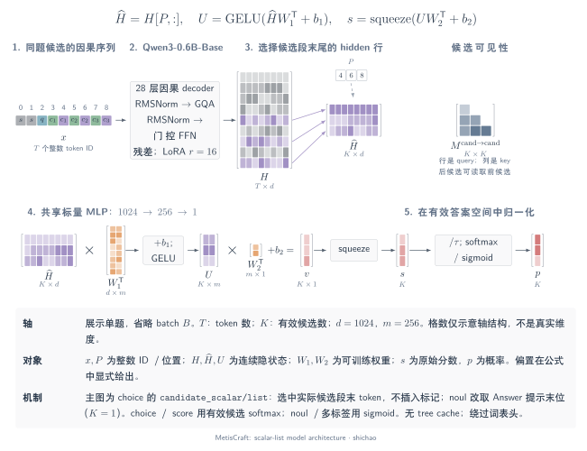
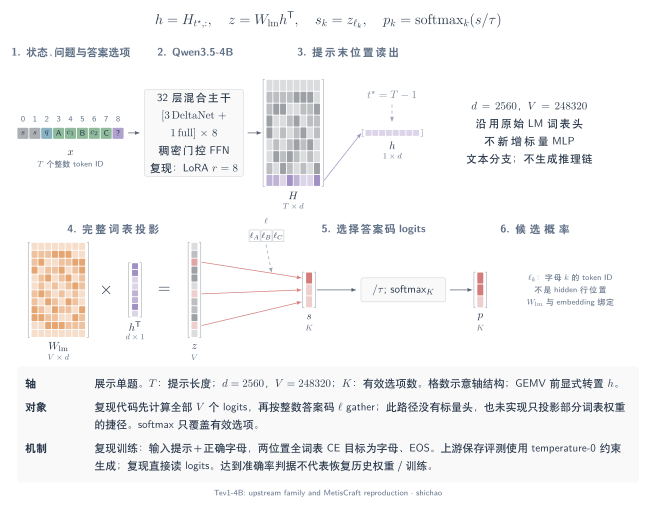

# 模型架构图谱

同一决策接口可以对应不同的神经网络计算。本图谱按具名实现展开 **token → 上下文状态 → 索引读出 → 参数投影 → 分数 → 归一化**，分别说明输入序列数、候选可见性、归一化轴和批量调用。这些差异用于解释计算机制，不直接证明速度或校准质量。

每个符号轴使用一致的几何边长：被选中的行仍为行，转置交换物理边，收缩维度两侧等长。格数示意轴结构，不是真实模型大小。各图均提供中英、明暗主题、矢量 SVG／PDF 与可独立编辑编译的 TikZ。点击图示可查看原尺寸，查看器随页面主题切换。

## MetisCraft：具体模型与工具包

已记录的客服分流模型使用 **Qwen3-0.6B-Base、LoRA r=16 和共享的 `1024 → 256 → 1` 标量头**。默认 `list` 布局从同题的因果序列中取出候选段末 hidden；后候选可以读取前候选。`noul` 改读最终答案提示位置，输出单个事件 logit。可选 `pairs` 独立编码各候选，再将分数 scatter 回问题。

[SVG](../../tensor-analysis/figures/metiscraft-architecture.zh.svg) · [暗色 SVG](../../tensor-analysis/figures/metiscraft-architecture.zh.dark.svg) · [PDF](../../tensor-analysis/figures/metiscraft-architecture.zh.pdf) · [TikZ](../../tensor-analysis/figures/metiscraft-architecture.zh.tex)

这是工具包组装的一个具体模型，不将预训练主干归为 MetisCraft 原创。[引言](introduction.md)连接任务、真实训练／测试样例及保存的响应；[标量布局](scalar-heads.md)展开 `list` 与 `pairs`；独立的[工程工作流图](../../tensor-analysis/figures/metiscraft-workflow.zh.svg)连接契约、产物与服务。

## Tev1：通过 MetisCraft 的答案 token 路径复现

Tev1-4B 属于另一种读出结构：**32 层 Qwen3.5-4B 混合主干**后接已有词表头。MetisCraft 复现从提示末状态计算完整词表 logits，再选择答案码；使用 LoRA r=8，以字母／EOS 的全词表 completion 目标训练，不添加客服模型的标量 MLP。

[SVG](../../tensor-analysis/figures/tev1-architecture.zh.svg) · [暗色 SVG](../../tensor-analysis/figures/tev1-architecture.zh.dark.svg) · [PDF](../../tensor-analysis/figures/tev1-architecture.zh.pdf) · [TikZ](../../tensor-analysis/figures/tev1-architecture.zh.tex)

[复现记录](../../reproductions/tev1.md)给出主集 **873/1,000（87.3%）**、迁移集 **298/300（99.33%）**，上游报告分别为 88.0%、100%。该记录同时说明上游约束生成与本次直接读 logits 的协议差异、答案一致率、校准限制及缺失的历史设置。这是在公开条件下达到准确率判据，不代表恢复原始训练任务或权重。

## 按实际计算组织的开源实现

以下条目是**固定源码架构核查**，不计为额外的 MetisCraft 复现实验。各章分别列明所选权重或源码模式、张量形状、训练依据及尚未公开的细节。

| 实现 | 读出与可见性 | 详细图示 |
|---|---|---|
| jebadiah | 因果提示；先选择原始 LM 权重行，再乘 hidden | [答案 token](architectures-token.md#jebadiah) |
| Hmm | 训练从完整词表取 A–Z；服务另有 top-logprob 路径 | [答案 token](architectures-token.md#hmm) |
| d3 | 独立 255 槽矩阵；full-attention 双向，DeltaNet 因果 | [固定槽位](architectures-token.md#d3) |
| d3-ultra | 独立槽矩阵；复用前缀状态并分叉问题后缀 | [固定槽位](architectures-token.md#d3-ultra) |
| mammoth-1 | 原始 LM 头、槽 ID gather、块内双向 full-attention | [Slot LM](architectures-token.md#mammoth-1) |
| JevForge | 独立候选行；共享 `1024 → 1024 → 1` 标量 MLP | [标量头](architectures-structured.md) |
| Kev-4B | 逐题行；decision／候选投影和缩放 pointer 点积 | [指针头](architectures-structured.md) |
| Clef | 候选 memory 路由、字段交互、词面先验及门控联合打分 | [联合 schema](architectures-structured.md) |
| JevAny | Native pointer／token 两路；依主干分派 row／packed | [Native 读出](architectures-structured.md) |
| GLiClass | 文本与标签联合双向编码；两套投影器后点积 | [动态标签](architectures-encoders.md#gliclass) |
| GLiNER2 | 双向 schema 的 `[L]` 状态；共享 `768 → 1536 → 1` 分类头 | [Schema 分类](architectures-encoders.md#gliner2) |
| Open-Jev 学生 | 仅输入文本，mean pooling 后固定任务类别 | [固定任务学生](architectures-encoders.md#open-jev) |
| SetFit | 句向量 body 适配后拟合固定类别逻辑回归 | [两阶段分类](architectures-encoders.md#setfit) |
| Qwen3 Reranker | 独立 query／document 提示；从词表取 `no`／`yes` | [逐对重排](architectures-encoders.md) |

## 范围与来源

MetisCraft 当前实现答案 token、scalar-list、scalar-pairs。数学家族相似不等于可直接加载其他项目的 checkpoint；pointer、固定槽位和联合 schema 头仍是外部对照。共享前缀树注意力属于研究机制，不是当前 MetisCraft 的执行路径。

ms-swift、Unsloth 等框架可配置多种模型，不为其虚构单一架构。ModernBERT、DeBERTa 在编码器章节中作为基座索引。数据集和基准按数据记录，不作为神经网络作图。Jev 的公开 System One 契约不揭示其私有网络。

[生态支持矩阵](../../support-matrix.md)记录适配与复现状态；图中参数和固定一手来源保留在[共享模型目录](../../tensor-analysis/src/model-atlas.json)，[渲染器](../../tensor-analysis/src/model_plates.py)按相同符号轴生成几何。完整推导继续阅读[读出机制对照](readout-comparison.md)。

[English](../../en/tensor-analysis/architectures.md)
