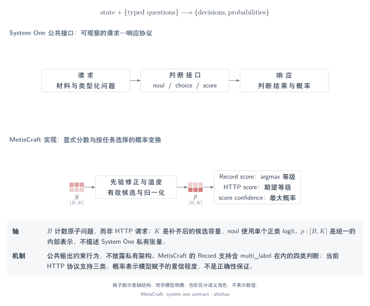
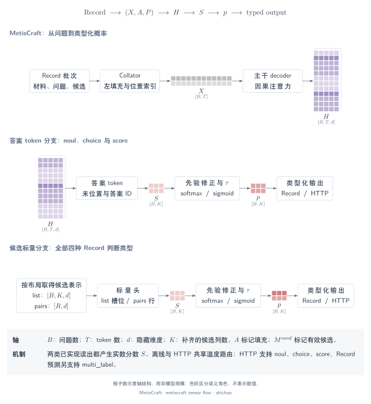

# System One 与 MetisCraft：从输入到类型化判断

[模型架构图谱：MetisCraft、Tev1 与 14 个已核查开源实现](architectures.md)，将具体模型路径与通用机制分类分开。

本章沿着一个问题，解释概率分布与程序可消费的答案如何产生。System One 提供公开的接口契约；MetisCraft 提供可检查的答案 token 与逐候选标量读出实现。接口相近，不代表内部模型架构相同。

首次阅读这一类模型，可从[0. 引言：任务、数据与架构](introduction.md)开始。

## 本页问题

模型如何把 `state` 和有限答案空间转成程序可用的判断？本章区分三个层次：

1. **契约**：接口接受哪些问题，返回哪些类型。
2. **计算**：哪些张量、索引与算子产生分数。
3. **证据**：哪些实现与测量支持相应结论。

[System One API 文档](https://docs.typesafe.ai/api/system-one)规定了共享状态上的具名问题。本章借此说明 MetisCraft 的实现，不推断 Jev 的私有层结构、训练方法或执行内核。官方文档核对日期为 **2026-11-09**。

[SVG](../../tensor-analysis/figures/system-one-contract.zh.svg) · [PDF](../../tensor-analysis/figures/system-one-contract.zh.pdf) · [TikZ](../../tensor-analysis/figures/system-one-contract.zh.tex)

## 张量与语义

一次 HTTP 请求可以包含多个问题。MetisCraft 将每个问题转换为一条 `Record`，因此批轴统计的是**问题数**，不是请求数。三个选项的选择题对应三个互斥事件；多标签问题则为每个候选定义一个 Bernoulli 事件。

| 对象 | 形状 | 单个元素的含义 |
|---|---|---|
| Token ID \(X\) | \([B,T]\) | 一个 token 位置上的词表索引 |
| Padding mask \(A\) | \([B,T]\) | 该位置是有效输入还是填充 |
| 隐状态 \(H\) | \([B,T,d]\) | 一个上下文化 token 的某个特征坐标 |
| 候选 mask \(M^{\mathrm{cand}}\) | \([B,K_{\max}]\) | 该问题是否存在这一候选列 |
| 读出分数 \(S\) | \([B,K_{\max}]\) | 未归一化分数，尚不是概率 |
| 有效概率 \(P_b\) | \([K_b]\) | 某个选项、等级或候选事件的概率 |

[记号与索引](notation.md)进一步说明 dtype、变长批次，以及 padding、因果可见性和候选有效性之间的区别。

## 算子链

MetisCraft 的处理路径为：

`请求 → Records → 分词 → 左填充 → 主干 → 读出 → logit 修正 → 温度 → 类型化概率 → 响应`

[SVG](../../tensor-analysis/figures/metiscraft-tensor-flow.zh.svg) · [PDF](../../tensor-analysis/figures/metiscraft-tensor-flow.zh.pdf) · [TikZ](../../tensor-analysis/figures/metiscraft-tensor-flow.zh.tex)

主干产生表示；读出选择相应表示或词表列，并将其转为分数；判断类型决定归一化方式；响应适配层把结果对应到稳定的答案 ID。

## 关键公式

对问题 \(b\)，令 \(\mathcal K_b\) 为有效候选列集合，\(\tau_b>0\) 为实际选用的温度。记 \(\widetilde s_{b,k}=(s_{b,k}-\delta_b)/\tau_b\)；除多标签正类加权修正外，\(\delta_b\) 为零。

\[
p_{b,k}=\frac{\exp(\widetilde s_{b,k})}{\sum_{j\in\mathcal K_b}\exp(\widetilde s_{b,j})}
\qquad\text{用于 choice 与 score},
\]

\[
p_{b,k}=\sigma(\widetilde s_{b,k})
\qquad\text{用于 noul 与 multi\_label 事件}.
\]

Softmax 通过分母耦合候选概率。逐候选 sigmoid 没有和为一的约束，但这不意味着相应隐表示相互独立。

## 小型示例

以下为**构造的算术示例**，不属于模型效果结果。三个选项的分数为 \([0,1,2]\)、温度为 \(1\) 时，softmax 约为 \([0.090031,0.244728,0.665241]\)。选择题返回第三个选项；如果它们是编号 \(0,1,2\) 的有序等级，同一分布的众数等级为 \(2\)，期望分为 \(1.575210\)。

| 判断类型 | Python / Record | `/v1/systemone` |
|---|---|---|
| `noul` | 肯定概率及阈值化决策 | 肯定概率 |
| `choice` | 选项分布及所选 ID | 选项分布及所选 ID |
| `score` | 等级分布及众数等级索引 | 等级分布及期望等级索引 |
| `multi_label` | 各候选概率及选中 ID | 当前版本不支持 |

MetisCraft `0.1.0rc1` 的 HTTP `confidence` 为最大选项／等级概率；TypeSafe 官方定义的 confidence 统计量有所不同。[训练与校准](training-calibration.md#概率分数与-confidence)给出明确对照，本章不改变接口协议。

## 源码与依据

本章以工具包提交 `91259c6d07ece19248a02a4b56b43dd3a77d81e5` 的实现为依据。

| 阶段 | 可检查的实现 |
|---|---|
| 问题转为 Record | [`request_to_records`](../../../src/metiscraft/data/jev.py#L146) |
| Token 序列与候选索引 | [`PromptBuilder`](../../../src/metiscraft/modeling/prompts.py#L136) |
| Padding 与张量组批 | [`Collator`](../../../src/metiscraft/train/collate.py#L39) |
| 答案 token 与标量读出 | [`DecisionModel.forward`](../../../src/metiscraft/modeling/model.py#L55) |
| 归一化与决策 | [`probabilities` 与 `decide`](../../../src/metiscraft/judgments/__init__.py#L112) |
| 校准与响应组装 | [`Predictor`](../../../src/metiscraft/serve/predictor.py#L126) |

## 适用边界与阅读路线

MetisCraft 实现两个读出家族、三条执行路径：答案 token、标量 `list` 和标量 `pairs`。[七类读出对照](readout-comparison.md)还解释生态中的其他机制；图示不表示工具包已经实现这些机制。

- **五分钟讲解**：使用[导览](walkthrough.md)，复用本章图示与证据。
- **理解实现**：[记号](notation.md) → [答案 token](answer-token.md) → [标量头](scalar-heads.md) → [训练与校准](training-calibration.md)。
- **运行第一个应用**：使用 [CPU Cookbook](../cookbook/first-model.md)。
- **查看真实模型效果**：阅读 [Tev1 复现记录](../../reproductions/tev1.md)；张量算术和随机模型检查不衡量任务准确率。
