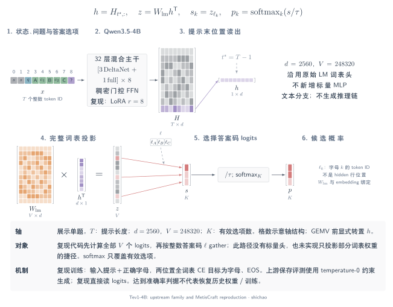

# JevLike 的任务与答案空间 { #0-引言jevlike-决策模型 }

客服消息在生成回复之前，往往已经需要多个判断：由哪个团队处理、是否紧急、涉及哪些主题。决策模型显式定义答案空间，返回可供程序读取、评测和校准的数值。MetisCraft 是面向有监督任务、用于训练和服务这类模型的工具包。

本章用一个完整的客服分流案例说明任务、数据与答案空间，再比较两种从模型中读取答案的方式。客服配方给候选表示打分，Tev1 复现实验读取答案 token 的分数。

## JevLike 的定义 { #1-什么是-jevlike }

本文用 **JevLike** 描述这样一类模型：接收共享材料和类型化问题，在定义好的答案空间中输出判断。这是对模型家族的工作性描述，不表示所有项目都采用 Jev 的内部架构。[System One 官方契约](https://docs.typesafe.ai/api/system-one)规定具名问题及其对应答案，并未据此公开服务背后的内部实现。

对于互斥的选择问题，记

\[
p_\theta(y=k\mid x,q,\mathcal C),\qquad k\in\{1,\ldots,K\},
\]

其中 \(x\) 是材料，\(q\) 是指令，\(\mathcal C\) 给出候选 ID 及其含义。是非与多标签问题则表示一个或多个 Bernoulli 事件。MetisCraft 的 Record 支持 `noul`、`choice`、`score`、`multi_label` 四类判断；HTTP `/v1/systemone` 支持前三类。

本文的客服模型在一次前向计算中给出分数。其他方法也可以先生成推理文本，再读取答案分布。比较计算量时，要分别数清输入序列和顺序解码步数。例如，`pairs` 可以在一次批量调用中编码多条候选序列。延迟需实际计时，概率质量需单独评测。[读出机制比较](readout-comparison.md) · [输出契约](index.md)

## 客服队列与紧急程度 { #2-任务客服分流与紧急程度判断 }

教学任务对每条消息提出两个问题：

| 问题 | 类型 | 答案空间 | 应用用途 |
|---|---|---|---|
| `queue` | `choice` | `cards`、`payments`、`transfers`、`top_up`、`account`、`security` | 选择一个处理队列 |
| `urgent` | `noul` | 回答“是”的概率 | 为另行评测的升级处理策略提供输入 |

对于下面这条构造的演示消息，保存的模型响应选择了 `security`，并给出较高的紧急概率：

> My card was stolen this morning and there are two payments on it that I did not make.

| 实录字段 | 值 |
|---|---:|
| `answers.queue.choice` | `security` |
| `answers.queue.confidence` | 0.9999995054983101 |
| `answers.urgent.noul` | 0.9999314182034214 |

以上数值来自运行 `20261105-101057-30757bf7`，并非构造的教学概率。消息为演示编写，**不是留出的数据集样本**。一次响应不能衡量任务准确率；[认识一次判断](../cookbook/decision.md)提供完整请求、响应及与先验基线的对照。

## 从意图标签到训练样本 { #3-数据从意图标签到类型化监督 }

应用使用 [`PolyAI/banking77`](https://huggingface.co/datasets/PolyAI/banking77/tree/1846984189f2bc0ac51c6fc3a600fa9e1714e0c6) 的固定修订 `1846984189f2bc0ac51c6fc3a600fa9e1714e0c6`，许可为 **CC-BY-4.0**。`label_mapping@1` 将 77 个原始意图映射为六个队列和一个二元紧急标签。这些业务标签是派生的教学标签，不是原数据集人工标注的紧急程度。

每条消息产生两条具有相同分组键的 Record；划分时，同一消息的两个问题保持在一起。版本为 `banking77_support/rev-18469841`，test 真值仅用于评测。[样例来源清单](../../examples/support-data-source.json)记录固定修订、样本 ID 和派生文件哈希。

| 划分 | 消息数 | 问题／Record 数 | 用途 |
|---|---:|---:|---|
| train | 8,967 | 17,934 | 拟合模型参数 |
| calib | 527 | 1,054 | 使用独立数据拟合温度 |
| dev | 501 | 1,002 | 检查开发集指标 |
| test | 3,080 | 6,160 | 在上游 test 划分评测 |

Calib 与 dev 通过哈希从上游 train 划出。上述数量描述已有运行所用的数据版本，不是所有导入任务必须遵循的模板。[配方与映射](../../../recipes/banking77_support/README.md)提供完整定义和准备命令。

### 训练样例

下面是一个真实训练 Record 的**元数据摘录**，保留原始文本与标签。可下载[完整训练 Record](../../examples/support-train-record.json)，检查六个候选说明、分组和来源。

```json
{
  "id": "banking77_support:train:0:queue",
  "input": {
    "context": {"state": "I am still waiting on my card?"},
    "query": "Which support queue should handle this customer message?"
  },
  "supervision": {"kind": "choice", "labels": "cards"}
}
```

原始意图为 `card_arrival`；同一消息的紧急问题标签为 `false`。`supervision` 为损失函数提供目标，不拼接到推理提示中。

### 评测样例

下面摘录一条原 test Record 的元数据。消息不同，任务与答案定义保持一致。可下载[完整评测 Record](../../examples/support-test-record.json)。

```json
{
  "id": "banking77_support:test:0:queue",
  "input": {
    "context": {"state": "How do I locate my card?"},
    "query": "Which support queue should handle this customer message?"
  },
  "supervision": {"kind": "choice", "labels": "cards"}
}
```

评测器将预测与目标比较；模型提示只接收输入和问题。冻结的 test 标签不参与模型训练或温度拟合。

## 请求与响应 { #4-调用请求不携带目标标签 }

安装工具包并准备好训练产物后，在一个终端启动服务：

```bash
metiscraft serve <run-directory>/artifact
```

在另一个终端下载完整演示请求，原样发送：

```bash
curl -fsS -o request.json https://shichaoxx.github.io/MetisCraft/assets/docs/examples/support-request.json
curl -fsS http://127.0.0.1:8000/v1/systemone \
  -H 'Content-Type: application/json' --data-binary @request.json
```

请求包含 `model`、`state` 和具名 `questions`，没有 `supervision`。[保存的响应 JSON](../../examples/support-response.json)来自前述真实训练产物；重新训练的模型可能输出不同数值。模型准备和停止服务的方法见 [CPU 教程](../cookbook/first-model.md)及[服务指南](../serving.md)。随机 CPU 模型验证软件流程，不衡量这个应用的效果。

## 候选分数的来源 { #5-metiscraft-自身的架构 }

<a id="共享的模型核心"></a>

客服模型在每个候选的末位读取一个向量，用共享的标量头打分。指针读出还可以取一个整道题共用的决策向量，再与每个候选的向量配对。比较时，先找分数依赖的输入位置，再检查同一道题哪些选项参与归一化。[候选打分与概率](../jevlike/candidate-scores.md)

<a id="训练与部署通过产物衔接"></a>

要追踪 MetisCraft 从输入 Record 到预测结果的完整路径，可查手册中的[模型核心](../metiscraft/model-and-artifacts.md#共享的模型核心)和[训练产物与部署](../metiscraft/model-and-artifacts.md#训练与部署通过产物衔接)。

## 客服分流模型 { #6-架构实例客服分流 }

客服配方采用 **Qwen3-0.6B-Base + LoRA + `list` 标量读出**。[固定基座配置](https://huggingface.co/Qwen/Qwen3-0.6B-Base/blob/da87bfb608c14b7cf20ba1ce41287e8de496c0cd/config.json)包含 28 层因果 decoder，隐藏维度 \(d=1024\)。[Qwen3 实现](https://github.com/huggingface/transformers/blob/v4.51.3/src/transformers/models/qwen3/modeling_qwen3.py)给出 RMSNorm、分组查询注意力、门控 MLP 和残差连接。配方对线性模块采用 LoRA \(r=16\)、\(\alpha=32\)，另加一个共享的 `1024 → 256 → 1` 读出头；这条路径不经过词表输出头。

下面的符号表与公式对应这份客服配方。要沿图核对候选位置和张量形状，可打开[手册中的模型结构图](../metiscraft/model-and-artifacts.md)。[模型架构图谱](architectures.md)列出其他实现的读出位置。

### 张量与维度 { #对象与轴 }

| 对象 | 形状 | 单个元素的含义 |
|---|---|---|
| \(X\) | \([B,T]\) | 一个问题的填充序列中的整数 token ID |
| \(H\) | \([B,T,1024]\) | 某个 token 的一个上下文隐藏特征 |
| \(P\) | \([B,K_{\max}]\) | 一个候选片段末端的 token 下标 |
| \(h\) | \([B,K_{\max},1024]\) | 选出的候选表示 |
| \(S\) | \([B,K_{\max}]\) | 一个未归一化的实数候选分数 |
| \(M\) | \([B,K_{\max}]\) | 该候选列是否有效 |

对于**包含队列和紧急问题的一次请求**，\(B=2\)、\(K_{\max}=6\)。队列行有六个有效列，紧急行只有一个；\(T\) 随分词与填充变化，配方最大输入长度为 384。`noul` 行选择末端答案提示的位置，不选择六个选项位置。

### 候选位置与标量头 { #计算链与机制 }

提示把材料、问题放在有序候选之前，因果 decoder 对序列进行上下文化。`positions` 选择每个候选末端向量，再由**同一个可学习 MLP**对所选向量打分：

\[
H=\operatorname{decoder}(X,A),\qquad h_{b,k,:}=H_{b,P_{b,k},:},
\]

\[
u=\operatorname{GELU}(hW_1^{\mathsf T}+b_1),\qquad
S=\operatorname{squeeze}_{-1}(uW_2^{\mathsf T}+b_2).
\]

第一层只收缩隐藏轴：\(([B,K,1024])(1024\times256)\to[B,K,256]\)。第二层把 \([B,K,256]\) 映射到 \([B,K,1]\)；squeeze 保留问题轴与候选轴。

队列分数通过 softmax 在**六个有效候选**间转成概率；紧急程度对一个分数应用 sigmoid。已有运行选用 choice 温度 1.50、noul 温度 1.55。队列使用分类 CE，紧急程度使用二元 CE；温度仅在 calib 拟合。详见[训练与校准](training-calibration.md)。

在 `list` 中，后面的候选可以看见前面的候选，因此不属于独立的候选对编码。同一请求的两个问题又会形成两条序列；当前实现不通过树缓存共享它们的材料编码。这些差异解释信息流，不代表已经测量的加速。

### 数值示例

构造三个分数 \([0,1,2]\)、温度 \(\tau=1\)，softmax 得到 \([0.090031,0.244728,0.665241]\)。目标下标为 2 时，CE 为 \(-\log(0.665241)\approx0.407606\)。构造紧急 logit \(2\)，sigmoid 得到 \(0.880797\)。这些数值用于解释算子，不是已有模型的预测。

[CPU 张量核验程序](../../../scripts/verify_tensor_examples.py)用随机微型模型，对照显式计算检查 gather、MLP、mask、归一化和 HTTP 转换。不下载权重，也不据此衡量任务准确率。

## 实验结果 { #7-架构结果与阅读路线 }

在 3,080 条 test 消息上，客服组准确率为 **97.8%**，只按训练标签频率预测的先验基线为 **24.7%**。紧急程度准确率为 **98.6%**，先验基线为 **87.0%**。两项指标都以由 Banking77 意图派生的标签为参照。[完整运行条件](../../../recipes/banking77_support/README.md)

### Tev1 的答案 token 读出 { #tev1-复现另一条模型路径 }

Tev1 复现实验使用 32 层 Qwen3.5-4B 混合主干，通过原有词表头读取答案 token 的分数。训练使用 LoRA r=8，以答案字母和 EOS 为目标。复现模型在主决策集上的准确率为 87.3%，在政策迁移集上为 99.33%。这两项评测与客服任务的数据和标签各异。[Tev1 架构、评测条件与限制](../../reproductions/tev1.md#模型架构)



[SVG](../../tensor-analysis/figures/tev1-architecture.zh.svg) · [PDF](../../tensor-analysis/figures/tev1-architecture.zh.pdf) · [TikZ](../../tensor-analysis/figures/tev1-architecture.zh.tex)

对照两种读出的计算，可继续看[答案 token](answer-token.md)、[标量布局](scalar-heads.md)与[模型架构图谱](architectures.md)。要运行一个任务，见 [Cookbook](../cookbook/index.md)。

[English](../../en/tensor-analysis/introduction.md)
