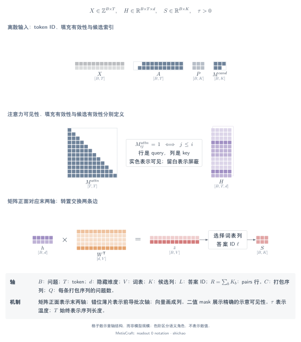

# 张量记号、索引与掩码

## 本页问题

一个张量元素表示什么，算子选择或归约的是哪条轴？表示、索引和掩码必须区分：形状兼容的数组，也可能指向不同对象。



[SVG](../../tensor-analysis/figures/readout-0-notation.zh.svg) · [PDF](../../tensor-analysis/figures/readout-0-notation.zh.pdf) · [TikZ](../../tensor-analysis/figures/readout-0-notation.zh.tex)

## 张量与语义

| 符号／代码名 | 定义域与形状 | 含义 |
|---|---|---|
| \(B\) | 正整数 | 一个批次中的判断问题数 |
| \(T\) | 正整数 | 模型输入批次填充后的 token 宽度 |
| \(d,V,d_h\) | 正整数 | 主干隐藏宽度、词表大小、标量头中间宽度 |
| \(K_b,K_{\max}\) | 正整数 | 问题 \(b\) 的有效候选数、批次中最大的候选数 |
| \(R=\sum_bK_b\) | 正整数 | 标量 `pairs` 展开后的输入行数 |
| \(C,Q\) | 正整数 | 对照架构的打包序列数、每序列问题数；仅等长时 \(B=CQ\) |
| \(X\)，`input_ids` | 整数 \([B,T]\)，pairs 为 \([R,T]\) | 词表 ID，不是连续特征 |
| \(A\)，`attention_mask` | 与 \(X\) 同形的 0/1 整数 | 有效 token 位置；1 表示非 padding |
| \(M^{\mathrm{attn}}\) | 概念上的布尔 token 可见关系 | query 位置是否允许读取 key 位置 |
| \(H\) | 浮点 \([B,T,d]\)，或 \([R,T,d]\) | 经过上下文编码的 token 表示 |
| \(t_{b,k}\)，`positions` | 整数 \([B,K_{\max}]\) | list 中候选表示的读取位置 |
| \(\ell_{b,k}\)，`codes` | 整数答案代码数组 | 答案代码所对应的词表列 |
| \(M^{\mathrm{cand}}\)，`mask` | 布尔 \([B,K_{\max}]\) | 有效候选列，与 token padding 独立 |
| \(S,Y\) | 浮点 \([B,K_{\max}]\) | 读出分数及与之对齐的监督目标 |
| \(P_b,\tau_b\) | 概率 \([K_b]\)、正标量 | 有效结果的概率、实际选中的温度 |

对于 `noul`，\(K_b=1\) 表示一个 Bernoulli logit。但答案 token 读出先取得 yes 和 no **两个词表列**再相减。因此 `codes` 的宽度不一定等于最终候选 mask 的宽度。

代码中的线性层权重按 \([d_{\mathrm{out}},d_{\mathrm{in}}]\) 存储。行向量计算写成 `h @ W.T + bias`；图中可画转置后的矩阵，使收缩轴 \(d_{\mathrm{in}}\) 与隐藏表示相接。

## 算子链

1. tokenizer 将文本转换为整数词表 ID。
2. 左侧 padding 对齐各行最后一个有效 token；position ID 从零计数有效 token。
3. 主干借助自身注意力机制，将 ID 转换为带上下文的浮点表示。
4. `gather` 选择位置或词表列，不进行平均。
5. 线性层收缩隐藏维；scatter 将 pair 分数放回其所属问题。
6. 候选掩码在分类归一化或损失归约前排除不存在的列。

三种掩码分别回答不同问题：

- **Padding：** 输入行中是否存在 token 位置 \(t\)。
- **注意力可见性：** token \(i\) 是否允许读取 token \(j\)。
- **候选有效性：** 该问题是否存在输出列 \(k\)。

MetisCraft 向因果主干传入二维 padding mask，当前 list 和 pairs 路径不构造分支隔离掩码。布尔可见性示意不决定实现采用稠密还是稀疏内核。

## 关键公式

对于左侧填充的第 \(b\) 行，逻辑位置为

\[
\mathrm{pos}_{b,t}=\max\left(0,\sum_{u=0}^{t}A_{b,u}-1\right).
\]

list 读出按 token 位置选择表示，其对象语义不变：

\[
G_{b,k,j}=H_{b,t_{b,k},j},\qquad
[B,T,d]\xrightarrow{\mathrm{gather\ on}\ T}[B,K_{\max},d].
\]

非 padding 位置间的理想化因果可见关系为

\[
M^{\mathrm{attn}}_{b,i,j}=A_{b,i}A_{b,j}\,\mathbf{1}[j\le i].
\]

它描述可见性，不是主干内部的 mask 格式或内核。隐状态可以受允许读取的先前 token 影响，未来位置则不能影响因果 decoder 的这一状态。

## 小型示例

长度分别为 3 和 5 的两行 token 变为：

```text
input_ids      [PAD PAD x0 x1 x2]   [y0 y1 y2 y3 y4]
attention_mask [ 0   0   1  1  1]   [ 1  1  1  1  1]
position_ids   [ 0   0   0  1  2]   [ 0  1  2  3  4]
```

若第一个问题有两个候选，第二个有三个，候选 mask 为 `[[1, 1, 0], [1, 1, 1]]`。第一行第三列既不是额外的负例，也不是空选项，不能进入该行的 softmax 分母。

`billing` 这样的选项 ID、局部候选下标 `0`、展示代码 `A`、`A` 的词表 ID，以及候选末词所在的 token 位置，是五种不同的对象。collator 保留所选读出需要的转换关系。

## 源码与依据

源码基线为提交 `6b9701da7814111b13d8882f48288f4df46dc983`。

- [`Record.target_size`](../../../src/metiscraft/data/contract.py#L130)：有效答案空间的宽度。
- [`Encoded`](../../../src/metiscraft/modeling/prompts.py#L126)：代码 ID、读出位置与 pair 序列。
- [`left_pad`](../../../src/metiscraft/train/collate.py#L21)：物理偏移与逻辑位置。
- [`Collator`](../../../src/metiscraft/train/collate.py#L76)：候选掩码与 pair 归属。
- [`DecisionModel.forward`](../../../src/metiscraft/modeling/model.py#L55)：gather、末 token 选择和 scatter。

[CPU 验证脚本](../../../scripts/verify_tensor_examples.py)独立构造 tokenizer 和微型 transformer，不引用仓库测试辅助代码，核对相同的转换和掩码行为。

## 适用边界

记号说明张量含义，不证明速度或准确率。打包对照架构使用 \(C\) 和 \(Q\)，不复用专属于 MetisCraft pairs 的 \(R\)。打包问题数不等长时，\(B=\sum_{c=1}^{C}Q_c\)。padding 隐状态和无效候选列没有任务层面的解释。

继续阅读[答案 token 读出](answer-token.md)或[标量头](scalar-heads.md)。
