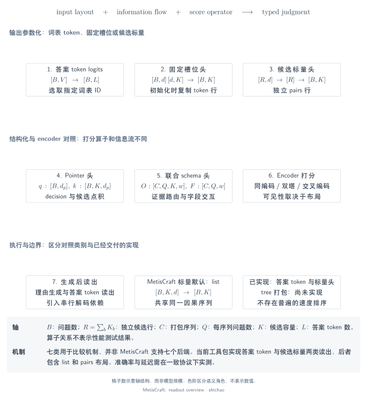
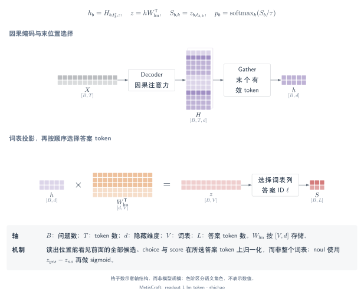
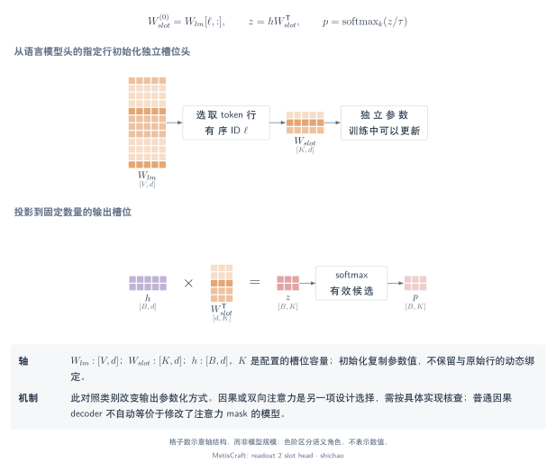
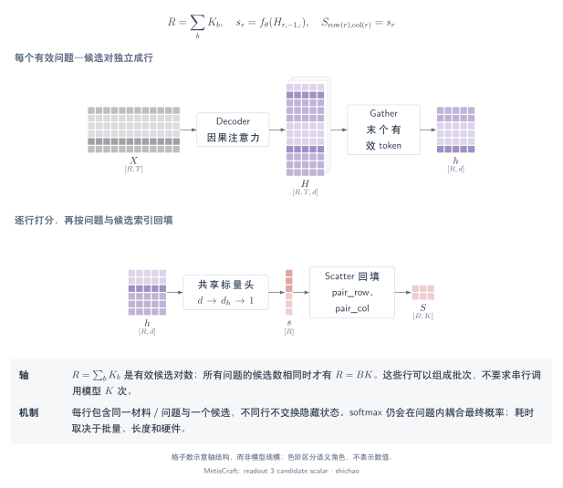
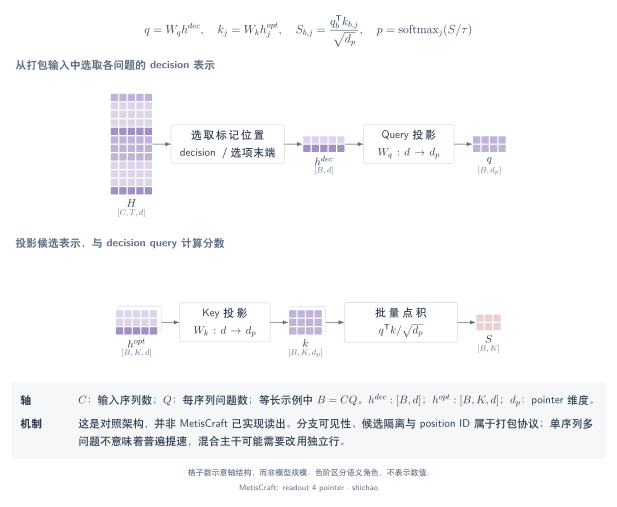
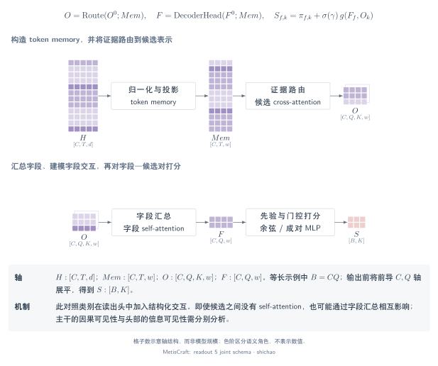
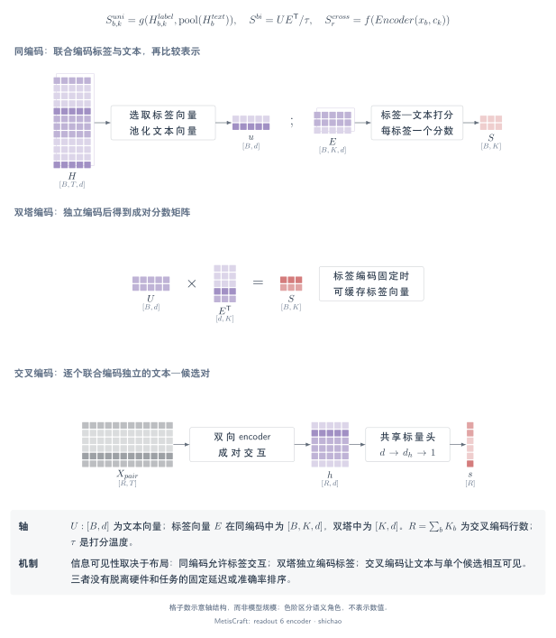
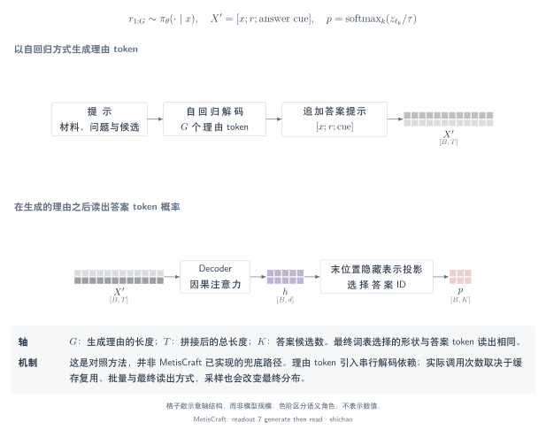

# 七类读出机制：表示、交互与归一化

## 本页问题

每个候选的分数从哪里来，哪些输入能够影响它？读出机制的差别在于选择什么表示、允许哪些交互，以及沿哪条轴归一化。这套分类用于解释机制，不是排名或检查点兼容承诺。

[SVG](../../tensor-analysis/figures/readout-overview.zh.svg) · [PDF](../../tensor-analysis/figures/readout-overview.zh.pdf) · [TikZ](../../tensor-analysis/figures/readout-overview.zh.tex)

## 张量与语义

[记号指南](notation.md)定义了 \(B,T,d,K,V\)。标量 pairs 使用 \(R=\sum_bK_b\) 个输入行。打包对照架构使用 \(C\) 条序列，每条包含 \(Q_c\) 个问题，因此 \(B=\sum_cQ_c\)。pointer 投影宽度记为 \(d_p\)，下文联合 schema 表示宽度为 \(w\)，这些轴不能混同。

MetisCraft 实现**第 1 类和第 3 类**，其中第 3 类具有 list 和 pairs 两种布局。其余图用于解释对照架构，不能在配方中直接选择，也不支持加载相应第三方检查点。

## 算子链与关键公式

### 1. 答案 token 读出

**问题：** 提示末尾偏好哪个答案代码？**张量：** 最后一个隐藏表示 \([B,d]\)、LM 权重 \([V,d]\)，按问题的代码索引选出 \([B,K]\) 分数。

`提示 → 因果主干 → 最后隐状态 → 词表 logits → gather 代码列 → 类型化归一化`

\[
s_{b,k}=(W_{\mathrm{lm}}h_b)_{\ell_{b,k}}.
\]

这一无偏置公式先 gather，再对候选做 softmax。因果注意力下，前面的选项文本不能读取后面的选项，但最终决策位置可以读取前面全部选项。详见[已实现路径与计算示例](answer-token.md)。

[SVG](../../tensor-analysis/figures/readout-1-lm-token.zh.svg) · [PDF](../../tensor-analysis/figures/readout-1-lm-token.zh.pdf) · [TikZ](../../tensor-analysis/figures/readout-1-lm-token.zh.tex)

### 2. LM 初始化的固定槽位头

**问题：** 固定输出槽位能否脱离完整 LM 词表单独训练？**张量：** \(h:[B,d]\)、槽位矩阵 \([K_{\mathrm{slot}},d]\)、logits \([B,K_{\mathrm{slot}}]\)。

`最后隐状态 → 槽位投影 → 有效槽位掩码 → 归一化`

\[
W_{\mathrm{slot}}^{(0)}=W_{\mathrm{lm}}[\ell,:],\qquad
s_b=W_{\mathrm{slot}}h_b.
\]

LM 行初始化是初始条件，不代表训练后仍保持相等。注意力可见性是另一项独立选择。若训练使用非因果 mask，仅把训练后的行复制回 LM head，不能保证普通因果服务等价。[支持矩阵](../../support-matrix.md)记录了固定版本示例及其注意力要求。

[SVG](../../tensor-analysis/figures/readout-2-slot-head.zh.svg) · [PDF](../../tensor-analysis/figures/readout-2-slot-head.zh.pdf) · [TikZ](../../tensor-analysis/figures/readout-2-slot-head.zh.tex)

### 3. 逐候选标量头

**问题：** 一个共享函数如何为可变候选打分？**张量：** 候选表示 \([B,K,d]\)，或展平为 \([R,d]\)，每个候选输出一个标量。

`候选对应的隐状态 → 共享 MLP → 恢复问题归属 → softmax 或 sigmoid`

\[
s_{b,k}=w_2^{\mathsf T}\operatorname{GELU}(W_1h_{b,k}+b_1)+b_2.
\]

图中展示 **pairs**：每个输入行包含一个候选，因此当该行固定时，其他候选不影响其原始分数。MetisCraft 默认的 **list** 将候选放入同一因果序列，后面的候选表示可能依赖前面的候选。两者共享头部形状，不共享信息独立性的保证。详见[两条实际执行路径](scalar-heads.md)。

[SVG](../../tensor-analysis/figures/readout-3-candidate-scalar.zh.svg) · [PDF](../../tensor-analysis/figures/readout-3-candidate-scalar.zh.pdf) · [TikZ](../../tensor-analysis/figures/readout-3-candidate-scalar.zh.tex)

### 4. Pointer 读出

**问题：** 决策表示如何选择某个选项表示？**张量：** 决策状态 \(h^D:[B,d]\)、选项状态 \(E:[B,K,d]\)、投影后的 query \([B,d_p]\) 与 key \([B,K,d_p]\)。

`gather 决策／选项位置 → 两个投影 → 沿 d_p 点积 → 候选归一化`

\[
s_{b,k}=\frac{\langle W_qh_b^D+c_q,\,W_ke_{b,k}+c_k\rangle}{\sqrt{d_p}}.
\]

[Kev `2074cc4`](https://github.com/jaredpalmer/kev/blob/2074cc44256200bb37540103fa4572901faa10f3/kev/model.py)提供具体 pointer 示例：选项末位与决策标记表示、问题分支隔离，以及可选的选项隔离。即使选项自身表示互相隔离，共享决策表示仍可能依赖全部选项。其混合主干的逐行路径也说明，不能认为所有主干都可执行相同 block mask。

[SVG](../../tensor-analysis/figures/readout-4-pointer.zh.svg) · [PDF](../../tensor-analysis/figures/readout-4-pointer.zh.pdf) · [TikZ](../../tensor-analysis/figures/readout-4-pointer.zh.tex)

### 5. 候选集合交互／联合 schema 头

**问题：** 选项与字段如何共同参与一次联合判断？**张量：** 候选查询 \(O:[N,w]\)、字段表示 \(F:[B,w]\)、token memory \([C,T,w]\)，以及将 \(N=\sum_bK_b\) 个候选映射到字段的 owner 索引。

`池化 span → 构造候选查询 → 读取 token memory → 按 owner 聚合 → 字段交互 → 比较字段与所属候选`

下面明确写出一个用于解释的字段聚合核心：

\[
\alpha_n=\frac{\exp(O_n^{\mathsf T}F_{g(n)}/\sqrt w)}
{\sum_{j:g(j)=g(n)}\exp(O_j^{\mathsf T}F_{g(n)}/\sqrt w)},\quad
\bar O_b=\sum_{n:g(n)=b}\alpha_nO_n.
\]

\(g(n)\) 是**索引**，不是浮点特征。点积先选出所属字段，再收缩宽度轴。联合头可结合字段 self-attention、memory cross-attention 和逐候选打分；确切层次和损失以对应实现为准。[Clef 固定版本源码](https://huggingface.co/Cloudflare/clef/tree/cfddda043dd190ef3b01cff449d5ee8cff1e8ec6)是该类对照依据。紧凑公式用于解释聚合，不声称复现其完整模型。

[SVG](../../tensor-analysis/figures/readout-5-joint-schema.zh.svg) · [PDF](../../tensor-analysis/figures/readout-5-joint-schema.zh.pdf) · [TikZ](../../tensor-analysis/figures/readout-5-joint-schema.zh.tex)

### 6. Encoder 候选／标签打分

**问题：** 双向表示能否不经下一 token 预测就为标签打分？**张量：** 文本表示 \(U:[B,d]\)、标签表示 \(E:[B,K,d]\)，或独立编码的标签矩阵 \([K,d]\)。

`双向 encoder → gather／池化文本和标签 → 候选 scorer → 类型化归一化`

\[
s_{b,k}=\langle u_b,e_{b,k}\rangle
\quad\text{或共享标签表示时}\quad S=UE^{\mathsf T}.
\]

联合编码中，标签 token 可以读取彼此和文本。双塔中，缓存的标签表示不依赖当前输入文本。交叉编码则将每个文本／候选 pair 放入同一行编码。这些布局彼此不同，仅凭“encoder”不能推断具体信息流。[GLiClass](https://github.com/Knowledgator/GLiClass)是 encoder 家族参考，不表示其所有 scorer 都等于此处的示意点积。形状和参数量不能推出延迟数字。

[SVG](../../tensor-analysis/figures/readout-6-encoder.zh.svg) · [PDF](../../tensor-analysis/figures/readout-6-encoder.zh.pdf) · [TikZ](../../tensor-analysis/figures/readout-6-encoder.zh.tex)

### 7. 生成推理过程后读取答案分布

**问题：** 采样的理由成为判断上下文后，计算如何改变？**张量：** 输入 token、\(G\) 个生成理由 token、最终词表向量 \([B,V]\)，以及 gather 后的答案分数 \([B,K]\)。

`提示 → 自回归生成理由 → 答案提示 → gather 答案代码 logits → 候选归一化`

\[
r_{1:G}\sim\pi_\theta(\cdot\mid x),\qquad
s_{b,k}=\left(W_{\mathrm{lm}}H_{b,t_b^\star,:}(x,r)\right)_{\ell_{b,k}},\qquad
p_b=\operatorname{softmax}(s_b).
\]

先 gather，再在答案空间中归一化。生成增加顺序解码依赖，也可能引入采样差异。调用次数取决于 prefill、缓存和答案提示的处理；\(G\) 是解码依赖长度，不是延迟测量。该类仅作概念对照，不是 MetisCraft 的兜底能力，也不同于工具包两位置的教师强制 completion 损失。

[SVG](../../tensor-analysis/figures/readout-7-generate-then-read.zh.svg) · [PDF](../../tensor-analysis/figures/readout-7-generate-then-read.zh.pdf) · [TikZ](../../tensor-analysis/figures/readout-7-generate-then-read.zh.tex)

## 小型示例与比较维度

| 机制 | 候选交互来源 | 计算行／打包方式 | 输出 |
|---|---|---|---|
| 答案 token | 最终状态读取前面的选项 | \(B\) 个问题行 | \([B,K]\) |
| 固定槽位 | 主干可见性与最终状态 | \(B\) 行；槽位容量固定 | \([B,K_{\mathrm{slot}}]\) |
| 标量 pairs | 原始行分数独立；分类分母耦合概率 | \(R=\sum_bK_b\) 行 | 恢复为 \([B,K_{\max}]\) |
| 标量 list | 后面候选表示读取前面候选 | \(B\) 行 | \([B,K_{\max}]\) |
| Pointer | 选项／决策可见性及共享决策 query | 按实现使用打包 \(C\) 条序列或问题行 | 每问题一个分布 |
| 联合 schema | 候选汇总、字段交互与 token memory | 打包字段及 owner 索引 | 每字段一个分布 |
| Encoder | 联合、双塔或 pair 布局决定可见性 | 由布局决定 | \([B,K]\) |
| 生成后读出 | 理由与最终状态 | Prefill 加顺序解码 | 生成后得到 \([B,K]\) |

行数、token 数、批量调用次数与自回归依赖长度是不同的量。一次打包调用返回 \(Q\) 个判断，不等于“每题分数次前向”；包含 \(K\) 行的 pairs 批次，也不一定需要 \(K\) 次串行调用。

构造分数 \([0,1]\) 得到 \([0.268941,0.731059]\)。增加第三个独立分数 2 后，概率变为 \([0.090031,0.244728,0.665241]\)：原分数不变，分类概率改变。pointer 的构造例中，query \([1,0]\) 与 key \([1,0]\)、\([0,1]\) 得到未缩放分数 1 和 0，实际投影宽度决定缩放因子。这些算术示例不比较已训练模型。

## 源码、依据与致谢

- MetisCraft 源码基线：`6b9701da7814111b13d8882f48288f4df46dc983`；[`DecisionModel`](../../../src/metiscraft/modeling/model.py#L55)、[`PromptBuilder`](../../../src/metiscraft/modeling/prompts.py#L136) 与 [`judgments`](../../../src/metiscraft/judgments/__init__.py#L74)。
- [支持矩阵](../../support-matrix.md)记录生态项目的固定版本、许可，以及源码核查与复现的差别。这里的外部示例不是运行时依赖。
- Pointer 源码：[Kev `2074cc4` 的 `kev/model.py`](https://github.com/jaredpalmer/kev/blob/2074cc44256200bb37540103fa4572901faa10f3/kev/model.py)。联合 schema 依据：[Clef `cfddda0`](https://huggingface.co/Cloudflare/clef/tree/cfddda043dd190ef3b01cff449d5ee8cff1e8ec6)。Encoder 背景：[GLiClass 源码](https://github.com/Knowledgator/GLiClass)，核对日期 2026-11-09；该链接是项目参考，不是固定基准结果。
- 早期共享前缀讲解思路参考独立作者的 [wdkns 架构课件 `6b8729b`](https://github.com/wdkns/modern_genai_bilibili/blob/6b8729b923d17863014ac6e0ff7715fc84473300/slides/jev_architecture-v2.pdf)。本章图件均独立绘制；这项致谢不表示 tree attention 由课件作者首创。

## 适用边界

CPU 检查覆盖 MetisCraft 实际实现的读出，不覆盖全部七类外部架构。比较公式提取机制核心，除非另行说明，否则省略实现专属的残差、归一化、adapter 与内存策略。仅有张量等价不能证明训练权重、任务准确率、吞吐或推理引擎兼容性相同。[五分钟导览](walkthrough.md)将已实现的链路与证据边界组织为可讲解的路线。
