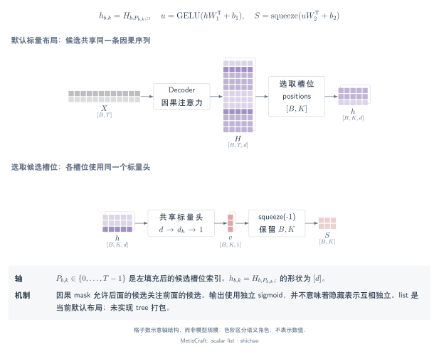
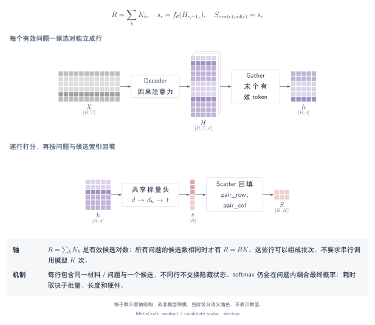

# 逐候选标量头：list 与 pairs

逐候选标量头把候选表示映射为一个实数分数。标量头的形状不能决定候选表示是否受其他候选影响；决定信息流的是**序列布局与注意力可见性**。

## 本页问题

候选分数何时不受其他候选影响？把所有候选放进同一条序列又会改变什么？MetisCraft 的 `list` 与 `pairs` 复用相同的标量 MLP，但采用不同的主干输入。默认布局为 `list`。

## 张量与语义

| 对象 | `list` | `pairs` |
|---|---|---|
| 输入序列 | \([B,T]\) | \([R,T_{\mathrm{pair}}]\)，\(R=\sum_b K_b\) |
| 主干输出 | \([B,T,d]\) | \([R,T_{\mathrm{pair}},d]\) |
| 读出索引 | 候选末位 \(I:[B,K_{\max}]\) | 每条 pair 序列的最后有效 token |
| 候选表示 | gather 后为 \([B,K_{\max},d]\) | \([R,d]\) |
| 标量分数 | \([B,K_{\max}]\) | \([R]\)，再 scatter 为 \([B,K_{\max}]\) |
| 附加对齐 | 候选索引保持 Record 的顺序 | `pair_row`、`pair_col` 将 pair 行映射回问题与候选列 |

对于 noul，两种布局都只使用一个表示和一个二元分数。Pairs 批次的候选数不必相等；\(R=B K\) 只是候选数固定时的特例。

## 算子链

### List：在一条因果序列中 gather 候选末位

提示包含状态、问题与所有候选片段，每个候选在自身片段的最后一个 token 位置读出。`gather` 把选中的序列位置组织成候选轴，不会为候选创建彼此独立的上下文。



[SVG](../../tensor-analysis/figures/scalar-list.zh.svg) · [PDF](../../tensor-analysis/figures/scalar-list.zh.pdf) · [TikZ](../../tensor-analysis/figures/scalar-list.zh.tex)

```python
indices = positions[..., None].expand(-1, -1, H.size(-1))  # [B, K_max, d]
G = H.gather(1, indices)                                 # [B, K_max, d]
S = scalar_head(G)                                      # [B, K_max]
```

后面的候选可以注意到前面的候选文本。训练时打乱候选在提示中的顺序，gather 索引再恢复 Record 的候选顺序；这个对齐过程不保证分数对顺序变化保持不变。

### Pairs：独立序列打分后 scatter 回原位置

每行输入包含状态、问题与一个候选。模型取每行最后位置的隐状态，计算标量，再将结果 scatter 回问题／候选矩阵。



[SVG](../../tensor-analysis/figures/readout-3-candidate-scalar.zh.svg) · [PDF](../../tensor-analysis/figures/readout-3-candidate-scalar.zh.pdf) · [TikZ](../../tensor-analysis/figures/readout-3-candidate-scalar.zh.tex)

```python
h = H_pairs[:, -1]                    # [R, d]
s = scalar_head(h)                    # [R]
S = s.new_zeros(candidate_mask.shape)  # [B, K_max]
S[pair_row, pair_col] = s
```

所有 pair 行可以在一次批量主干调用中计算；行数增加不等于串行模型调用次数增加。`S` 中的填充列无效，由候选 mask 排除。

## 关键公式

同一个两层头沿特征轴收缩，并保留前导轴：

\[
U=\operatorname{GELU}(G W_1^{\mathsf T}+b_1),\qquad
S=\operatorname{squeeze}_{-1}(U W_2^{\mathsf T}+b_2),
\]

\[
(B\times K_{\max}\times d)(d\times d_h)
\longrightarrow B\times K_{\max}\times d_h,
\qquad
(B\times K_{\max}\times d_h)(d_h\times1)
\longrightarrow B\times K_{\max}\times1.
\]

Pairs 将前导的 \([B,K_{\max}]\) 换为 \([R]\)，然后根据所属问题／候选索引 scatter。标量头以 fp32 计算；实际实现还在末层投影前包含可配置的 dropout。

归一化方式由任务决定：choice／score 使用 softmax，multi_label 对每个有效候选使用 sigmoid。独立 sigmoid 事件仍然可能来自因果耦合的 list 表示。

## 小型示例

独立 pairs 的原始分数为 \([0,1]\) 时，softmax 为 \([0.268941,0.731059]\)。加入一个分数为 \(2\) 的无关候选后，前两个候选的**原始分数不变**，但概率变成 \([0.090031,0.244728]\)。变化来自 softmax 分母，而不是原 pair 序列获得了新信息。

对于 `[前缀, 候选 A, 候选 B]` 的 list 序列，在固定前缀与截断结果时，修改 B 不会改变 A 的早期隐状态，修改 A 则可能影响 B。[CPU 验证脚本](../../../scripts/verify_tensor_examples.py)用真实微型 transformer 核对这一有向性，同时验证 gather／MLP／scatter 和变长候选 mask。

## 源码与依据

- [`candidate_list`](../../../src/metiscraft/modeling/prompts.py#L213)：序列顺序与候选末位索引。
- [`candidate_pairs`](../../../src/metiscraft/modeling/prompts.py#L237)：每个候选一条序列。
- [`Collator`](../../../src/metiscraft/train/collate.py#L76)：候选 mask、padding 偏移与 pair 归属。
- [`ScalarHead` 与 `DecisionModel.forward`](../../../src/metiscraft/modeling/model.py#L14)：MLP、gather 与 scatter。
- [客服分流配方](../../../recipes/banking77_support/qwen3-0.6b-base_candidate-scalar.yaml)：实际使用 `list` 的配置。

## 适用边界

独立 pairs、因果 list 与隔离的树分支是不同布局。MetisCraft 实现前两种；带分支可见性限制的前缀树打包属于研究对照，尚不是当前执行路径。稀疏外观的 mask 或共享前缀，都不能证明存在稀疏执行内核或实测加速。

List 的候选文本增加可能改变状态截断，因此因果不变性对照必须固定前缀与 token 预算。`infer_permutations` 当前仅接受 `1`；训练时打乱候选不表示推理时已经进行多顺序平均。下一步阅读[训练与校准](training-calibration.md)或[七类读出对照](readout-comparison.md)。
