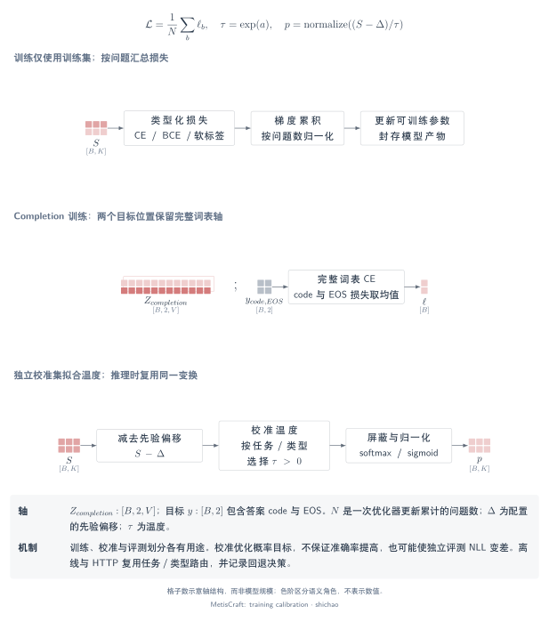

# 训练目标、校准与响应语义

## 本页问题

分数由什么目标训练、温度在哪份数据上拟合、返回的概率表示什么？训练损失、校准、离散决策、等级期望和 `confidence` 回答不同的问题。

[SVG](../../tensor-analysis/figures/training-calibration.zh.svg) · [PDF](../../tensor-analysis/figures/training-calibration.zh.pdf) · [TikZ](../../tensor-analysis/figures/training-calibration.zh.tex)

## 张量与语义

| 对象 | 形状 | 含义 |
|---|---|---|
| 分数 \(S\) | \([B,K_{\max}]\) | 未归一化的读出输出 |
| 目标 \(Y\) | \([B,K_{\max}]\) | 对齐的硬标签向量或提供的软监督 |
| 候选 mask \(M^{\mathrm{cand}}\) | \([B,K_{\max}]\) | 每个问题实际包含的候选列 |
| completion logits \(Z\) | \([B,2,V]\) | 提示末位和追加答案代码处的全词表下一 token logits |
| completion 目标 | 整数 \([B,2]\) | 答案代码 ID，随后为 EOS ID |
| 温度 \(\tau\) | 每个选中分组的正标量 | 重新缩放分数，不增加输出类别 |

选择题和等级题的硬标签转换为 one-hot 分类目标。`ordinal_soft` 在等级中心附近构造归一化的高斯形目标，不是一个有序回归头。提供的分类软目标之和为一。`noul` 使用一个 Bernoulli 目标，多标签为每个候选提供一个目标。只有软监督时，不会为准确率报告创造硬真值标签。

## 算子链

1. 在**模型加载之前**验证训练、校准、评测的数据用途和分组隔离。
2. 按配置的目标，仅在训练标签上更新读出／主干参数。
3. 在独立校准划分上收集有效分数，应用所配置的多标签 logit 修正。
4. 最小化负对数似然，拟合符合条件的任务／类型温度及类型回退温度。
5. 离线预测与 HTTP 服务选择相同分组，对相同分数归一化后组装类型化输出。

`completion` 是教师强制训练：把正确答案代码追加到输入，分别从前面的提示预测代码、从代码预测 EOS，不采样推理过程。推理时仍从提示末位读取代码 logits。

## 关键公式

对于有效列为 \(\mathcal K_b\) 的分类问题，

\[
\mathcal L_b^{\mathrm{cat}}=-\sum_{k\in\mathcal K_b}y_{b,k}\log p_{b,k}.
\]

对于多标签监督，每个问题内部先平均有效候选的损失：

\[
\mathcal L_b^{\mathrm{multi}}=\frac{1}{K_b}\sum_{k\in\mathcal K_b}
\mathrm{BCEWithLogits}(s_{b,k},y_{b,k}).
\]

`noul` 使用一个 BCE 项。实现返回**按问题求和的损失与问题数**，训练循环再按问题数归一化，也处理数量不足的累积尾批。多标签行不会因为候选较多就自然获得更大权重。可选的正类权重作用于多标签 BCE，可选 Brier 正则作用于分类输出。

对于一次优化步骤实际包含的问题集合 \(\mathcal B\)，梯度为 \(\nabla_\theta\bigl(|\mathcal B|^{-1}\sum_{b\in\mathcal B}\mathcal L_b\bigr)\)。梯度通过所选读出流入配方允许训练的主干或 adapter 参数。整数 token ID、gather 索引和掩码是路由数据，不是可训练参数。MetisCraft 使用 AdamW，标量头可单独配置学习率。

completion 训练使用

\[
\mathcal L_b^{\mathrm{completion}}=
\frac{1}{2}\left(\mathrm{CE}_V(Z_{b,0,:},a_b)+\mathrm{CE}_V(Z_{b,1,:},\mathrm{EOS})\right).
\]

这是全词表目标，与仅对答案代码集合做分类 CE 不同。

温度在独立校准分数 \(\bar s=s-\delta\) 上拟合：

\[
\tau^*=\arg\min_{\tau>0}\sum_{b\in\mathcal D_{\mathrm{calib}}}
\mathcal L_b(\bar s_b/\tau,y_b).
\]

拟合器优化 \(\log\tau\)，最终温度限制在 \([0.05,20]\)。多标签训练若使用 `pos_weight=w`，推理在校准前减去 \(\delta=\log w\)；这是基于模型假设的 odds 修正，不保证经验校准质量。

路由依次尝试 `task_id|kind`、`*|kind` 和温度 1。任务温度拟合默认至少需要 20 条校准记录。预测元数据记录实际选中的分组和回退原因。HTTP 问题名映射到已知 `task_id`；单任务产物可自动映射，多任务存在歧义时要求显式配置。

## 小型示例

对于构造分数 \([0,1,2]\)，温度 1 得到 \([0.090031,0.244728,0.665241]\)，温度 2 得到 \([0.186324,0.307196,0.506480]\)。概率最大的类别不变，但其概率降低。正温度保留行内的分数排序，不会自行修复选项顺序偏差，也不直接提高准确率。

[CPU 验证脚本](../../../scripts/verify_tensor_examples.py)对以温度 2 构造的校准分布进行拟合，并用 0.5、2.0、1.5 三个不同的任务温度，核对真实 `Record` 与进程内 HTTP 预测。这些是软件和数值检查，不是训练后业务模型的结果。

### 概率、分数与 confidence

MetisCraft `0.1.0rc1` 的语义如下：

- `probabilities` 是修正并应用温度后的分布。
- 等级题的 Record `decision` 是概率最大的等级下标；HTTP `score` 是期望 \(\sum_i i p_i\)，等级下标从零开始。
- HTTP 选择／等级题的 `confidence` 为 \(\max_i p_i\)。`noul` 只返回 yes 概率，没有单独的 confidence 字段。
- Record `uncertainty` 为 \(1-\max_i p_i\)；`noul` 为 \(1-\max(p,1-p)\)，它不是另外估计的错误概率。

[TypeSafe 官方 confidence 定义](https://docs.typesafe.ai/confidence)不同，核对日期为 **2026-11-09**。对于 \(n>1\) 个选项的选择题，官方定义

\[
c_{\mathrm{choice}}=\frac{p_{\max}-1/n}{1-1/n}.
\]

对于 \(n>1\) 个等级、众数等级为 \(m\) 的等级分布，官方定义

\[
c_{\mathrm{score}}=\max\left(0,1-
\frac{\sum_i p_i|i-m|}{\frac{1}{n}\sum_i\left|i-\frac{n-1}{2}\right|}\right).
\]

对于构造的选择概率 \([0.6,0.3,0.1]\)，MetisCraft 返回 `confidence=0.6`，官方 TypeSafe 统计量为 0.4。对于等级概率 \([0.2,0.5,0.3]\)，期望为 1.1，MetisCraft confidence 为 0.5，官方 TypeSafe 统计量为 0.25。这些集中程度统计量不是正确率的独立测量。本章说明这一差异，不修改该版本的响应契约。

## 源码与依据

源码基线为提交 `91259c6d07ece19248a02a4b56b43dd3a77d81e5`。

| 机制 | 源码 |
|---|---|
| 模型构造前的数据用途检查 | [`run_recipe`](../../../src/metiscraft/pipeline.py#L99)、[`data.usage`](../../../src/metiscraft/data/usage.py#L23) |
| 硬／软目标构造 | [`target_vector`](../../../src/metiscraft/judgments/__init__.py#L23) |
| 全词表 completion 损失 | [`completion_loss`](../../../src/metiscraft/judgments/__init__.py#L63) |
| 分类／Bernoulli 损失及归约 | [`batch_loss`](../../../src/metiscraft/judgments/__init__.py#L74) |
| 累积均值梯度与 AdamW 更新 | [`accumulate` 和 `train_loop`](../../../src/metiscraft/train/loop.py#L69) |
| 多标签先验修正 | [`prior_shift`](../../../src/metiscraft/judgments/__init__.py#L101) |
| 温度拟合与路由 | [`calibrate.py`](../../../src/metiscraft/calibrate.py#L35) |
| 修正后的推理分数 | [`predict`](../../../src/metiscraft/evaluate/infer.py#L43) |
| Record 输出与 HTTP 响应 | [`Predictor`](../../../src/metiscraft/serve/predictor.py#L126) |

外部契约依据：[System One API](https://docs.typesafe.ai/api/system-one)、[Choice](https://docs.typesafe.ai/primitives/choice)、[Score](https://docs.typesafe.ai/primitives/score)。公开接口不能证明 Jev 的内部实现。

## 适用边界

校准质量应在未用于拟合温度的数据上测量。准确率、NLL、Brier 分数与可靠性统计分别回答不同的评估问题。校准集 NLL 降低不保证另一分布上的改进；[Tev1 记录](../../reproductions/tev1.md)在结果旁保留了观测到的限制。反复按公开基准选择校准和评测方案，也可能过拟合该基准。

继续阅读[读出机制比较](readout-comparison.md)或[五分钟导览](walkthrough.md)。
