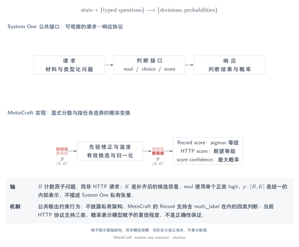
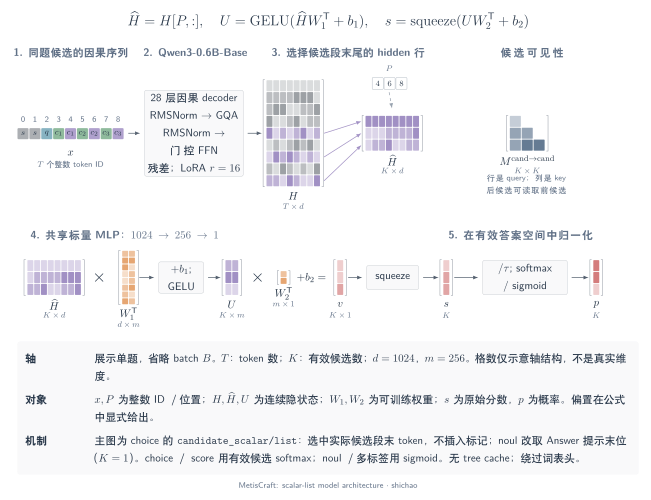
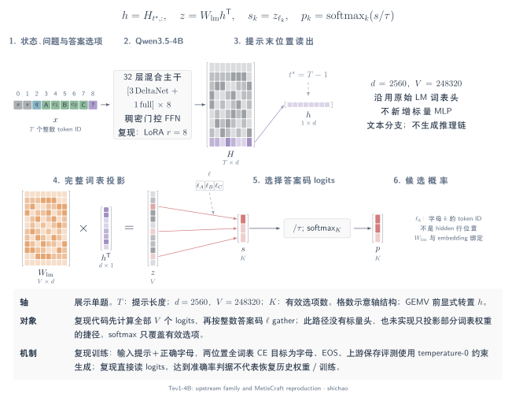

# 五分钟导览：System One 与 MetisCraft

[模型架构图谱：MetisCraft、Tev1 与 14 个已核查开源实现](architectures.md)，将具体模型路径与通用机制分类分开。

## 本页问题

如何连贯解释一个类型化判断模型，从接口走到张量和证据？这条路线跟随一个问题走过实际工具包，再将其放入更广泛的读出机制中，复用本章图件和源码，不引入独立演示系统。

## 张量与语义

全程保留三个对象：**问题、候选分数、概率**。一个请求可以包含多个问题，每个问题成为一条 `Record`。隐藏向量是学习到的表示，读出将其转换成候选分数，归一化再为分数赋予概率语义。

| 时间 | 讲解内容 | 展示材料 |
|---|---|---|
| 0:00–0:45 | 公开的类型化判断契约 | 契约图与一道选择题 |
| 0:45–1:30 | 问题如何变成张量批次 | 流程图；\([B,T]\) → \([B,T,d]\) |
| 1:30–2:45 | 两类读出、三条路径 | 答案 token、标量 list 与标量 pairs |
| 2:45–3:45 | 监督与校准输出 | Completion／分类目标及温度路由 |
| 3:45–5:00 | 验证依据和实测限制 | CPU 脚本、Tev1 证据与比较总览 |

## 算子链

### 1. 从一个具体问题开始

使用一个明确标注为构造的请求：

```json
{
  "state": "A customer asks for a refund after a duplicate charge.",
  "questions": {
    "route": {
      "type": "choice",
      "instructions": "Select the support team.",
      "criteria": {
        "billing": "Charges, payments and refunds",
        "technical": "Product faults and troubleshooting"
      }
    }
  }
}
```

结果是两个 ID 上的分布，不是自由文本。该请求用于解释契约，不为虚构输入宣称预测概率。[System One 契约](index.md)将公开 API 与私有架构分开。



[SVG](../../tensor-analysis/figures/system-one-contract.zh.svg) · [PDF](../../tensor-analysis/figures/system-one-contract.zh.pdf) · [TikZ](../../tensor-analysis/figures/system-one-contract.zh.tex)

### 2. 跟随张量流动

请求适配器为每个具名问题创建 Record。collator 分词、左侧填充，并保留候选身份。因果主干返回 \(H:[B,T,d]\)。Padding 有效性、token 可见性和候选有效性是三种不同关系，[记号页](notation.md)给出了精确定义。



[SVG](../../tensor-analysis/figures/metiscraft-architecture.zh.svg) · [PDF](../../tensor-analysis/figures/metiscraft-architecture.zh.pdf) · [TikZ](../../tensor-analysis/figures/metiscraft-architecture.zh.tex)

### 3. 对比已经实现的读出

**答案 token：** 选择提示的最终表示，投影到词表 logits，再 gather 有效答案代码列。`noul` 在 sigmoid 前用 yes 减 no。**标量 list：** 从共享因果序列中 gather 每个候选的末位表示，再通过共享 MLP。**标量 pairs：** 相同 MLP 为每个问题／候选输入行打分，按归属 scatter 回问题。

关键区别是信息流。即使 pairs 原始分数互相独立，新增候选仍可通过 softmax 改变原有候选的最终概率。list 中，前面的候选还可能改变后面的候选上下文表示。[答案 token](answer-token.md)和[标量头](scalar-heads.md)提供对应图件和可下载源码。

**具体对照：Tev1-4B。** 32 层混合 Qwen3.5 主干接原始 LM 词表头；MetisCraft 复现先做全词表投影，再取答案码，以字母／EOS completion 训练，不使用客服模型的标量 MLP。



[SVG](../../tensor-analysis/figures/tev1-architecture.zh.svg) · [PDF](../../tensor-analysis/figures/tev1-architecture.zh.pdf) · [TikZ](../../tensor-analysis/figures/tev1-architecture.zh.tex)

### 4. 分开讲训练与概率校准

训练目标更新模型参数，独立温度拟合缩放分数，评测在另一划分上测量行为。推理记录选中的任务／类型温度和回退原因；离线与 HTTP 使用相同选择逻辑。

Completion 使用全词表 logits \([B,2,V]\) 预测答案代码与 EOS，不是采样推理过程。等级分布既能产生众数等级，也能产生等级期望，因此需要明确输出字段。[训练与校准页](training-calibration.md)同时记录 rc1 `confidence` 与 TypeSafe 公开集中程度统计量的差异。

## 关键公式

整个分类链路可概括为

\[
X\xrightarrow{\mathrm{backbone}}H
\xrightarrow{\mathrm{readout}}S,
\qquad
p_{b,k}=\frac{\exp((s_{b,k}-\delta_b)/\tau_b)}
{\sum_{j\in\mathcal K_b}\exp((s_{b,j}-\delta_b)/\tau_b)}.
\]

读出决定分数如何取得，分母耦合有效结果。对于 `noul` 和多标签，将分类 softmax 替换为相应的 sigmoid 事件。等级期望为 \(\sum_i i p_i\)，众数等级则为 \(\arg\max_i p_i\)。

## 小型示例与可运行验证

使用构造 logits \([0,1,2]\)：概率约为 \([0.090031,0.244728,0.665241]\)，众数等级为 2，等级期望为 1.575210。这些数字展示算术，不能作为客服任务效果。

在已安装运行依赖与 `httpx` 的源码目录中执行：

```bash
CUDA_VISIBLE_DEVICES='' OMP_NUM_THREADS=1 python scripts/verify_tensor_examples.py
```

[独立脚本](../../../scripts/verify_tensor_examples.py)本地构造随机 tokenizer／模型，不下载权重、不引用仓库测试辅助代码，验证：

- 词表 gather 和 yes 减 no 的二元归约。
- 标量 list 的 gather／MLP，以及带变长掩码的 pair 归属／scatter。
- 因果可见性的有向性，以及 pairs 分数独立与 softmax 分母变化的差别。
- 教师强制的代码／EOS logits 和全词表目标。
- 已知构造温度的恢复及显式分组回退。
- 不同任务温度下，Record 与进程内 HTTP 的概率一致性。

成功判据是每项打印 `PASS`、进程以代码 0 退出。`--language zh` 选择中文进度文字，`--output /tmp/metiscraft-tensor-examples.json` 可选地保存数值证据。这些检查不验证训练效果、吞吐或第三方架构。完整的独立安装闭环见 [CPU Cookbook](../cookbook/first-model.md)。

## 源码与实测依据

本章实现对应提交 `6b9701da7814111b13d8882f48288f4df46dc983`。源码路线为 [`request_to_records`](../../../src/metiscraft/data/jev.py#L146) → [`Collator`](../../../src/metiscraft/train/collate.py#L39) → [`DecisionModel.forward`](../../../src/metiscraft/modeling/model.py#L55) → [`probabilities`](../../../src/metiscraft/judgments/__init__.py#L112) → [`Predictor`](../../../src/metiscraft/serve/predictor.py#L126)。

**已训练模型的证据**见 [Tev1 复现记录](../../reproductions/tev1.md)：4B 在主集达到 **873/1,000（87.3%）**，政策迁移达到 **298/300（99.33%）**，原版分别为 88.0% 和 100%，均达到观察结果之前设定的准确率容差。记录链接配方、固定输入与逐题对照，并保留单种子、公开开发集和 NLL 恶化等限制。这不表示恢复历史托管训练作业，也不表示训练权重相同。

## 适用边界

最后展示[七类读出比较](readout-comparison.md)，说明实际读出的位置，以及哪些架构仍只是对照。MetisCraft 定位为 **JevLike 工具包**，连接数据准备、训练、校准、评测与类型化决策服务。公开证据支持这条使用路径与明确陈述的实验，不证明私有 Jev 架构，也不证明普遍领先。

深入讨论时，用图回答三个问题：**读取哪个表示，哪些输入能影响它，在哪里归一化？**
